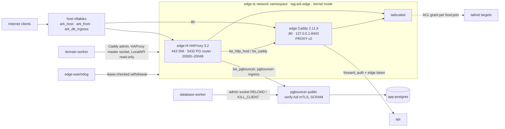

# Architecture

See [implementation-plan.md](implementation-plan.md) for the platform design and [design/front-door.md](design/front-door.md) for the front door. This note records what was built.

- One TypeScript API (`server/`) owns identity, authorization, desired state, and the durable operation queue.
- PostgreSQL is the control-plane database. Application clusters are separate records and must never share that instance.
- Workers are separate processes with typed job allowlists. Local development may set `ARK_EMBEDDED_WORKERS=1`; production refuses that mode and the API does not start the coordinator by default.
- The Docker agent is a small Go service. Only it should receive the host Docker socket. Compose input is validated before any engine call.
- Secrets use AES-256-GCM with a key ID. The root key is not stored in PostgreSQL. Inventory APIs return metadata, not plaintext.
- Better Auth uses a dynamic `baseURL` limited to registered hosts: the admin origin (`BETTER_AUTH_URL` and `BETTER_AUTH_TRUSTED_ORIGINS`) and, when enabled, the public gate login origin. The API refuses any other `Host` before Better Auth runs, with no fallback to the admin origin. Cookies are host-only `__Host-` cookies over HTTPS, so no `Host` header chooses a cookie domain. Sessions record the origin that minted them, and the admin API accepts only admin-origin sessions of users with a `platform_access` row.
- Public HTTP routes in access mode `sso` (the default) sit behind the login gate (FD-11): the edge calls `/api/gate/check` with `forward_auth` and its edge token before every request, the login origin mints single-use handoff codes, and each route gets its own host-only `__Host-ark_gate` session. Every revocation is journalled in the revoking transaction and queues a drain of the affected route's HAProxy connections. The edge watchdog withdraws the affected route if its drain is overdue (docs/design/front-door.md §3.9).
- Application PostgreSQL is provisioned with owner/migration/runtime/readonly roles, PUBLIC revoked, optional pgvector, and public-pooler admission rules that refuse privileged roles. SQL workspaces and schema inspection execute in the database worker, not the browser-facing API. Results are capped below the internal transport limit and fetched through a database-scoped operation endpoint; cancellation uses a private worker listener authenticated by the database worker token.
- Certificates are issued with a configured lego client. A local OpenSSL leaf is available only when `ARK_CERTIFICATE_MODE=development`; it is recorded as untrusted and never makes an endpoint ready. HTTP-01 challenges are served at `/.well-known/acme-challenge/:token`.
- The Docker agent talks to the Engine API over the unix socket, maintains exact container/network/volume ownership, and runs Compose with a fixed argument vector after policy validation. Discovery, bounded/redacted logs, and whitelisted stats return through scoped, claim-token-fenced operation evidence; the API has no production Docker fallback.
- Mail desired-state documents keep inbound ready independent of SES. Stalwart v0.16 reconciliation uses native JMAP extension methods and persists only server-returned object IDs. Outbound stays paused until relay credentials exist.
- Backups record upload, integrity and restore-test separately. Extraction success is only integrity evidence. Restore proof requires the explicitly enabled isolated runner and post-restore assertions; until those external assertions run, the UI does not claim a verified restore.
- Cloudflare publishes a reviewed DNS diff and refuses ambiguous same-name updates. SES uses SigV4 and requires the provider's production, identity, DKIM and MAIL FROM states. Stalwart runs from the official v0.16 digest with a mounted RocksDB configuration; desired state is ready only after native JMAP set responses contain no partial failures. Outbound stays paused until SES is ready.
- Public PgBouncer mappings and userlists are generated from admitted runtime roles. Mode changes rewrite Caddy/Serve, revoke sessions, and keep Tailscale Funnel disabled.
- Stateful workload metadata is explicit. Updates retain immutable deployment revisions and require an exact restore-tested recovery point before a stateful change.
- Workers send durable heartbeats. Prometheus alerts on missing/stale workers, failed operations, unverified backups, and certificate expiry. An optional HTTPS off-host heartbeat sender supports a separately operated host-loss receiver.
- The installer writes host secrets without overwriting existing values. Import is a read-only inventory compare and never promotes legacy users to owners.
- Third-party runtime and build images are pinned by readable version plus immutable OCI digest. Workload canonicalization injects read-only root filesystems, a bounded tmpfs, all-capability drop, no-new-privileges, PID, memory, and CPU limits; the agent rejects a document missing any of those exact controls and inspects their effective Docker values after deployment.

## Front door (as built)

The front door publishes tailnet services under public hostnames, and gives Vercel apps mTLS access to Ark databases. The design is in [design/front-door.md](design/front-door.md), and its [§9 as-built summary](design/front-door.md#9-as-built-summary) lists where the build differs. The user guides are [guides/front-door.md](guides/front-door.md) and [guides/vercel-database.md](guides/vercel-database.md). The runbooks are in [operating.md](operating.md), and the boundaries B1–B10 with their tests are in [security-review.md](security-review.md#front-door-trust-boundaries-b1b10).

- **Transport.** `edge-ts` is a kernel-mode Tailscale node (`tag:ark-edge`, `--shields-up`). HAProxy and Caddy share its namespace, and `edge-ts` publishes every front-door port. The VPS has three other Tailscale identities, each with its own key and tag: the host node (`tag:ark-vps`, Tailscale SSH), the admin node (`tag:ark-stack-admin`) and `backup-ts` (`tag:ark-backup`). Ark holds no Tailscale API key or OAuth client. The owner merges a generated ACL snippet by hand.
- **Routing.** HAProxy owns 443 and routes by SNI. Each HTTP route has its own `be_http_<hostname>` backend to Caddy on `127.0.0.1:8443` with PROXY v2, `retries 0` and `timeout connect 1s`. TLS-TCP routes have their own backends with an allowlist, stick tables and optional `terminate_mtls` with a CRL. On 5432, HAProxy sends classic `SSLRequest` clients and the database hostname to PgBouncer, and Postgres route SNIs to their routes. Raw TCP routes use 20000–20049. Caddy serves `:80`, terminates HTTPS with Ark's Let's Encrypt certificates and runs the login gate through `forward_auth`.
- **Pinning and withdrawal.** Every route is pinned to its target's StableNodeID. `edge.observe` (every 5 minutes, read-only LocalAPI) commits a generation with a 6-minute lease. The independent `edge-watchdog`, which holds no credentials, withdraws a route within 1 s of the lease no longer allowing it. It fences the route's HAProxy backend and closes its sessions across current and leaving workers, and Caddy answers 503 for it. Caddy is stopped only as a fallback when scoped control cannot be verified. Launch guards start both proxies from closed configurations unless the watchdog authorises the full one.
- **SSO.** `sso` routes require a gate session from the public `login.<domain>` origin, which exposes only sign-in, MFA and gate endpoints. Each route gets a host-only `__Host-ark_gate` cookie. Revocations drain the route within 5 s, or the watchdog withdraws it.
- **Databases.** PgBouncer 1.26.1 runs with TLS 1.3 only, `verify-full` against one private CA per client generation, SCRAM, and runtime or read-only roles. A pooler-wide source policy applies to every public database. 90-day client certificates roll over at T−30 from a fresh CA. Retirement drains the role by `not_after + 5 s`, enforced by a watchdog. CSRs are parsed in-process by a hand-written DER parser (`server/src/modules/x509.ts`), which is fuzzed and cross-checked against OpenSSL. The optional Vercel integration stays disabled until its live scope proof is recorded.
- **DNS and IPv6.** Ark writes only A/AAAA records: through a reviewed Cloudflare diff, or as manual rows for other providers. AAAA is published only after an external IPv6 preflight passes, with a per-domain switch.
- **Backups off the VPS.** Restic snapshots of staged pgBackRest repositories go to an S3-compatible bucket and to a home `rest-server --append-only` through `backup-ts`. Credentials cannot delete history, and canaries prove it.
