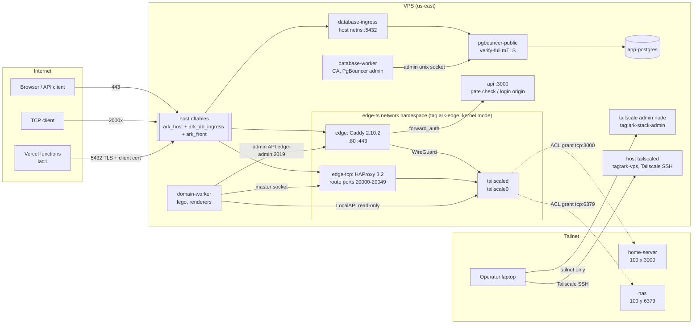
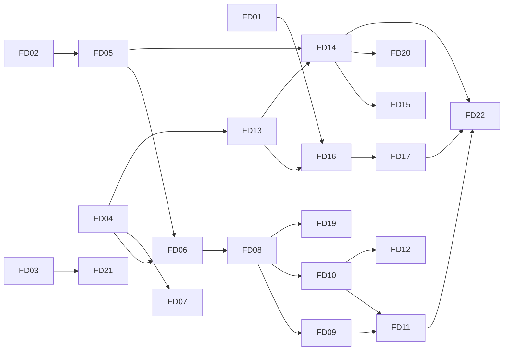

# Front door: public routes to tailnet services, and database access from Vercel

Status: proposed design and implementation plan. No product code has changed. Prepared 16 November 2026 against `main` at `f14666a`.

This document designs two related capabilities for Ark Stack:

1. A **public front door on the VPS**. It exposes HTTP(S) and raw TCP services that run anywhere on the user's Tailscale tailnet under the user's own public domains. Internet clients never learn a tailnet address, and the user's other machines stay reachable only through the tailnet.
2. **Database access from Vercel.** Without static IPs, the public PgBouncer port is protected by client certificates (mTLS), TLS, SCRAM and least-privilege runtime roles.

Every claim about the current code cites a file and line. Every claim about an upstream product cites its documentation, or names the prototype that checked it (see [§7 Verification log](#7-verification-log)). Anything that is still uncertain is marked **Unverified** or listed under [§6 Open questions](#6-open-questions).

## Contents

- [0. Decisions and recommendations at a glance](#0-decisions-and-recommendations-at-a-glance)
- [1. Current state and gaps found](#1-current-state-and-gaps-found)
- [2. Architecture and threat model](#2-architecture-and-threat-model)
- [3. Component designs](#3-component-designs)
- [4. Open choices: recommendations and alternatives](#4-open-choices-recommendations-and-alternatives)
- [5. Ticket breakdown](#5-ticket-breakdown)
- [6. Open questions](#6-open-questions)
- [7. Verification log](#7-verification-log)
- [8. References](#8-references)

---

## 0. Decisions and recommendations at a glance

These decisions were made with the user and are taken as given here: Option A (hardened); the whole stack on the VPS; `adminMode: "tailnet"`; HTTP and TCP routes; Public or Ark-login access for HTTP; mTLS at PgBouncer; DNS-only records; a dedicated `tag:ark-edge` node; no Tailscale API key that can write policy.

| Area                      | Recommendation                                                                                                                                                                                                                                                                            |
| ------------------------- | ----------------------------------------------------------------------------------------------------------------------------------------------------------------------------------------------------------------------------------------------------------------------------------------- |
| Edge-to-tailnet transport | A **kernel-mode Tailscale container `edge-ts`** owns a network namespace. The HTTP edge (Caddy) and the TCP edge (HAProxy) share it through `network_mode: service:edge-ts`. Userspace SOCKS5 cannot carry raw TCP: neither caddy-l4 nor HAProxy can dial through SOCKS5.                 |
| HTTP edge                 | Keep the **official `caddy:2.10.2` image, digest-pinned**, and extend `renderCaddyfile`. No plugins in v1.                                                                                                                                                                                |
| TCP edge                  | Add a separate **`haproxy:3.2` LTS official image, digest-pinned**, rendered by Ark. caddy-l4 was evaluated and rejected for v1: it is experimental, needs a custom build, needs Caddy ≥ 2.11.1 for any tagged release, has no CRL support, no per-source limits and no TCP idle timeout. |
| HTTP access gate          | Caddy `forward_auth` calls the Ark API. A one-time-code handshake then sets a host-only `__Host-` cookie on each route domain. Login happens on a dedicated **gate login origin**. For login to work from off-tailnet devices it must be public (open question Q1).                       |
| SSRF guard                | Targets must be Tailscale addresses (`100.64.0.0/10`, `fd7a:115c:a1e0::/48`) that appear in the edge node's own netmap. Each route is pinned to the target's `StableNodeID`, and Ark renders the IP only. Tailscale ACL grants enforce the same boundary on the receiving node.           |
| PgBouncer mTLS            | Set `client_tls_sslmode = verify-full` with a **CA bundle that holds one private CA per app environment**. Revoke by removing that CA from the bundle, rotating the role password, sending `RELOAD`, then `KILL_CLIENT` for live sessions. All of this was prototyped.                    |
| PgBouncer version         | **Upgrade from 1.24.1 to 1.26.1.** 1.24.1 is affected by CVE-2026-6664 (an unauthenticated crash), which is fixed in 1.25.2. Also fix the `pgbouncer-public` entrypoint bug found while prototyping.                                                                                      |
| Public DB port limits     | Extend the existing `ark_db_ingress` nftables table with per-source `ct count` and `limit rate` meters.                                                                                                                                                                                   |
| TCP route access          | nftables CIDR allowlist on the host, plus HAProxy `maxconn`, per-source stick-table limits and timeouts. TLS termination with client certificates and a CRL wherever the protocol allows, otherwise pass-through to the target's own TLS.                                                 |
| DNS                       | Route hostnames reuse domain claims, `dns_records` and `domain.verify`, which already checks address records before it enqueues certificate issuance. Cloudflare publishing gains a dry-run diff endpoint.                                                                                |
| Certificates              | Keep lego as the only ACME client, and have Caddy load Ark-issued files with `tls <cert> <key>`. Reloads must send `Cache-Control: must-revalidate`.                                                                                                                                      |
| Region                    | `platform_settings.region` defaults to `us-east` and maps to Vercel `iad1`. Ark only records the VPS region.                                                                                                                                                                              |

---

## 1. Current state and gaps found

### 1.1 What exists today (verified)

| Component             | Where                                                                 | Behaviour                                                                                                                                                                                                                                                                                                                                                                                                           |
| --------------------- | --------------------------------------------------------------------- | ------------------------------------------------------------------------------------------------------------------------------------------------------------------------------------------------------------------------------------------------------------------------------------------------------------------------------------------------------------------------------------------------------------------- |
| Edge renderer         | `shared/src/edge.ts:3-54`                                             | `renderCaddyfile` takes `appRoutes?: Array<{ hostname; upstream }>` (line 8) and emits `hostname { reverse_proxy upstream }` (lines 10-17). The global block binds the admin API to `edge-admin:2019` (line 39). A `:80` block serves only ACME challenges (lines 42-51). Public admin routes use a deny-before-fallback path allowlist (lines 18-37).                                                              |
| Edge apply            | `server/src/coordinator.ts:1398-1409`                                 | `applyEdge` selects endpoints with `kind === "http" && exposure === "public"` and hard-codes `upstream: "app-edge:8080"` (line 1406). **No `app-edge` service exists** in `infra/platform/docker-compose.yml`.                                                                                                                                                                                                      |
| Edge write and reload | `server/src/modules/providers.ts:514-560`                             | Writes `Caddyfile.next`, POSTs it to `/adapt` (line 539), then `/load` (line 546) through `ARK_EDGE_RELOAD_URL`. No `Cache-Control: must-revalidate` header is sent.                                                                                                                                                                                                                                                |
| Certificates          | `server/src/modules/certificates.ts:61-116`, `coordinator.ts:700-729` | lego HTTP-01 through a webroot, staging unless `ARK_ACME_STAGING=0` (line 75). The SAN is checked (line 108). After issuance it enqueues `edge.apply` (coordinator line 728).                                                                                                                                                                                                                                       |
| DNS verify            | `coordinator.ts:602-698`                                              | Verifies the ownership TXT, then each endpoint's required A/AAAA records. Only verified endpoints get `certificate.issue` (lines 645-666). Cloudflare domains then get `dns.publish` (line 693).                                                                                                                                                                                                                    |
| Cloudflare            | `providers.ts:94-131`, `shared/src/cloudflare.ts`                     | Always `proxied: false` (cloudflare.ts line 15). Refuses ambiguous multi-record updates (line 51).                                                                                                                                                                                                                                                                                                                  |
| Compose               | `infra/platform/docker-compose.yml`                                   | `edge` runs `caddy:2.10.2@sha256:c3d7…` and publishes 80/443 (lines 288-305). It joins `admin` and `edge-control` with alias `edge-admin`. `tailscale` (userspace, `tailnet` profile, lines 307-322) plus `tailnet-gateway` (lines 324-332) serve the admin UI. `pgbouncer-public` (lines 252-265) is published only on loopback 15432. `database-ingress` (lines 267-286) runs in the host netns with `NET_ADMIN`. |
| DB ingress            | `scripts/database-ingress.ts:54-76`                                   | A Bun TCP relay from `0.0.0.0:5432` to `127.0.0.1:15432` (lines 57, 75). It is IPv4-only, and PgBouncer sees loopback as the client address, so source filtering has to happen in nftables.                                                                                                                                                                                                                         |
| nftables allowlist    | `shared/src/cidr.ts:111-141`                                          | Table `inet ark_db_ingress` with an `input` chain and a `forward` chain (`ct status dnat`, line 135) that jump to `ark_db_allow`.                                                                                                                                                                                                                                                                                   |
| PgBouncer config      | `shared/src/pgbouncer.ts:1-37`, `coordinator.ts:1344-1396`            | Transaction mode, `client_tls_sslmode = require` (line 20), `max_client_conn = 200`, `default_pool_size = 20`. Only `runtime` roles are admitted (coordinator line 1348). Privileged suffixes are filtered out (pgbouncer.ts line 34).                                                                                                                                                                              |
| Auth                  | `server/src/auth.ts:11-60`                                            | Better Auth 1.7.1 with the `twoFactor` plugin. Cookies use prefix `ark_stack` and `SameSite=Lax`. `trustedProxies` comes from `ARK_TRUSTED_PROXIES`.                                                                                                                                                                                                                                                                |
| Access default        | `server/src/app.ts:507-517`                                           | A signed-in user **without a `platform_access` row is treated as `viewer`** (line 514).                                                                                                                                                                                                                                                                                                                             |
| Worker allowlists     | `server/src/app.ts:262-285`                                           | The domain worker owns `domain.`, `dns.`, `certificate.`, `edge.` and `admin.`. The database worker owns `database.` and `pgbouncer.`.                                                                                                                                                                                                                                                                              |
| Step-up               | `server/src/app.ts:920-976`, `access.ts:39-90`                        | Single-use, plan-hash-bound grants. Actions are `role.grant`, `secret.reveal`, `resource.delete`, `restore.overwrite`, `exposure.public`, `credential.rotate` and `platform.update` (app.ts line 928).                                                                                                                                                                                                              |
| Image publishing      | `docker-bake.hcl`, `scripts/check-image-plan.ts:4-12`                 | Seven first-party targets, each with provenance and a GHCR source annotation. Third-party images are pinned by digest in compose.                                                                                                                                                                                                                                                                                   |

### 1.2 Gaps found while preparing this design

These are prerequisites or adjacent bugs. Each one is tracked as a ticket.

1. **`pgbouncer-public` cannot start as configured.** The edoburu image's entrypoint generates a config when `/etc/pgbouncer/pgbouncer.ini` is missing, and fails with `DB_HOST: Setup pgbouncer config error! You must set DB_HOST env`. Compose overrides `command` with just the `.ini` path (compose line 254), so the entrypoint would also `exec` the `.ini` file itself. This was reproduced against the pinned `v1.24.1-p1` digest; see V-7. Fix: `entrypoint: ["/usr/bin/pgbouncer"]`. (FD-01)
2. **PgBouncer 1.24.1 has known CVEs.** Version 1.25.2 fixes CVE-2026-6664 ("An unauthenticated remote attacker can crash PgBouncer with a malformed SCRAM authentication packet") and three others ([changelog](https://www.pgbouncer.org/changelog.html)). The public pooler is internet-facing, so this blocks the Vercel work. (FD-01)
3. **The edge does not use Ark's lego certificates.** `renderCaddyfile` emits no `tls` directive, and the edge mounts neither `/var/lib/ark/certs` (compose lines 291-294) nor anything else from it. Caddy would therefore run its own automatic HTTPS for app hostnames, which bypasses Ark's issuance records and its DNS pre-check. (FD-02)
4. **Certificate renewals would not reach Caddy even once wired.** Caddy skips a `/load` whose config is unchanged unless it receives `Cache-Control: must-revalidate` ([API docs](https://caddyserver.com/docs/api#post-load)). `writeEdge` does not send it (providers.ts line 546). (FD-02)
5. **Users with no access row default to `viewer`** (app.ts line 514). Gate-only users must get no admin API access at all. (FD-11)
6. **`writePgbouncer` has no production reload path.** It needs `ARK_PGBOUNCER_RELOAD=1` and the Docker CLI (providers.ts lines 495-510), but compose sets neither. The design below replaces this with the PgBouncer admin console over a private unix socket. (FD-16)
7. **`app-edge:8080` does not exist.** Legacy `http` endpoints proxy to a missing service (coordinator.ts line 1406). The front-door renderer replaces this path for tailnet routes. Local service routing is out of scope, but the dead upstream should be removed or turned into an explicit "unrouted" status. (FD-09)

---

## 2. Architecture and threat model

### 2.1 Target topology



Three Tailscale identities live on the VPS. Each one is separate.

| Node              | Where                                    | Tag                   | Purpose                      | Grants as source                        | Grants as destination             |
| ----------------- | ---------------------------------------- | --------------------- | ---------------------------- | --------------------------------------- | --------------------------------- |
| `ark-vps`         | Host tailscaled, outside Compose         | `tag:ark-vps`         | Tailscale SSH for operators  | none                                    | operators → `tcp:22` (SSH policy) |
| `ark-stack-admin` | Existing `tailscale` service (userspace) | `tag:ark-stack-admin` | Admin UI over Serve          | none                                    | admin group → `tcp:443`           |
| `ark-edge`        | New `edge-ts` service (kernel mode)      | `tag:ark-edge`        | Egress to route targets only | `tag:ark-edge` → each route `host:port` | **none**                          |

### 2.2 Request flows

**Public HTTP route.** Client → host nft → (Docker DNAT) → Caddy in the `edge-ts` netns. Caddy terminates TLS with the lego certificate, strips forged identity headers, and proxies over `tailscale0` (WireGuard) to `100.x.y.z:port`. The target node's packet filter enforces the `tag:ark-edge` grant.

**SSO HTTP route.** As above, but `forward_auth` first calls `api:3000/api/gate/check` on the `admin` network. If the check fails, the API's `302` goes back to the browser, which then completes the handshake in §3.9.

**TCP route.** Client → host nft (CIDR allowlist and per-source limits for that port) → HAProxy in the `edge-ts` netns. HAProxy either terminates TLS and requires a client certificate checked against the route CA and CRL, or passes TLS through. It then opens a TCP connection to the target over `tailscale0`.

**Vercel → database.** Function → host nft (per-source limits and optional CIDR) → `database-ingress` relay → PgBouncer, which requires TLS 1.3, a client certificate from an admitted app CA, and SCRAM for a runtime role → `app-postgres` on the internal `database-management` network.

### 2.3 Threat model

**Assets**

| Asset                                     | Where it lives                               | Impact if lost                                                                                                |
| ----------------------------------------- | -------------------------------------------- | ------------------------------------------------------------------------------------------------------------- |
| Tailnet reachability                      | `edge-ts` node key and state volume          | An attacker can reach every granted route target `host:port`. They cannot reach anything else on the tailnet. |
| Route target services                     | Home machines and others on the tailnet      | Data exposure or compromise of those services.                                                                |
| Ark sessions and gate cookies             | `session`, `gate_sessions` tables; browsers  | Impersonation on SSO routes.                                                                                  |
| `BETTER_AUTH_SECRET`, `ARK_ROOT_KEY`      | `.env` on the VPS, process env               | Full control of Ark: decrypt every secret and mint sessions.                                                  |
| Private CA keys (DB clients, TCP clients) | `secrets` table, encrypted with the root key | An attacker can mint client certificates for PgBouncer or TCP routes.                                         |
| DB client cert, key and password          | Vercel env vars                              | Connections as that app's runtime role, from anywhere.                                                        |
| Public TLS keys                           | `/var/lib/ark/certs`                         | Impersonation of public hostnames.                                                                            |
| Cloudflare token                          | domain-worker env                            | DNS hijack of the zones it covers.                                                                            |
| Application data                          | `app-postgres`                               | Exfiltration or tampering.                                                                                    |
| Backups                                   | Off-VPS repository                           | Data exposure; loss of the recovery point.                                                                    |

**Attackers**

1. **Anonymous internet attacker.** Scans 80/443, 5432 and route ports. Tries forged headers, Host-header tricks, SSRF through route configuration, credential stuffing on the login origin, and the PgBouncer pre-auth CVEs.
2. **Holder of leaked app secrets.** For example, Vercel env vars leaked from a preview deployment or a CI log.
3. **A compromised route target or a malicious upstream app.** Tries to steal gate cookies, set cookies on other domains, inject redirects, or attack the edge through responses.
4. **A malicious or compromised tailnet device.** Tries to reach the edge or admin nodes, or to take over a route by renaming a machine or re-registering it under the same name.
5. **A malicious Ark operator or viewer** with less than owner rights. Tries to widen exposure without step-up.
6. **Root on the VPS** (full compromise). See below.
7. **A compromised provider account:** Tailscale coordination server, Cloudflare, or Vercel.

**Trust boundaries**

| #   | Boundary                                     | Controls                                                                                                                                                                                                                             |
| --- | -------------------------------------------- | ------------------------------------------------------------------------------------------------------------------------------------------------------------------------------------------------------------------------------------ |
| B1  | Internet ↔ VPS public ports                  | Host nft default-deny on `input` plus `forward`-chain control of DNAT'd ports. Only 80, 443, 5432, the configured route ports and UDP 41641/41642 are open.                                                                          |
| B2  | Internet ↔ Caddy                             | Lego TLS; deny-before-fallback routing; header stripping; body and timeout limits; Caddy ignores incoming `X-Forwarded-*` from untrusted clients ([docs](https://caddyserver.com/docs/caddyfile/directives/reverse_proxy#defaults)). |
| B3  | Caddy ↔ Ark API (forward_auth, login origin) | Internal `admin` network; edge token header; path allowlist for the login origin; API checks `Host` against registered route hostnames.                                                                                              |
| B4  | Edge netns ↔ tailnet                         | Tailscale ACL grants, enforced by the receiving node; `--shields-up` on the edge node; Ark's upstream allowlist; StableID pinning.                                                                                                   |
| B5  | Internet ↔ PgBouncer                         | nft limits; TLS 1.3; `verify-full` client certificate; SCRAM; runtime-only roles; per-role and per-database limits.                                                                                                                  |
| B6  | Operator ↔ admin UI                          | Tailnet only (`adminMode: "tailnet"`); Better Auth with MFA; step-up for exposure changes.                                                                                                                                           |
| B7  | Gate user ↔ login origin                     | Public (if Q1 is accepted); only the login and MFA endpoints are exposed; gate sessions are flagged and refused by the admin API.                                                                                                    |
| B8  | Ark ↔ providers                              | Scoped Cloudflare token (Zone:DNS:Edit plus Zone:Read); no Tailscale write credential.                                                                                                                                               |

**What a full VPS compromise exposes**

Root on the VPS reads `.env` and the Docker volumes, so all Ark secrets fall with it. That includes the root key, so every sealed secret can be decrypted, and the CA keys, so the attacker can mint DB and TCP client certificates. The attacker can also mint sessions and impersonate any user on any SSO route, and they hold the `edge-ts`, `ark-stack-admin` and `ark-vps` node keys.

Several things limit the damage:

- **Tailnet reach is limited to granted ports.** As `tag:ark-edge`, the attacker reaches only the `host:port` pairs granted to that tag. The other two VPS nodes are granted nothing as a source. This only holds if the user's policy has no broad pre-existing rules, so the ACL generator emits `tests` for it.
- **The tailnet policy is out of reach.** Ark holds no policy-writing API key, so the attacker cannot widen the policy or add grants.
- **Tailnet Lock blocks new nodes.** If it is enabled, the attacker cannot add new nodes with a stolen or reused auth key, because trusted nodes must sign every new node ([Tailnet Lock](https://tailscale.com/docs/features/tailnet-lock)). The edge key is a one-off key that is revoked after enrollment.
- **Off-VPS backups resist tampering** if the repository credentials allow appending but not deleting (see §3.18).

Route targets must still do their own authentication for anything sensitive. The SSO gate is a perimeter, not a substitute.

**Residual risks accepted for v1**

- Rate limiting on HTTP routes beyond the login origin would need the unofficial `caddy-ratelimit` plugin and a custom build. It is deferred (FD-23).
- A WebSocket that was open when access was revoked survives until the next edge reload plus `stream_close_delay`, which defaults to 5 minutes (V-3).
- PgBouncer cannot bind a client certificate to a role, so app A's certificate plus app B's password would be admitted. Exploiting that needs two separate secrets, and it is mitigated by one CA per app plus a per-role password (V-8).
- IPv6 clients reaching Docker-published ports through `docker-proxy` appear to Caddy and HAProxy with the bridge gateway address. CIDR policy is therefore enforced in host nftables, which sees the real source (Q9).

---

## 3. Component designs

### 3.1 Data model and migration

Add a new migration, `server/drizzle/0012_front_door.sql`, expand-only, matching the existing numbering (`0011_native_snapshot.sql` is the latest). Mirror it in `server/src/schema.ts`. Run it through `mise run test:upgrade`.

```sql
-- Platform settings
ALTER TABLE platform_settings
  ADD COLUMN region text NOT NULL DEFAULT 'us-east',
  ADD COLUMN vps_region_label text,               -- free text: "Hetzner ash", "DO nyc3"; recorded only
  ADD COLUMN public_ipv6 text,
  ADD COLUMN gate_login_mode text NOT NULL DEFAULT 'disabled'
    CHECK (gate_login_mode IN ('disabled', 'public', 'tailnet')),
  ADD COLUMN gate_login_hostname text,
  ADD COLUMN tcp_port_range_start integer NOT NULL DEFAULT 20000,
  ADD COLUMN tcp_port_range_end integer NOT NULL DEFAULT 20049;

-- Snapshot of the edge node's netmap (self + visible peers), written by edge.observe
CREATE TABLE tailnet_nodes (
  stable_id text PRIMARY KEY,                     -- tailcfg.StableNodeID
  dns_name text NOT NULL,                         -- MagicDNS FQDN, e.g. home.tail1234.ts.net
  host_name text NOT NULL,
  ipv4 text, ipv6 text,
  tags jsonb NOT NULL DEFAULT '[]',
  is_self boolean NOT NULL DEFAULT false,
  online boolean,
  observed_at timestamptz NOT NULL
);

-- One row per public route
CREATE TABLE front_routes (
  id text PRIMARY KEY,
  kind text NOT NULL CHECK (kind IN ('http', 'tcp')),
  endpoint_id text NOT NULL REFERENCES endpoints(id) ON DELETE RESTRICT,   -- public hostname, domain, certificate
  public_port integer,                                                     -- tcp only, inside the configured range
  target_input text NOT NULL,                                              -- as entered: MagicDNS name or Tailscale IP
  target_node_stable_id text NOT NULL,                                     -- pinned identity
  target_ip text NOT NULL,                                                 -- pinned address; the only thing rendered
  target_port integer NOT NULL CHECK (target_port BETWEEN 1 AND 65535),
  access_mode text NOT NULL DEFAULT 'sso' CHECK (access_mode IN ('public', 'sso')),  -- http only
  bypass_paths jsonb NOT NULL DEFAULT '[]',                                -- http only, path prefixes
  http_options jsonb NOT NULL DEFAULT '{}',   -- maxBodyMb, hsts, timeouts, upstreamHost, rewriteLocation, streaming
  tcp_options jsonb NOT NULL DEFAULT '{}',    -- tlsMode, maxConn, perSourceConn, perSourceRate, idleTimeout
  source_cidrs jsonb NOT NULL DEFAULT '[]',
  client_ca_id text REFERENCES private_cas(id),   -- tcp mTLS now; http mTLS later (reserved)
  rate_limit jsonb,                               -- reserved; not rendered in v1
  enabled boolean NOT NULL DEFAULT false,
  status text NOT NULL DEFAULT 'draft',
    -- draft | awaiting_acl | awaiting_dns | issuing_certificate | ready | identity_mismatch | disabled | error
  last_error text,
  created_by text REFERENCES "user"(id),
  created_at timestamptz NOT NULL DEFAULT now(),
  updated_at timestamptz NOT NULL DEFAULT now()
);
CREATE UNIQUE INDEX front_routes_http_endpoint ON front_routes(endpoint_id) WHERE kind = 'http';
CREATE UNIQUE INDEX front_routes_tcp_port ON front_routes(public_port) WHERE kind = 'tcp';

CREATE TABLE front_route_access (
  route_id text NOT NULL REFERENCES front_routes(id) ON DELETE CASCADE,
  user_id text NOT NULL REFERENCES "user"(id) ON DELETE CASCADE,
  granted_by text REFERENCES "user"(id),
  created_at timestamptz NOT NULL DEFAULT now(),
  PRIMARY KEY (route_id, user_id)
);

-- Login gate
CREATE TABLE gate_handoffs (
  id text PRIMARY KEY,
  code_hash text NOT NULL UNIQUE,              -- sha256 of a 32-byte random code
  route_id text NOT NULL REFERENCES front_routes(id) ON DELETE CASCADE,
  user_id text NOT NULL REFERENCES "user"(id) ON DELETE CASCADE,
  auth_session_id text NOT NULL REFERENCES session(id) ON DELETE CASCADE,
  state_hash text NOT NULL,
  return_path text NOT NULL,
  expires_at timestamptz NOT NULL,             -- now() + 60s
  consumed_at timestamptz,
  created_at timestamptz NOT NULL DEFAULT now()
);
CREATE TABLE gate_sessions (
  id text PRIMARY KEY,
  token_hash text NOT NULL UNIQUE,
  route_id text NOT NULL REFERENCES front_routes(id) ON DELETE CASCADE,
  user_id text NOT NULL REFERENCES "user"(id) ON DELETE CASCADE,
  auth_session_id text NOT NULL REFERENCES session(id) ON DELETE CASCADE,   -- sign-out and mode change cascade
  ip_address text, user_agent text,
  created_at timestamptz NOT NULL DEFAULT now(),
  last_seen_at timestamptz,
  expires_at timestamptz NOT NULL,
  revoked_at timestamptz
);
CREATE INDEX gate_sessions_user_idx ON gate_sessions(user_id);
ALTER TABLE session ADD COLUMN origin text NOT NULL DEFAULT 'admin' CHECK (origin IN ('admin', 'gate'));

-- Private CAs and client certificates
CREATE TABLE private_cas (
  id text PRIMARY KEY,
  purpose text NOT NULL CHECK (purpose IN ('db-client', 'tcp-client', 'http-client')),
  name text NOT NULL,
  cert_pem text NOT NULL,
  key_secret_id text NOT NULL REFERENCES secrets(id),
  crl_pem text, crl_next_update timestamptz,   -- used where the consumer supports CRLs (HAProxy)
  not_after timestamptz NOT NULL,
  status text NOT NULL DEFAULT 'active' CHECK (status IN ('active', 'retired', 'revoked')),
  created_at timestamptz NOT NULL DEFAULT now()
);
CREATE TABLE client_certificates (
  id text PRIMARY KEY,
  ca_id text NOT NULL REFERENCES private_cas(id) ON DELETE CASCADE,
  subject_cn text NOT NULL,
  serial text NOT NULL,
  fingerprint_sha256 text NOT NULL,
  not_after timestamptz NOT NULL,
  key_secret_id text REFERENCES secrets(id),   -- `once` secret; null after reveal or with CSR issuance
  status text NOT NULL DEFAULT 'issued' CHECK (status IN ('issued', 'revoked', 'expired')),
  revoked_at timestamptz, revoked_reason text,
  created_at timestamptz NOT NULL DEFAULT now(),
  UNIQUE (ca_id, serial)
);
CREATE TABLE database_clients (
  id text PRIMARY KEY,
  database_id text NOT NULL REFERENCES managed_databases(id) ON DELETE CASCADE,
  name text NOT NULL,                          -- "storefront"
  environment text NOT NULL,                   -- "production" | "preview" | free text
  role_id text NOT NULL REFERENCES database_roles(id),
  ca_id text NOT NULL REFERENCES private_cas(id),
  status text NOT NULL DEFAULT 'active' CHECK (status IN ('active', 'revoked')),
  created_at timestamptz NOT NULL DEFAULT now(),
  UNIQUE (database_id, name, environment)
);
```

Notes:

- **Routes reuse `endpoints`** (schema.ts lines 154-163) for hostname uniqueness, domain linkage and certificates. Add new endpoint kinds `route` (HTTP and/or TCP on that hostname) and `gate` (the login origin). Several TCP routes, plus at most one HTTP route, may share an endpoint.
- **`session.origin`** is set by a Better Auth `databaseHooks.session.create.before` hook from the request host. If the pinned 1.7.1 hook does not expose the request context (**Unverified**), use the existing post-response wrapper pattern in `app.ts:240-259`.
- **`database_roles.connectionLimit`** (schema.ts line 215) becomes the source of PgBouncer's per-role `max_user_connections`.
- **`front_routes.rate_limit` and `client_ca_id`** (for HTTP) are left unused in v1 so that HTTP mTLS and HTTP rate limits can arrive later without another migration.

### 3.2 Upstream allowlist (SSRF guard)

New module: `shared/src/tailnet.ts`, unit-tested in `shared/src/tailnet.test.ts`.

```ts
export const TAILSCALE_V4 = "100.64.0.0/10";
export const TAILSCALE_V6 = "fd7a:115c:a1e0::/48";
const RESERVED = ["100.100.100.100/32", "100.115.92.0/23"]; // quad-100 service IP; ChromeOS range Tailscale avoids

export function validateRouteTarget(input: {
  target: string; // "home.tail1234.ts.net" | "100.101.102.103" | "fd7a:115c:a1e0::1"
  port: number;
  peers: TailnetNode[]; // from the latest edge.observe snapshot
  self: TailnetNode; // the edge node
  forbiddenTags: string[]; // ["tag:ark-edge", "tag:ark-stack-admin", "tag:ark-vps"]
  tailnetSuffix: string; // ".tail1234.ts.net", learned from self.dns_name
}): { ok: true; stableId: string; ip: string } | { ok: false; reason: string };
```

Rules, applied in this order. All failures are closed.

1. **Syntax.** The target is either an IP literal or a lowercase FQDN ending in the tailnet's MagicDNS suffix. Ports, userinfo, schemes, paths, `localhost`, and bare single labels are rejected. Reuse `normalizeHostname` (`shared/src/hostnames.ts:8`) for the name form. Its `.internal`/`.local` blocklist does not apply to `.ts.net`.
2. **Range.** An IP must fall in `100.64.0.0/10` or `fd7a:115c:a1e0::/48`, and not in `RESERVED`. Reuse `ipv4ToInt` (`cidr.ts:23`) and `parseIpv6` (`cidr.ts:27`), and factor out the existing `prefixMatch` (`cidr.ts:75`) as an export. This rejects loopback, RFC 1918 Docker networks (`172.16.0.0/12`, which the API trusts as proxies; compose line 71), link-local `169.254.0.0/16` (cloud metadata), `::1`, `fe80::/10`, and public addresses.
3. **Identity.** Resolve the target **against the edge node's netmap snapshot, not DNS**. Match on `dns_name` for names, or on `ipv4`/`ipv6` for IPs. Exactly one peer must match. That peer's `stable_id` and IP are stored, and only the IP is ever rendered.
4. **Forbidden peers.** Reject the edge node itself, any peer carrying `tag:ark-edge`, `tag:ark-stack-admin` (exposing the tailnet-only admin UI publicly would defeat `adminMode: "tailnet"`) or `tag:ark-vps`, and any IP of the VPS's own nodes.
5. **Port.** Must be an integer from 1 to 65535. Ports 22, 3389, 5900, 2375/2376 and 2019 need an explicit `allowSensitivePort: true` together with an `exposure.public` step-up.
6. **Re-validation on every `edge.apply` and `edge.tcp_apply`.**
   - If the `stable_id` is missing from the latest snapshot, the route becomes `awaiting_acl` and is **omitted from the rendered config**.
   - If the IP changed but the `stable_id` is the same, `target_ip` is updated automatically and an audit event is written.
   - If a name the user entered now resolves to a different `stable_id`, the route becomes `identity_mismatch` and is omitted until an operator re-confirms the target with step-up. This stops a renamed or re-registered machine from taking over a route.

Because Tailscale only distributes peers that the policy lets the edge reach, appearing in the netmap is also evidence that the ACL grant exists. That is how status moves from `awaiting_acl` to ready.

Defence in depth beyond Ark's validator:

- Tailscale grants are enforced on the destination node, so a hijacked edge config still cannot reach ungranted ports.
- `--shields-up` on `edge-ts` blocks inbound tailnet connections to the edge node.
- Optional hardening (FD-05, stretch): an nftables `output` policy inside the `edge-ts` netns. It would allow new connections only to `100.64.0.0/10` and the Tailscale ULA, to `api:3000`, to DNS, and to Tailscale's control, DERP and STUN endpoints. tailscaled and the proxies share the netns, so per-process egress rules are impractical. Marked **open** because DERP and control endpoints change.

### 3.3 API endpoints

Every mutation keeps the existing patterns:

- Operator role and MFA (`requireOperator`, `requireMfa`, access.ts lines 21-37).
- Step-up via `requirePrivileged` with `privilegedRequestHash`, consumed after validation (as in app.ts lines 1674-1707).
- Audit events.
- A durable operation enqueued for any work done by a worker.

| Method and path                                                             | Who                               | Step-up action                                                                                           | Effect                                                                                                                                                                                                            |
| --------------------------------------------------------------------------- | --------------------------------- | -------------------------------------------------------------------------------------------------------- | ----------------------------------------------------------------------------------------------------------------------------------------------------------------------------------------------------------------- |
| `GET /api/front/tailnet`                                                    | operator                          | none                                                                                                     | Edge node status: self `dns_name`, tags, online, last observation, and peers (name, IPs, tags, stable ID).                                                                                                        |
| `POST /api/front/tailnet/observe`                                           | operator                          | none                                                                                                     | Enqueue `edge.observe`.                                                                                                                                                                                           |
| `GET /api/front/routes`                                                     | operator, viewer read             | none                                                                                                     | List routes with status and pinned target.                                                                                                                                                                        |
| `POST /api/front/routes`                                                    | operator                          | `exposure.public`                                                                                        | Create an HTTP or TCP route: validate the target (§3.2), create or attach the endpoint, write `dns_records` (A/AAAA), enqueue `domain.verify`, and return the ACL snippet. The route starts with `enabled=false`. |
| `PATCH /api/front/routes/:id`                                               | operator                          | `exposure.public` if the target, access mode, bypass paths, CIDRs or TLS mode get looser; otherwise none | Update options, then enqueue `edge.apply` or `edge.tcp_apply`.                                                                                                                                                    |
| `POST /api/front/routes/:id/enable`                                         | operator                          | `exposure.public`                                                                                        | Enable once the route is `ready`.                                                                                                                                                                                 |
| `POST /api/front/routes/:id/disable`                                        | operator                          | none (tightening)                                                                                        | Disable and enqueue `edge.drain`.                                                                                                                                                                                 |
| `DELETE /api/front/routes/:id`                                              | operator                          | `resource.delete`                                                                                        | Drain, remove the config, and keep the endpoint if anything else still uses it.                                                                                                                                   |
| `GET /api/front/routes/:id/acl`                                             | operator                          | none                                                                                                     | Return the ACL snippet (§3.7).                                                                                                                                                                                    |
| `GET /api/front/routes/:id/dns`                                             | operator                          | none                                                                                                     | Return the record plan plus provider guide (manual), or the dry-run diff (Cloudflare, §3.13).                                                                                                                     |
| `PUT /api/front/routes/:id/access`                                          | owner                             | `role.grant`                                                                                             | Replace the allowed-user list.                                                                                                                                                                                    |
| `POST /api/front/routes/:id/client-ca`                                      | operator                          | `credential.rotate`                                                                                      | Create or rotate the TCP route client CA.                                                                                                                                                                         |
| `POST /api/front/routes/:id/client-certs`                                   | operator                          | `credential.rotate`                                                                                      | Issue a client certificate. Returns a one-time secret ID that is revealed through the existing `/api/secrets/:id/reveal`.                                                                                         |
| `POST /api/front/routes/:id/client-certs/:certId/revoke`                    | operator                          | none (tightening)                                                                                        | Add it to the CRL and enqueue `edge.tcp_apply` plus `edge.drain`.                                                                                                                                                 |
| `GET /api/gate/users`, `POST /api/gate/users`, `DELETE /api/gate/users/:id` | owner                             | `role.grant` / `resource.delete`                                                                         | Manage gate-only users (§3.9.6).                                                                                                                                                                                  |
| `GET /api/gate/check`                                                       | **edge only**                     | n/a                                                                                                      | forward_auth target (§3.9). Requires `X-Ark-Edge-Token`. Never routed publicly.                                                                                                                                   |
| `GET /gate/login`, `GET /gate/authorize`, `POST /gate/logout`               | login origin                      | n/a                                                                                                      | Gate UI and authorize step (§3.9).                                                                                                                                                                                |
| `GET /api/gate/callback`, `POST /api/gate/logout-route`                     | route hostname via `/.ark/gate/*` | n/a                                                                                                      | Code exchange and per-route logout.                                                                                                                                                                               |
| `GET /api/databases/:id/clients`                                            | operator                          | none                                                                                                     | List app clients.                                                                                                                                                                                                 |
| `POST /api/databases/:id/clients`                                           | operator                          | `credential.rotate`                                                                                      | Create an app client: per-client CA, runtime role binding, and a certificate as a one-time secret. Enqueues `database.client_issue`.                                                                              |
| `POST /api/databases/:id/clients/:clientId/rotate`                          | operator                          | `credential.rotate`                                                                                      | New certificate from the same CA (§3.10.4).                                                                                                                                                                       |
| `POST /api/databases/:id/clients/:clientId/revoke`                          | operator                          | none (tightening)                                                                                        | Enqueue `database.client_revoke`.                                                                                                                                                                                 |
| `GET /api/databases/:id/clients/:clientId/vercel`                           | operator                          | none                                                                                                     | Env var names, a `vercel env add` script with placeholders, and code snippets. No secrets.                                                                                                                        |
| `PUT /api/settings/region`                                                  | owner                             | none (MFA)                                                                                               | Set `region` and `vps_region_label`.                                                                                                                                                                              |
| `PUT /api/settings/gate`                                                    | owner                             | `exposure.public`                                                                                        | Set `gate_login_mode` and `gate_login_hostname`. Creates the `gate` endpoint and DNS records.                                                                                                                     |

All new browser API prefixes (`/api/front/*`, `/api/gate/users*`) must be added to the tailnet gateway allowlist (`infra/platform/TailnetCaddyfile:9`) and to the public admin allowlist (`shared/src/edge.ts:25`). Otherwise the deny-before-fallback rule returns 404. `/api/gate/check` and `/api/gate/callback` must be added to **neither** list.

### 3.4 Operations and workers

Extend `OperationKind` (`shared/src/operations.ts:51-82`). The names below are chosen so the existing worker prefix allowlists (`app.ts:262-285`) already route them correctly, with no widening.

| Kind                                    | Worker   | Does                                                                                                                                                                                            |
| --------------------------------------- | -------- | ----------------------------------------------------------------------------------------------------------------------------------------------------------------------------------------------- |
| `edge.observe`                          | domain   | Reads the edge node's LocalAPI status (read-only), upserts `tailnet_nodes`, re-validates route pinning, and updates route statuses. Runs on a schedule (every 5 min) and on demand.             |
| `edge.apply` (extended)                 | domain   | Renders the Caddyfile with admin, gate login origin and HTTP routes. POSTs `/adapt`, then `/load` with `Cache-Control: must-revalidate`.                                                        |
| `edge.tcp_apply`                        | domain   | Renders `haproxy.cfg`, the per-route allowlist files, combined cert PEMs, CA and CRL files, and the `ark_front` nft ruleset for route ports. Validates, then reloads through the master socket. |
| `edge.drain`                            | domain   | For a disabled, revoked or deleted TCP route, runs `shutdown sessions server be_<id>/target` over the HAProxy socket. For HTTP, forces an `edge.apply`.                                         |
| `domain.verify` (reused)                | domain   | Already verifies endpoint A/AAAA records and enqueues `certificate.issue` (coordinator.ts lines 645-666). Route endpoints are ordinary endpoints.                                               |
| `certificate.issue` / `.renew` (reused) | domain   | Unchanged, except that after issuance it enqueues `edge.tcp_apply` as well as `edge.apply` when the endpoint has TCP routes with TLS termination.                                               |
| `dns.publish` (reused)                  | domain   | Unchanged mutation logic. Gains a dry-run mode (§3.13).                                                                                                                                         |
| `database.client_issue`                 | database | Creates the CA (if new) and the certificate. Seals the key as a `once` secret. Writes `client-ca-bundle.pem`, then enqueues `pgbouncer.reload`.                                                 |
| `database.client_revoke`                | database | Removes the CA from the bundle, rotates the role password (reusing `rotateRolePassword`, coordinator.ts line 43), `RELOAD`s, and `KILL_CLIENT`s that role's clients.                            |
| `pgbouncer.reload` (extended)           | database | Writes the new config (§3.10) and reloads through the admin socket.                                                                                                                             |

`edge.*` and `pgbouncer.reload` are platform-wide and enqueued without an actor (as at coordinator.ts line 728), so the owner-only platform check (line 500) does not block operators.

**Scheduled jobs:**

- `edge.observe` every 5 min.
- CRL refresh for TCP CAs weekly (`crl_next_update` minus 7 days).
- Expiry alerts for client certificates 30 days before `not_after`, extending `server/src/modules/alerts.ts`.

### 3.5 Edge config rendering (HTTP)

`renderCaddyfile` becomes:

```ts
export type HttpRoute = {
  id: string;
  hostname: string;
  certFile: string;
  keyFile: string;
  targetIp: string;
  targetPort: number;
  access: "public" | "sso";
  bypassPaths: string[];
  options: {
    maxBodyMb: number; // default 25
    hsts: boolean; // default true: max-age=31536000 (no includeSubDomains/preload by default)
    upstreamHost: "public" | "target"; // default "public"
    rewriteLocation: boolean; // default true
    responseHeaderTimeout: string; // default "60s"
    streamCloseDelay: string; // default "5m"
    streamTimeout?: string; // default none
  };
};
export function renderCaddyfile(input: {
  adminMode: AdminMode;
  adminHostname?: string;
  challengeDir: string;
  apiUpstream: string;
  gate?: { hostname: string; certFile: string; keyFile: string };
  httpRoutes?: HttpRoute[];
  errorsDir: string; // /etc/caddy/errors, static 502/503/504 pages
}): string;
```

All interpolated values are validated before rendering:

- Hostnames go through `normalizeHostname`.
- IPs go through the §3.2 validator.
- Bypass paths must match `^/[A-Za-z0-9._~\-/]*\*?$`.
- Route IDs must match `^rt_[a-z0-9]+$`.

This matters because the Caddyfile is a text format; the existing code already relies on validated hostnames. As an alternative, render JSON and POST it straight to `/load`. That removes the injection surface but loses the readable `Caddyfile` artefact. Keep the Caddyfile and add a unit test that fuzzes for injection. Rendered output for one SSO route, one public route and the login origin looks like this. The structure was validated on `caddy:2.10.2` (V-1, V-5, V-6):

```caddyfile
{
	admin edge-admin:2019
	# No trusted_proxies: the edge is the first hop. Trusting private ranges here would let IPv6
	# clients that arrive through docker-proxy (seen as the bridge gateway) spoof X-Forwarded-For.
	servers {
		timeouts {
			read_header 10s
			idle 2m
		}
	}
}

(ark_route_base) {
	header {
		-Server
		-Via
		-X-Powered-By
		X-Content-Type-Options nosniff
		Referrer-Policy strict-origin-when-cross-origin
		defer
	}
	request_header -X-Ark-*
	handle_errors 502 503 504 {
		header -Server
		root * /etc/caddy/errors
		rewrite * /{err.status_code}.html
		file_server
	}
}

(ark_upstream) {
	header_up Cookie "(^|;\s*)__Host-ark_gate[^;]*" ""
	header_down -Server
	header_down Set-Cookie "(?i);\s*domain=[^;]*" ""
	flush_interval -1
	stream_close_delay 5m
	transport http {
		dial_timeout 5s
		response_header_timeout 60s
		keepalive 90s
	}
}

:80 {
	@challenge path /.well-known/acme-challenge/*
	handle @challenge {
		root * /var/lib/ark/acme
		file_server
	}
	@known host app.example.com hooks.example.com login.example.com
	handle @known {
		redir https://{host}{uri} 308
	}
	handle {
		respond "Ark Stack challenge edge" 404
	}
}

# Gate login origin: only login, MFA and gate endpoints
login.example.com {
	tls /var/lib/ark/certs/login.example.com/fullchain.pem /var/lib/ark/certs/login.example.com/privkey.pem
	import ark_route_base
	header Strict-Transport-Security "max-age=31536000"
	request_body {
		max_size 64KB
	}
	@gateApi path /api/auth/sign-in/email /api/auth/sign-out /api/auth/get-session /api/auth/two-factor/verify-totp /api/auth/two-factor/verify-backup-code /api/auth/two-factor/enable /api/auth/two-factor/get-totp-uri
	@gatePages path /gate/*
	handle @gateApi {
		reverse_proxy api:3000
	}
	handle @gatePages {
		reverse_proxy api:3000
	}
	handle {
		respond 404
	}
}

# rt_k3x9 app.example.com -> home.tail1234.ts.net (100.101.102.103:3000), SSO
app.example.com {
	tls /var/lib/ark/certs/app.example.com/fullchain.pem /var/lib/ark/certs/app.example.com/privkey.pem
	import ark_route_base
	header Strict-Transport-Security "max-age=31536000"
	request_body {
		max_size 25MB
	}
	handle /.ark/gate/* {
		reverse_proxy api:3000 {
			header_up X-Ark-Edge-Token {env.ARK_EDGE_GATE_TOKEN}
			header_up X-Ark-Route rt_k3x9
		}
	}
	@bypass path /webhooks/*
	handle @bypass {
		reverse_proxy 100.101.102.103:3000 {
			import ark_upstream
			header_down Location "^https?://(100\.101\.102\.103|home\.tail1234\.ts\.net)(:3000)?(/|$)" "https://app.example.com/"
		}
	}
	handle {
		forward_auth api:3000 {
			uri /api/gate/check?route=rt_k3x9
			header_up X-Ark-Edge-Token {env.ARK_EDGE_GATE_TOKEN}
			copy_headers X-Ark-User X-Ark-Email
		}
		reverse_proxy 100.101.102.103:3000 {
			import ark_upstream
			header_down Location "^https?://(100\.101\.102\.103|home\.tail1234\.ts\.net)(:3000)?(/|$)" "https://app.example.com/"
		}
	}
}
```

Upstream blocks deliberately have no `header_up -X-Ark-*`. On SSO routes it would also strip the identity headers that `forward_auth` copies in. Client-forged `X-Ark-*` values are removed instead by `request_header -X-Ark-*` in `ark_route_base`, which runs before `forward_auth` and before any `handle` block (V-6). The edge test asserts both halves: a forged header never reaches the upstream, and the forward-auth identity always does.

No-leak rules and where each one is enforced:

| Leak                                    | Control                                                                                                                                                                                                                                                                                                                        | Verified                                        |
| --------------------------------------- | ------------------------------------------------------------------------------------------------------------------------------------------------------------------------------------------------------------------------------------------------------------------------------------------------------------------------------ | ----------------------------------------------- |
| Client-forged `X-Forwarded-*`           | Caddy ignores them from untrusted clients and rewrites them ([docs](https://caddyserver.com/docs/caddyfile/directives/reverse_proxy#defaults)); no `trusted_proxies` at the edge                                                                                                                                               | V-5: forged `X-Forwarded-For: 6.6.6.6` replaced |
| Client-forged identity                  | `request_header -X-Ark-*` before `forward_auth`                                                                                                                                                                                                                                                                                | V-6                                             |
| `Server`, `Via`                         | Site-level deferred `header { -Server -Via }`, plus `header -Server` inside `handle_errors`. `header_down -Via` alone does **not** work, because Caddy ≥ 2.10 adds `Via` after it ([v2.10.0 notes](https://github.com/caddyserver/caddy/releases/tag/v2.10.0))                                                                 | V-5, V-6                                        |
| `Location` pointing at the tailnet      | `header_down Location <regex> https://<public>/`                                                                                                                                                                                                                                                                               | V-5                                             |
| `Set-Cookie; Domain=` for tailnet names | `header_down Set-Cookie "(?i);\s*domain=[^;]*" ""`. Cookies become host-only on the public name                                                                                                                                                                                                                                | V-5                                             |
| Gate cookie sent to upstream            | `header_up Cookie` regex strip                                                                                                                                                                                                                                                                                                 | V-5, V-6                                        |
| Tailnet names in error pages            | `handle_errors 502 503 504` serves static files; Caddy has no access log by default                                                                                                                                                                                                                                            | V-6                                             |
| Tailnet names in certificates           | Certificates only for public route hostnames. `issueCertificateFiles` already checks the SAN (certificates.ts line 108). Route hostnames under `*.ts.net` or the tailnet suffix are refused. Let's Encrypt logs every certificate to CT ([LE CT logs](https://letsencrypt.org/docs/ct-logs/)), so a mistake would be permanent | design                                          |
| Edge-to-API secret                      | `X-Ark-Edge-Token` is set only on `forward_auth` and gate requests, never upstream                                                                                                                                                                                                                                             | V-6                                             |

WebSockets:

- `flush_interval -1` turns off buffering.
- There is no default `stream_timeout`; long idle connections are bounded only by the upstream and client.
- `stream_close_delay 5m` keeps upgraded connections open for 5 minutes after a reload. Without it they close immediately with code 1001. **Upgraded connections are never re-checked by `forward_auth`**, so revocation latency for an open socket is bounded by the next reload plus that delay. `edge.drain` forces a reload.
- WebSocket upgrades use the same transport. `forward_auth` sees the upgrade request with its cookies.

Per-route controls in v1: HSTS, body size, response header timeout, stream close delay, and access mode with bypass paths. **Rate limiting** needs `github.com/mholt/caddy-ratelimit`, which is "not an official repository of the Caddy Web Server organization", and a custom build. It is deferred to FD-23. Until then the login origin relies on Better Auth's rate limiter (auth.ts lines 55-59) with stricter `customRules` for the sign-in and two-factor paths (FD-11).

### 3.6 Tailscale edge node and transport

**Evaluation**

| Option                                             | HTTP                                                                                                                                                                                                                                                                                  | Raw TCP                                                                                     | Capabilities                                                                                                                                                                  | Maturity                                                                                                                        | Verdict                                |
| -------------------------------------------------- | ------------------------------------------------------------------------------------------------------------------------------------------------------------------------------------------------------------------------------------------------------------------------------------- | ------------------------------------------------------------------------------------------- | ----------------------------------------------------------------------------------------------------------------------------------------------------------------------------- | ------------------------------------------------------------------------------------------------------------------------------- | -------------------------------------- |
| **A. Kernel-mode `edge-ts` with a shared netns**   | Native dial to `100.x`                                                                                                                                                                                                                                                                | Native dial: works with any L4 proxy                                                        | `NET_ADMIN`, `NET_RAW` and `/dev/net/tun` on the Tailscale container only ([docker params](https://tailscale.com/docs/features/containers/docker/docker-params#ts_userspace)) | Official image; the sidecar pattern is from Tailscale's [blog](https://tailscale.com/blog/docker-tailscale-guide), not the docs | **Recommended**                        |
| B. Userspace mode + SOCKS5 + Caddy `network_proxy` | Works. Caddy 2.10.2 accepts `forward_proxy_url socks5://…`, adapted to `network_proxy` (V-1). It is deprecated in favour of `network_proxy url …` ([docs](https://caddyserver.com/docs/caddyfile/directives/reverse_proxy#network_proxy)). WebSocket over the proxy is **unverified** | **Not possible.** caddy-l4 dials with `net.Dial` (V-2b), and HAProxy has no SOCKS5 upstream | None                                                                                                                                                                          | Official                                                                                                                        | Rejected: TCP routes are a requirement |
| C. `tailscale/caddy-tailscale` plugin (tsnet)      | `transport tailscale`                                                                                                                                                                                                                                                                 | No L4 integration                                                                           | None                                                                                                                                                                          | "This plugin is still very experimental" ([README](https://github.com/tailscale/caddy-tailscale#proxy-transport)); custom build | Rejected                               |

Option A also keeps the two Tailscale roles cleanly separate. The admin node stays userspace with no capabilities (compose lines 307-322). The edge node is the only one with `NET_ADMIN`, and it holds no secrets beyond its own node key. Capabilities apply per process, so Caddy and HAProxy in the shared netns still run with `cap_drop: [ALL]`.

**Enrolment**

1. In the Tailscale admin console, define `tag:ark-edge` (the ACL snippet includes `tagOwners`).
2. Create a **one-off, pre-approved, tagged** auth key for `tag:ark-edge`, with expiry ≤ 1 day. Ephemeral must be off, because the node persists state. Ephemeral and pre-approval are properties set on the key when it is created ([auth keys](https://tailscale.com/docs/features/access-control/auth-keys)). Expiry is disabled by default for tagged devices.
3. Put it in `.env` as `TS_EDGE_AUTHKEY`. The installer writes it without echoing it, as it does today for other secrets.
4. After first start, `edge.observe` confirms `self.tags == ["tag:ark-edge"]`. The UI then tells the user to delete the key value from `.env` and revoke it in the console. With Tailnet Lock, the UI also shows `tailscale lock sign <nodekey>` for the user to run on a signing node.

**Compose service** (full diff in §3.16):

```yaml
edge-ts:
  image: tailscale/tailscale:v1.86.2@sha256:241d9518b7e0b6e533dbd0117fcea15acb4174249210837f52b71615949ce9d2
  hostname: ark-edge
  environment:
    TS_USERSPACE: "false" # kernel mode: tailscale0 inside this netns
    TS_AUTHKEY: ${TS_EDGE_AUTHKEY:-}
    TS_STATE_DIR: /var/lib/tailscale
    TS_ACCEPT_DNS: "false" # keep Docker DNS so `api` resolves; we never need MagicDNS here
    TS_EXTRA_ARGS: "--shields-up" # no inbound tailnet connections to the edge node
    TS_TAILSCALED_EXTRA_ARGS: "--port=41642" # host tailscaled keeps 41641
    TS_SOCKET: /var/run/tailscale/tailscaled.sock
  devices: ["/dev/net/tun:/dev/net/tun"]
  cap_drop: [ALL]
  cap_add: [NET_ADMIN, NET_RAW]
  security_opt: [no-new-privileges:true]
  ports:
    - "80:80"
    - "443:443"
    - "41642:41642/udp"
    - "20000-20049:20000-20049" # TCP route range (platform_settings.tcp_port_range_*)
  volumes:
    - ark_edge_ts_state:/var/lib/tailscale
    - ark_edge_ts_socket:/var/run/tailscale
  networks:
    admin: {}
    edge-control:
      aliases: [edge-admin] # Caddy's admin API keeps binding to edge-admin:2019
  restart: unless-stopped
```

Notes:

- **Ports move from `edge` to `edge-ts`**, because a container joined with `network_mode: service:` cannot publish ports. The `edge-admin` alias moves too, which keeps the existing guarantee that only `edge-control` members can reach the Caddy admin API (compose lines 299-303).
- **UDP 41642 is published so the edge node can make direct connections.** Without it, traffic is relayed through DERP over 443 ([firewall ports](https://tailscale.com/docs/reference/faq/firewall-ports): "Direct WireGuard tunnels use UDP with a source port that defaults to 41641").
- **Recreating `edge-ts` means recreating `edge` and `edge-tcp`.** The implementation plan already calls this out for the admin pair (`docs/implementation-plan.md` line 368). The upgrade runner must handle it (**Unverified**: whether `docker compose up` recreates `network_mode: service:` dependents automatically; test in FD-05).
- The env var names `TS_ACCEPT_DNS`, `TS_EXTRA_ARGS` and `TS_TAILSCALED_EXTRA_ARGS` are from the docker params page. `--shields-up` as a container argument is **Unverified** on v1.86.2; test it in FD-05.

**Observer (LocalAPI)**

The domain worker reads `GET /localapi/v0/status` from `ark_edge_ts_socket`, mounted into the domain worker. That container runs as the non-root `bun` user (`Dockerfile` line 20). On Linux, tailscaled grants LocalAPI write access only to root or the configured operator, so a non-root caller should get read-only access. **This is the key assumption to prototype in FD-06.** If it does not hold, the fallbacks are:

- (a) a tiny observer sidecar that runs as root, has the socket, and writes a sanitized `status.json` to a shared read-only volume; or
- (b) a Tailscale API OAuth client with only `devices:core:read`. That is consistent with "no key that can write policy", but it adds an internet credential (Q10).

Never mount the socket into `api`.

### 3.7 ACL snippet generator

New module: `shared/src/tailnet-acl.ts`. It is pure and deterministic, and is snapshot-tested.

- **Input:** routes, the edge tag, and the admin group placeholder.
- **Output:** a HuJSON fragment. Ark shows it for copy-paste with a diff against the previous snippet. Ark never writes policy.

```jsonc
// Ark Stack front door — generated 2026-11-16T12:00:00Z for tailnet tail1234.ts.net
// Paste into your tailnet policy file. Ark does not hold a key that can change your policy.
{
  "tagOwners": {
    "tag:ark-edge": ["autogroup:admin"],
  },
  "hosts": {
    // Pinned by Ark to StableID nXYZ123CNTRL (home.tail1234.ts.net)
    "ark-rt-k3x9": "100.101.102.103",
    // Pinned to StableID nABC456CNTRL (nas.tail1234.ts.net)
    "ark-rt-p7q2": "100.88.1.20",
  },
  "grants": [
    { "src": ["tag:ark-edge"], "dst": ["ark-rt-k3x9"], "ip": ["tcp:3000"] },
    { "src": ["tag:ark-edge"], "dst": ["ark-rt-p7q2"], "ip": ["tcp:6379"] },
  ],
  "tests": [
    {
      "src": "tag:ark-edge",
      "accept": ["ark-rt-k3x9:3000", "ark-rt-p7q2:6379"],
      "deny": ["ark-rt-k3x9:22", "ark-rt-p7q2:22"],
    },
  ],
}
```

How the snippet is built:

- **Grants syntax** follows the [grants reference](https://tailscale.com/docs/reference/syntax/grants#destination-selectors): `dst` accepts host aliases, and `ip` accepts `tcp:<port>`. Host aliases follow the [hosts section](https://tailscale.com/docs/reference/syntax/policy-file#hosts).
- **Tests make the policy reject an over-broad grant.** "If an assertion fails, Tailscale rejects the updated tailnet policy file" ([tests](https://tailscale.com/docs/reference/syntax/policy-file#tests)). The `deny` test catches a pre-existing broad rule that would let `tag:ark-edge` reach SSH on the target, because adding a narrow grant does not undo an existing allow-all (`docs/implementation-plan.md` line 135). Tests cannot contain CIDRs or wildcards, so Ark emits explicit `host:port` pairs.
- **No grant ever names `tag:ark-edge`, `tag:ark-stack-admin` or `tag:ark-vps` as `dst`, except the documented admin and SSH grants.** For inbound protection, the generator also emits an optional `deny` test with the owner's email, for example `{"src": "owner@example.com", "deny": ["tag:ark-edge:443"]}`. Whether a tag is a valid test destination is **Unverified**; FD-07 checks it against a scratch tailnet.
- **The UI recommends Tailnet Lock** ([docs](https://tailscale.com/docs/features/tailnet-lock)) and explains signing the edge node.
- **The snippet also includes a Tailscale SSH policy example** for `tag:ark-vps` with `"action": "check"`, because SSH access from user identities should re-authenticate ([Tailscale SSH](https://tailscale.com/docs/features/tailscale-ssh#check-mode)).
- **Moving out of `awaiting_acl`:** a route leaves that state only when `edge.observe` sees the target in the edge node's netmap (§3.2). A successful TCP connect test (FD-08) is required before the route is marked `ready`.

### 3.8 TCP proxy

**Comparison (both prototyped)**

| Criterion                | caddy-l4                                                                                                                                               | HAProxy 3.2 LTS                                                                                        |
| ------------------------ | ------------------------------------------------------------------------------------------------------------------------------------------------------ | ------------------------------------------------------------------------------------------------------ |
| Status                   | "very capable and flexible, but is still in development. Please expect breaking changes" ([README](https://github.com/mholt/caddy-l4#readme))          | LTS branch; official Docker image                                                                      |
| Build                    | Custom `xcaddy` build. **Every tag v0.1.0–v0.1.3 needs Caddy 2.11.1–2.11.7** (V-2). Staying on 2.10.2 means pinning the untagged commit `b02a6fd06daf` | None. Digest-pinned `haproxy:3.2.26-alpine` (`sha256:1c3568e5…`)                                       |
| CIDR allowlist           | `remote_ip` matcher (V-2)                                                                                                                              | `tcp-request connection reject unless { src -f file }` (V-9)                                           |
| Per-route connection cap | Only per-upstream `max_connections`, which marks the upstream unhealthy                                                                                | `maxconn` on frontend and server (V-9)                                                                 |
| Per-source limits        | None                                                                                                                                                   | Stick table `conn_cur` and `conn_rate` (V-9)                                                           |
| Idle timeout             | UDP only; `half_close_timeout`                                                                                                                         | `timeout client/server`, `timeout client-fin`                                                          |
| TLS with client certs    | `tls` handler with `client_auth require_and_verify` (V-2)                                                                                              | `bind … ssl crt … ca-file … verify required` (V-9)                                                     |
| **CRL**                  | No                                                                                                                                                     | **`crl-file`** (V-9)                                                                                   |
| Postgres TLS termination | `postgres_tls` handler (V-2)                                                                                                                           | No (pass-through only)                                                                                 |
| Behaviour on reload      | Existing connections survive, **including after their route is removed** (V-3)                                                                         | Old worker keeps connections until they close or `hard-stop-after` (from HAProxy docs; not prototyped) |
| Forced disconnect        | None short of a restart                                                                                                                                | Runtime API `shutdown sessions server`                                                                 |

**Recommendation: HAProxy.** caddy-l4's `postgres_tls` is attractive, but it is the only advantage. Postgres targets should terminate TLS themselves anyway, with `clientcert=verify-full` and SCRAM in `pg_hba.conf` ([PostgreSQL pg_hba](https://www.postgresql.org/docs/17/auth-pg-hba-conf.html)), which keeps the edge out of the plaintext path. If caddy-l4 is adopted later, the build pipeline would look like this:

- A new `edge-l4` bake target from `FROM caddy:<ver>-builder@sha256:…` with `xcaddy build v<ver> --with github.com/mholt/caddy-l4@<tag-or-commit>`, and `FROM caddy:<ver>@sha256:…` for runtime.
- Add `edge-l4` to `imageTargets` in `scripts/check-image-plan.ts:4-12` and to `group "default"` in `docker-bake.hcl`.
- Pin `GOTOOLCHAIN` and `GOFLAGS=-mod=readonly` together with a vendored `go.sum`.
- Publish through the existing `scripts/publish-images.ts`. Compose then references `ghcr.io/arkaydeus/ark-edge-l4:<release>@sha256:…`, recorded in `infra/platform/release.json`.

The same path applies to a Caddy build with `caddy-ratelimit` (FD-23).

**TLS modes per TCP route** (`tcp_options.tlsMode`):

| Mode                                                                                          | When                                                               | Edge behaviour                                                                                                                                                  | Requirements                                                                       |
| --------------------------------------------------------------------------------------------- | ------------------------------------------------------------------ | --------------------------------------------------------------------------------------------------------------------------------------------------------------- | ---------------------------------------------------------------------------------- |
| `passthrough` (default when the target speaks TLS itself: Postgres, SSH, HTTPS, Redis 6+ TLS) | End-to-end TLS                                                     | Plain L4 relay                                                                                                                                                  | Ark shows target-side hardening (below)                                            |
| `terminate_mtls` (default for plaintext protocols)                                            | Clients can wrap TLS (`redis-cli --tls`, `stunnel`, MQTT over TLS) | Terminates TLS with the lego certificate for the hostname; requires a client cert from the route CA, checked against the CRL; forwards plaintext over WireGuard | Route CA (§3.10.1)                                                                 |
| `terminate`                                                                                   | TLS but no client certificates                                     | As above, without verification                                                                                                                                  | **Non-empty CIDR allowlist required**                                              |
| `plain`                                                                                       | Legacy protocols                                                   | No TLS anywhere on the public leg                                                                                                                               | Non-empty CIDR allowlist, `allowPlaintext: true`, and an `exposure.public` step-up |

**Rendered config** (validated with `haproxy -c` on 3.2.26; V-9). Frontends and backends need distinct names, because 3.3 drops support for shared names:

```haproxy
global
    log stdout format raw local0
    maxconn 4000
    ssl-default-bind-options ssl-min-ver TLSv1.2
    stats socket /var/run/haproxy/admin.sock mode 600 level admin
    hard-stop-after 30m

defaults
    mode tcp
    log global
    option tcplog
    timeout connect 5s
    timeout client 1h
    timeout server 1h
    timeout client-fin 30s

# rt_p7q2 redis.example.com:20001 -> nas.tail1234.ts.net (100.88.1.20:6379), terminate_mtls
frontend fe_rt_p7q2
    bind :20001 ssl crt /certs/redis.example.com.pem ca-file /cas/rt_p7q2.pem verify required crl-file /cas/rt_p7q2.crl
    maxconn 50
    tcp-request connection reject unless { src -f /etc/haproxy/allow/rt_p7q2.lst }
    stick-table type ipv6 size 100k expire 10m store conn_cur,conn_rate(10s)
    tcp-request connection track-sc0 src
    tcp-request connection reject if { sc0_conn_cur gt 10 } || { sc0_conn_rate gt 20 }
    default_backend be_rt_p7q2

backend be_rt_p7q2
    server target 100.88.1.20:6379 maxconn 50
```

Operational details:

- **Allowlist files** hold one CIDR per line. An empty route allowlist is rendered as `0.0.0.0/0` and `::/0`, so the rule stays explicit.
- **Every CA in `ca-file` needs a CRL** in `crl-file`. OpenSSL CRL checking fails when the issuer's CRL is missing. Ark always generates one, empty when nothing is revoked, with 14-day validity, refreshed weekly.
- **Reload.** Start HAProxy with `-W -db -S /var/run/haproxy/master.sock`. The domain worker sends `reload` on the master CLI after `haproxy -c` passes on a candidate file, so the worker needs no Docker socket. Whether `reload` on the 3.2 master CLI returns a status suitable for the operation evidence is **Unverified** (FD-14).
- **Revocation and disable.** `edge.drain` runs `shutdown sessions server be_rt_x/target` on the admin socket **before** reloading. Then it reloads to remove the frontend.
- **Client IPs.** HAProxy sees the real client for IPv4 (Docker DNAT keeps the source). For IPv6 through `docker-proxy`, it sees the gateway. That is why **CIDR policy is also enforced in host nftables** (§3.11) and is authoritative there. HAProxy's `src` check is defence in depth.
- **No PROXY protocol to targets by default.** It is offered as an option (`send-proxy-v2`) for targets that support it.

**Safe defaults for exposing a tailnet database over TCP**, shown in the UI as a checklist:

1. Prefer an Ark-managed database through PgBouncer (§3.10) over a raw TCP route.
2. Use `passthrough` mode. The target Postgres has `ssl = on` and only `hostssl` lines, with `scram-sha-256 clientcert=verify-full` and `ssl_ca_file` pointing at an Ark-generated route CA. Unlike PgBouncer, Postgres supports `ssl_crl_file`, so add it.
3. Add `hostssl all postgres 0.0.0.0/0 reject` and the equivalent rule for any superuser. The application role should be least-privilege.
4. CIDR allowlist if the clients have stable IPs; per-source `conn_cur` ≤ 10 and `conn_rate` ≤ 20/10s; `maxconn` ≤ 50; `timeout client` 1h.
5. The ACL grant covers only `tcp:5432` on that host (§3.7).

### 3.9 Login gate (SSO for HTTP routes)

#### 3.9.1 Origins

- **Admin origin.** Tailnet only, unchanged (`https://ark-stack-admin.<tailnet>.ts.net`).
- **Gate login origin.** `https://login.<base-domain>`, served by the public edge, which allowlists only these paths: the Better Auth sign-in, sign-out, get-session and two-factor endpoints, plus `/gate/*`. With `gate_login_mode = "tailnet"` the gate reuses the admin origin. That works only for browsers on the tailnet (Q1).
- **Better Auth.** Configured with a dynamic `baseURL`: `{ allowedHosts: [adminHost, loginHost], protocol: "https", fallback: adminOrigin }`. Better Auth then "derives the host from the Host header and request URL, validates it against allowedHosts, and constructs the request-specific base URL", and forwarded headers are ignored unless opted in (Better Auth v1.7 options and dynamic-base-URL guide, via Context7). `changeMode` currently requires `BETTER_AUTH_URL` to equal the destination origin (coordinator.ts lines 1262-1267), so that check must become "admin origin ∈ allowedHosts". `useSecureCookies` stays true. Feature availability on the pinned **1.7.1** is **Unverified**: the docs consulted are for 1.7.7. FD-11 starts with a pin bump or a check.
- **Session separation.** Sessions created on the login origin get `session.origin = 'gate'`. The `/api/*` middleware (app.ts lines 484-518) rejects `gate` sessions with 403. It also rejects users with no `platform_access` row, instead of defaulting them to `viewer` (line 514). The gate check accepts only `gate` sessions. An admin who also uses gated routes therefore has two independent sessions, and stealing one gives nothing on the other side.

#### 3.9.2 Handshake

```mermaid
sequenceDiagram
  autonumber
  participant B as Browser
  participant E as Edge (app.example.com)
  participant A as Ark API
  participant L as Login origin (login.example.com)
  B->>E: GET /dashboard (no __Host-ark_gate)
  E->>A: forward_auth GET /api/gate/check?route=rt_k3x9 (+X-Ark-Edge-Token, X-Forwarded-Uri)
  A-->>E: 302 Location: https://login.example.com/gate/authorize?route=rt_k3x9&state=S&rd=%2Fdashboard<br/>Set-Cookie: __Host-ark_gate_state=S; Max-Age=600
  E-->>B: (response copied)
  B->>L: GET /gate/authorize?route=rt_k3x9&state=S&rd=/dashboard
  alt no gate session on login origin
    L-->>B: 303 /gate/login?next=/gate/authorize?... (relative only)
    B->>L: POST /api/auth/sign-in/email, then /api/auth/two-factor/verify-totp
  end
  L->>A: check user ∈ front_route_access(rt_k3x9), MFA assured
  A->>A: INSERT gate_handoffs(code_hash, route, user, auth_session, state_hash, rd, expires=+60s)
  L-->>B: 303 https://app.example.com/.ark/gate/callback?code=C&state=S  (Referrer-Policy: no-referrer)
  B->>E: GET /.ark/gate/callback?code=C&state=S (+ __Host-ark_gate_state=S)
  E->>A: reverse_proxy /api/gate/callback (+X-Ark-Edge-Token, X-Ark-Route)
  A->>A: UPDATE gate_handoffs SET consumed_at=now() WHERE code_hash=H(C) AND consumed_at IS NULL AND expires_at>now() RETURNING *
  A->>A: check route.hostname == Host, H(S) == state_hash == H(cookie), user still allowed
  A-->>B: 303 https://app.example.com/dashboard<br/>Set-Cookie: __Host-ark_gate=T; Secure; HttpOnly; SameSite=Lax; Path=/; Max-Age=43200<br/>Set-Cookie: __Host-ark_gate_state=; Max-Age=0
  B->>E: GET /dashboard (__Host-ark_gate=T)
  E->>A: forward_auth check → token_hash lookup, parent session valid, user allowed
  A-->>E: 204 + X-Ark-User, X-Ark-Email
  E->>B: proxied response from 100.101.102.103:3000
```

#### 3.9.3 Security properties

| Property                          | Mechanism                                                                                                                                                                                                                                                                                                                                                                                                                                                                   |
| --------------------------------- | --------------------------------------------------------------------------------------------------------------------------------------------------------------------------------------------------------------------------------------------------------------------------------------------------------------------------------------------------------------------------------------------------------------------------------------------------------------------------- |
| **No open redirect**              | `/gate/authorize` takes a route **ID**, not a URL. The callback URL is built from `front_routes → endpoints.hostname`. `rd` must be a relative path: it starts with `/`, does not start with `//` or `/\`, contains no control characters or backslashes, is ≤ 2048 bytes, and is decoded exactly once. It is stored server-side in the handoff, and the final redirect is `https://<route host><rd>`. The login page's `next` must be a relative `/gate/authorize?…` path. |
| **Code replay**                   | 256-bit random code; only its SHA-256 is stored; TTL 60 s; consumed atomically with `UPDATE … WHERE consumed_at IS NULL AND expires_at > now() RETURNING`, the same pattern as `consumePrivilegedGrant` (access.ts lines 39-65). Bound to the route, user, parent session and state.                                                                                                                                                                                        |
| **Login CSRF and code injection** | `state` is a 128-bit nonce that the check endpoint sets as the `__Host-ark_gate_state` cookie **on the route domain**. The callback requires `state` = cookie, and H(state) = the handoff's `state_hash`. An attacker cannot plant their own code in a victim's browser without that browser's state cookie.                                                                                                                                                                |
| **Code leakage**                  | Only in the callback URL, which immediately answers 303. `Referrer-Policy: no-referrer` on the authorize redirect and on the callback. The edge has no access log by default.                                                                                                                                                                                                                                                                                               |
| **Host binding**                  | The callback rejects a request whose `Host` (set by the edge to the site address) ≠ the route hostname, or whose `X-Ark-Route` ≠ the handoff's route. A code for route A cannot mint a cookie on route B.                                                                                                                                                                                                                                                                   |
| **Cookie flags**                  | The `__Host-` prefix forces `Secure`, `Path=/` and no `Domain`, so the cookie is host-only and cannot be shared with sibling subdomains or other routes. `HttpOnly`. `SameSite=Lax`: needed because the callback arrives by a cross-site top-level GET, and Strict would drop the state cookie. Lax still blocks the cookie on cross-site POSTs to the route.                                                                                                               |
| **Upstream isolation**            | The edge strips `__Host-ark_gate*` from the `Cookie` header sent upstream (V-6), so a compromised target cannot harvest gate tokens. `X-Ark-*` request headers are always edge-authored.                                                                                                                                                                                                                                                                                    |
| **Endpoint isolation**            | `/api/gate/check` and `/api/gate/callback` require `X-Ark-Edge-Token` (a new `ARK_EDGE_GATE_TOKEN` generated by the installer and passed to `api` and `edge`), and are absent from every public and tailnet path allowlist.                                                                                                                                                                                                                                                 |
| **Fail closed**                   | If the API is unreachable, `forward_auth` gets an error and Caddy serves the static 502 (V-6).                                                                                                                                                                                                                                                                                                                                                                              |
| **MFA**                           | The gate check requires `hasMfaAssurance` (shared `authz.ts`) on the parent session, the same rule `requireMfa` uses (access.ts lines 27-37). A user without TOTP is sent to enrolment on the login origin.                                                                                                                                                                                                                                                                 |
| **Lifetime**                      | Gate session: absolute 12 h and idle 2 h by default (configurable per platform). It is never longer than the parent Better Auth session.                                                                                                                                                                                                                                                                                                                                    |
| **Logout**                        | `POST /.ark/gate/logout` on a route (Origin must equal the route origin) revokes that gate session and clears the cookie. `POST /gate/logout` on the login origin signs out the Better Auth session; `gate_sessions.auth_session_id ON DELETE CASCADE` then kills every route session for it. Admin "sign out everywhere" deletes all of a user's sessions.                                                                                                                 |
| **Revocation**                    | Removing a user from `front_route_access`, deleting the user, or a mode change (which already deletes all sessions, coordinator.ts line 1276) takes effect on the next request, within a ≤ 10 s positive cache in the API. Open WebSockets: see §3.5.                                                                                                                                                                                                                       |
| **Brute force**                   | Better Auth's rate limiter (auth.ts lines 55-59) with `customRules` for `/sign-in/email` and `/two-factor/*` (for example 5/min per IP). The client IP comes from `X-Forwarded-For`, set by the edge and trusted from `172.16.0.0/12` (compose line 71). Optional CAPTCHA is out of scope.                                                                                                                                                                                  |

#### 3.9.4 Gate check contract

`GET /api/gate/check?route=<id>`

- **Request headers:** `X-Ark-Edge-Token`, `Cookie`, `X-Forwarded-Method`, `X-Forwarded-Uri` and `X-Forwarded-For` (set by `forward_auth`), and `Host`.
- **204 response:** headers `X-Ark-User: <user id>` and `X-Ark-Email: <email>`, plus `Cache-Control: no-store`.
- **302 response:** to authorize, with `Set-Cookie` for state. Only for `GET` and `HEAD` with `Accept: text/html`.
- **401 response:** `WWW-Authenticate: Ark-Gate` for anything else, so API clients and XHR requests get a clear signal rather than an HTML redirect.

`last_seen_at` is updated at most once a minute.

#### 3.9.5 Bypass paths

Bypass paths are path-prefix matchers rendered before `forward_auth` (§3.5). They are validated so that they cannot shadow `/.ark/gate/*`, and a bypass of `/` or `/*` is refused, because that is what `access_mode: public` is for. The UI warns that webhook endpoints must authenticate their callers themselves (signatures).

#### 3.9.6 Gate users

Better Auth sign-up is closed after bootstrap (app.ts lines 208-236). Owners create gate-only users with `POST /api/gate/users`, which calls `auth.api.signUpEmail` server-side with a one-time temporary password, shown once through the `once` secret mechanism. These users get **no** `platform_access` row. They must enrol TOTP at first login on the login origin. Existing admins can also be added to a route's access list. Open question: should we support groups (Q11)?

### 3.10 PgBouncer private CA and mTLS

#### 3.10.1 Private CA module

New module: `server/src/modules/pki.ts`, used by the database worker for DB clients and by the domain worker for TCP routes. It shells out to `openssl`, which `certificates.ts` already does, and which is present in the worker images.

- **CA:** ECDSA P-256, `basicConstraints=critical,CA:TRUE,pathlen:0`, `keyUsage=critical,keyCertSign,cRLSign`, validity 5 years. Subject `CN=Ark <purpose> CA <name> <id>`. The key is sealed in `secrets` (`kind: "pki.ca_key"`), encrypted with the root key the same way existing secrets are.
- **Client certificate:** ECDSA P-256, `extendedKeyUsage=clientAuth`, `keyUsage=critical,digitalSignature`, validity 180 days by default (Q6). `CN` = the role name, for audit only; PgBouncer does not bind it (V-8). Random 128-bit serial.
- **Default issuance.** Ark generates the key, seals it as a `once` secret, and reveals it through the existing one-time reveal (app.ts line 1896), which needs a `secret.reveal` step-up. The plaintext key is deleted from storage after the reveal.
- **Advanced issuance.** Upload a CSR and Ark signs it. The key never touches Ark.
- **CRL** (TCP routes only): `openssl ca -gencrl` with a 14-day `nextUpdate`.

#### 3.10.2 PgBouncer configuration

`pgbouncerConfig` (`shared/src/pgbouncer.ts:1-30`) changes as follows. Values are defaults, all settable per platform.

```ini
[databases]
; per admitted public database
appdb = host=app-postgres dbname=appdb pool_size=10 max_db_connections=30 max_db_client_connections=500

[users]
; per admitted runtime role; max_user_connections from database_roles.connection_limit
appdb_runtime = pool_mode=transaction max_user_connections=20 max_user_client_connections=300

[pgbouncer]
listen_addr = 0.0.0.0
listen_port = 5432
unix_socket_dir = /var/run/pgbouncer        ; shared only with database-worker
auth_type = scram-sha-256
auth_file = /var/lib/ark/pgbouncer/userlist.txt
admin_users = ark_pgbouncer_admin           ; unix socket only (see below)
pool_mode = transaction
max_prepared_statements = 200
ignore_startup_parameters = extra_float_digits

client_tls_sslmode = verify-full
client_tls_ca_file = /var/lib/ark/pgbouncer/client-ca-bundle.pem
client_tls_cert_file = /var/lib/ark/certs/db.example.com/fullchain.pem
client_tls_key_file = /var/lib/ark/certs/db.example.com/privkey.pem
client_tls_protocols = tlsv1.3
server_tls_sslmode = disable                 ; internal database-management bridge, unchanged

max_client_conn = 2000
default_pool_size = 10
client_login_timeout = 10
query_wait_timeout = 30
idle_transaction_timeout = 60
client_idle_timeout = 900
server_idle_timeout = 60
server_lifetime = 3600
```

Rationale, from the [PgBouncer config docs](https://www.pgbouncer.org/config.html):

- **`verify-full`**: "Client must use TLS with valid client certificate". It behaves the same as `verify-ca`. There is **no CRL option** in any version, and HBA `clientcert=` is not accepted: only `map=` is (from 1.24.1 source, via research).
- **One global CA bundle.** `client_tls_*` settings are global, with no per-database or per-listener TLS. A concatenated bundle works (V-8: certificates from two CAs in one file were both accepted).
- **`max_prepared_statements = 200`.** The default became 200 in 1.24.0. It tracks protocol-level named prepared statements in transaction mode, so postgres.js and node-postgres prepared queries work without `prepare: false` ([postgres.js poolers](https://github.com/porsager/postgres#connection-poolers)).
- **Per-role and per-database limits.** `max_user_client_connections` and `max_db_client_connections` arrived in 1.24.0; `max_user_connections` and `max_db_connections` cap server connections. Together they stop one Vercel app from exhausting the pool and starving the others.
- **`client_login_timeout = 10`** (default 60) shortens how long a slow or malicious client can hold a pre-auth slot. **`query_wait_timeout = 30`** fails fast under saturation instead of piling up function time. **`idle_transaction_timeout = 60`** protects the pool from leaked transactions.
- **`client_idle_timeout`.** The docs say it should exceed client-side connection lifetimes. With `attachDatabasePool`, idle clients close before suspension, so 900 s is only a backstop.
- **`client_tls_protocols = tlsv1.3`.** Node 18+ supports it, and TLS 1.2 is refused (V-8).

**Admin console without TLS or the network.** With `verify-full`, every TCP client, including an admin, would need a client certificate. Instead, the database worker reaches the console over a shared unix socket directory (`unix_socket_dir`, volume `ark_pgbouncer_socket` mounted only into `pgbouncer-public` and `database-worker`). It authenticates with SCRAM as `ark_pgbouncer_admin`, whose generated password is in `userlist.txt` only. V-8 confirmed `SHOW CLIENTS` over the socket. This replaces the `docker kill -s HUP` path (providers.ts lines 499-505), which has no production executor today.

`pgbouncerUserlist` must not let `ark_pgbouncer_admin` collide with a Postgres role. It is excluded from `[users]` and never created in Postgres.

#### 3.10.3 CA granularity

**One CA per app environment** (`database_clients` row; for example `storefront/production` and `storefront/preview`). Alternatives:

| Granularity                | Revocation                                       | Bundle size              | Verdict         |
| -------------------------- | ------------------------------------------------ | ------------------------ | --------------- |
| One CA for everything      | Requires reissuing **every** client              | 1                        | Rejected        |
| CA per database            | Revoking one app hits every app on that database | Number of databases      | Rejected        |
| **CA per app environment** | Remove one CA; other apps are untouched          | Number of clients (tens) | **Recommended** |
| Certificate pinning        | Not supported by PgBouncer                       | n/a                      | n/a             |

The certificate does **not** bind to a role (V-8: app B's certificate plus app A's password was accepted). The role is enforced by the SCRAM password, and the runtime role's grants limit it to its own database (existing least-privilege provisioning, `shared/src/provision-sql.ts`). Preview environments should use a separate role, ideally the existing `readonly` kind, so that leaked preview secrets cannot write production data.

#### 3.10.4 Revocation and rotation

No CRL exists, so revocation is CA removal plus credential rotation plus a session kill. Each step was prototyped (V-8).

`database.client_revoke`:

1. Mark the client `revoked` and its certificates `revoked`. Regenerate `client-ca-bundle.pem` without that CA and write it atomically (`.next`, then rename).
2. Rotate the role's password with the existing `rotateRolePassword` (coordinator.ts line 43), so a leaked password cannot be paired with another app's certificate.
3. Regenerate `userlist.txt`, then `RELOAD` on the admin socket. New TLS handshakes with the removed CA now fail with `unknown ca` (V-8). PgBouncer docs: "If the contents of any of the cert or key files are changed without changing the actual setting filename … the new file contents will be used for new connections after a RELOAD. Existing connections won't be closed".
4. **Kill live sessions.** Run `SHOW CLIENTS`, then `KILL_CLIENT <id>` for each client whose `user` is that role. V-8 confirmed that an already-authenticated session survives the CA removal and reload, so this step is required.
5. Audit, and alert the operator: "Redeploy apps that share this role", which is rarely needed because roles are per app environment.

**Rotation** (scheduled, or before expiry):

1. Issue a new certificate from the same CA. Both remain valid.
2. The user updates the Vercel env vars and redeploys.
3. The user confirms in the UI, or Ark auto-confirms when `SHOW CLIENTS` shows no connections using the old certificate for 24 h. **Unverified:** PgBouncer cannot show the client certificate serial, so auto-confirmation falls back to the time window.
4. Mark the old certificate `revoked`. Because the CA is shared, this is bookkeeping only, which is exactly why short validity matters. **To revoke immediately, rotate the CA:** issue a new CA, new certificate, swap the bundle, then remove the old CA.

Expiry alerts fire 30 days ahead, and certificates expire after 180 days.

### 3.11 Public port rate limiting (nftables)

Extend `nftAllowlist` (`shared/src/cidr.ts:111-141`). The existing `input` and `forward` hook structure stays; per-source sets are added. The ruleset was syntax-checked and loaded in a Linux kernel (V-10):

```nft
table inet ark_db_ingress {
  set conn4 { type ipv4_addr; size 65535; flags dynamic; }
  set conn6 { type ipv6_addr; size 65535; flags dynamic; }
  set rate4 { type ipv4_addr; size 65535; flags dynamic; timeout 2m; }
  set rate6 { type ipv6_addr; size 65535; flags dynamic; timeout 2m; }
  chain input   { type filter hook input priority -1; policy accept;   tcp dport 5432 jump ark_db_allow }
  chain forward { type filter hook forward priority -1; policy accept; ct status dnat tcp dport 5432 jump ark_db_allow }
  chain ark_db_allow {
    ct state new add @conn4 { ip saddr ct count over 128 } counter drop
    ct state new add @conn6 { ip6 saddr and ffff:ffff:ffff:ffff:: ct count over 128 } counter drop
    ct state new update @rate4 { ip saddr limit rate over 30/second burst 60 packets } counter drop
    ct state new update @rate6 { ip6 saddr and ffff:ffff:ffff:ffff:: limit rate over 30/second burst 60 packets } counter drop
    # optional CIDR allowlist (existing behaviour)
    ip saddr 203.0.113.0/24 accept
    drop
  }
}
```

Details:

- **Syntax** follows the [nftables meters page](https://wiki.nftables.org/wiki-nftables/index.php/Meters). `ct count` sets must not have a timeout ("If you define a timeout to your set and use it with ct count, you will hit an 'Operation is not supported' error").
- **IPv6 sources are grouped by /64.** Without that, one client could rotate through a whole /64.
- **Defaults are generous.** Vercel egress comes from shared AWS addresses, so many function instances can share one source IP. Defaults are 128 concurrent and 30 new per second per source, configurable per platform. Counters feed Prometheus through the existing metrics endpoint (FD-18).
- **The same generator renders the `ark_front` table for TCP route ports**, giving each port its own CIDR set and per-source meters, from `front_routes.source_cidrs` and `tcp_options`.
- **`database-ingress` keeps applying the file** (`scripts/database-ingress.ts:41-46`). A sibling watcher, or the same process generalised, applies `ark_front.nft`.

### 3.12 Vercel-side guide

This guide becomes `docs/guides/vercel-database.md` (FD-22). Ark's `GET /api/databases/:id/clients/:clientId/vercel` returns the same content, filled in with the client's actual values.

**Environment variables.** PEM values are base64-encoded into single lines, to avoid multi-line handling. Vercel's own guidance only says multi-line values are preserved through `vc env add NAME env < file` ([KB](https://vercel.com/kb/guide/using-private-dependencies-with-vercel)). Base64 is Ark's convention, not a Vercel recommendation. Sizes are well within the limit of "a total of 64 KB in Environment Variables per-Deployment" ([env var size](https://vercel.com/docs/environment-variables#environment-variable-size)).

```bash
vercel env add ARK_DB_HOST production          # db.example.com
vercel env add ARK_DB_NAME production          # appdb
vercel env add ARK_DB_USER production          # appdb_runtime
vercel env add ARK_DB_PASSWORD production --sensitive
base64 -i client.crt | tr -d '\n' | vercel env add ARK_DB_CLIENT_CERT_B64 production --sensitive
base64 -i client.key | tr -d '\n' | vercel env add ARK_DB_CLIENT_KEY_B64 production --sensitive
```

(The `--sensitive` flag spelling should be checked against the current Vercel CLI when the guide is written: **Unverified**.)

**node-postgres. Recommended, because `attachDatabasePool` supports it.**

```ts
// lib/db.ts — module scope, so one pool is reused per function instance
import { Pool } from "pg";
import { attachDatabasePool } from "@vercel/functions";

const pem = (name: string) => Buffer.from(process.env[name] ?? "", "base64").toString("utf8");

export const pool = new Pool({
  host: process.env.ARK_DB_HOST, // hostname, not IP: node-postgres then sets SNI itself
  port: 5432,
  database: process.env.ARK_DB_NAME,
  user: process.env.ARK_DB_USER,
  password: process.env.ARK_DB_PASSWORD,
  ssl: {
    rejectUnauthorized: true, // server cert is public Let's Encrypt; no custom CA needed
    minVersion: "TLSv1.3",
    cert: pem("ARK_DB_CLIENT_CERT_B64"),
    key: pem("ARK_DB_CLIENT_KEY_B64"),
  },
  max: 5,
  idleTimeoutMillis: 5_000,
  connectionTimeoutMillis: 5_000,
});
attachDatabasePool(pool);
```

- **Do not put `sslmode` (or `sslcert`, `sslkey`, `sslrootcert`) in a connection string.** node-postgres warns: "If any of these options are used then the `ssl` object is replaced" ([node-postgres SSL](https://node-postgres.com/features/ssl)).
- **`attachDatabasePool`** "ensures that idle pool clients are properly released before functions suspend" ([reference](https://vercel.com/docs/functions/functions-api-reference/vercel-functions-package#attachdatabasepool)).
- **Pool settings follow Vercel's pooling guidance:** pool at module scope, a low idle timeout (for example 5 s), and avoid a max of 1 ([guide](https://vercel.com/kb/guide/connection-pooling-with-functions)).

**postgres.js. Supported, but without `attachDatabasePool`.** In `@vercel/functions` 3.11.3, `attachDatabasePool` duck-types pools with `.on` and throws `"Unsupported database pool type"` for a postgres.js `sql` instance (V-11).

```ts
import postgres from "postgres";
const pem = (name: string) => Buffer.from(process.env[name] ?? "", "base64").toString("utf8");

export const sql = postgres({
  host: process.env.ARK_DB_HOST,
  port: 5432,
  database: process.env.ARK_DB_NAME,
  username: process.env.ARK_DB_USER,
  password: process.env.ARK_DB_PASSWORD,
  ssl: {
    rejectUnauthorized: true,
    minVersion: "TLSv1.3",
    servername: process.env.ARK_DB_HOST,
    cert: pem("ARK_DB_CLIENT_CERT_B64"),
    key: pem("ARK_DB_CLIENT_KEY_B64"),
  },
  max: 5,
  idle_timeout: 5, // seconds; closes idle sockets quickly since there is no suspend hook
  connect_timeout: 10,
  // prepare: true (default) is fine: PgBouncer ≥ 1.21 with max_prepared_statements > 0
});
```

**Function region.** Vercel functions default to `iad1` (Washington, D.C., `us-east-1`) ([regions](https://vercel.com/docs/functions/configuring-functions/region)). Pin it explicitly so it stays next to the VPS:

```json
{ "regions": ["iad1"] }
```

Ark fills this in from the platform region setting (§3.15).

**Static IPs on Pro.** As of 2026-06, Vercel offers Static IPs on Pro at $100/month per project, as a shared pool with two IPs per region ([static IPs](https://vercel.com/docs/networking/static-ips)). The user has chosen not to rely on static IPs, so mTLS stays the primary control. If static IPs are bought later, Ark's CIDR allowlist can be layered on top (Q2). Vercel itself says to "Keep your backend's authentication in place".

### 3.13 DNS flows and provider guides

**Model.** A route hostname must be inside a **verified domain claim** (`domain_claims.status = 'verified'`; the ownership TXT is proven through `domain.verify`, coordinator.ts lines 602-640). Creating a route:

1. Creates the endpoint (`kind: 'route'`, `status: 'awaiting_dns'`).
2. Inserts `dns_records` rows: an A record for `platform_settings.public_ipv4`, and an AAAA for `public_ipv6` if set (required: false, as in `addressRecords`, `shared/src/dns-plan.ts:121-151`).
3. Enqueues `domain.verify`. That operation already checks every required record for each endpoint, sets `verified`, and **only then** enqueues `certificate.issue` (coordinator.ts lines 645-666). This is the "DNS resolves to the VPS IP before certificates" requirement, with no new logic.

**Cloudflare (automatic).**

- **Dry-run diff.** Factor a `planCloudflare(zone, records)` out of `publishCloudflare` (providers.ts lines 94-131). It returns the `keep`/`update`/`create` actions from `chooseCloudflareMutation` without writing. `GET /api/front/routes/:id/dns` shows that diff. `POST /api/domains/:id/publish` gains a required `planHash` from the diff, so Ark applies only the reviewed diff. If DNS changed since review, the hash differs and the request returns 409.
- **Records stay DNS-only.** `proxied: false` is already forced (cloudflare.ts line 15). Cloudflare: "When a record is DNS-only, Cloudflare responds with your server's actual IP address" ([proxy status](https://developers.cloudflare.com/dns/proxy-status/)). The `proxied` flag is not exposed; a future per-domain flag would need Cloudflare's IP ranges trusted at the edge and is out of scope.
- **Token scope:** Zone / DNS / Edit and Zone / Zone / Read ([lego Cloudflare](https://go-acme.github.io/lego/dns/cloudflare/), [Cloudflare API](https://developers.cloudflare.com/api/resources/dns/subresources/records/methods/create/)).
- **Ordering fix.** Today `domain.verify` checks address records **before** it enqueues `dns.publish` (coordinator.ts line 693), so a first verify on a Cloudflare domain always ends `awaiting_dns`. For routes, the order becomes publish (after diff approval), then verify. `dns.publish` enqueues `domain.verify` when it succeeds.

**Other providers (manual).** Ark shows a table of exact records plus a provider guide, then polls `domain.verify` (UI "Recheck"; automatic every 2 minutes for 30 minutes).

| Type            | Host (relative) | Value          | TTL                  |
| --------------- | --------------- | -------------- | -------------------- |
| A               | `app`           | `203.0.113.10` | 300 (or "Automatic") |
| AAAA (optional) | `app`           | `2001:db8::10` | 300                  |

- **Namecheap guide** ([KB 434](https://www.namecheap.com/support/knowledgebase/article.aspx/434/2237/how-do-i-set-up-host-records-for-a-domain/), [KB 319](https://www.namecheap.com/support/knowledgebase/article.aspx/319/2237/how-can-i-set-up-an-a-address-record-for-my-domain/)): Domain List → **Manage** → **Advanced DNS** → Host Records → **Add New Record** → `A Record`, Host `app`, Value the IP, TTL Automatic. Repeat with `AAAA Record` for IPv6. This only works when the domain uses Namecheap BasicDNS, PremiumDNS or FreeDNS. If the nameservers point elsewhere, edit the records there instead. Ark does not offer Namecheap API automation: the API needs IPv4 whitelisting and account thresholds ("at least 20 domains … or at least $50 on your account balance", [API FAQ](https://www.namecheap.com/support/knowledgebase/article.aspx/9739/63/api-faq/)).
- **Generic guide:**
  - Find the authoritative DNS host with `dig NS example.com +short`.
  - Create the A (and AAAA) records exactly as shown, and remove any conflicting A/AAAA/CNAME on the same name.
  - Disable any provider "proxy", "CDN" or "forwarding" for that name.
  - Check for CAA records that exclude Let's Encrypt.
  - Wait for the TTL.
  - Verify with `dig A app.example.com @1.1.1.1 +short`.
- **Checks Ark adds to `domain.verify` for route endpoints** (the plan already calls for CAA and proxy checks, `docs/implementation-plan.md` line 171):
  - CAA lookup: warn when CAA exists and lacks `letsencrypt.org`.
  - Detect a resolved address inside Cloudflare's published ranges ("record is proxied; switch to DNS only").
  - A stale AAAA that does not match is an error, because Let's Encrypt prefers IPv6 when it validates HTTP-01.

### 3.14 Certificates for routes

- **Keep lego HTTP-01** (`shared/src/acme.ts:25-48`). It needs port 80 reachable and serves challenges from the `:80` block. Wildcards are not supported. That is fine, because each route has an explicit hostname.
- **Mount `/var/lib/ark/certs` read-only into `edge` and `edge-tcp`.** The implementation plan calls for per-service certificate volumes (`docs/implementation-plan.md` line 187). FD-02 starts with one read-only mount and leaves per-service scoping as a follow-up.
- **Reload Caddy after every issuance or renewal with `Cache-Control: must-revalidate`.** Without it, an identical config is a no-op and the renewed file is never re-read ([API docs](https://caddyserver.com/docs/api#post-load)).
- **HAProxy reads `crt` as cert plus key in one PEM.** `edge.tcp_apply` writes `<host>.pem` with mode 0640, group `haproxy`.
- **Lego v5 changes the CLI to `lego run …`** ([flags reference](https://go-acme.github.io/lego/references/ref-flags/)). The pinned image is v4.26.0 (`Dockerfile` line 40), so nothing changes now. The `legoArgs` builder is the single place to update when the pin moves.

### 3.15 Region configuration

`platform_settings.region` holds a preset: `us-east` (the default), `us-west`, `eu-west` or `eu-central`. `vps_region_label` is free text. Ark records it and **does not choose the VPS region**.

| Preset       | Suggested Vercel function region                 | Suggested S3-compatible backup region                   | Docs wording                                         |
| ------------ | ------------------------------------------------ | ------------------------------------------------------- | ---------------------------------------------------- |
| `us-east`    | `iad1` (Washington, D.C., `us-east-1`; verified) | `us-east-1`, or the provider's nearest US-East location | "Pick a VPS in the US East (Virginia/New York) area" |
| `us-west`    | `sfo1`                                           | `us-west-1`                                             |                                                      |
| `eu-west`    | `dub1`                                           | `eu-west-1`                                             |                                                      |
| `eu-central` | `fra1`                                           | `eu-central-1`                                          |                                                      |

- **Only the `iad1` mapping is verified.** The others must be checked against [vercel.com/docs/regions](https://vercel.com/docs/regions) in FD-03.
- **The setting drives the Vercel guide** (`regions` value), the backup wizard's suggested bucket region, and the region named in the docs.
- **It must not silently change SES.** SES uses `AWS_REGION`, which defaults to `eu-west-1` (compose line 199). SES region selection stays an explicit, separate choice.
- **The UI shows a latency hint.** Function region and VPS region should match. Each cross-region round trip costs tens of milliseconds, and an ORM issues several queries per request.

### 3.16 Compose changes

Summary diff against `infra/platform/docker-compose.yml`:

```yaml
services:
  pgbouncer-public:
    image: edoburu/pgbouncer:v1.26.1-p0@sha256:488422e38cff912895d0d65d8963fcd306e6ac589a724398b6eb8e294e94d624
    entrypoint: ["/usr/bin/pgbouncer"] # FD-01: bypass the env-driven entrypoint
    command: [/var/lib/ark/pgbouncer/pgbouncer.ini]
    volumes:
      - ../../tmp/pgbouncer:/var/lib/ark/pgbouncer:ro
      - ../../tmp/certs:/var/lib/ark/certs:ro
      - ark_pgbouncer_socket:/var/run/pgbouncer # admin console, shared with database-worker only

  database-worker:
    volumes:
      - ../../tmp/pgbouncer:/var/lib/ark/pgbouncer
      - ark_pgbouncer_socket:/var/run/pgbouncer

  edge-ts: { … see §3.6 … }

  edge:
    image: caddy:2.10.2@sha256:c3d7ee5d2b11f9dc54f947f68a734c84e9c9666c92c88a7f30b9cba5da182adb
    network_mode: service:edge-ts # ports and networks now belong to edge-ts
    environment:
      ARK_EDGE_GATE_TOKEN: ${ARK_EDGE_GATE_TOKEN:?generated by installer}
    volumes:
      - ../../tmp/acme:/var/lib/ark/acme:ro
      - ../../tmp/edge/Caddyfile:/etc/caddy/Caddyfile:ro
      - ../../tmp/certs:/var/lib/ark/certs:ro
      - ./edge-errors:/etc/caddy/errors:ro
      - ark_edge_data:/data
    depends_on: [edge-ts, api]
    security_opt: [no-new-privileges:true]
    cap_drop: [ALL]
    # NET_BIND_SERVICE: verify whether the official image binds 80/443 with an empty bounding set today
    # (it does now, compose line 305), unchanged by the netns move.

  edge-tcp:
    image: haproxy:3.2.26-alpine@sha256:1c3568e520453cc8ba98c39501febcf450429c80e6cc27ecad779961d76e597c
    network_mode: service:edge-ts
    command: [haproxy, -W, -db, -S, /var/run/haproxy/master.sock, -f, /usr/local/etc/haproxy/haproxy.cfg]
    volumes:
      - ../../tmp/edge-tcp:/usr/local/etc/haproxy:ro # haproxy.cfg, allow/*.lst, cas/*.pem|crl, certs/*.pem
      - ark_haproxy_run:/var/run/haproxy # master + admin sockets, shared with domain-worker
    depends_on: [edge-ts]
    read_only: true
    security_opt: [no-new-privileges:true]
    cap_drop: [ALL]
    restart: unless-stopped

  domain-worker:
    volumes:
      - ../../tmp/edge-tcp:/var/lib/ark/edge-tcp
      - ark_haproxy_run:/var/run/haproxy
      - ark_edge_ts_socket:/var/run/tailscale:ro # LocalAPI, read-only by uid (FD-06 prototype)
    environment:
      ARK_EDGE_TCP_DIR: /var/lib/ark/edge-tcp
      ARK_HAPROXY_MASTER_SOCKET: /var/run/haproxy/master.sock
      ARK_HAPROXY_ADMIN_SOCKET: /var/run/haproxy/admin.sock
      ARK_EDGE_TS_SOCKET: /var/run/tailscale/tailscaled.sock

  api:
    environment:
      ARK_EDGE_GATE_TOKEN: ${ARK_EDGE_GATE_TOKEN:?generated by installer}
      ARK_GATE_ORIGIN: ${ARK_GATE_ORIGIN:-}

volumes:
  ark_edge_ts_state:
  ark_edge_ts_socket:
  ark_haproxy_run:
  ark_pgbouncer_socket:
```

`ark_edge_ts_socket` is mounted `:ro`. Whether `connect()` on a unix socket works through a read-only bind mount is part of the FD-06 prototype. If it does not, mount it read-write and rely on uid-based LocalAPI permissions only.

### 3.17 VPS hardening

These steps are delivered as an installer step (`scripts/install.ts`) plus `docs/operating.md` sections. FD-20 covers them.

1. **Host Tailscale and SSH.**
   - Install tailscaled on the host. Join with a `tag:ark-vps` key and enable SSH with `tailscale set --ssh`.
   - Verify a Tailscale SSH session works, then remove public TCP 22 from the host firewall and the provider firewall.
   - Keep a provider console or rescue path as break-glass.
   - Policy: `ssh` rules for the owner, with `check` mode. A rule "from a tagged device cannot be in check mode", so admins connect from their user devices.
2. **Host nftables baseline** (`table inet ark_host`, V-10). `input` policy is drop. It accepts:
   - `established,related`, `lo`, and `tailscale0` (host node);
   - ICMP and ICMPv6 (needed for PMTU and NDP);
   - UDP 41641 (host tailscaled) and 41642 (edge node);
   - TCP 80, 443, 5432, and the configured route range — the last only for traffic that `docker-proxy` handles on the host.

   The `forward` chain drops `ct status dnat` traffic to any port outside the front set. Docker publishes ports through the nat table, so ufw's INPUT rules never see them: "packets are diverted before it reaches the INPUT and OUTPUT chains that ufw uses" ([Docker and ufw](https://docs.docker.com/engine/network/packet-filtering-firewalls/#docker-and-ufw)). That is why the existing allowlist hooks `forward` as well (cidr.ts lines 125-136). Every netfilter base chain on a hook sees the packet, so a `drop` in Ark's table takes effect whatever Docker's chains accept. Do not use ufw. Docker's nftables backend is experimental and has no `DOCKER-USER` chain ([Docker nftables](https://docs.docker.com/engine/network/firewall-nftables/)), so Ark stays on independent `inet` tables. Those work with both backends.

3. **Docker daemon.** `"userland-proxy": false` stops one `docker-proxy` process per published port in the 50-port range and keeps client IPs. But with `userland-proxy: false`, IPv6 published ports need container IPv6 (Q9). `"live-restore": true` lets containers survive daemon restarts.
4. **Unattended upgrades.** Keep the Ubuntu default `unattended-upgrades` security origin enabled ([Ubuntu automatic updates](https://ubuntu.com/server/docs/how-to/software/automatic-updates/)). Set `Automatic-Reboot "true"` with a maintenance window, and add a Prometheus alert when `/var/run/reboot-required` exists.
5. **Provider firewall.** Mirror the public port list at the cloud provider as a second layer.
6. **Verification script** (`mise run host:audit`, new). It compares `ss -lntup` and `nft list ruleset` against the expected public set, and runs an external probe from the off-host heartbeat runner: 22 closed, 2019/3000/15432 closed, and only the expected ports open on IPv4 and IPv6. This turns the security review's "Test forged forwarding headers … through the deployed Caddy/Tailscale paths" item (`docs/security-review.md`, "Deployment acceptance still required") into a repeatable check.

### 3.18 Backups off the VPS

The backup worker already drives restic and pgBackRest (`shared/src/backup-plan.ts:3-30`, `server/src/modules/backups.ts:25-27`). The front door adds:

- **Object storage (recommended default).** An S3-compatible bucket in the region suggested by `platform_settings.region`. Use credentials that can write and list but **not delete**: an object-lock or append-only policy where the provider supports it. A VPS compromise then cannot erase history. A separate off-host job does the pruning.
- **Home machine over the tailnet (optional).** A restic REST server running `--append-only` on a tailnet machine, reached through a **separate** `tag:ark-backup` userspace Tailscale sidecar. Restic is Go-based, so set `HTTPS_PROXY=socks5://ark-backup-ts:1055` on the backup worker. Using the edge node is not allowed, because backup reach must not share the edge's grants. Whether Go's proxy-from-environment honours `socks5://` for restic's REST backend is **Unverified** (FD-21).
- **Alerting.** The existing alerts for stale or unverified backups stay authoritative. Off-VPS proof also needs the off-host heartbeat receiver.

### 3.19 Observability

New metrics on `/api/metrics/prometheus`:

- `ark_front_routes{status}` and `ark_front_route_ready{route}`;
- the edge node's online state and last observation age;
- gate denials by reason;
- HAProxy frontend sessions, scraped through a `stats` listener on the `monitoring` network (not public);
- PgBouncer `SHOW POOLS` and `SHOW STATS`, read over the admin socket;
- nft drop counters;
- client certificate days until expiry.

Alerts cover:

- a route stuck in `awaiting_acl` or `identity_mismatch` for more than 15 min;
- edge observation older than 15 min;
- certificate expiry under 14 days (the existing rule, extended to client and route CAs);
- PgBouncer `cl_waiting` sustained above 0;
- per-source drop spikes.

---

## 4. Open choices: recommendations and alternatives

| Choice                    | Recommendation                                                                        | Alternatives considered                                                    | Why                                                                                                                                                        |
| ------------------------- | ------------------------------------------------------------------------------------- | -------------------------------------------------------------------------- | ---------------------------------------------------------------------------------------------------------------------------------------------------------- |
| Edge-to-tailnet transport | Kernel-mode `edge-ts` with a shared netns                                             | Userspace with SOCKS5 and `network_proxy`; caddy-tailscale                 | Only kernel mode supports raw TCP: neither L4 proxy can use SOCKS5 (V-2b). caddy-tailscale is experimental.                                                |
| TCP proxy                 | HAProxy 3.2 LTS, official image                                                       | caddy-l4 custom build                                                      | Maturity, CRL, per-source limits, idle timeouts, forced session shutdown, no build pipeline. caddy-l4 would force Caddy 2.11+ or an untagged commit (V-2). |
| One Caddy or two          | Keep the HTTP edge on stock Caddy; TCP in a separate container                        | Single Caddy with the L4 app                                               | Separates blast radius and restarts. An L4 revocation never drops HTTP.                                                                                    |
| Login origin              | Public `login.<domain>` exposing only login, MFA and gate endpoints (needs Q1)        | Tailnet-only login; per-route login pages                                  | Only a public origin works from off-tailnet devices. The surface is small and MFA-protected.                                                               |
| Gate token                | One-time code with a host-only `__Host-` cookie                                       | Signed JWT in a cookie; shared-parent-domain cookie                        | Routes are on unrelated domains. Opaque server-side tokens can be revoked. JWTs cannot be revoked without a lookup.                                        |
| Gate check caching        | ≤ 10 s positive cache in the API                                                      | None (DB on every request); signed short-lived tokens                      | Load is a few queries per request at personal scale; 10 s bounds revocation latency.                                                                       |
| Target identity           | StableID pinning plus netmap membership via read-only LocalAPI                        | Tailscale API with a `devices:core:read` OAuth client; trust DNS           | No extra credential; the netmap doubles as an ACL check.                                                                                                   |
| DB client CA granularity  | Per app environment                                                                   | Single CA; per database                                                    | Revoking one app is independent of the others (§3.10.3).                                                                                                   |
| DB cert issuance          | Ark-generated key, revealed once                                                      | CSR only                                                                   | Vercel has nowhere to generate keys, so CSR is offered as the advanced path.                                                                               |
| DB cert lifetime          | 180 days with a 30-day alert                                                          | 90 days; 1 year                                                            | No CRL, so shorter is better, but rotation in Vercel is manual.                                                                                            |
| PgBouncer version         | 1.26.1 (latest; CVE fixes from 1.25.2)                                                | Stay on 1.24.1                                                             | CVE-2026-6664 is pre-auth and the port is public.                                                                                                          |
| PgBouncer admin channel   | Unix socket in a shared volume                                                        | `docker kill -s HUP` with the Docker CLI; TCP with an internal client cert | No Docker socket needed; supports `KILL_CLIENT` (V-8).                                                                                                     |
| Rate limiting             | nftables per source for TCP and DB; Better Auth for login; HTTP route limits deferred | `caddy-ratelimit` plugin now                                               | Avoids a custom Caddy build in v1.                                                                                                                         |
| Cert source for the edge  | lego files and `tls cert key`                                                         | Caddy automatic HTTPS                                                      | A single ACME path with Ark's DNS pre-check, audit and CT awareness.                                                                                       |
| HTTP rendering format     | Caddyfile with strict validation                                                      | Caddy JSON via `/load`                                                     | Readable artefact and existing tests. Revisit if injection tests get awkward.                                                                              |
| Upstream Host header      | Public hostname by default                                                            | The target's own name                                                      | Apps generate correct absolute URLs, and fewer `Location` rewrites are needed.                                                                             |
| `stream_close_delay`      | 5 minutes                                                                             | 0 (drop on every reload); 1 h                                              | Survives routine reloads; bounds revocation latency for open sockets (V-3).                                                                                |

---

## 5. Ticket breakdown

The tickets are ordered so that each one can be built, tested and merged on its own. "Depends on" lists hard prerequisites only. Every ticket includes the repository's standard gates: `mise run format:check`, `mise run lint`, `mise run typecheck`, `mise run test`, and `mise run test:edge` where the edge is touched.

### FD-01: Make `pgbouncer-public` start, and upgrade PgBouncer to 1.26.1

- **Scope:**
  - Pin `edoburu/pgbouncer:v1.26.1-p0@sha256:488422e3…`.
  - Add `entrypoint: ["/usr/bin/pgbouncer"]`.
  - Run the existing external-login acceptance step from `docs/security-review.md`.
- **Depends on:** none.
- **Acceptance criteria:**
  - [ ] `docker compose up pgbouncer-public` reaches a listening state with the generated `pgbouncer.ini`. The log shows `PgBouncer 1.26.1`.
  - [ ] An integration test connects through `127.0.0.1:15432` with TLS and SCRAM as a runtime role, and fails as an `_owner` role.
  - [ ] The image reference and digest in compose match `infra/platform/release.json`, if that file records third-party images.

### FD-02: Edge serves Ark-issued certificates and reloads them correctly

- **Scope:**
  - `renderCaddyfile` emits `tls <fullchain> <privkey>` for every public hostname it serves (admin in public mode, and later routes).
  - Mount `/var/lib/ark/certs` read-only into `edge`.
  - `writeEdge` sends `Cache-Control: must-revalidate` on `/load`.
  - The `:80` block redirects known hostnames to HTTPS and returns 404 for others.
  - Turn the `app-edge:8080` placeholder into explicit "unrouted" handling.
- **Depends on:** none.
- **Acceptance criteria:**
  - [ ] `mise run test:edge` validates a config with `tls` file directives against a fixture certificate (adapt plus validate on `caddy:2.10.2`).
  - [ ] A unit test asserts that `writeEdge` sends `Cache-Control: must-revalidate`.
  - [ ] Integration: replace the cert files, call `writeEdge` with an unchanged config, and the edge then presents the new certificate fingerprint.
  - [ ] No hostname is rendered without a certificate that is `issued` (endpoint status `testing` or `ready`).

### FD-03: Region setting

- **Scope:**
  - Add the `region` and `vps_region_label` columns.
  - `PUT /api/settings/region` (owner and MFA).
  - A `shared/src/region.ts` mapping (Vercel region, backup region hint, docs label).
  - The settings UI field.
  - Verify the non-`iad1` Vercel mappings against vercel.com/docs/regions.
- **Depends on:** none.
- **Acceptance criteria:**
  - [ ] A fresh install reports `region = us-east`, and the Vercel snippet shows `iad1`.
  - [ ] Changing the region updates the suggested Vercel region and backup region, and **does not** change `AWS_REGION` or SES behaviour.
  - [ ] Only owners can change it (403 for operators), and an audit event is written.

### FD-04: Front-door data model and target validator

- **Scope:**
  - Migration `0012_front_door.sql` (§3.1) and Drizzle schema.
  - `shared/src/tailnet.ts` (`validateRouteTarget`) with unit tests.
  - Export `prefixMatch` from `cidr.ts`.
  - Extend `OperationKind`.
- **Depends on:** none.
- **Acceptance criteria:**
  - [ ] `mise run test:upgrade` applies the migration over the representative pre-existing schema.
  - [ ] Validator tests cover: Tailscale IPv4/IPv6 inside the ranges is accepted; `127.0.0.1`, `172.17.0.1`, `169.254.169.254`, `10.0.0.1`, `::1`, `fe80::1`, `100.100.100.100` and public IPs are rejected; MagicDNS names resolve only through the snapshot; ambiguous or missing peers are rejected; peers tagged `tag:ark-edge`, `tag:ark-stack-admin` or `tag:ark-vps` are rejected; sensitive ports need the override.
  - [ ] Re-validation tests cover: IP changed with the same StableID (updated); name now points to a different StableID (`identity_mismatch`); StableID missing (`awaiting_acl`).

### FD-05: Edge Tailscale node (`edge-ts`) and edge namespace move

- **Scope:**
  - Add the `edge-ts` service in kernel mode (§3.6).
  - Move the 80/443 publishing and the `edge-admin` alias to it, and switch `edge` to `network_mode: service:edge-ts`.
  - Installer support for `TS_EDGE_AUTHKEY` and `ARK_EDGE_GATE_TOKEN`.
  - Upgrade-runner handling for recreating dependents.
  - Docs for creating the tagged one-off key.
- **Depends on:** FD-02.
- **Acceptance criteria:**
  - [ ] On a disposable host with a test tailnet, `edge-ts` joins as `tag:ark-edge`, and `tailscale status` inside it shows kernel mode (`tailscale0` exists in the netns).
  - [ ] `edge` still serves 80/443 and the ACME challenge; `domain-worker` can still reach `edge-admin:2019`; `api` cannot (the existing guarantee).
  - [ ] With no grants, the edge cannot open TCP to any tailnet peer. With `--shields-up`, a tailnet peer cannot connect to the edge node.
  - [ ] Recreating `edge-ts` brings `edge` back without manual steps (the upgrade runner or Compose behaviour is documented).
  - [ ] UDP 41642 is published, and `tailscale netcheck` or a status check shows a direct path to at least one peer on a test network that allows it.

### FD-06: Edge observer and identity pinning (`edge.observe`)

- **Scope:**
  - **Prototype first:** a non-root process reading LocalAPI `/localapi/v0/status` through a shared socket volume. Confirm read-only behaviour, and that write endpoints are refused.
  - Implement `edge.observe`, which upserts `tailnet_nodes`, re-validates routes and updates their statuses.
  - Run it on a 5-minute schedule.
  - Add `GET /api/front/tailnet` and `POST /api/front/tailnet/observe`.
  - If read-only access fails, implement fallback (a): the root sidecar that writes a sanitized JSON file.
- **Depends on:** FD-04, FD-05.
- **Acceptance criteria:**
  - [ ] Prototype evidence is attached: a status call succeeds, and `POST /localapi/v0/prefs` (or equivalent) fails from the domain worker's uid.
  - [ ] Peers granted to `tag:ark-edge` appear in `tailnet_nodes`, and ungranted peers do not.
  - [ ] Renaming a target machine in the Tailscale console flips a name-pinned route to `identity_mismatch` on the next observation, and it disappears from the rendered config.
  - [ ] The API container has no access to the socket (compose policy test).

### FD-07: ACL snippet generator

- **Scope:**
  - `shared/src/tailnet-acl.ts` with snapshot tests.
  - `GET /api/front/routes/:id/acl` and a global "all routes" snippet.
  - UI with copy, diff, a Tailnet Lock explainer and an SSH policy example.
  - Verify the `tests` syntax (tag as `src`, tag as a `deny` target) against a scratch tailnet.
- **Depends on:** FD-04.
- **Acceptance criteria:**
  - [ ] The generated snippet pastes into a scratch tailnet's policy without errors.
  - [ ] Its `tests` block rejects the policy when a broad `{"src":["*"],"dst":["*"],"ip":["*"]}` rule is present (the `deny` assertion fails).
  - [ ] Output is deterministic (stable ordering) and contains no secrets.
  - [ ] No generated grant has `dst` set to `tag:ark-edge`.

### FD-08: HTTP route lifecycle (API, DNS and certificates)

- **Scope:**
  - `POST`, `PATCH`, `DELETE`, `enable` and `disable` for `/api/front/routes`, for HTTP.
  - Endpoint and `dns_records` creation.
  - Reuse `domain.verify` and `certificate.issue`; route state machine.
  - Connectivity probe: during `edge.observe`, a TCP connect from the edge netns to `target_ip:port`, run as a HAProxy health check or a one-shot from `edge-ts`.
  - Step-up and audit.
  - Add the new paths to both admin path allowlists.
- **Depends on:** FD-04, FD-06.
- **Acceptance criteria:**
  - [ ] Creating a route under an unverified domain returns 422. Under a verified domain it creates A (and AAAA) records with `required` flags matching `addressRecords`.
  - [ ] Certificates are only requested after the route's A record resolves to `public_ipv4` (stub resolver test).
  - [ ] Route status moves `draft → awaiting_acl → awaiting_dns → issuing_certificate → ready`, and `enable` is refused before `ready`.
  - [ ] Creating, enabling or loosening a route without a matching `exposure.public` grant returns 403, and the grant is not consumed by a validation failure.
  - [ ] Operators without domain scope cannot create routes on that domain.

### FD-09: Edge rendering for HTTP routes (public access mode)

- **Scope:**
  - `renderCaddyfile` gains `httpRoutes` (public mode): no-leak headers, WebSocket settings, body and timeout limits, HSTS, error pages (`infra/platform/edge-errors/{502,503,504}.html`), `Location` and `Set-Cookie` rewriting, and the `:80` redirect list.
  - `applyEdge` reads `front_routes` instead of hard-coding `app-edge:8080`.
  - Input validation and an injection fuzz test.
- **Depends on:** FD-02, FD-08.
- **Acceptance criteria:**
  - [ ] `mise run test:edge` validates the rendered config on `caddy:2.10.2`.
  - [ ] A containerised test (like V-5) asserts: no `Server` or `Via` header on success and on 502; forged `X-Forwarded-For` and `X-Ark-User` are not passed upstream; an upstream `Location: http://100.x…` and `Set-Cookie; Domain=…ts.net` are rewritten; an unreachable upstream serves the static 502 with no tailnet name in the body or headers.
  - [ ] A WebSocket echo through the edge stays connected for more than 10 minutes idle, and survives one `edge.apply`.
  - [ ] Routes in `awaiting_acl`, `identity_mismatch` or `disabled` are absent from the output.

### FD-10: Gate login origin and session separation

- **Scope:**
  - Better Auth dynamic `baseURL` (`allowedHosts` for the admin and login hosts). Check that the pinned 1.7.1 supports it, and bump the pin if needed.
  - `session.origin` marking.
  - The `/api/*` middleware rejects `gate` sessions and users without a `platform_access` row.
  - `changeMode` validation updated.
  - Login origin path allowlist in the edge.
  - `PUT /api/settings/gate`, which creates the gate endpoint and records.
  - Stricter rate-limit `customRules` for sign-in and two-factor.
- **Depends on:** FD-02, FD-08.
- **Acceptance criteria:**
  - [ ] Signing in on the login origin creates a session with `origin = 'gate'`, and that cookie gets 403 on every `/api/*` admin route.
  - [ ] A user with no `platform_access` row gets 403 (not viewer data) from `/api/state`.
  - [ ] On the login origin, any path outside the allowlist returns 404 (including `/api/state`, `/api/internal/jobs` and `/api/gate/check`).
  - [ ] An admin session on the tailnet origin is unaffected, and mode changes still revoke all sessions.
  - [ ] More than 5 failed sign-ins per minute from one IP are rate-limited (429).

### FD-11: Gate handshake and SSO routes

- **Scope:**
  - `/api/gate/check`, `/gate/authorize`, `/gate/login` (minimal server-rendered page), `/api/gate/callback`, and route and global logout.
  - The `gate_handoffs` and `gate_sessions` logic and the edge token.
  - `access_mode: sso` rendering, bypass paths, and `front_route_access` with `PUT /api/front/routes/:id/access`.
- **Depends on:** FD-09, FD-10.
- **Acceptance criteria:**
  - [ ] An end-to-end Playwright test against a containerised edge and fake upstream covers: an unauthenticated GET redirects to the login origin; after password and TOTP the browser lands on the original path with `__Host-ark_gate` set (Secure, HttpOnly, SameSite=Lax, no Domain); the upstream sees `X-Ark-User` and never sees the gate cookie.
  - [ ] Replaying a used code fails. A code older than 60 s fails. A code presented on another route's hostname fails. A callback without the matching state cookie fails.
  - [ ] Each of these is rejected: `rd=//evil.com`, `rd=https://evil.com`, `rd=/\evil.com`, and a `rd` with CR/LF characters.
  - [ ] Removing the user from the route denies the next request within 10 s. Signing out on the login origin invalidates every route session.
  - [ ] `/api/gate/check` without the edge token returns 401, and the path is unreachable from the public and tailnet gateways.
  - [ ] A bypass path reaches the upstream without login. A bypass of `/` or `/*` is refused, and a bypass cannot shadow `/.ark/gate/*`.
  - [ ] An XHR (`Accept: application/json`) without a session gets 401, not a redirect.

### FD-12: Gate users

- **Scope:**
  - `/api/gate/users` CRUD (owner, `role.grant` step-up).
  - Server-side `signUpEmail` with a temporary password revealed once.
  - Forced TOTP enrolment on first gate login.
- **Depends on:** FD-10.
- **Acceptance criteria:**
  - [ ] A gate user can log in only on the login origin, must enrol TOTP before any route is reachable, and has no `platform_access` row.
  - [ ] The temporary password is revealed exactly once.
  - [ ] Deleting a gate user removes their sessions and route access.

### FD-13: Private CA module

- **Scope:**
  - `server/src/modules/pki.ts`: CA creation and sealing, client certificate issuance (generated key or CSR), and CRL generation.
  - The `private_cas` and `client_certificates` persistence.
  - Expiry alert rule.
- **Depends on:** FD-04.
- **Acceptance criteria:**
  - [ ] Unit or integration tests show `openssl verify` succeeding for an issued certificate against its CA, and failing against another CA.
  - [ ] The certificate has `clientAuth` EKU and the CA has `pathlen:0`.
  - [ ] The CA key exists only as a sealed secret, and the API never returns it.
  - [ ] The generated CRL lists revoked serials and has the configured `nextUpdate`.
  - [ ] An alert fires 30 days before a client certificate expires.

### FD-14: TCP routes on HAProxy

- **Scope:**
  - The `edge-tcp` service.
  - `edge.tcp_apply` renderer: `haproxy.cfg`, allow files, combined certificate PEMs, CA and CRL files.
  - Candidate validation with `haproxy -c` and reload through the master socket.
  - `edge.drain` with `shutdown sessions`.
  - TCP route API (port allocation within the range, `tlsMode` policy, CIDRs, limits).
  - Route CA issuance (from FD-13) for `terminate_mtls`.
  - UI checklist for database targets.
- **Depends on:** FD-05, FD-06, FD-08, FD-13.
- **Acceptance criteria:**
  - [ ] On a test host, a `terminate_mtls` route accepts a client with a valid certificate. It rejects no certificate, a rogue CA, and a revoked serial (CRL).
  - [ ] Each of these holds: a source outside `source_cidrs` is refused; the 11th concurrent connection from one source is refused; the route `maxconn` is enforced.
  - [ ] Disabling a route closes its established sessions within 5 s, and other routes' sessions are untouched.
  - [ ] Ports outside the configured range, and platform ports (80, 443, 5432, 2019, 3000, 41641, 41642), are rejected at the API.
  - [ ] `plain` mode requires a non-empty CIDR list, `allowPlaintext`, and step-up.

### FD-15: Host nftables for route ports (`ark_front`)

- **Scope:**
  - Generalise `nftAllowlist` into a per-port renderer with per-source `ct count` and `limit rate` sets.
  - The `ark_front` table, applied by the host-netns reconciler (extend `scripts/database-ingress.ts` or add a sibling).
  - Status file and readback, following the existing pattern.
- **Depends on:** FD-14.
- **Acceptance criteria:**
  - [ ] Generated rulesets pass `nft -c` (CI container with `NET_ADMIN`).
  - [ ] On the test host, CIDR denial is proven from an outside IPv4 and an outside IPv6 address, including IPv6 that reaches the port through `docker-proxy`.
  - [ ] A failed apply closes the affected ports (fail closed) and reports an error.

### FD-16: PgBouncer mTLS and serverless settings

- **Scope:**
  - `pgbouncerConfig` changes (§3.10.2): `verify-full`, CA bundle, TLS 1.3, prepared statements, `[users]` and per-database limits, timeouts, and the admin unix socket.
  - Admin-socket `RELOAD` replaces `docker kill -s HUP`.
  - Bundle generation from active `database_clients`.
- **Depends on:** FD-01, FD-13.
- **Acceptance criteria:**
  - [ ] The V-8 matrix is reproduced in CI: valid cert plus password is accepted; no cert, a rogue CA, a wrong password and TLS 1.2 are each rejected.
  - [ ] `max_user_client_connections` is enforced: the (N+1)th client of a role is refused.
  - [ ] Prepared statements work through the pooler in transaction mode (postgres.js default `prepare: true`).
  - [ ] Reload goes through the admin socket. No Docker CLI or socket is present in the database worker.
  - [ ] With zero admitted clients, the public listener is not exposed (an empty bundle must never mean "accept any cert").

### FD-17: Database client issuance, rotation and revocation

- **Scope:**
  - The `/api/databases/:id/clients*` endpoints and `database.client_issue`/`client_revoke`.
  - One-time reveal of the cert and key bundle; the Vercel env and snippet endpoint.
  - The rotation workflow and UI.
- **Depends on:** FD-16.
- **Acceptance criteria:**
  - [ ] Issuing returns a one-time secret, and a second reveal fails.
  - [ ] The certificate and key connect successfully with the documented node-postgres config.
  - [ ] Revoking app B makes B's new connections fail with `unknown ca`, B's existing sessions get closed (`KILL_CLIENT`), and B's role password changes. App A's sessions and new connections are unaffected.
  - [ ] Rotation issues a second certificate from the same CA, and both work until the old one is retired.
  - [ ] Every action writes redacted audit events (no PEM material).

### FD-18: Public database port rate limits

- **Scope:**
  - Add per-source `ct count` and `limit rate` sets to `ark_db_ingress` (§3.11), configurable per platform.
  - Export nft counters as metrics.
- **Depends on:** none (FD-15 shares the renderer if it lands first).
- **Acceptance criteria:**
  - [ ] Generated rules pass `nft -c`.
  - [ ] On a test host, opening more than N concurrent connections from one IP drops the excess, while another IP still connects.
  - [ ] The existing CIDR allowlist behaviour and tests are unchanged.

### FD-19: DNS reviewed diff and provider guides for routes

- **Scope:**
  - `planCloudflare` dry run and plan-hash-bound publish.
  - Publish then verify ordering for Cloudflare domains.
  - CAA and Cloudflare-proxied detection in `domain.verify`.
  - Namecheap and generic guides in the UI and docs.
  - Refuse route hostnames under `ts.net` or the tailnet suffix.
- **Depends on:** FD-08.
- **Acceptance criteria:**
  - [ ] The diff shows `keep`/`update`/`create` per record without writing (mocked Cloudflare). Publishing with a stale plan hash returns 409.
  - [ ] Created records have `proxied: false`.
  - [ ] A Cloudflare-proxied address or a CAA record without `letsencrypt.org` produces an actionable error, and no certificate is requested.
  - [ ] The manual flow shows the exact records and moves to `verified` after propagation (stub resolver).

### FD-20: VPS hardening

- **Scope:**
  - Installer and docs: host Tailscale with `tag:ark-vps` and SSH, the `ark_host` nft baseline, Docker daemon settings, unattended-upgrades checks, the reboot-required alert, and the `mise run host:audit` external probe.
- **Depends on:** FD-05, FD-14 (for the final port list).
- **Acceptance criteria:**
  - [ ] On a fresh test VPS, an external scan (IPv4 and IPv6) shows only 80, 443, 5432, the configured route ports and UDP 41641/41642.
  - [ ] Public 22 is closed, and Tailscale SSH works for the owner.
  - [ ] `host:audit` fails when an unexpected port is listening or published.
  - [ ] `unattended-upgrades --dry-run` succeeds, and the reboot-required metric is exported.

### FD-21: Off-VPS backups with region defaults

- **Scope:**
  - Backup target wizard: S3-compatible with a region suggestion from FD-03, and append-only credential guidance.
  - Optional tailnet REST target through a separate `tag:ark-backup` userspace sidecar. Prototype the restic SOCKS5 proxy first.
- **Depends on:** FD-03.
- **Acceptance criteria:**
  - [ ] A backup to object storage completes, and a restore test from it passes with the existing flow.
  - [ ] Credentials without delete permission are detected and reported as "append-only: yes".
  - [ ] The tailnet option works end to end on a test tailnet, or is documented as unsupported with the prototype result.

### FD-22: Documentation and security review update

- **Scope:**
  - `docs/guides/vercel-database.md` (§3.12).
  - `docs/guides/front-door.md` (routes, ACL, DNS providers).
  - `docs/operating.md` sections (edge node enrolment, revocation runbooks).
  - Update `docs/architecture.md` and `docs/security-review.md` with the new boundaries and acceptance items.
- **Depends on:** FD-11, FD-14, FD-17.
- **Acceptance criteria:**
  - [ ] A reviewer can follow the Vercel guide from a blank Next.js project to a working query against a test Ark install.
  - [ ] The security review lists each new boundary (B1–B8) with the test that covers it.

### FD-23 (later): HTTP route rate limiting and mTLS

- **Scope:**
  - Custom Caddy build with `github.com/mholt/caddy-ratelimit`, through a new `edge` bake target (§3.8 pipeline), published to GHCR.
  - Render `front_routes.rate_limit`.
  - HTTP client-certificate access mode using `client_ca_id`.
- **Depends on:** FD-09, FD-13.
- **Acceptance criteria:**
  - [ ] The bake plan and `check-image-plan.ts` include the target.
  - [ ] Images are digest-pinned in compose.
  - [ ] A per-route limit returns 429 beyond the threshold.
  - [ ] An mTLS route rejects a request without a certificate at the TLS layer.

**Suggested order:** FD-01, FD-02, FD-03 and FD-04 (in parallel) → FD-05 → FD-06, FD-07 → FD-08 → FD-09 → FD-10 → FD-11, FD-12 → FD-13 → FD-16 → FD-17, FD-18 → FD-14 → FD-15 → FD-19 → FD-20, FD-21 → FD-22. The Vercel track (FD-01, FD-13, FD-16, FD-17, FD-18) does not depend on the tailnet track and can be delivered first.



---

## 6. Open questions

| #   | Question                                                                                                                                                                                                                                                                                              | Recommendation                                                    |
| --- | ----------------------------------------------------------------------------------------------------------------------------------------------------------------------------------------------------------------------------------------------------------------------------------------------------- | ----------------------------------------------------------------- |
| Q1  | **Public login origin.** SSO routes only work off-tailnet if Ark's sign-in and MFA endpoints are reachable publicly at `login.<domain>`. Only those endpoints would be public, never the admin UI or API. Accept that, or keep login tailnet-only (gated routes then work only from tailnet devices)? | Public login origin, with MFA required and the rate limits above. |
| Q2  | Vercel **Static IPs** are now available on Pro ($100/month per project, shared pool). Stay certificate-only, or add a CIDR allowlist on top for production?                                                                                                                                           | Certificate-only for now. Revisit for high-value databases.       |
| Q3  | Is the 50-port TCP route range (20000–20049) acceptable? Changing it means recreating `edge-ts`. Do you need well-known public ports, such as 6379? 5432 stays reserved for PgBouncer.                                                                                                                | 20000–20049, editable at install time.                            |
| Q4  | Should the HTTP edge stay on Caddy 2.10.2 until a plugin is needed, or move to 2.11.x now?                                                                                                                                                                                                            | Stay on 2.10.2. Upgrade when FD-23 lands.                         |
| Q5  | Should DB client certificates be per app **environment** (production and preview separate)? Should preview use a read-only role by default?                                                                                                                                                           | Yes to both.                                                      |
| Q6  | Client certificate lifetime: 180 days (manual Vercel rotation twice a year) or 90 days?                                                                                                                                                                                                               | 180 days.                                                         |
| Q7  | `stream_close_delay` 5 minutes: is up to about 5 minutes of WebSocket access after a revocation acceptable?                                                                                                                                                                                           | Yes, with `edge.drain` forcing a reload on revocation.            |
| Q8  | Backup destination: which object-storage provider, or a home machine over the tailnet?                                                                                                                                                                                                                | Object storage in `us-east`, append-only credentials.             |
| Q9  | Does the VPS have IPv6, and should routes get AAAA records? Container IPv6 or `userland-proxy` is needed to preserve IPv6 client addresses.                                                                                                                                                           | Publish AAAA only once FD-15's IPv6 tests pass.                   |
| Q10 | If the read-only LocalAPI prototype fails, which fallback: a root observer sidecar, or a Tailscale API OAuth client with only `devices:core:read`?                                                                                                                                                    | Observer sidecar (no new credential).                             |
| Q11 | Per-route access lists: individual users only, or groups too?                                                                                                                                                                                                                                         | Users only in v1; schema allows groups later.                     |
| Q12 | Should operators (not only owners) be able to create public routes? Today the plan requires operator plus an `exposure.public` step-up, scoped to domains they manage.                                                                                                                                | Keep it operator-scoped.                                          |

---

## 7. Verification log

These are the prototypes run for this design, outside the repository under `/tmp/ark-fd-proto`. All were run on 2026-11-16 with Docker 29.9.2 (Docker Desktop, arm64 Linux VM).

| ID   | What                                                                                                                                                                                                      | Result                                                                                                                                                                                                                                                                                                                                                                                                                                                                                                                     |
| ---- | --------------------------------------------------------------------------------------------------------------------------------------------------------------------------------------------------------- | -------------------------------------------------------------------------------------------------------------------------------------------------------------------------------------------------------------------------------------------------------------------------------------------------------------------------------------------------------------------------------------------------------------------------------------------------------------------------------------------------------------------------- |
| V-1  | `caddy adapt --validate` on pinned `caddy:2.10.2` with `forward_auth`, `handle_errors`, `header_down` regex, `flush_interval -1`, `stream_close_delay`, `transport http { forward_proxy_url socks5://… }` | Valid. `forward_proxy_url` adapts to `"network_proxy":{"from":"url","url":"socks5://…"}`. `tls` file directives need the files present at validate time.                                                                                                                                                                                                                                                                                                                                                                   |
| V-2  | `xcaddy build` of caddy-l4                                                                                                                                                                                | `v0.1.3` needs Caddy `v2.11.7` and Go ≥ 1.26.9. Tags `v0.1.0`/`.1`/`.2`/`.3` need Caddy `2.11.1`/`.3`/`.4`/`.7`. Built Caddy 2.11.9 with l4 v0.1.3. Its modules include `layer4.handlers.{proxy,tls,postgres_tls,proxy_protocol,throttle}` and `layer4.matchers.{remote_ip,tls,postgres}`. A Caddyfile with `remote_ip`, `tls { connection_policy { client_auth { mode require_and_verify; trust_pool file … } } }`, `postgres` and `postgres_tls` validates.                                                              |
| V-2b | caddy-l4 v0.1.3 source                                                                                                                                                                                    | `l4proxy` dials with `net.Dial`/`tls.Dial` (`proxy.go` around line 1085), so there is no SOCKS dialing. `Upstream.MaxConnections` marks the upstream unhealthy. `Server.IdleTimeout` applies to UDP only.                                                                                                                                                                                                                                                                                                                  |
| V-3  | Reload behaviour (Caddy 2.11.9 + l4)                                                                                                                                                                      | WebSocket closed immediately with code 1001 when the live config had `stream_close_delay 0s`. It survived the 3 s delay then closed, and survived a reload with the 5 m delay. A raw TCP connection through l4 survived reloads **and the removal of its listener**; new connections to the removed port were refused.                                                                                                                                                                                                     |
| V-5  | Header behaviour on `caddy:2.10.2`                                                                                                                                                                        | Forged `X-Forwarded-For` replaced. `X-Ark-*` stripped. Gate cookie stripped from upstream `Cookie`. `Location` rewritten. `Set-Cookie` `Domain` removed. **`header_down -Via` did not remove `Via: 1.1 Caddy`, but a deferred site-level `header -Via` did.**                                                                                                                                                                                                                                                              |
| V-6  | `forward_auth` gate pattern on `caddy:2.10.2`                                                                                                                                                             | Auth 302 passed through. A spoofed `X-Ark-User` was replaced by the auth response value. The edge token was not sent upstream. Bypass path stripped. An unreachable upstream served the static 502. `Server: Caddy` appeared on error responses until `header -Server` was added inside `handle_errors`. An unreachable auth service failed closed with 502.                                                                                                                                                               |
| V-7  | Pinned `edoburu/pgbouncer:v1.24.1-p1` run like compose                                                                                                                                                    | `/entrypoint.sh: line 68: DB_HOST: Setup pgbouncer config error! You must set DB_HOST env`. The image has `ENTRYPOINT ["/entrypoint.sh"]` and `CMD ["/usr/bin/pgbouncer", "/etc/pgbouncer/pgbouncer.ini"]`. The same entrypoint is in v1.26.1-p0.                                                                                                                                                                                                                                                                          |
| V-8  | PgBouncer 1.26.1, `verify-full` with a two-CA bundle, SCRAM, `tlsv1.3`                                                                                                                                    | Cert A + password: accepted. No cert: `tlsv13 alert certificate required`. Rogue CA: `unknown ca`. Wrong password: `SASL authentication failed`. **Cert B + role A password: accepted (no binding).** TLS 1.2: refused. After removing CA B and sending SIGHUP: new B connections fail with `unknown ca`; A is unaffected; an **existing B session kept working**. `SHOW HELP` lists `KILL_CLIENT <client_id>`, `KILL [<db>]` and `RELOAD`. The admin console works over a shared `unix_socket_dir` with SCRAM and no TLS. |
| V-9  | `haproxy -c` on `haproxy:3.2.26-alpine`                                                                                                                                                                   | Config with `ssl crt … ca-file … verify required crl-file …`, `src -f` allowlists, stick-table `conn_cur`/`conn_rate`, and `maxconn` is valid. Shared frontend and backend names produce a warning that 3.3 will reject them.                                                                                                                                                                                                                                                                                              |
| V-10 | nftables rulesets in a Linux container (`NET_ADMIN`)                                                                                                                                                      | `ark_db_ingress` with `ct count` and `limit rate` dynamic sets (IPv4, plus IPv6 grouped by /64), and the `ark_host` baseline: `nft -c` passes, and both load.                                                                                                                                                                                                                                                                                                                                                              |
| V-11 | `@vercel/functions` 3.11.3 tarball                                                                                                                                                                        | `attachDatabasePool` accepts objects with `.on` and pg-style `options.idleTimeoutMillis` (or mysql/mongo/redis shapes). Anything else throws `Unsupported database pool type`, which includes a postgres.js `sql` instance.                                                                                                                                                                                                                                                                                                |
| V-12 | The Caddyfile in §3.5 and the HAProxy config in §3.8, extracted from this document                                                                                                                        | `caddy adapt --validate` on `caddy:2.10.2` (with fixture certs) and `haproxy -c` on `haproxy:3.2.26-alpine` both exit 0.                                                                                                                                                                                                                                                                                                                                                                                                   |

**Facts not verified, and where they get settled:**

- **Tailscale:**
  - Read-only LocalAPI for a non-root uid across containers, and `connect()` through a read-only bind mount (FD-06).
  - `--shields-up` via `TS_EXTRA_ARGS`, and Compose's recreation of `network_mode: service:` dependents (FD-05).
  - Whether a tag is a valid `src`/`deny` target in policy `tests` (FD-07).
  - That the SOCKS5 proxy resolves MagicDNS names: confirmed in source, but not documented and not needed by the recommended design.
- **HAProxy:**
  - Status output of `reload` on the master CLI, and old-worker connection draining on reload (FD-14).
- **Better Auth:**
  - Dynamic `baseURL` and session-creation hook context on the pinned 1.7.1; the docs consulted were for 1.7.7 (FD-10).
- **Vercel:**
  - Region codes other than `iad1` (FD-03).
  - The `vercel env add --sensitive` flag (FD-22).
  - Whether Vercel recommends base64 for multi-line values (we use it as our own convention).
- **Restic:**
  - SOCKS5 through `HTTPS_PROXY` for the REST backend (FD-21).
- **Caddy:**
  - That `network_proxy` also applies to WebSocket upgrades. This is moot under the recommended kernel-mode design.
- **Cloudflare:**
  - Whether `proxied` defaults to false when omitted. Ark always sends `false` explicitly.

---

## 8. References

**Caddy:**

- [`reverse_proxy`](https://caddyserver.com/docs/caddyfile/directives/reverse_proxy): streaming, `network_proxy`, headers, defaults
- [`forward_auth`](https://caddyserver.com/docs/caddyfile/directives/forward_auth)
- [`handle_errors`](https://caddyserver.com/docs/caddyfile/directives/handle_errors)
- [`request_body`](https://caddyserver.com/docs/caddyfile/directives/request_body)
- [`tls`](https://caddyserver.com/docs/caddyfile/directives/tls)
- [Admin API `/load`](https://caddyserver.com/docs/api#post-load)
- Release notes: [v2.5.0](https://github.com/caddyserver/caddy/releases/tag/v2.5.0), [v2.8.0](https://github.com/caddyserver/caddy/releases/tag/v2.8.0), [v2.10.0](https://github.com/caddyserver/caddy/releases/tag/v2.10.0)
- [caddy-ratelimit](https://github.com/mholt/caddy-ratelimit)

**caddy-l4:**

- [README](https://github.com/mholt/caddy-l4#readme), [servers](https://github.com/mholt/caddy-l4/blob/master/docs/servers.md), [proxy handler](https://github.com/mholt/caddy-l4/blob/master/docs/handlers/proxy.md)

**caddy-tailscale:**

- [README](https://github.com/tailscale/caddy-tailscale#proxy-transport)

**Tailscale:**

- [Docker parameters](https://tailscale.com/docs/features/containers/docker/docker-params)
- [Userspace networking](https://tailscale.com/docs/concepts/userspace-networking)
- [Docker guide (blog)](https://tailscale.com/blog/docker-tailscale-guide)
- [Auth keys](https://tailscale.com/docs/features/access-control/auth-keys)
- [Grants](https://tailscale.com/docs/reference/syntax/grants)
- [Policy file: hosts, tagOwners, tests](https://tailscale.com/docs/reference/syntax/policy-file)
- [Tailnet Lock](https://tailscale.com/docs/features/tailnet-lock)
- [Tailscale SSH](https://tailscale.com/docs/features/tailscale-ssh)
- [Firewall ports](https://tailscale.com/docs/reference/faq/firewall-ports)
- [IP addresses](https://tailscale.com/docs/concepts/tailscale-ip-addresses)
- [Node keys](https://tailscale.com/docs/concepts/node-keys)
- [MagicDNS](https://tailscale.com/docs/features/magicdns)
- [Funnel limitations](https://tailscale.com/docs/features/tailscale-funnel#requirements-and-limitations): `*.ts.net` names and ports 443/8443/10000 only, which is why Funnel is not used

**PgBouncer:**

- [Configuration](https://www.pgbouncer.org/config.html)
- [Changelog](https://www.pgbouncer.org/changelog.html)

**PostgreSQL:**

- [pg_hba.conf `clientcert`](https://www.postgresql.org/docs/17/auth-pg-hba-conf.html)

**Vercel:**

- [`@vercel/functions` reference](https://vercel.com/docs/functions/functions-api-reference/vercel-functions-package#attachdatabasepool)
- [Function regions](https://vercel.com/docs/functions/configuring-functions/region)
- [Regions list](https://vercel.com/docs/regions)
- [Static IPs](https://vercel.com/docs/networking/static-ips)
- [Environment variable size](https://vercel.com/docs/environment-variables#environment-variable-size)
- [Connection pooling guide](https://vercel.com/kb/guide/connection-pooling-with-functions)

**Drivers:**

- [node-postgres SSL](https://node-postgres.com/features/ssl)
- [postgres.js](https://github.com/porsager/postgres#connection-poolers)

**Cloudflare:**

- [Create DNS records](https://developers.cloudflare.com/dns/manage-dns-records/how-to/create-dns-records/)
- [API: records create](https://developers.cloudflare.com/api/resources/dns/subresources/records/methods/create/)
- [Proxy status](https://developers.cloudflare.com/dns/proxy-status/)

**lego:**

- [Cloudflare provider](https://go-acme.github.io/lego/dns/cloudflare/)
- [HTTP-01](https://go-acme.github.io/lego/obtain/http01/)
- [Flags](https://go-acme.github.io/lego/references/ref-flags/)

**Let's Encrypt:**

- [CT logs](https://letsencrypt.org/docs/ct-logs/)

**Namecheap:**

- [Host records](https://www.namecheap.com/support/knowledgebase/article.aspx/434/2237/how-do-i-set-up-host-records-for-a-domain/)
- [A records](https://www.namecheap.com/support/knowledgebase/article.aspx/319/2237/how-can-i-set-up-an-a-address-record-for-my-domain/)
- [API FAQ](https://www.namecheap.com/support/knowledgebase/article.aspx/9739/63/api-faq/)

**Docker:**

- [Packet filtering and firewalls](https://docs.docker.com/engine/network/packet-filtering-firewalls/)
- [iptables](https://docs.docker.com/engine/network/firewall-iptables/)
- [nftables backend](https://docs.docker.com/engine/network/firewall-nftables/)

**nftables:**

- [Meters](https://wiki.nftables.org/wiki-nftables/index.php/Meters)
- [Rate limiting](https://wiki.nftables.org/wiki-nftables/index.php/Rate_limiting_matchings)

**Ubuntu:**

- [Automatic updates](https://ubuntu.com/server/docs/how-to/software/automatic-updates/)

**Better Auth:**

- Options: dynamic `baseURL` and `allowedHosts`, via Context7 `/better-auth/better-auth/v1.7.7` (`docs/content/docs/reference/options.mdx`, `guides/dynamic-base-url.mdx`)
