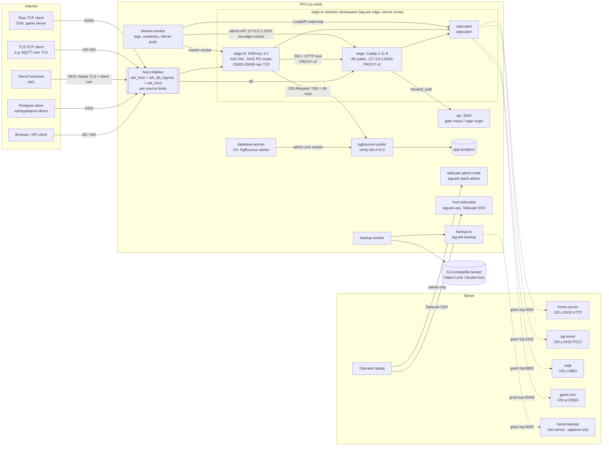
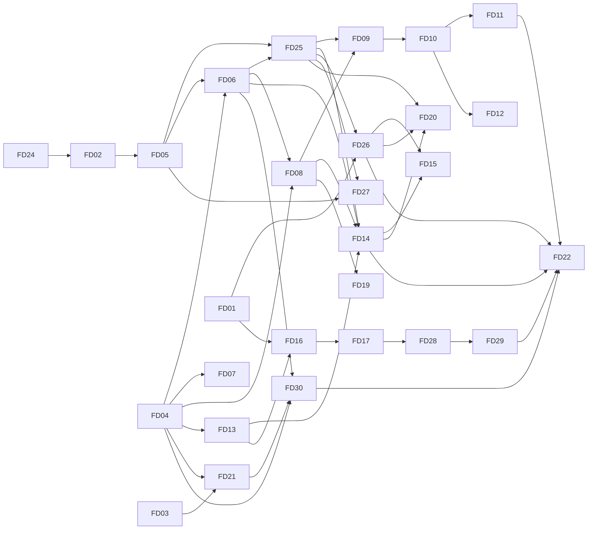

# Front door: public routes to tailnet services, and database access from Vercel

Status: proposed design and implementation plan, **revision 3** (review corrections, 16 November 2026). No product code has changed. The corrected examples and acceptance criteria below supersede revision 2 prototypes; those prototypes do not prove the revised security properties. Revision 1 was prepared on 16 November 2026 against `main` at `f14666a`. Revision 2, also dated 16 November 2026, is rebased onto `main` at `36db9ee`: better-auth is now 1.7.25, and the latest migration is `0012_drop_account_issuer.sql`. It applies the user's answers to the revision 1 open questions, which are recorded in [§0.1 Resolved decisions](#01-resolved-decisions).

This document designs two related capabilities for Ark Stack:

1. A **public front door on the VPS**. It exposes HTTP(S), TLS-based TCP and raw TCP services that run anywhere on the user's Tailscale tailnet, under the user's own public hostnames: `www.example.com`, the apex `example.com`, `db.example.com` and so on. Clients use plain hostnames on standard ports wherever the protocol allows it. Edge-controlled headers and error pages do not disclose a configured tailnet authority; upstream bodies and application-generated URLs require owner auditing (§3.5). The user's other machines stay reachable only through the tailnet.
2. **Database access from Vercel.** Without static IPs, the public PgBouncer endpoint is protected by client certificates (mTLS), TLS, SCRAM and least-privilege roles. Certificates last 90 days; automatic rollover starts 30 days before expiry.

Every claim about the current code cites a file and line. Every claim about an upstream product cites its documentation, or names the prototype that checked it (see [§7 Verification log](#7-verification-log)). Anything still uncertain is marked **Unverified** or listed under [§6 Remaining questions](#6-remaining-questions).

## Contents

- [0. Decisions and recommendations at a glance](#0-decisions-and-recommendations-at-a-glance)
  - [0.1 Resolved decisions](#01-resolved-decisions)
- [1. Current state and gaps found](#1-current-state-and-gaps-found)
- [2. Architecture and threat model](#2-architecture-and-threat-model)
- [3. Component designs](#3-component-designs)
- [4. Choices: recommendations and alternatives](#4-choices-recommendations-and-alternatives)
- [5. Ticket breakdown](#5-ticket-breakdown)
- [6. Remaining questions](#6-remaining-questions)
- [7. Verification log](#7-verification-log)
- [8. References](#8-references)

---

## 0. Decisions and recommendations at a glance

These revision 1 decisions, made with the user, are taken as given here:

- Option A (hardened), with the whole stack on the VPS.
- `adminMode: "tailnet"`.
- HTTP and TCP routes.
- Public or Ark-login access for HTTP routes.
- mTLS at PgBouncer.
- DNS-only records.
- A dedicated `tag:ark-edge` node.
- No Tailscale API key that can write policy.

The user's revision 2 answers are listed in [§0.1](#01-resolved-decisions).

| Area                         | Recommendation                                                                                                                                                                                                                                                                                                                                                                                                                                                    |
| ---------------------------- | ----------------------------------------------------------------------------------------------------------------------------------------------------------------------------------------------------------------------------------------------------------------------------------------------------------------------------------------------------------------------------------------------------------------------------------------------------------------- |
| Edge-to-tailnet transport    | A **kernel-mode Tailscale container `edge-ts`** owns a network namespace. HAProxy and Caddy share it through `network_mode: service:edge-ts`. Userspace SOCKS5 cannot carry raw TCP: neither caddy-l4 nor HAProxy can dial through SOCKS5 (V-2b).                                                                                                                                                                                                                 |
| Public listeners and routing | **HAProxy (`edge-l4`) owns every public TCP port except 80.** On 443 it routes by TLS SNI: HTTPS hostnames go to Caddy over PROXY protocol v2 on `127.0.0.1:8443`, and TLS-TCP hostnames go to their tailnet targets. On 5432 it routes PostgreSQL: classic `SSLRequest` clients go to PgBouncer, and direct-TLS clients go by SNI. Dedicated ports 20000–20049 are only for protocols without TLS. Caddy keeps `:80`. All of this was prototyped (V-13 to V-15). |
| HTTP edge                    | **Caddy upgraded to 2.11.9**, official image, digest-pinned, with no plugins. Header stripping, `Via` removal, the forward-auth gate, WebSocket survival across reloads and certificate reload were all re-run on 2.11.9 (V-16, V-17).                                                                                                                                                                                                                            |
| TCP and SNI proxy            | **HAProxy 3.2 LTS**, official image, digest-pinned. It handles SNI routing, CRL-checked client certificates, per-source limits, forced session shutdown, and synchronous master-CLI reloads (V-14). caddy-l4 was rejected (§3.8).                                                                                                                                                                                                                                 |
| PostgreSQL by hostname       | `psql "host=pg.example.com sslnegotiation=direct sslmode=verify-full"` reaches a tailnet Postgres on the normal port 5432. Supported by libpq 17+, node-postgres 8.22+, postgres.js 4.1.1, pgJDBC 42.7.4+, Npgsql 9+ and pgx 5.7.5+. PgBouncer 1.26.1 shares 5432: it is the default for classic clients and also accepts direct TLS itself (V-13).                                                                                                               |
| HTTP access gate             | Caddy `forward_auth` calls the Ark API, and a one-time-code handshake sets a host-only `__Host-` cookie on each route domain. Login happens on the **public `login.<domain>` origin**, which exposes only sign-in, MFA and gate endpoints.                                                                                                                                                                                                                        |
| SSRF guard                   | Targets must be Tailscale addresses that appear in the edge node's own netmap. Each route is pinned to the target's `StableNodeID`, Ark renders only the IP, and Tailscale ACL grants enforce the same boundary on the receiving node.                                                                                                                                                                                                                            |
| PgBouncer mTLS               | `client_tls_sslmode = verify-full`, with **one private CA per app environment and certificate generation** in one bundle. Preview deployments use a **read-only role**. Revocation removes the CA, rotates the password, then sends `RELOAD` and `KILL_CLIENT` (V-8). PgBouncer is upgraded to 1.26.1 (FD-01, started separately).                                                                                                                                |
| Client certificates          | **90-day lifetime with automatic rollover.** The next certificate is issued 30 days before expiry, both are valid during the overlap, and Ark raises a "rollover pending" alert. An optional **Vercel integration** uses a project-scoped, expiring Vercel token to push env vars and redeploy (§3.10.5).                                                                                                                                                         |
| Public DB and TCP limits     | nftables per-source `ct count` and `limit rate` meters on every public TCP port. Per-route CIDR allowlists are enforced in HAProxy, because nftables cannot see SNI and Docker's native IPv6 keeps real client addresses.                                                                                                                                                                                                                                         |
| DNS                          | Plain hostnames, including the apex and `www`. A and AAAA records come from the existing reviewed-diff flow. **AAAA is published only after an IPv6 preflight passes**, with a per-domain off switch.                                                                                                                                                                                                                                                             |
| Backups                      | **Both** an S3-compatible store (AWS S3, Backblaze B2, Cloudflare R2, MinIO) and a home machine over the tailnet (`rest-server --append-only`). Credentials cannot delete existing backups.                                                                                                                                                                                                                                                                       |
| Route management             | **Owners only** create, change or delete routes. Access lists hold individual users only.                                                                                                                                                                                                                                                                                                                                                                         |
| Region                       | `platform_settings.region` defaults to `us-east`, which maps to Vercel `iad1`. Ark only records the VPS region.                                                                                                                                                                                                                                                                                                                                                   |

### 0.1 Resolved decisions

The user answered every revision 1 open question. Each decision below is applied throughout the document.

| #   | Decision                                                                                                                                                                                                                                                                                       | Where it is applied                                             |
| --- | ---------------------------------------------------------------------------------------------------------------------------------------------------------------------------------------------------------------------------------------------------------------------------------------------- | --------------------------------------------------------------- |
| R1  | **Public login origin: yes.** `login.<domain>` exposes only the sign-in, MFA and gate endpoints.                                                                                                                                                                                               | §3.5 (login site block), §3.9.1, §2.3 boundary B7, FD-10        |
| R2  | **Vercel: client certificates only, no Static IPs.**                                                                                                                                                                                                                                           | §3.10, §3.12; Vercel Static IPs noted but not used              |
| R3  | **Plain hostnames, not `host:port`.** HTTP(S) and WebSocket by hostname on 80/443, including the apex and `www`. TLS-based TCP is routed by SNI on shared standard ports: 443, and 5432 for PostgreSQL. Dedicated ports from 20000–20049 are only for protocols without TLS.                   | §2.1, §3.5, §3.8 (rewritten), §3.11, §3.13, FD-14, FD-25, FD-26 |
| R4  | **Caddy upgraded to the current 2.11.x (2.11.9), digest-pinned. HAProxy remains the TCP/SNI proxy.** The upgrade ticket re-runs the header-stripping, `Via` removal, WebSocket-reload and certificate-reload tests.                                                                            | §3.5, §3.14, §3.16, FD-24 (re-runs recorded as V-16, V-17)      |
| R5  | **One CA per app environment, plus a read-only role for preview deployments.**                                                                                                                                                                                                                 | §3.1, §3.10.3, FD-17                                            |
| R6  | **Client certificates last 90 days with automatic rollover.** Issued about 30 days before expiry, with overlapping validity and a rollover-pending alert. An optional Vercel integration (token stored encrypted) pushes env vars and redeploys. Without it, rollover is a guided manual step. | §3.10.4, §3.10.5, §3.12, FD-28, FD-29                           |
| R7  | **Up to about 5 minutes of WebSocket access after revocation is acceptable.**                                                                                                                                                                                                                  | §2.3 residual risks, §3.5                                       |
| R8  | **Backups go to both destinations:** any S3-compatible store (configurable endpoint, region, bucket and path style) and a home machine over the tailnet, using append-only or write-only credentials.                                                                                          | §3.18 (rewritten), FD-21, FD-30                                 |
| R9  | **IPv6: AAAA by default, but only after a preflight.** The preflight checks for a public IPv6 address and that 80, 443, 5432 and the TCP route ports are reachable over it. Otherwise A only, with a warning. Per-domain AAAA toggle. Docker native IPv6 with `userland-proxy` off.            | §3.13, §3.17, FD-27                                             |
| R10 | **Tailnet observation: read-only LocalAPI first.** Fallback is an observer sidecar that alone touches the tailscaled socket and exposes one read-only "list peers" endpoint. **No Tailscale OAuth client.**                                                                                    | §3.6, FD-06                                                     |
| R11 | **Access lists: individual users only** in v1, no groups.                                                                                                                                                                                                                                      | §3.1, §3.9.6                                                    |
| R12 | **Route creation: owners only.** Operators cannot create, change or delete routes.                                                                                                                                                                                                             | §3.3, FD-08, FD-14                                              |

---

## 1. Current state and gaps found

### 1.1 What exists today (verified)

| Component             | Where                                                                 | Behaviour                                                                                                                                                                                                                                                                                                                                                                                                                              |
| --------------------- | --------------------------------------------------------------------- | -------------------------------------------------------------------------------------------------------------------------------------------------------------------------------------------------------------------------------------------------------------------------------------------------------------------------------------------------------------------------------------------------------------------------------------- |
| Edge renderer         | `shared/src/edge.ts:3-54`                                             | `renderCaddyfile` takes `appRoutes?: Array<{ hostname; upstream }>` (line 8) and emits `hostname { reverse_proxy upstream }` (lines 10-17). The global block binds the admin API to `edge-admin:2019` (line 39). A `:80` block serves only ACME challenges (lines 42-51). Public admin routes use a deny-before-fallback path allowlist (lines 18-37).                                                                                 |
| Edge apply            | `server/src/coordinator.ts:1398-1409`                                 | `applyEdge` selects endpoints with `kind === "http" && exposure === "public"` and hard-codes `upstream: "app-edge:8080"` (line 1406). **No `app-edge` service exists** in `infra/platform/docker-compose.yml`.                                                                                                                                                                                                                         |
| Edge write and reload | `server/src/modules/providers.ts:514-560`                             | Writes `Caddyfile.next`, POSTs it to `/adapt` (line 539), then `/load` (line 546) through `ARK_EDGE_RELOAD_URL`. No `Cache-Control: must-revalidate` header is sent.                                                                                                                                                                                                                                                                   |
| Certificates          | `server/src/modules/certificates.ts:61-116`, `coordinator.ts:700-729` | lego HTTP-01 through a webroot, staging unless `ARK_ACME_STAGING=0` (line 75). The SAN is checked (line 108). After issuance it enqueues `edge.apply` (coordinator line 728).                                                                                                                                                                                                                                                          |
| DNS verify            | `coordinator.ts:602-698`                                              | Verifies the ownership TXT, then each endpoint's required A/AAAA records. Only verified endpoints get `certificate.issue` (lines 645-666). Cloudflare domains then get `dns.publish` (line 693).                                                                                                                                                                                                                                       |
| Cloudflare            | `providers.ts:94-131`, `shared/src/cloudflare.ts`                     | Always `proxied: false` (cloudflare.ts line 15). Refuses ambiguous multi-record updates (line 51).                                                                                                                                                                                                                                                                                                                                     |
| Compose               | `infra/platform/docker-compose.yml`                                   | `edge` runs `caddy:2.10.2@sha256:c3d7…` and publishes 80/443 (lines 288-305). It joins `admin` and `edge-control` with alias `edge-admin`. `tailscale` (userspace, `tailnet` profile, lines 307-322) plus `tailnet-gateway` (lines 324-332) serve the admin UI. `pgbouncer-public` (lines 252-265) is published only on loopback 15432. `database-ingress` (lines 267-286) runs in the host netns with `NET_ADMIN` and `DAC_OVERRIDE`. |
| DB ingress            | `scripts/database-ingress.ts` (`startListener`)                       | A Bun TCP relay from `0.0.0.0:5432` to `127.0.0.1:15432`. It is IPv4-only, and PgBouncer sees loopback as the client address, so source filtering has to happen in nftables.                                                                                                                                                                                                                                                           |
| nftables allowlist    | `shared/src/db-ingress.ts` (`nftAllowlist`)                           | Table `inet ark_db_ingress` with an `input` chain and a `forward` chain (`ct status dnat`) that jump to `ark_db_allow` (when an allowlist is set) and then to the FD-18 per-source limits in `ark_db_limits` (§3.11).                                                                                                                                                                                                                  |
| PgBouncer config      | `shared/src/pgbouncer.ts:1-37`, `coordinator.ts:1344-1396`            | Transaction mode, `client_tls_sslmode = require` (line 20), `max_client_conn = 200`, `default_pool_size = 20`. Only `runtime` roles are admitted (coordinator line 1348). Privileged suffixes are filtered out (pgbouncer.ts line 34).                                                                                                                                                                                                 |
| Auth                  | `server/src/auth.ts:11-60`                                            | Better Auth **1.7.25** (pinned since #25, which also dropped `account.issuer` in `0012_drop_account_issuer.sql`) with the `twoFactor` plugin. Cookies use prefix `ark_stack` and `SameSite=Lax`. `trustedProxies` comes from `ARK_TRUSTED_PROXIES`.                                                                                                                                                                                    |
| Access default        | `server/src/app.ts:507-517`                                           | A signed-in user **without a `platform_access` row is treated as `viewer`** (line 514).                                                                                                                                                                                                                                                                                                                                                |
| Worker allowlists     | `server/src/app.ts:262-285`                                           | The domain worker owns `domain.`, `dns.`, `certificate.`, `edge.` and `admin.`. The database worker owns `database.` and `pgbouncer.`.                                                                                                                                                                                                                                                                                                 |
| Step-up               | `server/src/app.ts:920-976`, `access.ts:39-90`                        | Single-use, plan-hash-bound grants. Actions are `role.grant`, `secret.reveal`, `resource.delete`, `restore.overwrite`, `exposure.public`, `credential.rotate` and `platform.update` (app.ts line 928).                                                                                                                                                                                                                                 |
| Image publishing      | `docker-bake.hcl`, `scripts/check-image-plan.ts:4-12`                 | Seven first-party targets, each with provenance and a GHCR source annotation. Third-party images are pinned by digest in compose.                                                                                                                                                                                                                                                                                                      |

### 1.2 Gaps found while preparing this design

These are prerequisites or adjacent bugs. Each one is tracked as a ticket.

1. **`pgbouncer-public` cannot start as configured.** The edoburu image's entrypoint generates a config when `/etc/pgbouncer/pgbouncer.ini` is missing, and fails with `DB_HOST: Setup pgbouncer config error! You must set DB_HOST env`. Compose overrides `command` with just the `.ini` path (compose line 254), so the entrypoint would also `exec` the `.ini` file itself. This was reproduced against the pinned `v1.24.1-p1` digest; see V-7. Fix: `entrypoint: ["/usr/bin/pgbouncer"]`. (FD-01, **started separately**)
2. **PgBouncer 1.24.1 has known CVEs.** Version 1.25.2 fixes CVE-2026-6664 ("An unauthenticated remote attacker can crash PgBouncer with a malformed SCRAM authentication packet") and three others ([changelog](https://www.pgbouncer.org/changelog.html)). The public pooler is internet-facing, so this blocks the Vercel work. (FD-01, **started separately**)
3. **The edge does not use Ark's lego certificates.** `renderCaddyfile` emits no `tls` directive, and the edge mounts neither `/var/lib/ark/certs` (compose lines 291-294) nor anything else from it. Caddy would therefore run its own automatic HTTPS for app hostnames, which bypasses Ark's issuance records and its DNS pre-check. (FD-02)
4. **Certificate renewals would not reach Caddy even once wired.** Caddy skips a `/load` whose config is unchanged unless it receives `Cache-Control: must-revalidate` ([API docs](https://caddyserver.com/docs/api#post-load)). `writeEdge` does not send it (providers.ts line 546). (FD-02)
5. **Users with no access row default to `viewer`** (app.ts line 514). Gate-only users must get no admin API access at all. (FD-11)
6. **`writePgbouncer` has no production reload path.** It needs `ARK_PGBOUNCER_RELOAD=1` and the Docker CLI (providers.ts lines 495-510), but compose sets neither. The design below replaces this with the PgBouncer admin console over a private unix socket. (FD-16)
7. **`app-edge:8080` does not exist.** Legacy `http` endpoints proxy to a missing service (coordinator.ts line 1406). The front-door renderer replaces this path for tailnet routes. Local service routing is out of scope, but the dead upstream should be removed or turned into an explicit "unrouted" status. (FD-09)
8. **Dependabot does not cover container image digests.** `.github/dependabot.yml` (added in #18) updates only the `bun` workspace and GitHub Actions. The digest-pinned third-party images (Caddy, HAProxy, Tailscale, PgBouncer, PostgreSQL) are bumped by hand through the image-pin flow. The front door adds two of them (HAProxy, and the Caddy upgrade), so FD-24 and FD-25 include a documented bump procedure. A Dependabot `docker-compose` entry could be added later; that is out of scope here.

---

## 2. Architecture and threat model

### 2.1 Target topology



**Public ports**, all published by `edge-ts`:

| Port                                              | Owner                          | What arrives there    | How it is routed                                                                                                                                                                                                                                                                                                                          |
| ------------------------------------------------- | ------------------------------ | --------------------- | ----------------------------------------------------------------------------------------------------------------------------------------------------------------------------------------------------------------------------------------------------------------------------------------------------------------------------------------- |
| TCP 80                                            | Caddy                          | HTTP                  | ACME HTTP-01 challenges; known hostnames get `308` to HTTPS; everything else gets `404`.                                                                                                                                                                                                                                                  |
| TCP 443                                           | HAProxy `fe_tls443`            | TLS ClientHello       | By SNI. HTTP route hostnames, `login.<domain>` and the public admin hostname (if any) go to Caddy (`127.0.0.1:8443`, PROXY v2). TLS-TCP route hostnames go to their route backend. Unknown or missing SNI goes to Caddy, which has no certificate for it, so the handshake fails. Non-TLS bytes are rejected after the 5 s inspect delay. |
| TCP 5432                                          | HAProxy `fe_pg5432`            | PostgreSQL            | `SSLRequest`, `GSSENCRequest` and `CancelRequest` go to PgBouncer. Direct TLS with SNI equal to the Ark database hostname (or no SNI) also goes to PgBouncer. Direct TLS with a Postgres route's SNI goes to that route. Anything else is rejected (§3.8.3).                                                                              |
| TCP 20000–20049                                   | HAProxy, one frontend per port | Protocols without TLS | By port. One raw-TCP route per port.                                                                                                                                                                                                                                                                                                      |
| Optional shared SNI ports (8883, 5671, 636, 6380) | HAProxy                        | TLS ClientHello       | By SNI, as on 443. Opt-in at install time (§3.8.2).                                                                                                                                                                                                                                                                                       |
| UDP 41642                                         | `edge-ts` tailscaled           | WireGuard             | Direct tailnet paths for the edge node.                                                                                                                                                                                                                                                                                                   |
| UDP 41641                                         | host tailscaled                | WireGuard             | Direct paths for the host's SSH node.                                                                                                                                                                                                                                                                                                     |

Mail keeps 25, 465, 587 and 993 (`infra/mail/docker-compose.yml:6`); the front door never claims them.

Four Tailscale identities live on the VPS. They are kept separate:

| Node              | Where                                    | Tag                   | Purpose                               | Grants as source                        | Grants as destination         |
| ----------------- | ---------------------------------------- | --------------------- | ------------------------------------- | --------------------------------------- | ----------------------------- |
| `ark-vps`         | Host tailscaled, outside Compose         | `tag:ark-vps`         | Tailscale SSH for the owner           | none                                    | owner → `tcp:22` (SSH policy) |
| `ark-stack-admin` | Existing `tailscale` service (userspace) | `tag:ark-stack-admin` | Admin UI over Serve                   | none                                    | admin users → `tcp:443`       |
| `ark-edge`        | `edge-ts` (kernel mode)                  | `tag:ark-edge`        | Egress to route targets only          | `tag:ark-edge` → each route `host:port` | **none**                      |
| `ark-backup`      | `backup-ts` (userspace, SOCKS5)          | `tag:ark-backup`      | Egress to the home backup server only | `tag:ark-backup` → `home:8000`          | **none**                      |

### 2.2 Request flows

- **HTTP(S) route** (`www.example.com`, `example.com`).
  1. The client connects to 443, where HAProxy reads the SNI.
  2. HAProxy passes the still-encrypted stream to Caddy on `127.0.0.1:8443`, prefixed with a PROXY v2 header that carries the real client address (V-14).
  3. Caddy terminates TLS with the lego certificate, strips forged headers, optionally runs `forward_auth`, and proxies over `tailscale0` (WireGuard) to `100.x.y.z:port`.
  4. The target node's packet filter enforces the `tag:ark-edge` grant.
- **SSO HTTP route.** As above, but `forward_auth` first calls `api:3000/api/gate/check` on the `admin` network. If the check fails, the API's `302` goes back to the browser, which then completes the handshake in §3.9.
- **TLS-TCP route on 443 or another shared SNI port** (`mqtt.example.com:8883`).
  1. HAProxy reads the SNI and applies the route's CIDR allowlist and per-source limits.
  2. It then either passes TLS through to the target (`passthrough`), or terminates TLS itself with the lego certificate and requires a client certificate from the route CA, checked against its CRL (`terminate_mtls`, V-14). After termination it forwards plaintext over WireGuard.
- **PostgreSQL route by hostname** (`pg-home.example.com:5432`, client uses `sslnegotiation=direct`). HAProxy reads the SNI from the direct-TLS ClientHello. It then either:
  - passes the connection through to a PostgreSQL ≥ 17 target, which terminates TLS and enforces `clientcert=verify-full` and SCRAM itself; or
  - terminates TLS (`alpn postgresql`) and forwards plaintext over WireGuard to an older target.

  Both were prototyped (V-13).

- **Vercel → Ark database** (`db.example.com:5432`, classic negotiation). HAProxy matches the `SSLRequest` bytes and relays to PgBouncer over the internal `pgbouncer-ingress` network. PgBouncer requires TLS 1.3, a client certificate from an admitted app-environment CA, and SCRAM for that environment's role. It reaches `app-postgres` over the internal `database-management` network.
- **Raw TCP route** (`ssh.example.com:20001`). Host nftables applies the per-port CIDR allowlist and per-source limits. HAProxy applies `maxconn` and timeouts, then relays over WireGuard.

### 2.3 Threat model

**Assets**

| Asset                                            | Where it lives                                                                                                          | Impact if lost                                                                                                                                                                |
| ------------------------------------------------ | ----------------------------------------------------------------------------------------------------------------------- | ----------------------------------------------------------------------------------------------------------------------------------------------------------------------------- |
| Tailnet reachability                             | `edge-ts` and `backup-ts` node keys and state volumes                                                                   | An attacker can reach every granted route target `host:port`, and the home backup server's port. They cannot reach anything else on the tailnet.                              |
| Route target services                            | Home machines and others on the tailnet                                                                                 | Data exposure or compromise of those services.                                                                                                                                |
| Ark sessions and gate cookies                    | `session`, `gate_sessions` tables; browsers                                                                             | Impersonation on SSO routes.                                                                                                                                                  |
| `BETTER_AUTH_SECRET`, `ARK_ROOT_KEY`             | `.env` on the VPS, process env                                                                                          | Full control of Ark: decrypt every secret and mint sessions.                                                                                                                  |
| Private CA keys (DB clients, TCP clients)        | `secrets` table; decryptable by api, database-worker, domain-worker, mail-worker and backup-worker with shared root key | An attacker can mint client certificates for PgBouncer or TLS-TCP routes.                                                                                                     |
| DB client cert, key and password                 | Vercel env vars                                                                                                         | Connections as that app environment's role, from permitted sources until expiry plus the enforced ≤5 s retirement drain, or revocation; expiry alone does not close sessions. |
| **Vercel project tokens** (optional integration) | `secrets` table; same five root-key holders as CA keys, including publicly exposed api                                  | Full control of that one Vercel project: env vars, deployments, and therefore code running on the app's production domain (§3.10.5).                                          |
| Public TLS keys                                  | `/var/lib/ark/certs`                                                                                                    | Impersonation of public hostnames.                                                                                                                                            |
| Cloudflare token                                 | domain-worker env                                                                                                       | DNS hijack of the zones it covers.                                                                                                                                            |
| Backup credentials                               | `secrets` table, sealed                                                                                                 | Write-only by design: an attacker can add data and read backups, but not delete or overwrite existing recovery points (§3.18).                                                |
| Application data                                 | `app-postgres`, tailnet databases                                                                                       | Exfiltration or tampering.                                                                                                                                                    |
| Backups                                          | S3-compatible bucket; home machine                                                                                      | Data exposure (restic and pgBackRest encrypt at rest); loss of recovery points if delete were possible.                                                                       |

**Attackers**

1. **Anonymous internet attacker.** Scans 80, 443, 5432 and route ports. Tries:
   - forged headers and Host-header tricks;
   - **arbitrary SNI values**, and SNI/Host mismatch (domain fronting);
   - forged PROXY protocol headers;
   - SSRF through route configuration;
   - credential stuffing on the login origin;
   - the PgBouncer pre-auth CVEs;
   - slow or partial handshakes to exhaust HAProxy's inspection slots.
2. **Holder of leaked app secrets**, for example Vercel env vars leaked from a preview deployment or a CI log.
3. **A compromised route target or malicious upstream app.** Tries to steal gate cookies, set cookies on other domains, inject redirects, or attack the edge through responses.
4. **A malicious or compromised tailnet device.** Tries to reach the edge, backup or admin nodes, or to take over a route by renaming a machine or re-registering it under the same name.
5. **A malicious Ark operator or viewer** without owner rights. Tries to create or widen routes. Route management is owner-only with step-up (R12).
6. **Root on the VPS** (full compromise). See below.
7. **A compromised provider account:** Tailscale coordination server, Cloudflare, Vercel, or the object-storage provider.

**Trust boundaries**

| #   | Boundary                                     | Controls                                                                                                                                                                                                                                                                                                                                                                                                                                                                                                                                                                                                                          |
| --- | -------------------------------------------- | --------------------------------------------------------------------------------------------------------------------------------------------------------------------------------------------------------------------------------------------------------------------------------------------------------------------------------------------------------------------------------------------------------------------------------------------------------------------------------------------------------------------------------------------------------------------------------------------------------------------------------- |
| B1  | Internet ↔ VPS public ports                  | Host nft default-deny on `input`, plus `forward`-chain control of DNAT'd ports. The permitted set is the union of enabled platform services: 80/443/5432, enabled SNI and route ports, UDP 41641/41642, plus TCP 25/465/587/993 when mail is enabled. Per-source `ct count` and `limit rate` on every public TCP port.                                                                                                                                                                                                                                                                                                            |
| B2  | Internet ↔ HAProxy (`edge-l4`)               | TLS ClientHello or Postgres preamble required within 5 s, otherwise reject (V-13). SNI is attacker-chosen plaintext, so routing by SNI grants no authority by itself: each route still applies its own CIDR, TLS and client-certificate policy. Unknown SNI never reaches a tailnet target. `maxconn` per frontend and route; stick-table per-source limits; `hard-stop-after`.                                                                                                                                                                                                                                                   |
| B3  | HAProxy ↔ Caddy                              | PROXY headers are required on the loopback-only HTTPS listener ([pinned wrapper source](https://github.com/caddyserver/caddy/blob/v2.11.9/modules/caddyhttp/proxyprotocol/listenerwrapper.go)) (`fallback_policy require`, **no `allow` list**, which would override it with optional USE). HAProxy emits v2. Headerless loopback TLS must fail; only tailscaled, HAProxy and Caddy share this netns. This prevents accidental headerless bypass, not a malicious process in the trusted edge netns forging PROXY. Public :80 never parses PROXY. V-14 proved the old optional behavior; FD-25 must prove the corrected contract. |
| B4  | Internet ↔ Caddy (HTTP semantics)            | Lego TLS; deny-before-fallback routing; header stripping; body and timeout limits; Caddy ignores incoming `X-Forwarded-*` from untrusted clients ([docs](https://caddyserver.com/docs/caddyfile/directives/reverse_proxy#defaults)). SNI/Host mismatch (domain fronting between Ark sites) is refused with `strict_sni_host on`. Without that option Caddy 2.11.9 served the mismatched Host (200); with it, the response is 421 (V-14).                                                                                                                                                                                          |
| B5  | Caddy ↔ Ark API (forward_auth, login origin) | Internal `admin` network; edge token header; path allowlist for the login origin; API checks `Host` against registered route hostnames.                                                                                                                                                                                                                                                                                                                                                                                                                                                                                           |
| B6  | Edge netns ↔ tailnet                         | Tailscale ACL grants, enforced by the receiving node; `--shields-up` on the edge node; Ark's upstream allowlist; StableID pinning.                                                                                                                                                                                                                                                                                                                                                                                                                                                                                                |
| B7  | Gate user ↔ login origin                     | **Public (R1).** Only the login and MFA endpoints are exposed. Gate sessions are flagged and refused by the admin API. Rate limits.                                                                                                                                                                                                                                                                                                                                                                                                                                                                                               |
| B8  | Internet ↔ PgBouncer                         | nft per-source limits; HAProxy CIDR allowlist for the PgBouncer backend; TLS 1.3; `verify-full` client certificate; SCRAM; runtime or read-only roles; per-role and per-database limits. PgBouncer is reachable only from `edge-ts` over the dedicated `pgbouncer-ingress` network, so the edge namespace never joins `database-management` and cannot reach `app-postgres`.                                                                                                                                                                                                                                                      |
| B9  | Operator ↔ admin UI                          | Tailnet only (`adminMode: "tailnet"`); Better Auth with MFA; step-up for exposure changes; route management owner-only.                                                                                                                                                                                                                                                                                                                                                                                                                                                                                                           |
| B10 | Ark ↔ providers                              | Scoped Cloudflare token (Zone:DNS:Edit plus Zone:Read); optional **project-scoped, expiring** Vercel token; write-only object-storage credentials; no Tailscale credential of any kind (R10).                                                                                                                                                                                                                                                                                                                                                                                                                                     |

**What a full VPS compromise exposes**

Root on the VPS reads `.env` and the Docker volumes, so all Ark secrets fall with it. That includes the root key, so every sealed secret can be decrypted, and the CA keys, so the attacker can mint DB and TCP client certificates. The attacker can also mint sessions, impersonate any user on any SSO route, and hold the `edge-ts`, `backup-ts`, `ark-stack-admin` and `ark-vps` node keys. If the Vercel integration is enabled, they also hold each connected project's token, which lets them **deploy arbitrary code to that Vercel project**. That is the main reason the integration is optional and project-scoped (§3.10.5).

Several things limit the damage:

- **Tailnet reach is limited to granted ports.** As `tag:ark-edge`, the attacker reaches only the `host:port` pairs granted to that tag. As `tag:ark-backup`, only the home backup server's port. The other VPS nodes are granted nothing as a source. This only holds if the user's policy has no broad pre-existing rules, so the ACL generator emits `tests` for it.
- **The tailnet policy is out of reach.** Ark holds no Tailscale API credential at all, so the attacker cannot widen the policy or add grants.
- **Tailnet Lock blocks new nodes.** If it is enabled, the attacker cannot add new nodes with a stolen or reused auth key, because trusted nodes must sign every new node ([Tailnet Lock](https://tailscale.com/docs/features/tailnet-lock)). Edge and backup keys are one-off keys revoked after enrollment.
- **Existing backups survive.** The S3 credentials cannot delete or overwrite them: Object Lock or bucket lock, plus no-delete policies. The home `rest-server` runs `--append-only` (V-18). Pruning happens off-host.
- **Client certificates expire within 90 days** for new TLS handshakes even if nobody revokes them; the enforced retirement drain bounds live access to expiry +5 s (§3.10.4).

Route targets must still do their own authentication for anything sensitive. The SSO gate is a perimeter, not a substitute.

**Residual risks accepted for v1**

- Rate limiting on HTTP routes beyond the login origin would need the unofficial `caddy-ratelimit` plugin and a custom build. It is deferred (FD-23).
- A WebSocket that was open when access was revoked survives until the next edge reload plus `stream_close_delay` (5 minutes). The user accepts this (R7; V-3, V-15).
- PgBouncer cannot bind a client certificate to a role, so app A's certificate plus app B's password would be admitted. Exploiting that needs two separate secrets, and it is mitigated by one CA per app environment/generation plus a per-role password (V-8).
- During a rollover overlap, a superseded client certificate stays valid until its own expiry, at most 30 days. Immediate invalidation needs CA rotation (§3.10.4).
- HAProxy is a single chokepoint for 443 and 5432. A HAProxy vulnerability or DoS affects every route. Mitigations: the LTS branch, digest pin with a documented bump procedure, `maxconn` and per-source limits, and nft per-source limits in front.
- SNI is visible on the wire, so route hostnames are public (they are in DNS and CT logs anyway). No ECH is offered, because no HTTPS DNS records are published.
- PostgreSQL clients that cannot use `sslnegotiation=direct` cannot reach a tailnet Postgres by hostname on 5432. They either use the opt-in per-route compatibility port (§3.8.3) or upgrade the driver.

---

## 3. Component designs

### 3.1 Data model and migration

Add a new migration, **`server/drizzle/0013_front_door.sql`**. It is expand-only and follows `0012_drop_account_issuer.sql`, which is the latest on `main` at `36db9ee`. Mirror it in `server/src/schema.ts` and run it through `mise run test:upgrade`.

```sql
-- Platform settings
ALTER TABLE platform_settings
  ADD COLUMN region text NOT NULL DEFAULT 'us-east',
  ADD COLUMN vps_region_label text,               -- free text: "Hetzner ash", "DO nyc3"; recorded only
  ADD COLUMN public_ipv6 text,
  ADD COLUMN pooler_source_cidrs jsonb NOT NULL DEFAULT '[]',
  ADD COLUMN pooler_allow_internet boolean NOT NULL DEFAULT false,
  ADD COLUMN ipv6_status text NOT NULL DEFAULT 'unchecked'
    CHECK (ipv6_status IN ('unchecked', 'passed', 'failed', 'not_present')),
  ADD COLUMN ipv6_checked_at timestamptz,
  ADD COLUMN ipv6_evidence jsonb,                 -- per-port results of the last preflight
  ADD COLUMN gate_login_mode text NOT NULL DEFAULT 'disabled'
    CHECK (gate_login_mode IN ('disabled', 'public')),
  ADD COLUMN gate_login_hostname text,
  ADD COLUMN sni_extra_ports jsonb NOT NULL DEFAULT '[]',   -- subset of [8883, 5671, 636, 6380], install-time
  ADD COLUMN tcp_port_range_start integer NOT NULL DEFAULT 20000,
  ADD COLUMN tcp_port_range_end integer NOT NULL DEFAULT 20049;

-- Per-domain AAAA switch (R9). Effective AAAA = aaaa_enabled AND ipv6_status = 'passed'.
ALTER TABLE domain_claims ADD COLUMN aaaa_enabled boolean NOT NULL DEFAULT true;

-- Complete snapshots are independent for edge and backup observation sources.
CREATE TABLE tailnet_snapshots (
  source text PRIMARY KEY CHECK (source IN ('edge', 'backup')),
  generation text NOT NULL,
  completed_at timestamptz NOT NULL,
  valid_until timestamptz NOT NULL  -- completed_at + 6 minutes
);
CREATE TABLE tailnet_nodes (
  source text NOT NULL REFERENCES tailnet_snapshots(source),
  generation text NOT NULL,
  stable_id text NOT NULL,                     -- tailcfg.StableNodeID
  dns_name text NOT NULL,                         -- MagicDNS FQDN, e.g. home.tail1234.ts.net
  host_name text NOT NULL,
  ipv4 text, ipv6 text,
  tags jsonb NOT NULL DEFAULT '[]',
  is_self boolean NOT NULL DEFAULT false,
  online boolean,
  observed_at timestamptz NOT NULL,
  PRIMARY KEY (source, stable_id)
);

-- Private CAs must precede front_routes, which references them
CREATE TABLE private_cas (
  id text PRIMARY KEY,
  purpose text NOT NULL CHECK (purpose IN ('db-client', 'tcp-client', 'http-client')),
  name text NOT NULL,
  cert_pem text NOT NULL,
  key_secret_id text NOT NULL REFERENCES secrets(id),
  crl_pem text, crl_next_update timestamptz,   -- used where the consumer supports CRLs (HAProxy)
  not_after timestamptz NOT NULL,
  status text NOT NULL DEFAULT 'active' CHECK (status IN ('active', 'retired', 'revoked')),
  created_at timestamptz NOT NULL DEFAULT now()
);

-- One row per public route
CREATE TABLE front_routes (
  id text PRIMARY KEY,
  kind text NOT NULL CHECK (kind IN ('http', 'tls', 'postgres', 'tcp')),
  -- http:     Host-routed by Caddy behind the 443 SNI router
  -- tls:      SNI-routed TLS-TCP on 443 or an enabled shared SNI port (listen_port)
  -- postgres: SNI-routed direct-TLS PostgreSQL on 5432 (+ optional compat_port)
  -- tcp:      raw TCP without TLS on a dedicated port from the range (listen_port)
  endpoint_id text NOT NULL REFERENCES endpoints(id) ON DELETE RESTRICT,   -- public hostname, domain, certificate
  listen_port integer NOT NULL,                                            -- 443, 5432, 8883..., or 20000-20049
  compat_port integer,                                                     -- postgres only, opt-in, from the range
  target_input text NOT NULL,                                              -- as entered: MagicDNS name or Tailscale IP
  target_node_stable_id text NOT NULL,                                     -- pinned identity
  target_ip text NOT NULL,                                                 -- pinned address; the only thing rendered
  target_port integer NOT NULL CHECK (target_port BETWEEN 1 AND 65535),
  access_mode text NOT NULL DEFAULT 'sso' CHECK (access_mode IN ('public', 'sso')),  -- http only
  bypass_paths jsonb NOT NULL DEFAULT '[]',                                -- http only, path prefixes
  http_options jsonb NOT NULL DEFAULT '{}',   -- maxBodyMb, hsts, timeouts, upstreamHost, rewriteLocation, streaming
  tls_mode text CHECK (tls_mode IN ('passthrough', 'terminate', 'terminate_mtls', 'plain')),
    -- tls/postgres: passthrough | terminate | terminate_mtls; tcp: plain (forced)
  tcp_options jsonb NOT NULL DEFAULT '{}',    -- maxConn, perSourceConn, perSourceRate, idleTimeout
  source_cidrs jsonb NOT NULL DEFAULT '[]',  -- empty = deny all
  allow_internet boolean NOT NULL DEFAULT false, -- explicit exposure.public step-up; renders open CIDRs
  client_ca_id text REFERENCES private_cas(id),   -- tls/postgres terminate_mtls now; http mTLS later (reserved)
  rate_limit jsonb,                               -- reserved; not rendered in v1
  enabled boolean NOT NULL DEFAULT false,
  status text NOT NULL DEFAULT 'draft',
    -- draft | awaiting_acl | awaiting_dns | issuing_certificate | ready | identity_mismatch | observation_expired | disabled | error
  last_error text,
  created_by text REFERENCES "user"(id),
  created_at timestamptz NOT NULL DEFAULT now(),
  updated_at timestamptz NOT NULL DEFAULT now()
);
-- A hostname has at most one route per listener: one route on 443 (HTTP or TLS-TCP, because both are
-- told apart only by SNI), one TLS-TCP route per shared SNI port, one Postgres route on 5432.
CREATE UNIQUE INDEX front_routes_endpoint_listener ON front_routes(endpoint_id, listen_port) WHERE kind <> 'tcp';
CREATE UNIQUE INDEX front_routes_dedicated_port ON front_routes(listen_port) WHERE kind = 'tcp';
CREATE UNIQUE INDEX front_routes_compat_port ON front_routes(compat_port) WHERE compat_port IS NOT NULL;

CREATE TABLE front_route_access (           -- individual users only (R11); no groups in v1
  route_id text NOT NULL REFERENCES front_routes(id) ON DELETE CASCADE,
  user_id text NOT NULL REFERENCES "user"(id) ON DELETE CASCADE,
  granted_by text REFERENCES "user"(id),
  created_at timestamptz NOT NULL DEFAULT now(),
  PRIMARY KEY (route_id, user_id)
);

-- Login gate
CREATE TABLE gate_handoffs (
  id text PRIMARY KEY,
  code_hash text NOT NULL UNIQUE,              -- sha256 of a 32-byte random code
  route_id text NOT NULL REFERENCES front_routes(id) ON DELETE CASCADE,
  user_id text NOT NULL REFERENCES "user"(id) ON DELETE CASCADE,
  auth_session_id text NOT NULL REFERENCES session(id) ON DELETE CASCADE,
  state_hash text NOT NULL,
  return_path text NOT NULL,
  expires_at timestamptz NOT NULL,             -- now() + 60s
  consumed_at timestamptz,
  created_at timestamptz NOT NULL DEFAULT now()
);
CREATE TABLE gate_sessions (
  id text PRIMARY KEY,
  token_hash text NOT NULL UNIQUE,
  route_id text NOT NULL REFERENCES front_routes(id) ON DELETE CASCADE,
  user_id text NOT NULL REFERENCES "user"(id) ON DELETE CASCADE,
  auth_session_id text NOT NULL REFERENCES session(id) ON DELETE CASCADE,   -- sign-out and mode change cascade
  ip_address text, user_agent text,
  created_at timestamptz NOT NULL DEFAULT now(),
  last_seen_at timestamptz,
  expires_at timestamptz NOT NULL,
  revoked_at timestamptz
);
CREATE INDEX gate_sessions_user_idx ON gate_sessions(user_id);
ALTER TABLE session ADD COLUMN origin text CHECK (origin IN ('admin', 'gate'));
-- Existing sessions were created before the public gate existed. Backfill explicitly.
UPDATE session SET origin = 'admin';
ALTER TABLE session ALTER COLUMN origin SET NOT NULL;
-- No SQL default: every future insert must supply an origin.

-- Client certificates
CREATE TABLE client_certificates (
  id text PRIMARY KEY,
  ca_id text NOT NULL REFERENCES private_cas(id) ON DELETE CASCADE,
  subject_cn text NOT NULL,
  serial text NOT NULL,
  fingerprint_sha256 text NOT NULL,
  not_before timestamptz NOT NULL,
  not_after timestamptz NOT NULL,              -- not_before + 90 days (R6)
  key_secret_id text REFERENCES secrets(id),   -- `once` secret; null after reveal/push or with CSR issuance
  status text NOT NULL DEFAULT 'issued' CHECK (status IN ('issued', 'revoked', 'expired')),
  rollover_state text NOT NULL DEFAULT 'current'
    CHECK (rollover_state IN ('current', 'pending', 'delivered', 'superseded')),
    -- delivered is a transient transition inside the promotion transaction; delivered_at is durable history
    -- pending: not delivered; current: delivered active successor; superseded: predecessor
  superseded_by text REFERENCES client_certificates(id),
  delivered_at timestamptz,
  revoked_at timestamptz, revoked_reason text,
  created_at timestamptz NOT NULL DEFAULT now(),
  UNIQUE (ca_id, serial)
);
CREATE UNIQUE INDEX client_certificates_successor_unique
  ON client_certificates(superseded_by) WHERE superseded_by IS NOT NULL;
CREATE TABLE database_clients (
  id text PRIMARY KEY,
  database_id text NOT NULL REFERENCES managed_databases(id) ON DELETE CASCADE,
  name text NOT NULL,                          -- "storefront"
  environment text NOT NULL,                   -- "production" | "preview" | free text
  role_kind text NOT NULL CHECK (role_kind IN ('runtime', 'readonly')),  -- preview defaults to readonly (R5)
  role_id text NOT NULL REFERENCES database_roles(id),
  ca_id text NOT NULL REFERENCES private_cas(id),
  status text NOT NULL DEFAULT 'active' CHECK (status IN ('active', 'revoked')),
  created_at timestamptz NOT NULL DEFAULT now(),
  UNIQUE (database_id, name, environment)
);

-- Optional Vercel integration (R6), one per database client
CREATE TABLE vercel_integrations (
  id text PRIMARY KEY,
  database_client_id text NOT NULL UNIQUE REFERENCES database_clients(id) ON DELETE CASCADE,
  vercel_project_id text NOT NULL,
  vercel_team_id text,
  token_secret_id text NOT NULL REFERENCES secrets(id),       -- project-scoped Vercel access token, sealed
  token_expires_at timestamptz,
  deploy_hook_secret_id text REFERENCES secrets(id),          -- optional deploy hook URL, sealed
  env_target text NOT NULL CHECK (env_target IN ('production', 'preview')),
  git_branch text,                                            -- preview only
  last_push_at timestamptz, last_push_status text, last_deployment_id text,
  created_by text REFERENCES "user"(id),
  created_at timestamptz NOT NULL DEFAULT now()
);

-- Off-VPS backup destinations (R8): both kinds are required for "backups healthy"
CREATE TABLE backup_targets (
  id text PRIMARY KEY,
  kind text NOT NULL CHECK (kind IN ('s3', 'tailnet_rest')),
  name text NOT NULL,
  endpoint text,                 -- s3: https://s3.us-east-005.backblazeb2.com, https://<acct>.r2.cloudflarestorage.com, ...
  region text,                   -- s3: us-east-1, auto, ...
  bucket text,
  prefix text NOT NULL DEFAULT 'ark',
  path_style boolean NOT NULL DEFAULT false,
  rest_url text,                 -- tailnet_rest: http://backup-home.tail1234.ts.net:8000/ark
  target_node_stable_id text,    -- tailnet_rest: pinned like routes (§3.2)
  credential_secret_id text NOT NULL REFERENCES secrets(id),
  append_only_verified boolean NOT NULL DEFAULT false,
  append_only_evidence jsonb,
  last_success_at timestamptz,
  created_at timestamptz NOT NULL DEFAULT now()
);
```

Notes:

- **Routes reuse `endpoints`** (schema.ts lines 150-159) for hostname uniqueness, domain linkage and certificates. Add the endpoint kinds `route` and `gate` (the login origin). One hostname may carry an HTTP route on 443 and a Postgres route on 5432, for example, but not both an HTTP and a TLS-TCP route on 443.
- **`session.origin`** is set by a Better Auth `databaseHooks.session.create.before` hook from the request host. In 1.7.25 the hook signature is `(session, context: GenericEndpointContext | null)`, and `ctx.request` can be missing for server-side `auth.api.*` calls (from source, via research). When the context or request is missing, the hook does not guess from absent headers: Ark's own server-side calls pass the origin explicitly (gate-user creation sets `gate`), and any other context-free creation is refused. `session.additionalFields` is supported in 1.7.25. Mark origin as server-authored (`input: false`); browser payloads cannot choose it.
- **`database_roles.connectionLimit`** (schema.ts line 210) becomes the source of PgBouncer's per-role `max_user_connections`.
- **Region columns ship with FD-03.** As implemented (FD-04), `0013_front_door.sql` is the SQL above without the `region` and `vps_region_label` lines; FD-03 adds those two columns in its own migration, `0014_region.sql`, together with CHECK constraints on the preset list and the label length. `server/src/front-door-migration.test.ts` runs the literal block above, checks that 0013 differs from it only by those two lines, and checks that 0014 contains them.
- **Reserved for later:** `front_routes.rate_limit` and `client_ca_id` (for HTTP) stay unused in v1, so HTTP mTLS and HTTP rate limits can arrive without another migration.
- **Manual records:** apex and `www` hostnames need no special casing, because Ark only ever writes A/AAAA records (no CNAME at the apex).

### 3.2 Upstream allowlist (SSRF guard)

New module: `shared/src/tailnet.ts`, unit-tested in `shared/src/tailnet.test.ts`.

```ts
export const TAILSCALE_V4 = "100.64.0.0/10";
export const TAILSCALE_V6 = "fd7a:115c:a1e0::/48";
const RESERVED = ["100.100.100.100/32", "100.115.92.0/23"]; // quad-100 service IP; ChromeOS range Tailscale avoids

export function validateRouteTarget(input: {
  target: string; // "home.tail1234.ts.net" | "100.101.102.103" | "fd7a:115c:a1e0::1"
  port: number;
  peers: TailnetNode[]; // from the latest edge.observe snapshot
  snapshot: { source: "edge" | "backup"; generation: string; validUntil: string };
  now: string; // reject expired or incomplete snapshots; never mix observation sources
  self: TailnetNode; // the edge node
  forbiddenTags: string[]; // ["tag:ark-edge", "tag:ark-stack-admin", "tag:ark-vps", "tag:ark-backup"]
  tailnetSuffix: string; // ".tail1234.ts.net", learned from self.dns_name
}): { ok: true; stableId: string; ip: string } | { ok: false; reason: string };
```

Rules, applied in this order. All failures are closed. A snapshot must be complete and unexpired before any target is accepted.

1. **Syntax.** The target is either an IP literal or a lowercase FQDN ending in the tailnet's MagicDNS suffix. Ports, userinfo, schemes, paths, `localhost`, and bare single labels are rejected. Reuse `normalizeHostname` (`shared/src/hostnames.ts:8`) for the name form. Its `.internal`/`.local` blocklist does not apply to `.ts.net`.
2. **Range.** An IP must fall in `100.64.0.0/10` or `fd7a:115c:a1e0::/48`, and not in `RESERVED`. Reuse `ipv4ToInt` (`cidr.ts:23`) and `parseIpv6` (`cidr.ts:27`), and factor out the existing `prefixMatch` (`cidr.ts:75`) as an export. This rejects loopback, RFC 1918 Docker networks (`172.16.0.0/12`, which the API trusts as proxies; compose line 71), link-local `169.254.0.0/16` (cloud metadata), `::1`, `fe80::/10`, and public addresses.
3. **Identity.** Resolve the target **against the edge node's netmap snapshot, not DNS**. Match on `dns_name` for names, or on `ipv4`/`ipv6` for IPs. Exactly one peer must match. That peer's `stable_id` and IP are stored, and only the IP is ever rendered.
4. **Forbidden peers.** Reject the edge node itself, any peer carrying `tag:ark-edge`, `tag:ark-stack-admin` (exposing the tailnet-only admin UI publicly would defeat `adminMode: "tailnet"`), `tag:ark-vps` or `tag:ark-backup`, and any IP of the VPS's own nodes.
5. **Port.** Must be an integer from 1 to 65535. Ports 22, 3389, 5900, 2375/2376 and 2019 need an explicit `allowSensitivePort: true` together with an `exposure.public` step-up.
6. **Re-validation on every `edge.apply` and `edge.l4_apply`.**
   - If the `stable_id` is missing from the latest snapshot, an observed route becomes `awaiting_acl` and is **omitted from the rendered config**. Routes in `awaiting_dns` or `issuing_certificate` retain that lifecycle position with a transient error in `last_error`; they remain unserved and recovery never skips their DNS/certificate work.
   - If the IP changed but the `stable_id` is the same, `target_ip` is updated automatically and an audit event is written.
   - If a name the user entered now resolves to a different `stable_id`, the route becomes `identity_mismatch` and is omitted until an operator re-confirms the target with step-up. This stops a renamed or re-registered machine from taking over a route.

Netmap presence is necessary but **not sufficient** evidence of an outbound grant: peers may appear because they can connect to the edge. Only a successful TCP probe from the edge netns to the exact target port (§3.7), together with valid identity, permits `ready`. A member → edge rule must not make the reverse direction ready.

**Snapshot lifetime and withdrawal.** `edge.observe` commits self and the entire peer set as one generation, deleting peers absent from that completed generation in the same transaction. Partial/failed reads never extend `valid_until`. Observations run every 5 minutes; validity lasts 6 minutes from completion. On missing identity, name replacement, IP change or expiry, durably enqueue active-config withdrawal and `edge.drain`, rather than only changing status. An independent edge-local watchdog checks the persisted lease at least every second: it withdraws affected backends, drains their sessions across all HAProxy generations, and forces a Caddy reload with `stream_close_delay 0s` for identity withdrawal. If withdrawal cannot be applied, it stops the affected proxy's listeners (all listeners of that proxy if isolation is unavailable) and alerts; stale configuration must not keep serving. This watchdog must work when the observer or domain worker is unavailable. Startup with no fresh lease is closed. A small launch guard for each proxy must obtain a valid lease from the watchdog before starting the proxy, including container restarts after a fail-closed stop; the official proxy binaries remain unchanged. The watchdog reads the durable policy/revocation journal independently of the operation worker at least every second through a read-only, token-authenticated internal API. If that API or the watchdog fails, proxy supervision expires the lease and stops admission; it cannot silently restart from stale files. It uses the HAProxy master CLI and Caddy admin API for withdrawal/stop, never Docker or host-root access. FD-06 supplies the watchdog, internal read-only lease/journal endpoint and Caddy launch guard; FD-25 supplies the HAProxy launch guard/control adapter. Both are in the image plan.

**As built (FD-06).** The lease endpoint is `GET /api/internal/edge/lease`, readable only with `ARK_EDGE_WATCHDOG_TOKEN`; that token cannot heartbeat, claim or complete operations. It returns an allowlist rather than a journal: enabled `ready` routes whose pinned StableID and IP still match the latest complete generation, re-validated on every read, and nothing once the lease has expired. A replaced identity is therefore withdrawn as soon as its generation commits, before any worker updates route status. The watchdog is the `edge-watchdog` image target, a container on `control` and `edge-control` with no database credential, root key or socket. It counts the remaining lease down on its own clock from the API's `now` and `validUntil`, and treats a policy it could not refresh for 5 s as revoked. A Caddy withdrawal reloads the active config with each denied `reverse_proxy` handler replaced by a fixed 503 and verifies the result; the fallback is `POST /stop`. Tailnet routes render without `stream_close_delay` until FD-09, so the reload closes their upgraded sessions, and the rendered `grace_period 5s` bounds in-flight requests. FD-09 must keep identity withdrawal at zero stream-close delay if it adds the 5-minute default. The Caddy launch guard (`infra/platform/edge-launch-guard.sh`, the `edge` entrypoint) starts from `Caddyfile` only when the watchdog answers `open` for every individually identified tailnet handler in it, and otherwise from `Caddyfile.closed`, which the domain worker renders without tailnet routes. Every reported withdrawal queues an `edge.apply` so the rendered files follow the policy, and a failed withdrawal raises the critical `edge-withdrawal` alert. The watchdog re-reads the lease before each pass (waiting at most 300 ms), so a newly applied route is not withdrawn on a policy older than the config it inspects. Each `edge.observe` also queues `edge.apply` when an allowed route with an issued certificate is missing from Caddy's active config, which heals a closed start once the lease is valid. `mise run test:edge` measures identity withdrawal within detection + 5 s, expiry withdrawal by completion + lease + 5 s with the operation worker stopped, closed starts and the stop fallback; `docs/operating.md` ("Edge observer and lease watchdog") has the operator view.

**FD-06 enforcement hardening.** Caddy’s native `vars` handler carries the route ID, hostname, StableID and pinned backend through adaptation and reload. Both active withdrawal and launch authorisation require that identity and the enclosing host match; sharing a backend never shares authorisation. Unmarked legacy handlers are denied. The launch guard remains Caddy’s parent and polls `/v1/supervise` every second, with a one-second timeout. A verified enforcement pass must be at most two seconds old. After a two-second initial startup grace, a missing/frozen watchdog or failed inspection causes a hard stop, closing listeners and upgraded sessions. An unreadable Caddy config is a withdrawal failure after a five-second watchdog startup grace; once Caddy has been inspected, failures have no grace. Identical failure reports are coalesced per proxy (stop retries continue); event details contain a bounded backend count/sample and failed reports are retried. Routes in DNS/certificate lifecycle states retain their position on transient observation failure, with the error recorded separately; a changed StableID still becomes sticky `identity_mismatch`. The runtime suite covers shared-backend revocation, live watchdog stop/freeze, and unreadable admin configuration.

Identity pinning is polling-based: a removed/replaced peer may remain reachable until detection, at most 6 minutes plus 5 seconds for enforced withdrawal after the last complete observation. Tailscale destination ACLs remain the immediate network boundary; Ark does not claim continuous identity validation.

Defence in depth beyond Ark's validator:

- Tailscale grants are enforced on the destination node, so a hijacked edge config still cannot reach ungranted ports.
- `--shields-up` on `edge-ts` blocks inbound tailnet connections to the edge node.
- Optional hardening (FD-05, stretch): an nftables `output` policy inside the `edge-ts` netns. It would allow new connections only to `100.64.0.0/10` and the Tailscale ULA, to `api:3000`, to DNS, and to Tailscale's control, DERP and STUN endpoints. tailscaled and the proxies share the netns, so per-process egress rules are impractical. Marked **open** because DERP and control endpoints change.

### 3.3 API endpoints

Every mutation keeps the existing patterns:

- Role checks plus MFA (`requireOperator`, `requireMfa`, access.ts lines 21-37). **Route management uses a new `requireOwner` instead (R12).**
- Step-up via `requirePrivileged` with `privilegedRequestHash`, consumed after validation (as in app.ts lines 1674-1707).
- Audit events.
- A durable operation enqueued for any work done by a worker.

| Method and path                                                             | Who                               | Step-up action                                                                                                        | Effect                                                                                                                                                                                                                                                                                                                                       |
| --------------------------------------------------------------------------- | --------------------------------- | --------------------------------------------------------------------------------------------------------------------- | -------------------------------------------------------------------------------------------------------------------------------------------------------------------------------------------------------------------------------------------------------------------------------------------------------------------------------------------- |
| `GET /api/front/tailnet`                                                    | **owner** (read)                  | none                                                                                                                  | Edge node status: self `dns_name`, tags, online, last observation, and peers (name, IPs, tags, stable ID).                                                                                                                                                                                                                                   |
| `POST /api/front/tailnet/observe`                                           | **owner**                         | none                                                                                                                  | Enqueue `edge.observe`. Read-only, with no exposure effect.                                                                                                                                                                                                                                                                                  |
| `GET /api/front/routes`                                                     | operator, viewer (read)           | none                                                                                                                  | List routes with status, listener, pinned target and DNS state.                                                                                                                                                                                                                                                                              |
| `POST /api/front/routes`                                                    | **owner**                         | `exposure.public`                                                                                                     | Create an `http`, `tls`, `postgres` or `tcp` route. Validate the target (§3.2) and the listener (shared SNI port, or a free port from the range for `tcp`). Create or attach the endpoint, write `dns_records` (A, plus AAAA when §3.13 allows), enqueue `domain.verify`, and return the ACL snippet. The route starts with `enabled=false`. |
| `PATCH /api/front/routes/:id`                                               | **owner**                         | `exposure.public` if the target, access mode, bypass paths, CIDRs, TLS mode or compat port get looser; otherwise none | Update options, then enqueue `edge.apply` and/or `edge.l4_apply`.                                                                                                                                                                                                                                                                            |
| `POST /api/front/routes/:id/enable`                                         | **owner**                         | `exposure.public`                                                                                                     | Enable once the route is `ready`.                                                                                                                                                                                                                                                                                                            |
| `POST /api/front/routes/:id/disable`                                        | **owner**                         | none (tightening)                                                                                                     | Disable and enqueue `edge.drain`.                                                                                                                                                                                                                                                                                                            |
| `DELETE /api/front/routes/:id`                                              | **owner**                         | `resource.delete`                                                                                                     | Drain, remove the config, and keep the endpoint if anything else still uses it.                                                                                                                                                                                                                                                              |
| `GET /api/front/routes/:id/acl`                                             | **owner** (read)                  | none                                                                                                                  | Return the ACL snippet for one route (§3.7), with the diff against the last generated one. Owner-only as built (FD-07).                                                                                                                                                                                                                      |
| `GET /api/front/acl`                                                        | **owner** (read)                  | none                                                                                                                  | Return the global ACL snippet for every route and tailnet backup target (§3.7), with the diff. Owner-only.                                                                                                                                                                                                                                   |
| `GET /api/front/routes/:id/dns`                                             | operator (read)                   | none                                                                                                                  | Return the record plan and provider guide (manual), or the dry-run diff (Cloudflare, §3.13).                                                                                                                                                                                                                                                 |
| `PUT /api/front/routes/:id/access`                                          | **owner**                         | `role.grant`                                                                                                          | Replace the allowed-user list (users only, R11); removals atomically enqueue edge.drain for open sockets (§3.9.3).                                                                                                                                                                                                                           |
| `POST /api/front/routes/:id/client-ca`                                      | **owner**                         | `credential.rotate`                                                                                                   | Create or rotate the client CA for a `terminate_mtls` route.                                                                                                                                                                                                                                                                                 |
| `POST /api/front/routes/:id/client-certs`                                   | **owner**                         | `credential.rotate`                                                                                                   | Issue a route client certificate. Returns a one-time secret ID, revealed through the existing `/api/secrets/:id/reveal`.                                                                                                                                                                                                                     |
| `POST /api/front/routes/:id/client-certs/:certId/revoke`                    | owner or operator                 | none (tightening)                                                                                                     | Add it to the CRL, then enqueue `edge.l4_apply` and `edge.drain`. Operators may tighten.                                                                                                                                                                                                                                                     |
| `GET /api/gate/users`, `POST /api/gate/users`, `DELETE /api/gate/users/:id` | owner                             | `role.grant` / `resource.delete`                                                                                      | Manage gate-only users (§3.9.6).                                                                                                                                                                                                                                                                                                             |
| `GET /api/gate/check`                                                       | **edge only**                     | n/a                                                                                                                   | forward_auth target (§3.9). Requires `X-Ark-Edge-Token`. Never routed publicly.                                                                                                                                                                                                                                                              |
| `GET /gate/login`, `GET /gate/authorize`, `POST /gate/logout`               | login origin                      | n/a                                                                                                                   | Gate UI and authorize step (§3.9).                                                                                                                                                                                                                                                                                                           |
| `GET /api/gate/callback`, `POST /api/gate/logout-route`                     | route hostname via `/.ark/gate/*` | n/a                                                                                                                   | Code exchange and per-route logout.                                                                                                                                                                                                                                                                                                          |
| `GET /api/databases/:id/clients`                                            | **owner** (FD-17)                 | none                                                                                                                  | List app clients, their certificate states and rollover status. No PEM, key, password or secret ID.                                                                                                                                                                                                                                          |
| `POST /api/databases/:id/clients`                                           | **owner** (FD-17)                 | `credential.rotate` (MFA)                                                                                             | Create an app-environment client: per-client CA, role binding (`readonly` by default for `preview`, R5), and a certificate (generated key, or a submitted PEM CSR of at most 16 KiB, rate-limited). Enqueues `database.client_issue`.                                                                                                        |
| `POST /api/databases/:id/clients/:clientId/reveal`                          | **owner** (FD-17)                 | `secret.reveal` (MFA)                                                                                                 | One-time reveal: certificate, key (deleted from storage afterwards), password, CA-verified server settings, the node-postgres snippet and Vercel env values. A second reveal fails with 409.                                                                                                                                                 |
| `POST /api/databases/:id/clients/:clientId/rollover`                        | operator                          | `credential.rotate`                                                                                                   | Issue the successor certificate now, instead of waiting for T−30 days (§3.10.4).                                                                                                                                                                                                                                                             |
| `POST /api/databases/:id/clients/:clientId/rollover/confirm`                | operator                          | none                                                                                                                  | Manual path: the operator confirms the successor is deployed.                                                                                                                                                                                                                                                                                |
| `POST /api/databases/:id/clients/:clientId/revoke`                          | **owner** (FD-17)                 | `credential.rotate` (MFA)                                                                                             | Blocks the reveal at once, then enqueues `database.client_revoke`.                                                                                                                                                                                                                                                                           |
| `GET /api/databases/:id/clients/:clientId/vercel`                           | **owner** (FD-17)                 | none                                                                                                                  | Env var names, a `vercel env add` script with placeholders, and code snippets. No secrets.                                                                                                                                                                                                                                                   |
| `PUT /api/databases/:id/clients/:clientId/vercel-integration`               | **owner**                         | `credential.rotate`                                                                                                   | Connect the Vercel integration: project ID, optional team ID, project-scoped token, optional deploy hook URL, target. Ark validates the token's scope before storing it sealed (§3.10.5).                                                                                                                                                    |
| `POST /api/databases/:id/clients/:clientId/vercel-integration/test`         | owner                             | none                                                                                                                  | Read-only API call proving the token reaches exactly that project.                                                                                                                                                                                                                                                                           |
| `DELETE /api/databases/:id/clients/:clientId/vercel-integration`            | owner or operator                 | none (tightening)                                                                                                     | Delete the sealed token and hook.                                                                                                                                                                                                                                                                                                            |
| `GET /api/backups/targets`, `PUT /api/backups/targets/:kind`                | owner                             | `credential.rotate`                                                                                                   | Configure the S3-compatible target and the tailnet REST target (§3.18).                                                                                                                                                                                                                                                                      |
| `POST /api/backups/targets/:id/verify`                                      | owner                             | none                                                                                                                  | Run the append-only canary check.                                                                                                                                                                                                                                                                                                            |
| `POST /api/settings/ipv6/preflight`                                         | owner                             | none                                                                                                                  | Enqueue `domain.ipv6_preflight` (§3.13.4).                                                                                                                                                                                                                                                                                                   |
| `PUT /api/domains/:id/aaaa`                                                 | owner                             | `exposure.public` to enable, none to disable                                                                          | Per-domain AAAA toggle (R9).                                                                                                                                                                                                                                                                                                                 |
| `PUT /api/settings/region`                                                  | owner                             | `platform.update` (MFA)                                                                                               | Set `region` and `vps_region_label`.                                                                                                                                                                                                                                                                                                         |
| `PUT /api/settings/gate`                                                    | owner                             | `exposure.public`                                                                                                     | Set `gate_login_mode` (`disabled` or `public`, R1) and `gate_login_hostname`. Creates the `gate` endpoint and DNS records.                                                                                                                                                                                                                   |

All new browser API prefixes must be added to the tailnet gateway allowlist (`infra/platform/TailnetCaddyfile:9`) and to the public admin allowlist (`shared/src/edge.ts:25`); otherwise the deny-before-fallback rule returns 404. The prefixes are:

- `/api/front/*`
- `/api/gate/users*`
- `/api/backups/targets*`
- `/api/settings/ipv6*`

`/api/gate/check`, `/api/gate/bypass-check`, `/api/gate/callback` and `/api/gate/logout-route` must be added to **neither** list; exact route-host callback/logout rewrites are the only public exposure for those two handlers.

### 3.4 Operations and workers

Extend `OperationKind` (`shared/src/operations.ts:51-82`). The names below are chosen to fit the existing worker prefix allowlists (`app.ts:262-285`). `integration.` is added to the domain worker and `backup.observe` stays within the backup worker prefix. Certificate issuance enqueues `pgbouncer.reload` for the database worker rather than executing its console commands in the domain worker.

| Kind                                    | Worker                             | Does                                                                                                                                                                                                                                                                                                                                                                                                                                                                                                                                                          |
| --------------------------------------- | ---------------------------------- | ------------------------------------------------------------------------------------------------------------------------------------------------------------------------------------------------------------------------------------------------------------------------------------------------------------------------------------------------------------------------------------------------------------------------------------------------------------------------------------------------------------------------------------------------------------- |
| `edge.observe`                          | domain                             | Reads the edge node's LocalAPI status (read-only), or the observer sidecar if that fallback is deployed (§3.6). Atomically replaces the complete `edge` snapshot generation, removes absent peers, re-validates pinning, and durably withdraws/drains invalid active routes (§3.2). Runs every 5 min and on demand; the edge-local expiry watchdog is independent.                                                                                                                                                                                            |
| `edge.apply` (extended)                 | domain                             | Renders the Caddyfile: the admin site (public mode only), the gate login origin, and HTTP routes. POSTs `/adapt`, then `/load` with `Cache-Control: must-revalidate` (V-17).                                                                                                                                                                                                                                                                                                                                                                                  |
| `edge.l4_apply`                         | domain                             | Renders `haproxy.cfg`: 443 SNI map, 5432 Postgres router, shared SNI ports, raw-TCP frontends, per-route allowlist files, combined cert PEMs, CA and CRL files. Also renders the `ark_front` nft ruleset. Validates via the restricted version-matched validator (§3.8.6), then atomically promotes the generation and sends `reload` on the master socket, which returns `Success=1` or `Success=0` (V-14).                                                                                                                                                  |
| `edge.drain`                            | domain                             | Serializes admission removal and draining across current and leaving HAProxy workers through the master CLI (§3.8.6). Every HTTP authorization revocation durably forces `edge.apply` (§3.9.3), even when configuration text is unchanged.                                                                                                                                                                                                                                                                                                                    |
| `domain.verify` (reused)                | domain                             | Already verifies endpoint A/AAAA records and enqueues `certificate.issue` (coordinator.ts lines 645-666). Route endpoints are ordinary endpoints.                                                                                                                                                                                                                                                                                                                                                                                                             |
| `domain.ipv6_preflight`                 | domain                             | IPv6 preflight (§3.13.4). Writes `platform_settings.ipv6_status` and evidence, then re-plans AAAA records for every domain.                                                                                                                                                                                                                                                                                                                                                                                                                                   |
| `certificate.issue` / `.renew` (reused) | domain                             | After issuance or renewal, enqueue `edge.apply`; also `edge.l4_apply` for HAProxy-terminated hostnames and `pgbouncer.reload` for endpoint kind `database`. Record and retry dependent reload failures; issuance alone does not mean the new fingerprint is serving.                                                                                                                                                                                                                                                                                          |
| `dns.publish` (reused)                  | domain                             | Gains reviewed keep/update/create/**delete** planning, Ark-owned provider record IDs and tombstones for AAAA withdrawal (§3.13).                                                                                                                                                                                                                                                                                                                                                                                                                              |
| `integration.vercel_push`               | domain (new `integration.` prefix) | Pushes the successor certificate and key to Vercel env vars, triggers a redeploy, waits for `READY`, and records delivery/promotes the certificate to `current` atomically (§3.10.5). The domain worker is the only worker on a non-internal network (`admin`), and it already holds an external provider token (Cloudflare).                                                                                                                                                                                                                                 |
| `database.client_issue`                 | database                           | Creates the CA (if new) and the certificate. Seals the key as a `once` secret. Writes `client-ca-bundle.pem` and reloads PgBouncer inline (as built, FD-17), so the client is admitted when the operation succeeds.                                                                                                                                                                                                                                                                                                                                           |
| `database.client_rollover`              | database                           | Scheduled daily. For every unsuperseded `current` certificate with `not_after − now ≤ 30 days` and no successor, issues one successor from a fresh per-generation CA as a `once` secret, marked `pending`, under a per-client transaction lock and a unique non-null `superseded_by` linkage. If an integration exists, enqueues `integration.vercel_push`; otherwise raises the rollover-pending alert. Reload PgBouncer to trust both generation CAs before delivery; delivery atomically promotes the successor to `current` and preserves `delivered_at`. |
| `database.client_revoke`                | database                           | Removes all of the client's current/pending/retiring generation CAs from the bundle, rotates the role password (reusing `rotateRolePassword`, coordinator.ts line 43), `RELOAD`s, and `KILL_CLIENT`s that role's clients.                                                                                                                                                                                                                                                                                                                                     |
| `pgbouncer.reload` (extended)           | database                           | Writes the new config (§3.10) and reloads through the admin socket.                                                                                                                                                                                                                                                                                                                                                                                                                                                                                           |
| `backup.observe`                        | backup                             | Read backup-ts LocalAPI using the read-only UID/sidecar contract (§3.6), commit only complete `backup` generations, and suspend/drain REST transfers on identity expiry or replacement.                                                                                                                                                                                                                                                                                                                                                                       |
| `backup.create` (extended)              | backup                             | Writes to **both** targets (§3.18).                                                                                                                                                                                                                                                                                                                                                                                                                                                                                                                           |
| `backup.verify_target`                  | backup                             | Runs the append-only canary on a target.                                                                                                                                                                                                                                                                                                                                                                                                                                                                                                                      |

`edge.*` and `pgbouncer.reload` are platform-wide and enqueued without an actor (as at coordinator.ts line 728), so the owner-only platform check (line 500) does not block a database operator's credential work.

**Network change:** the backup worker is only on the internal `control` network (compose line 232), so it cannot reach S3 today. It gains a non-internal `backup-egress` network, plus a path to the `backup-ts` SOCKS5 proxy (§3.18).

**Scheduled jobs:**

- `edge.observe` every 5 min.
- Edge-local identity lease watchdog every second, independently of operation workers.
- `backup.observe` every 5 min with its own `backup` snapshot and expiry; backup operations validate it (§3.18.3).
- Certificate-retirement admission fence and role drain at each predecessor `not_after` (§3.10.4).
- `database.client_rollover` daily.
- CRL refresh for TLS-TCP route CAs weekly (`crl_next_update` minus 7 days).
- `domain.ipv6_preflight` weekly, and on any change to the public IP.
- Append-only canary per backup target weekly.
- Expiry alerts: client certificates (rollover pending at T−30 days, warning at T−14, critical at T−7) and Vercel tokens (30 days before `token_expires_at`). These extend `server/src/modules/alerts.ts`.

### 3.5 Edge config rendering (HTTP, Caddy 2.11.9)

`renderCaddyfile` becomes:

```ts
export type HttpRoute = {
  id: string;
  hostname: string;
  certFile: string;
  keyFile: string;
  targetIp: string;
  targetPort: number;
  access: "public" | "sso";
  bypassPaths: string[];
  options: {
    maxBodyMb: number; // default 25
    hsts: boolean; // default true: max-age=31536000 (no includeSubDomains/preload by default)
    upstreamHost: "public" | "target"; // default "public"
    rewriteLocation: boolean; // default true
    responseHeaderTimeout: string; // default "60s"
    streamCloseDelay: string; // default "5m"
    streamTimeout?: string; // default none
  };
};
export function renderCaddyfile(input: {
  adminMode: AdminMode;
  adminHostname?: string;
  challengeDir: string;
  apiUpstream: string;
  gate?: { hostname: string; certFile: string; keyFile: string };
  httpRoutes?: HttpRoute[];
  errorsDir: string; // /etc/caddy/errors, static 502/503/504 pages
}): string;
```

All interpolated values are validated before rendering:

- Hostnames go through `normalizeHostname`.
- IPs go through the §3.2 validator.
- Bypass paths must match `^/[A-Za-z0-9._~\-/]*\*?$`.
- Route IDs must match `^rt_[a-z0-9]+$`.

This matters because the Caddyfile is a text format; the existing code already relies on validated hostnames. As an alternative, render JSON and POST it straight to `/load`. That removes the injection surface but loses the readable `Caddyfile` artefact. Keep the Caddyfile and add a unit test that fuzzes for injection. Rendered output for the login origin, an apex hostname that redirects to `www`, and an SSO route on `www.example.com` looks like this. HTTPS sites bind only to `127.0.0.1:8443` behind the HAProxy SNI router (§3.8); `:80` stays public. The whole example was validated with `caddy adapt --validate` on `caddy:2.11.9`, and its global block and loopback binding were exercised behind HAProxy (V-14, V-20):

```caddyfile
{
	admin edge-admin:2019
	# HTTPS is reached only through the HAProxy SNI router on 443 (PROXY v2 over loopback).
	# https_port is internal only; it does not change the port clients use.
	https_port 8443
	servers {
		timeouts {
			read_header 10s
			idle 2m
		}
		# HTTP/3 off: UDP 443 is not behind the SNI router, and Alt-Svc would advertise 8443.
		protocols h1 h2
	}
	# Scoped to the loopback HTTPS listener so the public :80 server never parses PROXY headers.
	# No trusted_proxies: the PROXY header already sets the real client address.
	servers 127.0.0.1:8443 {
		listener_wrappers {
			proxy_protocol {
				# No allow list: it would select optional USE instead of REQUIRE.
				fallback_policy require
			}
			tls
		}
		strict_sni_host on
		protocols h1 h2
	}
}

(ark_route_base) {
	header {
		-Server
		-Via
		-X-Powered-By
		X-Content-Type-Options nosniff
		Referrer-Policy strict-origin-when-cross-origin
		defer
	}
	request_header -X-Ark-*
	handle_errors 502 503 504 {
		header -Server
		root * /etc/caddy/errors
		rewrite * /{err.status_code}.html
		file_server
	}
}

(ark_upstream) {
	header_up Cookie "(^|;\s*)__Host-ark_gate[^;]*" ""
	# Stripping the first cookie leaves its following separator; remove it as a second pass.
	header_up Cookie "^;\s*" ""
	header_down -Server
	header_down Set-Cookie "(?i);\s*domain=[^;]*" ""
	flush_interval -1
	stream_close_delay 5m
	transport http {
		dial_timeout 5s
		response_header_timeout 60s
		keepalive 90s
	}
}

:80 {
	@challenge path /.well-known/acme-challenge/*
	handle @challenge {
		root * /var/lib/ark/acme
		file_server
	}
	@known host example.com www.example.com login.example.com
	handle @known {
		redir https://{host}{uri} 308
	}
	handle {
		respond "Ark Stack challenge edge" 404
	}
}

# Gate login origin: only login, MFA and gate endpoints
login.example.com {
	bind 127.0.0.1
	tls /var/lib/ark/certs/login.example.com/fullchain.pem /var/lib/ark/certs/login.example.com/privkey.pem
	import ark_route_base
	header Strict-Transport-Security "max-age=31536000"
	request_body {
		max_size 64KB
	}
	@gateApi path /api/auth/sign-in/email /api/auth/sign-out /api/auth/get-session /api/auth/two-factor/verify-totp /api/auth/two-factor/verify-backup-code /api/auth/two-factor/enable /api/auth/two-factor/get-totp-uri
	@gatePages path /gate/*
	handle @gateApi {
		reverse_proxy api:3000 {
			header_up X-Ark-Edge-Token {env.ARK_EDGE_GATE_TOKEN}
		}
	}
	handle @gatePages {
		reverse_proxy api:3000
	}
	handle {
		respond 404
	}
}

# rt_a1b2 example.com (apex) -> canonical redirect to www (http_options.redirectTo)
example.com {
	bind 127.0.0.1
	tls /var/lib/ark/certs/example.com/fullchain.pem /var/lib/ark/certs/example.com/privkey.pem
	import ark_route_base
	header Strict-Transport-Security "max-age=31536000"
	redir https://www.example.com{uri} 308
}

# rt_k3x9 www.example.com -> home.tail1234.ts.net (100.101.102.103:3000), SSO
www.example.com {
	bind 127.0.0.1
	tls /var/lib/ark/certs/www.example.com/fullchain.pem /var/lib/ark/certs/www.example.com/privkey.pem
	import ark_route_base
	header Strict-Transport-Security "max-age=31536000"
	request_body {
		max_size 25MB
	}
	handle /.ark/gate/callback {
		rewrite * /api/gate/callback
		reverse_proxy api:3000 {
			header_up X-Ark-Edge-Token {env.ARK_EDGE_GATE_TOKEN}
			header_up X-Ark-Route rt_k3x9
		}
	}
	handle /.ark/gate/logout {
		rewrite * /api/gate/logout-route
		reverse_proxy api:3000 {
			header_up X-Ark-Edge-Token {env.ARK_EDGE_GATE_TOKEN}
			header_up X-Ark-Route rt_k3x9
		}
	}
	handle /.ark/gate/* {
		respond 404
	}
	@bypass path /webhooks/*
	handle @bypass {
		# Required raw-URI guard: success only for unambiguous original paths (§3.9.5).
		forward_auth api:3000 {
			uri /api/gate/bypass-check?route=rt_k3x9
			header_up X-Ark-Original-Uri {http.request.orig_uri}
			header_up X-Ark-Edge-Token {env.ARK_EDGE_GATE_TOKEN}
		}
		reverse_proxy 100.101.102.103:3000 {
			import ark_upstream
			header_down Location "(?i)^(?:https?:)?//(?:100\.101\.102\.103|home\.tail1234\.ts\.net\.?)(?::3000)?([/?#].*|$)" "https://www.example.com${1}"
		}
	}
	handle {
		forward_auth api:3000 {
			uri /api/gate/check?route=rt_k3x9
			header_up X-Ark-Edge-Token {env.ARK_EDGE_GATE_TOKEN}
			copy_headers X-Ark-User X-Ark-Email
		}
		reverse_proxy 100.101.102.103:3000 {
			import ark_upstream
			header_down Location "(?i)^(?:https?:)?//(?:100\.101\.102\.103|home\.tail1234\.ts\.net\.?)(?::3000)?([/?#].*|$)" "https://www.example.com${1}"
		}
	}
}
```

**As built (FD-25).** `renderCaddyfile` emits this global block (`CADDY_GLOBAL_BLOCK` in `shared/src/edge.ts`) and `bind 127.0.0.1` in every HTTPS site, keeping `auto_https off` and `grace_period 5s` from FD-02/FD-06. One deviation from the literal above: Caddy applies only the most specific `servers` block to a listener, so the scoped `servers 127.0.0.1:8443` block repeats `timeouts { read_header 10s idle 2m }`. Without it, the adapted config shows the HTTPS server with no header or idle timeout. `mise run test:edge` reads the running edge's adapted config and checks the 8443 server, the PROXY wrapper with `REQUIRE` and no `allow`, `strict_sni_host` and h1/h2, and that `:80` has no wrapper.

Upstream blocks deliberately have no `header_up -X-Ark-*`. On SSO routes it would also strip the identity headers that `forward_auth` copies in. Client-forged `X-Ark-*` values are removed instead by `request_header -X-Ark-*` in `ark_route_base`, which runs before `forward_auth` and before any `handle` block (V-6). The edge test asserts both halves: a forged header never reaches the upstream, and the forward-auth identity always does.

No-leak rules and where each one is enforced:

| Leak                                    | Control                                                                                                                                                                                                                                                                                                                        | Verified                                        |
| --------------------------------------- | ------------------------------------------------------------------------------------------------------------------------------------------------------------------------------------------------------------------------------------------------------------------------------------------------------------------------------ | ----------------------------------------------- |
| Client-forged `X-Forwarded-*`           | Caddy ignores them from untrusted clients and rewrites them ([docs](https://caddyserver.com/docs/caddyfile/directives/reverse_proxy#defaults)); no `trusted_proxies` at the edge. Behind the SNI router, the client address comes from PROXY v2: the upstream saw the real client, not `127.0.0.1` (V-14)                      | V-5: forged `X-Forwarded-For: 6.6.6.6` replaced |
| Client-forged identity                  | `request_header -X-Ark-*` before `forward_auth`                                                                                                                                                                                                                                                                                | V-6                                             |
| `Server`, `Via`                         | Site-level deferred `header { -Server -Via }`, plus `header -Server` inside `handle_errors`. `header_down -Via` alone does **not** work, because Caddy ≥ 2.10 adds `Via` after it ([v2.10.0 notes](https://github.com/caddyserver/caddy/releases/tag/v2.10.0)); re-confirmed on 2.11.9                                         | V-5, V-6, V-16                                  |
| `Location` pointing at the tailnet      | Anchored known-authority rewrite for absolute and scheme-relative URLs, plus fail-closed handling for unsupported authority forms (§3.5)                                                                                                                                                                                       | V-5                                             |
| `Set-Cookie; Domain=` for tailnet names | `header_down Set-Cookie "(?i);\s*domain=[^;]*" ""`. Cookies become host-only on the public name                                                                                                                                                                                                                                | V-5                                             |
| Gate cookie sent to upstream            | `header_up Cookie` regex strip                                                                                                                                                                                                                                                                                                 | V-5, V-6                                        |
| Tailnet names in error pages            | `handle_errors 502 503 504` serves static files; Caddy has no access log by default                                                                                                                                                                                                                                            | V-6                                             |
| Tailnet names in certificates           | Certificates only for public route hostnames. `issueCertificateFiles` already checks the SAN (certificates.ts line 108). Route hostnames under `*.ts.net` or the tailnet suffix are refused. Let's Encrypt logs every certificate to CT ([LE CT logs](https://letsencrypt.org/docs/ct-logs/)), so a mistake would be permanent | design                                          |
| Edge-to-API secret                      | `X-Ark-Edge-Token` is set only on internal prechecks, exact gate handlers and allowlisted login API requests, never on route upstream requests                                                                                                                                                                                 | V-6                                             |

The `Location` renderer escapes every known internal authority, including IPv4, bracketed IPv6 canonical/expanded forms, and the target name (optional final DNS dot and explicit target port). Its anchored authority rewrite accepts absolute HTTP(S) and scheme-relative URLs, preserving path/query/fragment, including authority-only and query-only targets. Reject malformed or unsupported authority-bearing redirects with a static 502 rather than passing them through. FD-09 verifies this policy against the literal rendered example and IPv6 fixtures. This is an edge-controlled-header guarantee only: upstream HTML, scripts, links, certificate SANs and application public-URL settings require owner auditing before exposure; arbitrary response bodies are not sanitized.

WebSockets:

- `flush_interval -1` turns off buffering.
- There is no default `stream_timeout`; long idle connections are bounded only by the upstream and client.
- `stream_close_delay 5m` keeps upgraded connections open for 5 minutes after a Caddy reload. Without it they close immediately with code 1001 (V-3).
- **Upgraded connections are never re-checked by `forward_auth`**, so revocation latency for an open socket is bounded from the revocation event by its mandatory durable drain/reload and dispatch deadline (§3.9.3). The user accepts up to about 5 minutes from revocation (R7), with the mandatory drain and failure response in §3.9.3.
- **Prototyped on 2.11.9 behind HAProxy** (V-15). A WebSocket survived:
  - a Caddy `/load` reload;
  - an HAProxy master-CLI `reload` (old workers keep established connections until `hard-stop-after`, 30 min);
  - 80 s of complete idleness. 2.11's new 1-minute `read_body_idle`/`write_idle` defaults did not cut the hijacked connection.
- WebSocket upgrades use the same transport. `forward_auth` sees the upgrade request with its cookies.

Caddy 2.11 changes that matter here ([releases](https://github.com/caddyserver/caddy/releases)):

- From 2.11.1, `reverse_proxy` rewrites `Host` to the upstream address **only for HTTPS upstreams**. Tailnet upstreams are HTTP, so `upstreamHost: "public"` still forwards the public Host.
- From 2.11.4/2.11.6, request header fields containing `_` or `.` are dropped, and there is a 16 KiB header limit. The UI warns that upstream apps relying on such headers will not receive them.
- From 2.11.6, `/load` returns 400 on an invalid config. `writeEdge` keeps its `/adapt`-then-`/load` sequence and treats any non-2xx as a failed apply.
- `forward_proxy_url` is still accepted on 2.11.9 but is deprecated ("Use 'network_proxy <url>' instead", V-16). The front door uses neither, because the transport is kernel-mode (§3.6).

Per-route controls in v1: HSTS, body size, response header timeout, stream close delay, and access mode with bypass paths. **Rate limiting** needs `github.com/mholt/caddy-ratelimit`, which is "not an official repository of the Caddy Web Server organization", and a custom build. It is deferred to FD-23. Until then the login origin relies on Better Auth's rate limiter (auth.ts lines 55-59) with stricter `customRules` for the sign-in and two-factor paths (FD-11).

### 3.6 Tailscale edge node and transport

**Evaluation**

| Option                                             | HTTP                                                                                                                                                                                                                                                                                                       | Raw TCP                                                                                     | Capabilities                                                                                                                                                                  | Maturity                                                                                                                        | Verdict                                |
| -------------------------------------------------- | ---------------------------------------------------------------------------------------------------------------------------------------------------------------------------------------------------------------------------------------------------------------------------------------------------------- | ------------------------------------------------------------------------------------------- | ----------------------------------------------------------------------------------------------------------------------------------------------------------------------------- | ------------------------------------------------------------------------------------------------------------------------------- | -------------------------------------- |
| **A. Kernel-mode `edge-ts` with a shared netns**   | Native dial to `100.x`                                                                                                                                                                                                                                                                                     | Native dial: works with any L4 proxy                                                        | `NET_ADMIN`, `NET_RAW` and `/dev/net/tun` on the Tailscale container only ([docker params](https://tailscale.com/docs/features/containers/docker/docker-params#ts_userspace)) | Official image; the sidecar pattern is from Tailscale's [blog](https://tailscale.com/blog/docker-tailscale-guide), not the docs | **Recommended**                        |
| B. Userspace mode + SOCKS5 + Caddy `network_proxy` | Works. Caddy 2.10.2 and 2.11.9 both accept `forward_proxy_url socks5://…`, adapted to `network_proxy` (V-1, V-16). It is deprecated in favour of `network_proxy url …` ([docs](https://caddyserver.com/docs/caddyfile/directives/reverse_proxy#network_proxy)). WebSocket over the proxy is **unverified** | **Not possible.** caddy-l4 dials with `net.Dial` (V-2b), and HAProxy has no SOCKS5 upstream | None                                                                                                                                                                          | Official                                                                                                                        | Rejected: TCP routes are a requirement |
| C. `tailscale/caddy-tailscale` plugin (tsnet)      | `transport tailscale`                                                                                                                                                                                                                                                                                      | No L4 integration                                                                           | None                                                                                                                                                                          | "This plugin is still very experimental" ([README](https://github.com/tailscale/caddy-tailscale#proxy-transport)); custom build | Rejected                               |

Option A also keeps the two Tailscale roles cleanly separate. The admin node stays userspace with no capabilities (compose lines 307-322). The edge node is the only one with `NET_ADMIN`, and it holds no secrets beyond its own node key. Capabilities apply per process, so Caddy and HAProxy in the shared netns still run with `cap_drop: [ALL]`.

**Enrolment**

1. In the Tailscale admin console, define `tag:ark-edge` (the ACL snippet includes `tagOwners`).
2. Create a **one-off, pre-approved, tagged** auth key for `tag:ark-edge`, with expiry ≤ 1 day. Ephemeral must be off, because the node persists state. Ephemeral and pre-approval are properties set on the key when it is created ([auth keys](https://tailscale.com/docs/features/access-control/auth-keys)). Expiry is disabled by default for tagged devices.
3. Put it in `.env` as `TS_EDGE_AUTHKEY`. The installer writes it without echoing it, as it does today for other secrets.
4. After first start, `edge.observe` confirms `self.tags == ["tag:ark-edge"]`. The UI then tells the user to delete the key value from `.env` and revoke it in the console. With Tailnet Lock, the UI also shows `tailscale lock sign <nodekey>` for the user to run on a signing node.

**Compose service** (full diff in §3.16):

```yaml
edge-ts:
  image: tailscale/tailscale:v1.86.2@sha256:241d9518b7e0b6e533dbd0117fcea15acb4174249210837f52b71615949ce9d2
  hostname: ark-edge
  environment:
    TS_USERSPACE: "false" # kernel mode: tailscale0 inside this netns
    TS_AUTHKEY: ${TS_EDGE_AUTHKEY:-}
    TS_STATE_DIR: /var/lib/tailscale
    TS_ACCEPT_DNS: "false" # keep Docker DNS so `api` resolves; we never need MagicDNS here
    TS_EXTRA_ARGS: "--shields-up" # no inbound tailnet connections to the edge node
    TS_TAILSCALED_EXTRA_ARGS: "--port=41642" # host tailscaled keeps 41641
    TS_SOCKET: /var/run/tailscale/tailscaled.sock
  devices: ["/dev/net/tun:/dev/net/tun"]
  cap_drop: [ALL]
  cap_add: [NET_ADMIN, NET_RAW]
  security_opt: [no-new-privileges:true]
  ports:
    - "80:80" # Caddy (ACME HTTP-01, redirects)
    - "443:443" # HAProxy SNI router
    - "5432:5432" # HAProxy PostgreSQL router (PgBouncer + Postgres routes)
    - "41642:41642/udp"
    - "20000-20049:20000-20049" # raw-TCP route range (platform_settings.tcp_port_range_*)
    # optional shared SNI ports, chosen at install time (platform_settings.sni_extra_ports):
    # - "8883:8883"
  volumes:
    - ark_edge_ts_state:/var/lib/tailscale
    - ark_edge_ts_socket:/var/run/tailscale
  networks:
    admin: {} # enable_ipv6 (R9): published ports DNAT to this network over IPv4 and IPv6
    edge-control:
      aliases: [edge-admin] # Caddy's admin API keeps binding to edge-admin:2019
    pgbouncer-ingress: {} # only edge-ts and pgbouncer-public; never database-management
  restart: unless-stopped
```

Notes:

- **Ports move from `edge` and `database-ingress` to `edge-ts`**, because a container joined with `network_mode: service:` cannot publish ports. `database-ingress` stops listening on 5432 and remains only as the host-netns nftables reconciler (§3.8.3, §3.11). The `edge-admin` alias moves too, which keeps the existing guarantee that only `edge-control` members can reach the Caddy admin API (compose lines 299-303).
- **UDP 41642 is published so the edge node can make direct connections.** Without it, traffic is relayed through DERP over 443 ([firewall ports](https://tailscale.com/docs/reference/faq/firewall-ports): "Direct WireGuard tunnels use UDP with a source port that defaults to 41641").
- **Recreating `edge-ts` means recreating `edge` and `edge-l4`.** The implementation plan already calls this out for the admin pair (`docs/implementation-plan.md` line 368). The upgrade runner must handle it. **Verified in FD-05** (Compose v5.6.1, `mise run test:edge`): `docker compose up` recreates `edge` when the same run recreates `edge-ts`. It does not do so when `edge-ts` alone is recreated (`up --force-recreate edge-ts`) or restarted in place (a crash or `docker restart`). In those cases `edge` stays in the dead namespace with only loopback. `mise run maintain` and the installer therefore run a rejoin step (`scripts/edge-namespace.ts`, also `mise run edge:rejoin`) that recreates the managed `edge` dependent outside its owner's live namespace. Optional admin tailnet services are excluded; a stopped edge owner produces a start-the-owner-first error.
- The env var names `TS_ACCEPT_DNS`, `TS_EXTRA_ARGS` and `TS_TAILSCALED_EXTRA_ARGS` are from the docker params page. **Verified in FD-05** on v1.86.2: `TS_EXTRA_ARGS: "--shields-up"` and `TS_ACCEPT_DNS: "false"` reach tailscaled's prefs (`ShieldsUp: true`, `CorpDNS: false`). The image's iptables is the legacy backend, which needs `NET_RAW`. With `NET_ADMIN` alone, every netfilter call fails with "can't initialize iptables table: Permission denied", so both capabilities are kept.

**Observer (R10: LocalAPI first, sidecar fallback, no OAuth)**

The domain worker reads `GET /localapi/v0/status` from `ark_edge_ts_socket`, mounted into the domain worker. That container runs as the non-root `bun` user (`Dockerfile` line 20).

Tailscale's source, via research, shows that a non-root, non-operator caller of the LocalAPI socket gets read-only access on Linux:

- The socket is created with mode 0666.
- `ipnauth.IsReadonlyConn` grants write only to root, the daemon's own uid, or the configured operator.
- `serveStatus` and `serveWhoIs` need only `PermitRead`, while `serveStart` (the `tailscale up` path) needs `PermitWrite`.

So read-only LocalAPI is the primary design. Two things were unverified until the FD-06 deployment test: the uid mapping across containers (tailscaled runs as root in `edge-ts`, the worker as `bun`), and `connect()` through a `:ro` bind mount.

**Verified in FD-06** (`mise run test:edge`, pinned v1.86.2, uid 1000 with `ark_edge_ts_socket` mounted `:ro`): `GET /localapi/v0/status` and `GET /localapi/v0/prefs` succeed; `PATCH /localapi/v0/prefs` answers `403 prefs write access denied`, `POST /localapi/v0/prefs` 405, and `start`, `logout`, `serve-config` and `reset-auth` 403. A root caller through the same mount may `PATCH` prefs, so the refusals come from tailscaled's per-uid check. `connect()` through the read-only mount works. The worker gets no write access, so **the sidecar was not built**. Read-only callers may also use `POST /localapi/v0/dial` and `ping`. `edge.observe` uses `dial` for the edge-netns TCP probe: tailscaled opens the connection from the namespace the proxies share. This gives the domain worker no reach it lacks today, because it already writes the edge configuration. FD-25 should note that any socket holder can open connections inside the `edge-ts` namespace, loopback included.

**Fallback (only if FD-06 shows the worker can write):** a first-party **`edge-observer` sidecar**, a new bake target. It is the **only** container that mounts the tailscaled socket. It exposes exactly one endpoint, `GET /v1/peers`, on the internal `edge-control` network, authenticated with a bearer token (`ARK_EDGE_OBSERVER_TOKEN`). That endpoint returns the sanitized self and peer list (stable ID, DNS name, host name, IPs, tags, online) and nothing else. It has no write handlers, runs as a distroless image with `read_only: true` and `cap_drop: [ALL]`, and calls only `GET /localapi/v0/status`.

**No Tailscale OAuth client or API key of any kind is used** (R10).

Never mount the socket into `api`.

### 3.7 ACL snippet generator

New module: `shared/src/tailnet-acl.ts`. It is pure and deterministic, and is snapshot-tested.

- **Input:** routes (all four kinds), the tailnet backup target, the edge and backup tags, and the admin group placeholder. Grants are always by the target's `host:port`, whatever public listener the route uses. Each comment names the public hostname and listener, so the user can see what each grant is for.
- **Output:** a HuJSON fragment. Ark shows it for copy-paste with a diff against the previous snippet. Ark never writes policy.

```jsonc
// Ark Stack front door — generated 2026-11-16T12:00:00Z for tailnet tail1234.ts.net
// Paste into your tailnet policy file. Ark does not hold any Tailscale credential.
{
  "tagOwners": {
    "tag:ark-edge": ["autogroup:admin"],
    "tag:ark-backup": ["autogroup:admin"],
  },
  "hosts": {
    // www.example.com (https, 443) — pinned to StableID nXYZ123CNTRL (home.tail1234.ts.net)
    "ark-rt-k3x9": "100.101.102.103",
    // pg-home.example.com (postgres, 5432, passthrough) — pinned to StableID nPGH789CNTRL (pg-home.tail1234.ts.net)
    "ark-rt-pg01": "100.90.4.7",
    // mqtt.example.com (tls, 8883, terminate_mtls) — pinned to StableID nABC456CNTRL (nas.tail1234.ts.net)
    "ark-rt-p7q2": "100.88.1.20",
    // ssh-box.example.com (tcp, 20001) — pinned to StableID nDEF012CNTRL (box.tail1234.ts.net)
    "ark-rt-t001": "100.77.9.3",
    // backup target (rest-server, append-only) — pinned to StableID nBAK345CNTRL (backup-home.tail1234.ts.net)
    "ark-backup-home": "100.66.2.9",
  },
  "grants": [
    { "src": ["tag:ark-edge"], "dst": ["ark-rt-k3x9"], "ip": ["tcp:3000"] },
    { "src": ["tag:ark-edge"], "dst": ["ark-rt-pg01"], "ip": ["tcp:5432"] },
    { "src": ["tag:ark-edge"], "dst": ["ark-rt-p7q2"], "ip": ["tcp:1883"] },
    { "src": ["tag:ark-edge"], "dst": ["ark-rt-t001"], "ip": ["tcp:22"] },
    { "src": ["tag:ark-backup"], "dst": ["ark-backup-home"], "ip": ["tcp:8000"] },
  ],
  "tests": [
    {
      "src": "tag:ark-edge",
      "accept": ["ark-rt-k3x9:3000", "ark-rt-pg01:5432", "ark-rt-p7q2:1883", "ark-rt-t001:22"],
      "deny": ["ark-rt-k3x9:22", "ark-rt-pg01:22", "ark-rt-p7q2:22", "ark-backup-home:8000"],
    },
    {
      "src": "tag:ark-backup",
      "accept": ["ark-backup-home:8000"],
      "deny": ["ark-backup-home:22", "ark-rt-k3x9:3000"],
    },
  ],
}
```

As built (FD-07), the header carries no timestamp, so the same routes always give byte-identical output. Host aliases are one per target machine (`ark-rt-<MagicDNS label>`, or the IP when no name is known), grants are one per target `host:port`, `tagOwners` declares all four Ark tags, and separate TCP/UDP tests sample common ports, configured service ports, observed non-target addresses and the other Ark tags. Per-route assertions use the full allowed inventory and stable aliases so they compose with the global policy. Native test destinations require single numeric ports; these samples do not establish exact isolation. The offline audit in `docs/operating.md` compares the full TCP/UDP port complement on known destinations, within its documented selector-model limits. The snippet text and the diff against the last generated snippet (table `tailnet_acl_snippets`, migration `0016_tailnet_acl_snippets.sql`) come from `GET /api/front/acl` and `GET /api/front/routes/:id/acl`, both owner-only. `mise run test:tailnet-acl` validates it against a scratch tailnet (`docs/operating.md`).

How the snippet is built:

- **Grants syntax** follows the [grants reference](https://tailscale.com/docs/reference/syntax/grants#destination-selectors): `dst` accepts host aliases, and `ip` accepts `tcp:<port>`. Host aliases follow the [hosts section](https://tailscale.com/docs/reference/syntax/policy-file#hosts).
- **Tests make the policy reject an over-broad grant.** "If an assertion fails, Tailscale rejects the updated tailnet policy file" ([tests](https://tailscale.com/docs/reference/syntax/policy-file#tests)). The `deny` test catches a pre-existing broad rule that would let `tag:ark-edge` reach SSH on the target, because adding a narrow grant does not undo an existing allow-all (`docs/implementation-plan.md` line 135). Tests cannot contain CIDRs or wildcards, so Ark emits explicit `host:port` pairs.
- **No grant ever names `tag:ark-edge`, `tag:ark-backup`, `tag:ark-stack-admin` or `tag:ark-vps` as `dst`, except the documented admin and SSH grants.** The `deny` tests check sampled TCP/UDP ports on the other identity’s targets. For inbound protection, the generator also emits an optional `deny` test with the owner's email, for example `{"src": "owner@example.com", "deny": ["tag:ark-edge:443"]}`. Whether a tag is a valid test destination is **Unverified**; FD-07 checks it against a scratch tailnet.
- **The UI recommends Tailnet Lock** ([docs](https://tailscale.com/docs/features/tailnet-lock)) and explains signing the edge node.
- **The snippet also includes a Tailscale SSH policy example** for `tag:ark-vps` with `"action": "check"`, because SSH access from user identities should re-authenticate ([Tailscale SSH](https://tailscale.com/docs/features/tailscale-ssh#check-mode)).
- **Moving out of `awaiting_acl`:** a route leaves that state only when `edge.observe` sees the target in the edge node's netmap (§3.2). A successful TCP connect test (FD-08) is required before the route is marked `ready`.

### 3.8 L4 and SNI router (HAProxy)

R3 asks for plain hostnames on standard ports wherever possible. The design gives every route kind its own routing key:

| Route kind                                    | Client connects to                                                      | Routing key                                 | Who routes                            |
| --------------------------------------------- | ----------------------------------------------------------------------- | ------------------------------------------- | ------------------------------------- |
| `http` (HTTP(S), WebSocket)                   | `https://www.example.com`, `https://example.com`                        | TLS SNI on 443, then `Host`                 | HAProxy `fe_tls443` → Caddy           |
| `tls` (TLS-from-first-byte TCP)               | `mqtt.example.com:443`, or `mqtt.example.com:8883` when 8883 is enabled | TLS SNI                                     | HAProxy `fe_tls443` or `fe_tls<port>` |
| `postgres`                                    | `pg-home.example.com:5432` with `sslnegotiation=direct`                 | TLS SNI from the direct-TLS ClientHello     | HAProxy `fe_pg5432`                   |
| Ark databases (PgBouncer)                     | `db.example.com:5432`, classic or direct                                | `SSLRequest` preamble, or SNI = DB hostname | HAProxy `fe_pg5432` → PgBouncer       |
| `tcp` (no TLS: SSH, game servers, raw MQTT …) | `ssh-box.example.com:20001`                                             | Port                                        | HAProxy `fe_rt_<id>`                  |

#### 3.8.1 Why HAProxy, and why an SNI router in front of Caddy

**HAProxy versus caddy-l4.** Both were prototyped.

| Criterion                | caddy-l4                                                                                                                                                                                   | HAProxy 3.2 LTS                                                                                                                                                                                                                                                               |
| ------------------------ | ------------------------------------------------------------------------------------------------------------------------------------------------------------------------------------------ | ----------------------------------------------------------------------------------------------------------------------------------------------------------------------------------------------------------------------------------------------------------------------------- |
| Status                   | "very capable and flexible, but is still in development. Please expect breaking changes" ([README](https://github.com/mholt/caddy-l4#readme))                                              | LTS branch; official Docker image                                                                                                                                                                                                                                             |
| Build                    | Custom `xcaddy` build. Every tag v0.1.0–v0.1.3 needs Caddy 2.11.1–2.11.7 (V-2). Now that Caddy is on 2.11.9 this is buildable, but it would still be a custom, first-party-published image | None. Digest-pinned `haproxy:3.2.26-alpine` (`sha256:1c3568e5…`)                                                                                                                                                                                                              |
| SNI routing              | `tls sni` matcher                                                                                                                                                                          | `req.ssl_sni` (V-13, V-14)                                                                                                                                                                                                                                                    |
| PostgreSQL               | `postgres` matcher and `postgres_tls` handler (V-2). It could even answer `SSLRequest` itself and then route by SNI                                                                        | Routes direct TLS by SNI and classic `SSLRequest` by its bytes. It **cannot** answer `SSLRequest` itself, which HAProxy's docs confirm ([`req.ssl_sni`](https://docs.haproxy.org/3.2/configuration.html#7.3.5-req.ssl_sni): "will not work for explicit TLS based protocols") |
| CIDR allowlist           | `remote_ip` matcher                                                                                                                                                                        | `src -f file`                                                                                                                                                                                                                                                                 |
| Per-route connection cap | Only per-upstream `max_connections` (marks unhealthy)                                                                                                                                      | `maxconn` on frontend and server                                                                                                                                                                                                                                              |
| Per-source limits        | None                                                                                                                                                                                       | Stick table `conn_cur` and `conn_rate`                                                                                                                                                                                                                                        |
| Idle timeout             | UDP only; `half_close_timeout`                                                                                                                                                             | `timeout client/server/client-fin`                                                                                                                                                                                                                                            |
| Client certificates      | `client_auth require_and_verify`                                                                                                                                                           | `verify required`                                                                                                                                                                                                                                                             |
| **CRL**                  | No                                                                                                                                                                                         | **`crl-file`**: revocation proven in V-14                                                                                                                                                                                                                                     |
| Reload                   | Existing connections survive, even after their route is removed (V-3)                                                                                                                      | Synchronous master-CLI `reload` returning `Success=1/0` (V-14). Old workers drain until `hard-stop-after` (V-15)                                                                                                                                                              |
| Forced disconnect        | None short of a restart                                                                                                                                                                    | Runtime API `shutdown sessions server`                                                                                                                                                                                                                                        |

caddy-l4's only real advantage is answering `SSLRequest`, which would let classic Postgres clients be routed by SNI. PgBouncer already owns classic clients on 5432, and every maintained driver now supports direct TLS (§3.8.3), so that advantage is small. **HAProxy is recommended.**

**Why put HAProxy in front of Caddy on 443?**

| Option                                                          | Verdict                                                                                                                                                                                                                   |
| --------------------------------------------------------------- | ------------------------------------------------------------------------------------------------------------------------------------------------------------------------------------------------------------------------- |
| **HAProxy SNI router on 443 → Caddy over PROXY v2 on loopback** | **Recommended.** One public 443 serves both HTTP hostnames and TLS-TCP hostnames, as R3 requires. The client address is preserved (V-14). Caddy stays a stock image. Cost: one extra in-process hop, and HTTP/3 disabled. |
| caddy-l4 as a listener wrapper inside Caddy on 443              | Rejected: experimental plugin, custom build, and the gaps in the table above.                                                                                                                                             |
| Separate public IPs: one for Caddy, one for HAProxy             | Rejected: most VPS plans give one IPv4, and hostnames would then need different A records per protocol.                                                                                                                   |
| Caddy owns 443; TLS-TCP only on other ports                     | Rejected: R3 wants normal ports, and many TLS-TCP clients can use 443.                                                                                                                                                    |

HTTP/3 (QUIC over UDP 443) is turned off (`protocols h1 h2`). The router is TCP-only, and Caddy would otherwise advertise `Alt-Svc` for its internal port. Re-enabling it later means publishing UDP 443 straight to Caddy, which is out of scope.

#### 3.8.2 Listeners and protocol coverage

- **443: always.** HTTP routes, the login origin, the public admin hostname (if `adminMode` is public), and TLS-TCP routes.
- **5432: always**, once any public database or Postgres route exists (§3.8.3).
- **Optional shared SNI ports**, chosen at install time because each one is a published port on `edge-ts`, and changing the set recreates the namespace:
  - 8883 (MQTT over TLS)
  - 5671 (AMQPS)
  - 636 (LDAPS)
  - 6380 (Redis/Valkey TLS)

  Mail's 25, 465, 587 and 993 are excluded (`infra/mail/docker-compose.yml:6`).

- **20000–20049:** raw TCP only. The API refuses to put a TLS-capable route kind on the range. The one exception is the opt-in PostgreSQL compatibility port (§3.8.3).

Which protocols can be routed by name (from research; the HAProxy docs state the general rule):

| Protocol                                      | TLS from the first byte?                  | Route by name?                          | Notes                                                                                          |
| --------------------------------------------- | ----------------------------------------- | --------------------------------------- | ---------------------------------------------------------------------------------------------- |
| HTTPS, WebSocket over TLS                     | yes                                       | yes (443)                               | Through Caddy.                                                                                 |
| PostgreSQL ≥ 17 with `sslnegotiation=direct`  | yes                                       | yes (5432)                              | §3.8.3.                                                                                        |
| PostgreSQL classic (`SSLRequest`)             | no: 8-byte preamble first                 | **no**                                  | Goes to PgBouncer; compat port for tailnet targets.                                            |
| MQTT over TLS, AMQPS, LDAPS, Redis/Valkey TLS | yes                                       | yes (443 or the protocol's shared port) | Standard implicit TLS.                                                                         |
| MongoDB TLS                                   | yes                                       | yes, standalone only                    | Replica-set discovery returns members' own hostnames, so clients need `directConnection=true`. |
| NATS                                          | no by default (server sends `INFO` first) | only with `handshake_first`             | [NATS TLS](https://docs.nats.io/running-a-nats-service/configuration/securing_nats/tls).       |
| MySQL / MariaDB                               | no (`SSLRequest`-style upgrade)           | no                                      | Dedicated port with `plain` mode, or keep it on the tailnet.                                   |
| SMTP 25/587, IMAP 143 (STARTTLS)              | no                                        | no                                      | Not offered (mail is Stalwart's).                                                              |
| SSH, RDP, game protocols, raw MQTT 1883       | no TLS                                    | no                                      | Dedicated port from the range.                                                                 |

#### 3.8.3 PostgreSQL on 5432: SNI routing and coexistence with PgBouncer

**How direct TLS works.**

- PostgreSQL 17 added `sslnegotiation=direct`: the client "start[s the] SSL handshake directly after establishing the TCP/IP connection". This "is only allowed with `sslmode=require` or higher" ([libpq](https://www.postgresql.org/docs/current/libpq-connect.html#LIBPQ-CONNECT-SSLNEGOTIATION)).
- The client must offer ALPN `postgresql` ([protocol](https://www.postgresql.org/docs/current/protocol-flow.html#PROTOCOL-FLOW-SSL)). It only works against servers ≥ 17, with no fallback.
- libpq sends SNI by default (`sslsni=1`). Its docs note that a proxy unaware of the Postgres handshake needs `sslnegotiation=direct` to route on it.
- Classic negotiation sends an 8-byte `SSLRequest` (`0000000804d2162f`) before TLS. HAProxy can match those bytes, but it cannot answer them, so it cannot see the SNI that follows.

**Routing rules** (`fe_pg5432`, evaluated within a 5 s inspect delay):

| First bytes                                                                               | SNI                                                   | Goes to            | Why                                                                                                                                                                                                          |
| ----------------------------------------------------------------------------------------- | ----------------------------------------------------- | ------------------ | ------------------------------------------------------------------------------------------------------------------------------------------------------------------------------------------------------------ |
| `SSLRequest` `…04d2162f`, `GSSENCRequest` `…04d21630`, `CancelRequest` `0000001004d2162e` | n/a                                                   | PgBouncer          | Classic clients, including Vercel apps using today's drivers in classic mode, and plaintext cancel requests. PgBouncer answers `N` to GSSENC, and the client then sends `SSLRequest` on the same connection. |
| TLS ClientHello                                                                           | the Ark database hostname (`db.example.com`), or none | PgBouncer          | PgBouncer **≥ 1.25.0 accepts client-side direct TLS** ([changelog](https://www.pgbouncer.org/changelog.html): "Add support for client-side direct TLS connections").                                         |
| TLS ClientHello                                                                           | a `postgres` route hostname                           | that route         | Passthrough to a PG ≥ 17 target, or edge termination for an older one (below).                                                                                                                               |
| TLS ClientHello                                                                           | anything else                                         | reject             | Unknown hostnames never reach a backend.                                                                                                                                                                     |
| anything else (plaintext `StartupMessage`, garbage, nothing)                              | n/a                                                   | reject after ≤ 5 s | Plaintext Postgres is never accepted on the public port.                                                                                                                                                     |

**Prototype results (V-13).** HAProxy 3.2.26 routed between PgBouncer 1.26.1, a PostgreSQL 17.6 target (passthrough) and a PostgreSQL 16.16 target (edge-terminated).

| Client                          | Classic → PgBouncer | Direct → PgBouncer | Direct, SNI → PG17 passthrough | Direct, SNI → PG16 edge-terminated | Classic → route hostname                               |
| ------------------------------- | ------------------- | ------------------ | ------------------------------ | ---------------------------------- | ------------------------------------------------------ |
| psql 18.6 (libpq 18)            | ✅                  | ✅                 | ✅                             | ✅                                 | fails safely: lands on PgBouncer, certificate mismatch |
| psql 17.6 (libpq 17)            | ✅                  | not tested         | ✅                             | not tested                         | not tested                                             |
| node-postgres 8.23.1            | ✅                  | ✅                 | ✅                             | ✅                                 | fails safely: certificate mismatch                     |
| postgres.js 4.1.1               | ✅                  | ✅                 | ✅                             | not tested                         | not tested                                             |
| `sslmode=disable` (plaintext)   | rejected            | n/a                | n/a                            | n/a                                | rejected                                               |
| Unknown SNI, or idle connection | n/a                 | n/a                | rejected (handshake EOF)       | n/a                                | idle rejected at 5 s                                   |

Both node drivers set ALPN `postgresql` and SNI for non-IP hosts in direct mode (from their source). libpq refuses `sslnegotiation=direct` with `sslmode=prefer`, so a client cannot be downgraded to plaintext.

**Client support (from documentation and source; only the rows above were prototyped):**

| Client                                                                   | Direct TLS option                                           | Since          |
| ------------------------------------------------------------------------ | ----------------------------------------------------------- | -------------- |
| libpq: psql, psycopg, pgAdmin, Postico, others linked against libpq ≥ 17 | `sslnegotiation=direct`                                     | libpq 17       |
| node-postgres (`pg`)                                                     | `sslnegotiation: 'direct'`                                  | 8.22.0         |
| postgres.js                                                              | `sslnegotiation: 'direct'` (not on Cloudflare Workers)      | 4.1.1          |
| pgJDBC: DBeaver, DataGrip, and other JDBC tools if they bundle ≥ 42.7.4  | `sslNegotiation=direct`                                     | 42.7.4         |
| Npgsql                                                                   | `SSL Negotiation=Direct`                                    | 9.0            |
| Go pgx                                                                   | `sslnegotiation=direct`                                     | 5.7.5          |
| asyncpg                                                                  | `direct_tls=True` (caller-supplied `SSLContext` lacks ALPN) | unverified     |
| TablePlus and other GUIs with their own drivers                          | unknown                                                     | **unverified** |

Whether each GUI exposes the parameter in its UI is unverified. Most accept extra connection parameters or a URI.

**Coexistence with `pgbouncer-public`.**

- HAProxy owns public 5432 and reaches PgBouncer over a dedicated internal network, `pgbouncer-ingress` (members: `edge-ts`, `pgbouncer-public`). This keeps the edge namespace off `database-management`, so it can never reach `app-postgres`.
- `database-ingress` stops listening on 5432. Its relay (`startListener` in `scripts/database-ingress.ts`) is retired. It remains as the host-netns reconciler that applies `ark_db_ingress` and `ark_front` nft tables.
- The loopback publish `127.0.0.1:15432` is removed.
- PgBouncer does not support the PROXY protocol, so it sees HAProxy's address ([issue #241](https://github.com/pgbouncer/pgbouncer/issues/241) is still open), exactly as it saw the Bun relay's address before.
- **One pooler-wide CIDR policy**, stored as `platform_settings.pooler_source_cidrs` with `pooler_allow_internet` default false, is enforced in `be_pgbouncer`. Classic SSLRequest contains no database name, and HAProxy cannot inspect the encrypted StartupMessage afterwards. Therefore this listener cannot enforce database-specific source policies. Do not union `managed_databases.source_cidrs` or report database-specific CIDR enforcement. Reject publication when databases request different CIDRs or a restricted database would share an unrestricted Vercel pooler; require the owner to adopt one reviewed common policy, or keep the restricted database private/use a separate enforced listener. UI/API status must state this boundary. 5432 nft retains port-wide source limits; HAProxy sees the real source (§3.17).
- When no public database exists, `be_pgbouncer` is not rendered, so `SSLRequest` connections are rejected. This replaces the `expose` file toggle.

**Old targets and old clients.**

- **Target older than PostgreSQL 17:** use `tls_mode: terminate` or `terminate_mtls`. HAProxy terminates direct TLS with the public certificate and `alpn postgresql`, then forwards plaintext over WireGuard. The target's `pg_hba.conf` then needs a `host` line (not `hostssl`) limited to the edge node's Tailscale IP, with `scram-sha-256` (V-13: PG 16.16 worked this way).
- **Client that cannot do direct TLS:** the owner can enable a per-route **compatibility port** from the 20000–20049 range. HAProxy relays it as raw TCP to the target, which then handles classic `SSLRequest` TLS itself (PG target with `ssl=on`). Clients use `pg-home.example.com:20007`. This deliberately departs from "plain hostnames": it is off by default, labelled as a fallback, and inherits the route's CIDR list. Its only purpose is to keep old drivers usable.

**Query cancellation.**

- Direct-TLS clients that encrypt cancel requests (libpq 17+ cancels through the same negotiation) are routed by SNI, like the session. This follows from the libpq 17 docs and is not separately prototyped.
- A plaintext `CancelRequest` always goes to PgBouncer. Cancels from drivers that send them in plaintext therefore cannot reach a tailnet Postgres route. This is a documented limitation, and each driver's behaviour is unverified.

**Recommended defaults for a tailnet database exposed as a `postgres` route** (shown in the UI as a checklist):

1. Prefer an Ark-managed database through PgBouncer (§3.10). Use a route only for databases that must stay on another machine.
2. Target PG ≥ 17 with `passthrough`. In the target's `pg_hba.conf`, use only `hostssl` lines, with `scram-sha-256 clientcert=verify-full`. Set `ssl_ca_file` to an Ark-generated route CA and `ssl_crl_file` to its CRL ([pg_hba](https://www.postgresql.org/docs/17/auth-pg-hba-conf.html)). Clients connect with `sslnegotiation=direct sslmode=verify-full`.
3. Add `hostssl all postgres 0.0.0.0/0 reject`, and the same for any other superuser. Use a least-privilege application role.
4. A CIDR allowlist if the clients have stable IPs; per-source `conn_cur` ≤ 10 and `conn_rate` ≤ 20/10 s; `maxconn` ≤ 50; `timeout client` 1 h.
5. The ACL grant covers only `tcp:5432` on that host (§3.7).

#### 3.8.4 TLS modes per route

| Mode             | Applies to                                                    | Edge behaviour                                                                                                                                               | Requirements                                                                                                                                                                                 |
| ---------------- | ------------------------------------------------------------- | ------------------------------------------------------------------------------------------------------------------------------------------------------------ | -------------------------------------------------------------------------------------------------------------------------------------------------------------------------------------------- |
| `passthrough`    | `tls`, `postgres` (default when the target speaks TLS itself) | L4 relay after SNI match                                                                                                                                     | Target-side hardening shown in the UI                                                                                                                                                        |
| `terminate_mtls` | `tls`, `postgres` (default for `tls` with plaintext targets)  | Terminates TLS with the lego certificate; requires a client certificate from the route CA, checked against the CRL; forwards plaintext over WireGuard (V-14) | Route CA (§3.10.1)                                                                                                                                                                           |
| `terminate`      | `tls`, `postgres`                                             | As above, without client certificates                                                                                                                        | **Non-empty CIDR allowlist required**                                                                                                                                                        |
| `plain`          | `tcp` only (forced)                                           | Raw relay on a dedicated port                                                                                                                                | Non-empty CIDR allowlist, `allowPlaintext: true`, and an `exposure.public` step-up, unless the protocol does its own authentication (for example SSH), which the owner confirms with step-up |

Terminated routes use HAProxy's documented loop-back pattern: the SNI frontend sends to `abns@<route>` with `send-proxy-v2`, and a second frontend on that abstract socket does `accept-proxy ssl …`. This keeps the original client address for logs and limits (V-13, V-14).

#### 3.8.5 Rendered configuration

The revision 2 ancestor of this excerpt was syntax-validated on `haproxy:3.2.26-alpine` (V-20). The corrected literal example requires fresh validation and the FD-14 runtime matrix; V-20 alone proves neither CIDR enforcement nor fragmented handshakes. It shows 443, 5432 and one raw-TCP port. Frontends and backends need distinct names, because 3.3 drops support for shared names.

```haproxy
global
    log stdout format raw local0
    maxconn 4000
    ssl-default-bind-options ssl-min-ver TLSv1.2
    stats socket /var/run/haproxy/admin.sock mode 660 gid 4400 level admin
    hard-stop-after 30m

defaults
    mode tcp
    log global
    option tcplog
    timeout connect 5s
    timeout client 1h
    timeout server 1h
    timeout client-fin 30s
    # Start even if a backend name does not resolve yet; re-resolve through Docker's DNS.
    default-server init-addr last,libc,none resolvers docker

resolvers docker
    nameserver dns 127.0.0.11:53
    hold valid 10s

# ---- 443: SNI router -------------------------------------------------------
frontend fe_tls443
    bind :443
    maxconn 2000
    tcp-request inspect-delay 5s
    stick-table type ipv6 size 100k expire 10m store conn_cur,conn_rate(10s)
    tcp-request connection track-sc0 src
    tcp-request connection reject if { sc0_conn_cur gt 64 } || { sc0_conn_rate gt 200 }
    tcp-request content accept if { req.ssl_hello_type 1 }
    tcp-request content reject
    # Backend rules enforce each matched route policy. Content rules after accept are unreachable.
    use_backend be_rt_p7q2_tls if { req.ssl_sni -i mqtt.example.com }
    # Everything else, including HTTP routes, login and unknown SNI, goes to Caddy.
    # Caddy has certificates only for configured names, so unknown SNI fails the handshake there.
    default_backend be_caddy

backend be_caddy
    server caddy 127.0.0.1:8443 send-proxy-v2

# rt_p7q2 mqtt.example.com:443 -> nas.tail1234.ts.net (100.88.1.20:1883), terminate_mtls
backend be_rt_p7q2_tls
    tcp-request content reject if !{ src -f /usr/local/etc/haproxy/allow/rt_p7q2.lst }
    stick-table type ipv6 size 10k expire 10m store conn_cur,conn_rate(10s)
    tcp-request content track-sc1 src
    tcp-request content reject if { sc1_conn_cur gt 10 } || { sc1_conn_rate gt 20 }
    server loop abns@rt_p7q2 send-proxy-v2

frontend fe_rt_p7q2_tls
    bind abns@rt_p7q2 accept-proxy ssl crt /usr/local/etc/haproxy/certs/mqtt.example.com.pem ca-file /usr/local/etc/haproxy/cas/rt_p7q2.pem verify required crl-file /usr/local/etc/haproxy/cas/rt_p7q2.crl
    maxconn 50
    default_backend be_rt_p7q2

backend be_rt_p7q2
    server target 100.88.1.20:1883 maxconn 50

# ---- 5432: PostgreSQL router ----------------------------------------------
frontend fe_pg5432
    bind :5432
    maxconn 2000
    tcp-request inspect-delay 5s
    acl pg_ssl_request req.payload(0,8) -m bin 0000000804d2162f
    acl pg_gssenc_request req.payload(0,8) -m bin 0000000804d21630
    acl pg_cancel_request req.payload(0,8) -m bin 0000001004d2162e
    acl tls_client_hello req.ssl_hello_type 1
    tcp-request content accept if pg_ssl_request || pg_gssenc_request || pg_cancel_request || tls_client_hello
    tcp-request content reject
    # Ark databases via PgBouncer: classic negotiation, or direct TLS for the DB hostname / no SNI
    use_backend be_pgbouncer if pg_ssl_request || pg_gssenc_request || pg_cancel_request
    use_backend be_pgbouncer if tls_client_hello { req.ssl_sni -i db.example.com }
    use_backend be_pgbouncer if tls_client_hello !{ req.ssl_sni -m found }
    # Postgres routes by SNI (direct TLS)
    use_backend be_rt_pg01 if tls_client_hello { req.ssl_sni -i pg-home.example.com }
    default_backend be_reject

backend be_pgbouncer
    # One explicit pooler-wide policy, never a union advertised as per-database isolation.
    # Empty = deny all; open CIDRs require pooler_allow_internet plus exposure.public.
    tcp-request content reject if !{ src -f /usr/local/etc/haproxy/allow/pgbouncer.lst }
    server pgbouncer pgbouncer-public:5432 maxconn 2000

# rt_pg01 pg-home.example.com:5432 -> pg-home.tail1234.ts.net (100.90.4.7:5432), passthrough (PG >= 17)
backend be_rt_pg01
    tcp-request content reject if !{ src -f /usr/local/etc/haproxy/allow/rt_pg01.lst }
    stick-table type ipv6 size 10k expire 10m store conn_cur,conn_rate(10s)
    tcp-request content track-sc1 src
    tcp-request content reject if { sc1_conn_cur gt 10 } || { sc1_conn_rate gt 20 }
    server target 100.90.4.7:5432 maxconn 50

backend be_reject
    tcp-request content reject

# ---- 20001: raw TCP route (no TLS) ----------------------------------------
# rt_t001 ssh-box.example.com:20001 -> box.tail1234.ts.net (100.77.9.3:22), plain
frontend fe_rt_t001
    bind :20001
    maxconn 20
    tcp-request connection reject unless { src -f /usr/local/etc/haproxy/allow/rt_t001.lst }
    stick-table type ipv6 size 10k expire 10m store conn_cur,conn_rate(10s)
    tcp-request connection track-sc0 src
    tcp-request connection reject if { sc0_conn_cur gt 5 } || { sc0_conn_rate gt 10 }
    default_backend be_rt_t001

backend be_rt_t001
    server target 100.77.9.3:22 maxconn 20
```

#### 3.8.6 Operational details

**Production executor and ownership.** FD-25 adds a first-party `haproxy-validator` bake target based on the **same digest** as edge-l4, with the same HAProxy/OpenSSL build. A minimal non-root daemon accepts only `POST /v1/validate` over `/var/run/haproxy-validator/validate.sock` with a generation ID matching `[a-f0-9]{64}`. It runs a fixed argv, `haproxy -c -f /usr/local/etc/haproxy/generations/<id>/haproxy.cfg`; it accepts no command, flags or arbitrary paths, resolves files beneath that read-only directory, refuses symlinks escaping it, and has a 10 s timeout and bounded diagnostics. No Docker CLI/socket is present. Both serving and validation containers mount identical absolute configuration/certificate paths. Worker writes a complete immutable generation, validation returns its hash, worker verifies no bytes changed, atomically swaps `current`, then requests reload under the apply lock; invalid candidates never alter `current`. Referenced allowlists, certs and CRLs live inside the hashed generation. Keep prior generations until their workers leave.

Installer/init runs before the unprivileged services: inspect the pinned HAProxy image's numeric UID/GID (UID 99 in the tested image), reserve non-conflicting shared GID **4400**, and add only HAProxy, domain-worker, the lease watchdog and validator to that supplemental group. Create `ark_haproxy_run` as `99:4400` mode `2770`, validator socket directory as its daemon UID:`4400` mode `2770`; sockets are `0660` group `4400`, including master and admin. Config generations are owned by the worker's existing `bun` UID:`4400`, directories `2750`, files and combined private-key PEMs `0640`, worker umask `0027`; HAProxy/validator mounts are read-only and worker owns the writable source. Do not assume identical usernames imply identical numeric IDs. Worker remains `bun`, no root/capabilities or Docker access. FD-25 verifies actual image users with `cap_drop: [ALL]` and `no-new-privileges`, including socket directory traversal and reload/session shutdown. The validator and edge-local lease watchdog are new narrowly scoped first-party targets, version-pinned and covered by image-policy checks.

- **Allowlist files** hold one CIDR per line. Empty means deny all in HAProxy and nftables, and enable is refused. Only `allow_internet = true`, saved under an owner-confirmed `exposure.public` step-up, renders `0.0.0.0/0` and `::/0`; `terminate` still requires a restricted non-empty list. The same explicit contract applies to the pooler.
- **Content inspection is terminal.** The first `accept` or `reject` ends inspection in that section. No frontend CIDR rule belongs below its terminal accept. Every TLS-TCP backend (passthrough and the pre-termination loop backend) applies CIDRs and a route stick table before forwarding; the pre-termination connection still carries the original source, and `accept-proxy` restores it on the inner frontend. A complete ClientHello is buffered up to 5 s before selecting SNI; fragmented input must neither bypass policy nor be prematurely accepted. Backend admission precedes TLS termination, so rejected sources never reach the target. Shared-port limits are additional aggregate controls.
- **Every CA in `ca-file` needs a CRL** in `crl-file`, because OpenSSL CRL checking fails when the issuer's CRL is missing. Ark always generates one (empty if nothing is revoked) with 14-day validity, refreshed weekly. Revocation was proven in V-14: after the CRL update and a master-CLI `reload`, the revoked certificate got `certificate revoked`.
- **Reload.** HAProxy runs as `haproxy -W -db -S /var/run/haproxy/master.sock,gid,4400,mode,660 -f /usr/local/etc/haproxy/current/haproxy.cfg`. The domain worker sends `reload` on the master CLI after the restricted validator accepts the immutable candidate generation. The command is synchronous and returns `Success=1` (or `Success=0`) followed by the startup log (V-14), so no Docker socket is needed. Old workers keep established connections until they close, or until `hard-stop-after` (30 min). A WebSocket survived this (V-15).
- **Revocation and disable.** Serialize all apply, reload and drain operations under one durable edge lock. First persist the revoked policy and fence new admission: disable the affected route server (the loop server and target for terminated routes) in every accepting worker, then reload a generation with that route removed/restricted. Do not kill sessions before fencing admission. Enumerate `show proc` through the master CLI, address each current and leaving worker by `@!<pid>`, disable its affected servers and `shutdown sessions server <backend>/<server>` in every generation that contains them. Re-enumerate until stable, then verify zero affected sessions with worker-local session/stat inspection; connections racing the fence are included. Use the generation manifest to find prior backend names. All affected sessions close within 5 s of revocation; unrelated routes stay available. Failure keeps admission fenced, retries durably and alerts; never report success from only the current admin socket. `hard-stop-after` is a general resource bound, not the revocation mechanism.
- **Client addresses.** HAProxy sees the real client for IPv4 (Docker DNAT keeps the source) and for IPv6 once Docker native IPv6 is enabled with `userland-proxy: false` (§3.17). Until then, IPv6 clients that arrive through `docker-proxy` would appear as the gateway. AAAA records are therefore only published after the IPv6 preflight, which checks this (§3.13.4).
- **No PROXY protocol to targets by default.** It is offered as an option (`send-proxy-v2`) for targets that support it. It is never sent to PgBouncer.

**As built (FD-25).**

- **Renderer.** `shared/src/edge-l4.ts` renders `fe_tls443` and `be_caddy` as above. HTTP, admin and login hostnames are an explicit `use_backend be_caddy` ACL, and `default_backend be_caddy` takes unknown SNI. `edge.l4_apply` renders no tailnet backend until FD-14. The renderer already supports SNI passthrough routes to tailnet backends, which the runtime tests use: a route allowlist (empty = deny all) and a stick table come before forwarding. Each tailnet server is named `t_<sha256(route identity)>`, from the route ID, hostname, StableID and pinned backend. The withdrawal adapter and launch guard can therefore check any worker of any generation without a manifest. Each generation still carries `manifest.json`.
- **Omissions and additions.** `resolvers docker` and `default-server init-addr` are left out until a backend uses a hostname (FD-26). Relative paths resolve through `default-path origin "${ARK_EDGE_L4_GENERATION}"`, because `default-path config` resolves from the path HAProxy was given: the launch guard's symlink, not the generation. The validator sets the variable to the candidate directory, and the guard sets it to `current`, which every reload re-reads after the swap.
- **Generations and validator.** A generation ID is the SHA-256 of sorted `path NUL sha256(content)` lines. The `haproxy-validator` target is the edge-l4 digest plus Bun (musl) and `workers/src/haproxy-validator.ts`, run as uid 99 with `network_mode: none`. It accepts only `POST /v1/validate {"generation":"<64 hex>"}`, re-hashes the directory (symlinks and special files are refused), and runs `haproxy -c` on both configs with a 10 s timeout. The worker side is `installEdgeL4Generation` (`shared/src/haproxy-control.ts`) behind `writeEdgeL4` (`server/src/modules/edge-l4.ts`). `edge.apply` queues `edge.l4_apply`, which runs under a transaction-scoped advisory lock that `edge.drain` also takes. A `Success=0` reload restores the previous `current`.
- **Leaving workers.** HAProxy 3.2 answers `disable server` and `shutdown sessions server` with "Proxy is disabled." in a leaving worker, whose proxies are already stopped. The adapter therefore shuts down that worker's affected sessions one by one (`show sess`, then `shutdown session <id>`). After a failed reload, `show proc` lists the still-serving worker under "old workers". The adapter therefore decides how to drain each worker from its answers, not from the section it is listed in.
- **Stop fallback.** `stop` shuts down every frontend and proxied session, but only in the workers seen in the failing pass, so a freshly restarted HAProxy is inspected rather than stopped.
- **Watchdog and launch guard.** The watchdog adds the adapter where `ARK_HAPROXY_MASTER_SOCKET` is mounted, and `/v1/launch?proxy=haproxy` and `/v1/supervise?proxy=<caddy|haproxy>` answer per proxy. `allowedBackends` now includes every route kind, because each proxy matches only its own identity form. The HAProxy launch guard (`infra/platform/edge-l4-launch-guard.sh`) starts HAProxy through a symlink in its own tmpfs that points at `current/haproxy.cfg` or `current/haproxy.closed.cfg`. It is supervised, and switches to the full configuration with a reload once the lease allows it.
- **Users and sockets.** The installer checks that the image uid is 99 and that GID 4400 is free, seeds the first generation, and applies `1000:4400` with modes `2750`/`0640`. The socket volumes are `99:4400` `2770` tmpfs.
- **Tests.** `mise run test:edge` (`scripts/test-edge-l4.ts`) covers the acceptance criteria of FD-25 against the shipped services. All earlier edge runtime suites now start `edge-l4` as well, because Caddy no longer listens on 443.

### 3.9 Login gate (SSO for HTTP routes)

#### 3.9.1 Origins

- **Admin origin.** Tailnet only, unchanged (`https://ark-stack-admin.<tailnet>.ts.net`).
- **Gate login origin.** `https://login.<base-domain>`, served by the public edge, which allowlists only these paths: the Better Auth sign-in, sign-out, get-session and two-factor endpoints, plus `/gate/*`. **Decided (R1): the login origin is public.** It is reached through the 443 SNI router like any HTTP hostname. A tailnet-only login mode is not offered.
- **Better Auth.** Configured with a dynamic `baseURL`: `{ allowedHosts: [adminHost, loginHost], protocol: "https" }`. Better Auth then "derives the host from the Host header and request URL, validates it against allowedHosts, and constructs the request-specific base URL", and forwarded headers are ignored unless opted in (Better Auth v1.7 options and dynamic-base-URL guide, via Context7).

Re-checked against the pinned **1.7.25** source (tag `v1.7.25`, via research):

- `BaseURLConfig = string | DynamicBaseURLConfig`, with `allowedHosts`, `fallback` and `protocol`.
- Since 1.7.0 the dynamic form ignores `x-forwarded-host` and `x-forwarded-proto` unless `advanced.trustedProxyHeaders: true`. Ark leaves that off: Caddy forwards the original `Host` to the HTTP upstream `api:3000`, and 2.11 rewrites `Host` only for HTTPS upstreams. Set `protocol: "https"` explicitly. Reject any request whose canonical Host is neither registered adminHost nor loginHost **before** Better Auth, with no fallback to admin. Derive session origin by positive match only; reject contradictory/malformed Host and request-URL authority. Context-free callers must provide origin explicitly, and an insert omitting it fails at the database.

`changeMode` currently requires `BETTER_AUTH_URL` to equal the destination origin (coordinator.ts lines 1262-1267), so that check must become "admin origin ∈ allowedHosts". `useSecureCookies` stays true. FD-10 still adds an integration test, because the behaviour was confirmed in source, not at runtime.

- **Session separation.** Sessions created on the login origin get `session.origin = 'gate'`. The `/api/*` middleware (app.ts lines 484-518) rejects `gate` sessions with 403. It also rejects users with no `platform_access` row, instead of defaulting them to `viewer` (line 514). The gate check accepts only `gate` sessions. An admin who also uses gated routes has separate sessions. This protects session authority; account-wide MFA endpoints must also enforce the following restriction.

- **MFA management.** Keep `/two-factor/enable` and `/two-factor/get-totp-uri` on the public login allowlist only for first enrollment: a before hook requires a login-origin `gate` session and `twoFactorEnabled = false`. Already-enrolled users receive 403 for both paths, with the stored secret and backup codes unchanged. Re-enrollment, secret retrieval and all other account MFA management require an admin-origin session on the admin origin. Gate-only recovery uses an owner-assisted reset, which revokes sessions and enqueues drains. A gate session must never replace an existing admin MFA secret.
- **Login cookies.** Configure every Better Auth login-origin authentication, MFA and auxiliary cookie name explicitly under `advanced.cookies` with `__Host-` names, `Secure`, `Path=/`, and no Domain; never accept the legacy `__Secure-ark_stack` names on this origin. Apply these settings to remembered-device and temporary two-factor cookies as well as the session token. This prevents sibling route JavaScript planting a parent-domain cookie that is honored by `/gate/authorize`; duplicate cookie names are refused. Tailnet admin sessions retain their own origin scope.

#### 3.9.2 Handshake

```mermaid
sequenceDiagram
  autonumber
  participant B as Browser
  participant E as Edge (www.example.com)
  participant A as Ark API
  participant L as Login origin (login.example.com)
  B->>E: GET /dashboard (no __Host-ark_gate)
  E->>A: forward_auth GET /api/gate/check?route=rt_k3x9 (+X-Ark-Edge-Token, X-Forwarded-Uri)
  A-->>E: 302 Location: https://login.example.com/gate/authorize?route=rt_k3x9&state=S&rd=%2Fdashboard<br/>Set-Cookie: __Host-ark_gate_state=S; Max-Age=600
  E-->>B: (response copied)
  B->>L: GET /gate/authorize?route=rt_k3x9&state=S&rd=/dashboard
  alt no gate session on login origin
    L-->>B: 303 /gate/login?next=/gate/authorize?... (relative only)
    B->>L: POST /api/auth/sign-in/email, then /api/auth/two-factor/verify-totp
  end
  L->>A: check user ∈ front_route_access(rt_k3x9), MFA assured
  A->>A: INSERT gate_handoffs(code_hash, route, user, auth_session, state_hash, rd, expires=+60s)
  L-->>B: 303 https://www.example.com/.ark/gate/callback?code=C&state=S  (Referrer-Policy: no-referrer)
  B->>E: GET /.ark/gate/callback?code=C&state=S (+ __Host-ark_gate_state=S)
  E->>A: reverse_proxy /api/gate/callback (+X-Ark-Edge-Token, X-Ark-Route)
  A->>A: UPDATE gate_handoffs SET consumed_at=now() WHERE code_hash=H(C) AND consumed_at IS NULL AND expires_at>now() RETURNING *
  A->>A: check route.hostname == Host, H(S) == state_hash == H(cookie), user still allowed
  A-->>B: 303 https://www.example.com/dashboard<br/>Set-Cookie: __Host-ark_gate=T; Secure; HttpOnly; SameSite=Lax; Path=/; Max-Age=43200<br/>Set-Cookie: __Host-ark_gate_state=; Max-Age=0
  B->>E: GET /dashboard (__Host-ark_gate=T)
  E->>A: forward_auth check → token_hash lookup, parent session valid, user allowed
  A-->>E: 204 + X-Ark-User, X-Ark-Email
  E->>B: proxied response from 100.101.102.103:3000
```

#### 3.9.3 Security properties

| Property                          | Mechanism                                                                                                                                                                                                                                                                                                                                                                                                                                                                                                                                                                                                                                                                                                                                                                                                                                                                                                                                                                                                           |
| --------------------------------- | ------------------------------------------------------------------------------------------------------------------------------------------------------------------------------------------------------------------------------------------------------------------------------------------------------------------------------------------------------------------------------------------------------------------------------------------------------------------------------------------------------------------------------------------------------------------------------------------------------------------------------------------------------------------------------------------------------------------------------------------------------------------------------------------------------------------------------------------------------------------------------------------------------------------------------------------------------------------------------------------------------------------- |
| **No open redirect**              | `/gate/authorize` takes a route **ID**, not a URL. The callback URL is built from `front_routes → endpoints.hostname`. `rd` must be a relative path: it starts with `/`, does not start with `//` or `/\`, contains no control characters or backslashes, is ≤ 2048 bytes, and is decoded exactly once. It is stored server-side in the handoff, and the final redirect is `https://<route host><rd>`. The login page's `next` must be a relative `/gate/authorize?…` path.                                                                                                                                                                                                                                                                                                                                                                                                                                                                                                                                         |
| **Code replay**                   | 256-bit random code; only its SHA-256 is stored; TTL 60 s; consumed atomically with `UPDATE … WHERE consumed_at IS NULL AND expires_at > now() RETURNING`, the same pattern as `consumePrivilegedGrant` (access.ts lines 39-65). Bound to the route, user, parent session and state.                                                                                                                                                                                                                                                                                                                                                                                                                                                                                                                                                                                                                                                                                                                                |
| **Login CSRF and code injection** | `state` is a 128-bit nonce that the check endpoint sets as the `__Host-ark_gate_state` cookie **on the route domain**. The callback requires `state` = cookie, and H(state) = the handoff's `state_hash`. An attacker cannot plant their own code in a victim's browser without that browser's state cookie.                                                                                                                                                                                                                                                                                                                                                                                                                                                                                                                                                                                                                                                                                                        |
| **Code leakage**                  | Only in the callback URL, which immediately answers 303. `Referrer-Policy: no-referrer` on the authorize redirect and on the callback. The edge has no access log by default.                                                                                                                                                                                                                                                                                                                                                                                                                                                                                                                                                                                                                                                                                                                                                                                                                                       |
| **Host binding**                  | The callback rejects a request whose `Host` (set by the edge to the site address) ≠ the route hostname, or whose `X-Ark-Route` ≠ the handoff's route. A code for route A cannot mint a cookie on route B.                                                                                                                                                                                                                                                                                                                                                                                                                                                                                                                                                                                                                                                                                                                                                                                                           |
| **Cookie flags**                  | The `__Host-` prefix forces `Secure`, `Path=/` and no `Domain`, so the cookie is host-only and cannot be shared with sibling subdomains or other routes. `HttpOnly`. `SameSite=Lax`: needed because the callback arrives by a cross-site top-level GET, and Strict would drop the state cookie. Lax still blocks the cookie on cross-site POSTs to the route.                                                                                                                                                                                                                                                                                                                                                                                                                                                                                                                                                                                                                                                       |
| **Upstream isolation**            | The edge strips `__Host-ark_gate*` from the `Cookie` header sent upstream (V-6), so a compromised target cannot harvest gate tokens. `X-Ark-*` request headers are always edge-authored.                                                                                                                                                                                                                                                                                                                                                                                                                                                                                                                                                                                                                                                                                                                                                                                                                            |
| **Endpoint isolation**            | `/api/gate/check`, `/api/gate/callback` and `/api/gate/logout-route` require `X-Ark-Edge-Token` (a new `ARK_EDGE_GATE_TOKEN` generated by the installer and passed to `api` and `edge`), and are absent from every public and tailnet path allowlist.                                                                                                                                                                                                                                                                                                                                                                                                                                                                                                                                                                                                                                                                                                                                                               |
| **Fail closed**                   | If the API is unreachable, `forward_auth` gets an error and Caddy serves the static 502 (V-6).                                                                                                                                                                                                                                                                                                                                                                                                                                                                                                                                                                                                                                                                                                                                                                                                                                                                                                                      |
| **MFA**                           | The gate check requires `hasMfaAssurance` (shared `authz.ts`) on the parent session, the same rule `requireMfa` uses (access.ts lines 27-37). A user without TOTP is sent to enrolment on the login origin.                                                                                                                                                                                                                                                                                                                                                                                                                                                                                                                                                                                                                                                                                                                                                                                                         |
| **Lifetime**                      | Gate session: absolute 12 h and idle 2 h by default (configurable per platform). It is never longer than the parent Better Auth session.                                                                                                                                                                                                                                                                                                                                                                                                                                                                                                                                                                                                                                                                                                                                                                                                                                                                            |
| **Logout**                        | `POST /.ark/gate/logout` on a route (Origin must equal the route origin) revokes that gate session and clears the cookie. `POST /gate/logout` on the login origin signs out the Better Auth session; `gate_sessions.auth_session_id ON DELETE CASCADE` then kills every route session for it. Admin "sign out everywhere" deletes all of a user's sessions.                                                                                                                                                                                                                                                                                                                                                                                                                                                                                                                                                                                                                                                         |
| **Revocation**                    | Removing a user from `front_route_access`, deleting the user, or a mode change (which already deletes all sessions, coordinator.ts line 1276) takes effect on the next request, within a ≤ 10 s positive cache in the API. Every access-list removal, user/session deletion, parent-session sign-out, logout-everywhere, MFA reset, route logout and mode change writes durable `edge.drain` outbox work in the same transaction (capture affected route IDs before cascades). After commit force a Caddy `/load` with `Cache-Control: must-revalidate`, even for identical text; begin within 5 s. Open sockets close within about 5 minutes of the revocation event (maximum 305 s including dispatch), without unrelated reloads. If apply cannot complete within 5 s, the edge-local watchdog withdraws the affected HTTP route with zero stream-close delay, or stops Caddy if that cannot be isolated, and raises a critical alert. Retry work survives worker restart; failure is not reported as completed. |
| **Brute force**                   | Better Auth's rate limiter (auth.ts lines 55-59) with `customRules` for `/sign-in/email` and `/two-factor/*` (for example 5/min per IP). Remove Docker-wide trusted proxy ranges. Caddy overwrites forwarding headers and adds the edge token on the allowlisted login API handlers and gate calls; API uses forwarded client IP only after verifying that token on those exact paths. Other callers use the transport peer address and ignore XFF. After the namespace move the edge peer is edge-ts's admin-network address, not the old Caddy container; a recorded peer address is an additional check, never a subnet trust grant. Optional CAPTCHA is out of scope.                                                                                                                                                                                                                                                                                                                                           |

#### 3.9.4 Gate check contract

`GET /api/gate/check?route=<id>`

- **Request headers:** `X-Ark-Edge-Token`, `Cookie`, `X-Forwarded-Method`, `X-Forwarded-Uri` and `X-Forwarded-For` (set by `forward_auth`), and `Host`.
- **204 response:** headers `X-Ark-User: <user id>` and `X-Ark-Email: <email>`, plus `Cache-Control: no-store`.
- **302 response:** to authorize, with `Set-Cookie` for state. Only for `GET` and `HEAD` with `Accept: text/html`.
- **401 response:** `WWW-Authenticate: Ark-Gate` for anything else, so API clients and XHR requests get a clear signal rather than an HTML redirect.

`last_seen_at` is updated at most once a minute.

The token authenticates only the internal `/api/gate/check` and `/api/gate/bypass-check` prechecks, the two exact callback/logout API handlers, and trusted-client-IP handling on the exact allowlisted login handlers. `/api/gate/bypass-check` verifies the unmodified original URI from the edge-set `X-Ark-Original-Uri` header and returns 204 or 400; it grants no session or admin authority. A route-host public proxy may map only `GET /.ark/gate/callback` → `/api/gate/callback` (preserving the full query) and `POST /.ark/gate/logout` → `/api/gate/logout-route`; wrong methods return 405 and all other `/.ark/gate/*` paths return 404 before any bypass or upstream. Never translate the wildcard prefix into `/api/gate/*`; the edge token grants no authority to `/api/gate/users` or other admin handlers.

**Origin and CSRF contract.** Pass original `Origin`, `Upgrade` and `Sec-Fetch-Site` through forward_auth. A cookie-authenticated browser WebSocket upgrade requires an exact origin match against `https://<route hostname>` (scheme, host and port), or an owner-reviewed explicit origin exception in `http_options.allowedOrigins`; missing, `null`, suffix and sibling-origin values are refused with 403. Non-browser clients must supply an allowed Origin or use a separately configured non-cookie credential; absence is not a browser bypass. For cookie-authenticated unsafe HTTP methods, require the same Origin validation (or an application CSRF token verified by an explicitly documented integration); reject missing Origin by default. GET/HEAD must be read-only at the upstream. SameSite is a site boundary and does not isolate sibling origins. The gate's own callback uses one-time state instead, and logout requires exact Origin. Enforce this at the gate check before authorizing the upgraded/unsafe request.

#### 3.9.5 Bypass paths

Bypass paths are path-prefix matchers rendered before `forward_auth` (§3.5). Before any bypass dispatch, a mandatory raw-request-URI guard rejects with 400 dot-dot segments, semicolons, backslashes, and percent-encoded dots/slashes/backslashes (case-insensitive, including nested encodings such as `%25`); malformed encodings are refused. The guard examines the original URI, not only Caddy's cleaned path, and runs even on public-mode bypasses. FD-11 must implement this guard as an API precheck before the bypass reverse_proxy; until it exists, configured bypasses are refused at enable/render time. Caddy's cleaned prefix matcher alone is insufficient for upstreams with different normalization rules. They are validated so that they cannot shadow `/.ark/gate/*`, and a bypass of `/` or `/*` is refused, because that is what `access_mode: public` is for. The UI warns that webhook endpoints must authenticate their callers themselves (signatures).

#### 3.9.6 Gate users

Better Auth sign-up is closed after bootstrap (app.ts lines 208-236). Owners create gate-only users with `POST /api/gate/users`, which calls `auth.api.signUpEmail` server-side with a one-time temporary password, shown once through the `once` secret mechanism. These users get **no** `platform_access` row. They must enrol TOTP at first login on the login origin. Existing admins can also be added to a route's access list. **Access lists hold individual users only (R11).** There are no groups in v1, and the schema (`front_route_access`) has no group column.

### 3.10 PgBouncer private CA and mTLS

#### 3.10.1 Private CA module

New module: `server/src/modules/pki.ts`, used by the database worker for DB clients and by the domain worker for TLS-TCP and Postgres route client CAs. As built (FD-13), it does not shell out to `openssl`: keys are generated and used through `node:crypto`, and certificates, CRLs and CSR parsing are DER-encoded in-process (`server/src/modules/x509.ts`), so no private key is ever written to a file or passed to a subprocess. The Bun tests verify every structure with `openssl verify -x509_strict` and `openssl crl`. Migration `0015_client_certificate_pem.sql` adds `client_certificates.cert_pem`, so the issued certificate is available for the later one-time reveal, Vercel push and rollover delivery.

- **CA:** ECDSA P-256, `basicConstraints=critical,CA:TRUE,pathlen:0`, `keyUsage=critical,keyCertSign,cRLSign`, validity 5 years. Subject `CN=Ark <purpose> CA <name>, serialNumber=<id with underscores replaced by hyphens>` (as built: the CA ID is a separate `serialNumber` attribute, so every generation has a distinct DN and the composed CN is validated against RFC 5280's 64-character bound). The key is sealed in `secrets` (`kind: "pki.ca_key"`), encrypted with the root key the same way existing secrets are. This key is shared by api, database-worker, domain-worker, mail-worker and backup-worker with database access; each can decrypt CA keys. API becomes public through the login origin. Sealing does not isolate these services; purpose-specific keys are a future hardening option.
- **Client certificate:** ECDSA P-256, `extendedKeyUsage=clientAuth`, `keyUsage=critical,digitalSignature`, **validity 90 days (R6)** with automatic rollover (§3.10.4). `CN` = the client's login-role name, for audit only; PgBouncer does not bind it (V-8). Random 128-bit serial.
- **Every certificate, CA and leaf, carries `subjectKeyIdentifier` and `authorityKeyIdentifier`.** Python 3.13+ clients reject certificates without an Authority Key Identifier by default (`VERIFY_X509_STRICT`). This was observed while prototyping V-14, with OpenSSL's minimal `x509 -req` output.
- **Default issuance.** The caller must supply an existing `keyOwner` supported by the generic reveal endpoint (database, mailbox, domain, service, project, or the owner-only `platform` resource). Ark generates the key, seals it as a `once` secret bound to that resource, and reveals it through the existing one-time reveal (app.ts line 1896), which needs a `secret.reveal` step-up. The plaintext key is deleted from storage after the reveal.
- **Advanced issuance.** Upload a CSR and Ark signs it. The key never touches Ark. As built (FD-17), CSR submission is owner-only, PEM-only (one strict block), at most 16 KiB and rate-limited; the hand-written parser rejects every malformed or out-of-policy request with one typed `CsrError` (strict DER booleans, integers, bit strings and OIDs with size caps, a validated subject and key, canonical key encoding, RSA at most 8192 bits with a small exponent). `x509-csr-malformed.test.ts` and the seeded `csr-fuzz.test.ts` cover it; replacing the parser with a maintained library remains open.
- **Database client keys (FD-17).** A database client's generated key and role password are revealed only through `POST /api/databases/:id/clients/:clientId/reveal`; the generic endpoint refuses them.
- **CRL** (HAProxy-terminated routes, and Postgres route targets via `ssl_crl_file`): a v2 CRL signed by the CA (AKI, CRL number, reason codes) with a 14-day `nextUpdate` by default, generated in-process and stored in `private_cas.crl_pem`.

#### 3.10.2 PgBouncer configuration

`pgbouncerConfig` (`shared/src/pgbouncer.ts:1-30`) changes as follows. Values are defaults, all settable per platform.

```ini
[databases]
; per admitted public database
appdb = host=app-postgres dbname=appdb pool_size=10 max_db_connections=30 max_db_client_connections=500

[users]
; per active database client login role; max_user_connections from its connection limit
appdb_storefront_production = pool_mode=transaction max_user_connections=20 max_user_client_connections=300
appdb_storefront_preview = pool_mode=transaction max_user_connections=5 max_user_client_connections=100

[pgbouncer]
listen_addr = 0.0.0.0
listen_port = 5432
; shared only with database-worker
unix_socket_dir = /var/run/pgbouncer
auth_type = hba
auth_hba_file = /var/lib/ark/pgbouncer/pg_hba.conf
auth_file = /var/lib/ark/pgbouncer/userlist.txt
; transport restriction is enforced in pg_hba.conf below, not by admin_users
admin_users = ark_pgbouncer_admin
pool_mode = transaction
max_prepared_statements = 200
ignore_startup_parameters = extra_float_digits

client_tls_sslmode = verify-full
client_tls_ca_file = /var/lib/ark/pgbouncer/client-ca-bundle.pem
client_tls_cert_file = /var/lib/ark/certs/db.example.com/fullchain.pem
client_tls_key_file = /var/lib/ark/certs/db.example.com/privkey.pem
client_tls_protocols = tlsv1.3
; internal database-management bridge, unchanged
server_tls_sslmode = disable

max_client_conn = 2000
default_pool_size = 10
client_login_timeout = 10
query_wait_timeout = 30
idle_transaction_timeout = 60
client_idle_timeout = 900
server_idle_timeout = 60
server_lifetime = 3600
```

Render this complete, ordered `pg_hba.conf` alongside the INI (PgBouncer [HBA format](https://www.pgbouncer.org/config.html#hba-file-format)):

```text
local   pgbouncer  ark_pgbouncer_admin                     scram-sha-256
local   all        all                                     reject
host    all        ark_pgbouncer_admin  0.0.0.0/0           reject
host    all        ark_pgbouncer_admin  ::/0                reject
hostssl all        all                  0.0.0.0/0           scram-sha-256
hostssl all        all                  ::/0                scram-sha-256
host    all        all                  0.0.0.0/0           reject
host    all        all                  ::/0                reject
```

The global `verify-full` policy still checks every network client's certificate. `admin_users` grants console authority only; the first-match HBA rules restrict the admin identity to local sockets, even with a valid application certificate. No trailing comments are allowed in INI values. FD-16 starts the exact extracted INI and HBA in the pinned image.

Rationale, from the [PgBouncer config docs](https://www.pgbouncer.org/config.html):

- **`verify-full`**: "Client must use TLS with valid client certificate". It behaves the same as `verify-ca`. There is **no CRL option** in any version, and HBA `clientcert=` is not accepted: only `map=` is (from 1.24.1 source, via research).
- **One global CA bundle.** `client_tls_*` settings are global, with no per-database or per-listener TLS. A concatenated bundle works (V-8: certificates from two CAs in one file were both accepted).
- **`max_prepared_statements = 200`.** The default became 200 in 1.24.0. It tracks protocol-level named prepared statements in transaction mode, so postgres.js and node-postgres prepared queries work without `prepare: false` ([postgres.js poolers](https://github.com/porsager/postgres#connection-poolers)).
- **Per-role and per-database limits.** `max_user_client_connections` and `max_db_client_connections` arrived in 1.24.0; `max_user_connections` and `max_db_connections` cap server connections. Together they stop one Vercel app from exhausting the pool and starving the others.
- **`client_login_timeout = 10`** (default 60) shortens how long a slow or malicious client can hold a pre-auth slot. **`query_wait_timeout = 30`** fails fast under saturation instead of piling up function time. **`idle_transaction_timeout = 60`** protects the pool from leaked transactions.
- **`client_idle_timeout`.** The docs say it should exceed client-side connection lifetimes. With `attachDatabasePool`, idle clients close before suspension, so 900 s is only a backstop.
- **`client_tls_protocols = tlsv1.3`.** Node 18+ supports it, and TLS 1.2 is refused (V-8).

**Admin console without TLS or the network.** With `verify-full`, every TCP client, including an admin, would need a client certificate. Instead, the database worker reaches the console over a shared unix socket directory (`unix_socket_dir`, volume `ark_pgbouncer_socket` mounted only into `pgbouncer-public` and `database-worker`). It authenticates with SCRAM as `ark_pgbouncer_admin`, whose generated password is in `userlist.txt` only. V-8 confirmed `SHOW CLIENTS` over the socket. This replaces the `docker kill -s HUP` path (providers.ts lines 499-505), which has no production executor today.

`pgbouncerUserlist` must not let `ark_pgbouncer_admin` collide with a Postgres role. It is excluded from `[users]` and never created in Postgres.

**As built (FD-16).** `shared/src/pgbouncer.ts` renders the INI and HBA above byte for byte (a unit test compares them with this section), and `server/src/modules/pgbouncer.ts` plans, writes and reloads them. Details the section leaves open:

- **Admin password.** The installer generates `ARK_PGBOUNCER_ADMIN_PASSWORD`; Compose passes it only to `database-worker`, and `userlist.txt` holds its SCRAM-SHA-256 verifier, never the plaintext.
- **Socket volume.** `ark_pgbouncer_socket` is a named tmpfs volume owned by uid 1000 with mode 0700, because the image's own `/var/run/pgbouncer` belongs to uid 70 and PgBouncer runs as uid 1000.
- **No admitted client.** PgBouncer is not routed (`expose` stays `0`), nothing is mapped, and `client-ca-bundle.pem` holds a freshly generated deny-all CA whose key is discarded. It is never empty or unset: without `client_tls_ca_file`, PgBouncer's TLS layer falls back to the system trust store.
- **Bundle selection** walks each active client's certificates through `superseded_by` from its `ca_id` generation, and trusts a generation while it has an issued certificate before `not_after + 5 s` and an unrevoked, unexpired `db-client` CA. A CA linked to a revoked client is never trusted.
- **Reload.** When no client is admitted, the worker first closes public routing and waits for the running host ingress to acknowledge closure. Files are replaced atomically, then `RELOAD` runs on the socket. Every reload discovers a pending database endpoint certificate and checks its served fingerprint, even without a certificate payload; only verified recovery clears the renewal alert and marks the certificate serving. Failures are retried (three attempts by default), then raise the critical `pgbouncer-reload` alert and fail the operation.
- **Tests.** `scripts/test-pgbouncer-public.ts` (`mise run test:pgbouncer`) runs all of this against the pinned image.

#### 3.10.3 CA granularity

**One CA per app environment and certificate generation** (`database_clients` row; for example `storefront/production` and `storefront/preview`). Alternatives:

| Granularity                           | Revocation                                                                      | Bundle size              | Verdict         |
| ------------------------------------- | ------------------------------------------------------------------------------- | ------------------------ | --------------- |
| One CA for everything                 | Requires reissuing **every** client                                             | 1                        | Rejected        |
| CA per database                       | Revoking one app hits every app on that database                                | Number of databases      | Rejected        |
| **CA per app environment/generation** | Remove the compromised generation CA, drain that role; other apps keep their CA | Number of clients (tens) | **Recommended** |
| Certificate pinning                   | Not supported by PgBouncer                                                      | n/a                      | n/a             |

The certificate does **not** bind to a role (V-8: app B's certificate plus app A's password was accepted). The role is enforced by the SCRAM password.

**One login role per client.** Each `database_clients` row gets its own login role, `<db>_<client>_<env>` (for example `appdb_storefront_preview`). It is created as `IN ROLE <db>_runtime` or `IN ROLE <db>_readonly`, inheriting grants from the existing least-privilege roles (`shared/src/provision-sql.ts`). It has its own password and `CONNECTION LIMIT` from `database_roles.connectionLimit`. Revoking or rotating one app environment therefore never touches another app's credentials.

**Preview environments default to the `readonly` group (R5)**, so leaked preview secrets cannot write data. Production defaults to `runtime`. An owner can change either, with step-up.

**As built (FD-17).** `server/src/modules/db-clients.ts` and `shared/src/db-clients.ts`:

- **Names.** Client names (1-24) and environments (1-16) are lowercase letters and digits, so `<db>_<client>_<env>` splits unambiguously; role-kind names (`runtime`, `readonly`, `owner`, …) are refused as environments, and the role must fit PostgreSQL's 63 characters. Every environment other than `production` defaults to `readonly`. A revoked client keeps its name, so reissue under another name.
- **Role.** `LOGIN INHERIT NOSUPERUSER NOCREATEDB NOCREATEROLE NOREPLICATION NOBYPASSRLS CONNECTION LIMIT <n> IN ROLE <db>_runtime|<db>_readonly`, with limits 20 (runtime) and 5 (readonly). Its password is sealed (`postgres.client`) and stays sealed for PgBouncer's userlist after the reveal.
- **Issuance recovery.** Migration `0019_database_client_recovery.sql` adds `issued_at`, set only after the role is applied and PgBouncer reload succeeds. Until then inventory reports `provisioning` and reveal is blocked. Repeating the original issue request with fresh step-up after a failed operation reuses its client ID, CA, certificate and sealed password. Concurrent requests reserve only one queued identity. Jobs recheck that their actor is still an owner before running; actorless system operations retain their existing authorization.
- **Submission limit.** A PostgreSQL sliding window permits 10 requests per owner per 10 minutes, counted before CSR parsing, shared across API processes and restarts. Expired counters are pruned on submission.
- **One-time reveal.** `database_clients.revealed_at` (migration `0018_database_client_lifecycle.sql`) is claimed atomically with the audit row after issuance completes; the sealed key is deleted in the same transaction.
- **Revocation.** The API records the request (blocking the reveal), then the worker revokes the client, all its linked certificates and CA generations, sets a new password nobody sees with `NOLOGIN` and terminates the role's backends, reloads PgBouncer with the reduced bundle and userlist, and runs `SHOW CLIENTS` then `KILL_CLIENT <id>` until none of the role's sessions remain (raising a critical `pgbouncer-revoke:<role>` alert if draining fails, and resolving it when that role is drained). `revocation_completed_at` is set only after all steps finish. Failed revocations accept a fresh step-up retry even when admission already says `revoked`; concurrent pending requests return 409. Queueing and revocation intent commit together.
- **Inventory.** Three queries load clients, roles and all connected certificate generations; chains are assembled in memory, including rollovers across CAs.
- **Tests.** `server/src/db-clients.test.ts` (API, roles, step-up, audit scan, failure recovery at persistence/role/reload/drain boundaries, owner demotion, concurrent requests and reveals, shared rate limits and bounded inventory queries) and the FD-17 section of `scripts/test-pgbouncer-public.ts` (connect with the §3.12 module, preview read-only, revoke with live sessions).

`reloadPgbouncer` today admits only `runtime` roles (coordinator.ts line 1348). It changes to admit exactly the login roles of active `database_clients`. The existing filter of privileged suffixes (`pgbouncer.ts` line 34) stays as a backstop.

#### 3.10.4 Revocation, 90-day lifetime and automatic rollover

**Revocation.** PgBouncer has no CRL, so revocation is CA removal plus credential rotation plus a session kill. Each step was prototyped (V-8).

`database.client_revoke`:

1. Mark the client `revoked` and all its certificates `revoked`. Regenerate `client-ca-bundle.pem` without any of that client's generation CAs and write it atomically (`.next`, then rename).
2. Rotate the client's login-role password with the existing `rotateRolePassword` (coordinator.ts line 43), so a leaked password cannot be paired with another app's certificate.
3. Regenerate `userlist.txt`, then `RELOAD` on the admin socket. New TLS handshakes with the removed CA now fail with `unknown ca` (V-8). PgBouncer docs: "If the contents of any of the cert or key files are changed without changing the actual setting filename … the new file contents will be used for new connections after a RELOAD. Existing connections won't be closed".
4. **Kill live sessions.** Run `SHOW CLIENTS`, then `KILL_CLIENT <id>` for each client whose `user` is that login role. V-8 confirmed that an already-authenticated session survives the CA removal and reload, so this step is required.
5. Audit. If the Vercel integration is connected, delete its sealed token too.

**Lifetime (R6): 90 days, with overlapping validity.** The timeline for one certificate:

```text
day 0                         day 60 (T−30)                     day 90 (T)
|-- cert N valid ----------------------------------------------------|
                              |-- cert N+1 issued (pending) ----------------------- ... --> day 150
                              |   delivered (push+redeploy, or manual confirm)
                              |   alert: rollover pending            T−14 warning, T−7 critical
                                                                     cert N expires; role drained by T+5s
```

1. **Issue the successor at T−30 days.** Under a per-client transaction lock, select an unsuperseded `current` certificate with no successor, issue N+1 with a fresh key **and a fresh generation CA**, and set N.superseded_by once. A uniqueness constraint prevents duplicate successors on retries. Add both CAs to the bundle and `RELOAD` PgBouncer before delivery. N+1 is `pending`, valid for 90 days from issue. `database_clients.ca_id` tracks the promoted generation; historical certificate rows retain their own CA. An owner can also trigger rollover early (`POST …/rollover`).
2. **Deliver it.**
   - **With the Vercel integration** (§3.10.5): `integration.vercel_push` upserts the env vars, redeploys, waits for the deployment to become ready, and records delivery of N+1.
   - **Without it:** Ark raises a **rollover-pending alert**. The UI shows a guided step: reveal the new bundle once (`secret.reveal` step-up), the exact `vercel env add …` commands, then "Redeploy and confirm". The operator's confirmation records delivery. In the same idempotent transaction, set `delivered_at` once, mark N `superseded`, promote N+1 through `delivered` to `current`, and update the client CA pointer. The daily job can then select N+1 at day 120; `delivered` must never remain a scheduler dead end.
3. **Escalate if not delivered.** The pending alert becomes a warning at T−14 days and critical at T−7 days, through the existing alert pipeline (`server/src/modules/alerts.ts`).
4. **Retire the predecessor and bound live access.** TLS expiry rejects new handshakes only. At N.not_after, a durable retirement task removes N's generation CA, reloads and drains **all sessions for this client's role**, including successor sessions, because PgBouncer cannot identify the certificate serial. Under a serialized pooler lock, first fence new admission in `be_pgbouncer` across all HAProxy generations; close unauthenticated PgBouncer clients that could complete a pre-retirement handshake, reload the reduced CA bundle, kill the role's clients, verify no role or pre-auth clients remain, then reopen admission. Existing sessions for other roles remain alive; new pooler connections may briefly retry. Reconnecting with N+1 succeeds, N fails. The retirement deadline is **not_after + 5 seconds**; an independent watchdog fences admission and stops PgBouncer if the drain/reload cannot meet it. No claim of a ≤90-day exposure bound is made without this enforcement. Idle timeouts and `server_lifetime` are not absolute client lifetimes.
5. **Emergency revocation during overlap.** Remove only N's generation CA using the same admission fence and role drain; N+1 remains trusted and reconnects. If a legacy pair shares a CA, individual certificate revocation is impossible: emergency rotate to a new CA and redistribute N+1, with explicit downtime if delivery is not ready. Removing a client's access altogether removes **every** generation CA belonging to its certificate chain, not just `database_clients.ca_id`, and rotates its role password (§3.10.4 revocation).
6. **Delivery is not observed use.** PgBouncer `SHOW CLIENTS` has no serial; `delivered_at` means a ready deployment or manual confirmation. A missing delivery does not postpone the predecessor retirement deadline. Clients must reconnect and refresh pools when their valid successor is delivered.

Each CA may have a 5-year cryptographic validity, but its trust in PgBouncer lasts only for that generation's certificate window. Old trust is removed at retirement or emergency revocation. The accepted overlap permits **new** connections with N until retirement; established access is bounded by the enforced five-second drain deadline.

#### 3.10.5 Optional Vercel integration

The integration makes rollover fully automatic. It is **off by default**, connected per database client by an owner with a `credential.rotate` step-up.

**Credentials.**

- **A Vercel project-scoped access token.** Vercel added project-scoped tokens on 2026-07-30: "A project-scoped token denies any request to another project, to a user-level resource, or to a team-level resource" ([access tokens](https://vercel.com/docs/accounts/access-tokens), [changelog](https://vercel.com/changelog/project-scoped-tokens)).
  - Ark requires an expiry (`expiresAt`), with a default of 1 year, and alerts 30 days before it.
  - When the token is connected, Ark calls the API with it and **refuses to store a token that can see any other project**. Use the candidate bearer token **in memory only** for `GET /v5/user/tokens/current` (the special `current` value is in Vercel's [OpenAPI specification](https://openapi.vercel.sh)), `GET /v9/projects/{selectedProjectId}?teamId={teamId}`, and negative probes `GET /v9/projects?teamId={teamId}` and `GET /v9/projects/{knownOtherProjectId}?teamId={teamId}`. Metadata must positively bind the sole project scope to the selected project/team and give an unexpired mandatory expiry; a list failure by itself is never scope proof. Require the documented project-scope denial for the negative probes, not network errors, 401, 404, 429 or 5xx. Do not log response secrets. FD-29 must validate the metadata field shape and permissions against live test tokens before shipping. If project-scoped tokens cannot read sufficient metadata, or the schema is ambiguous, **disable connection and use manual rollover**; never persist a token on inferred scope. No higher-privileged verifier token is introduced.
  - The token is stored as a sealed secret (`vercel_integrations.token_secret_id`).
- **Optionally, a deploy hook URL**, also sealed. Deploy hooks need no token, but "treat it with the same security as you would any other token or password" ([deploy hooks](https://vercel.com/docs/deploy-hooks)).

**Flow** (`integration.vercel_push`, domain worker):

1. `POST https://api.vercel.com/v10/projects/{projectId}/env?upsert=true` with `ARK_DB_CLIENT_CERT_B64` and `ARK_DB_CLIENT_KEY_B64`.
   - Both use `type: "sensitive"` and `target` equal to the client environment (`production`, or `preview` with optional `gitBranch`) ([create env vars](https://vercel.com/docs/rest-api/projects/create-one-or-more-environment-variables)).
   - On a revocation-driven rotation the password is pushed as well.
2. **Redeploy**, because env changes "only apply to new deployments" ([env vars](https://vercel.com/docs/environment-variables)).
   - **Preferred:** the deploy hook. It builds the branch head as a new deployment, which picks up current env vars, but it is limited to 60 triggers per hour per project and needs a Git-connected project.
   - **Otherwise:** `POST /v13/deployments` with the last production `deploymentId` and `withLatestCommit: true`. Whether this redeploy picks up env vars changed after the original deployment is **unverified** ("All project settings and environment variables are inherited from the original unless explicitly overridden"), so FD-29 must test it before relying on it.
3. Poll the new deployment until it is ready, with a timeout of 30 min. On success, atomically record `delivered_at`, supersede the predecessor and promote the successor to `current` (§3.10.4). On failure, keep it `pending` and raise the alert; the old certificate still works until T.
4. Audit every call: endpoint, project, target and status. Values are never logged.

**Security trade-off.** This must be shown in the UI before connecting:

- **A project token can deploy code to that Vercel project.** If the VPS is compromised, the attacker gets the token and can ship arbitrary code to the app's production domain, reaching its users, sessions and every other secret in that project. Without the integration, a VPS compromise exposes the database, but not the Vercel app's code or domain.
- **Mitigations:**
  - project scope only, never team or account scope;
  - a mandatory expiry;
  - opt-in per client;
  - the token is sealed with `ARK_ROOT_KEY`; api, database-worker, domain-worker, mail-worker and backup-worker have that key and database access, so compromise of any can decrypt it. The public login origin newly exposes api; “used only by domain-worker” is an operational convention, not secret isolation;
  - every use is audited;
  - deleting the integration deletes the token.
- **Recommended use:** preview environments, or production for owners who accept the risk. Production apps holding sensitive user data should keep the guided manual path, which is one reveal and one redeploy about every 60 days in steady state, with a 30-day delivery window.
- **Not offered:** a team-scoped token, or a Vercel Integration/OAuth app (a larger permission surface).

### 3.11 Public port limits and allowlists (nftables)

nftables sees only addresses and ports. It cannot see SNI, so it cannot tell `db.example.com:5432` from `pg-home.example.com:5432`, or `www.example.com:443` from `mqtt.example.com:443`. Responsibilities are therefore split:

| Port class                                       | nftables (host netns, before DNAT/forward)                                                                    | HAProxy (edge netns, real client address)                                                           |
| ------------------------------------------------ | ------------------------------------------------------------------------------------------------------------- | --------------------------------------------------------------------------------------------------- |
| Shared: 443, 5432, enabled SNI ports             | Per-source `ct count` and `limit rate` for the whole port. **No CIDR allowlist**, because the port is shared. | Per-route CIDR allowlist (after SNI or preamble match); per-route `maxconn` and stick-table limits. |
| Dedicated raw TCP (20000–20049) and compat ports | Per-port CIDR allowlist plus per-source limits (authoritative). Ports with no enabled route are dropped.      | `maxconn`, stick-table limits, `src -f` (defence in depth).                                         |
| 80                                               | Per-source limits                                                                                             | n/a (Caddy)                                                                                         |

The existing table `inet ark_db_ingress` (rendered by `nftAllowlist`, now in `shared/src/db-ingress.ts`) keeps its name and its `input` and `forward` hooks. It loses the port-wide CIDR allowlist, which moves to HAProxy's `be_pgbouncer` (§3.8.3), and gains per-source sets. A new table `inet ark_front` covers 443, the SNI ports and the dedicated range. Both rulesets were syntax-checked and loaded in a Linux kernel (V-10, re-run as V-19):

```nft
table inet ark_db_ingress {
  set conn4 { type ipv4_addr; size 65535; flags dynamic; }
  set conn6 { type ipv6_addr; size 65535; flags dynamic; }
  set rate4 { type ipv4_addr; size 65535; flags dynamic; timeout 2m; }
  set rate6 { type ipv6_addr; size 65535; flags dynamic; timeout 2m; }
  chain input {
    type filter hook input priority -1; policy accept;
    tcp dport 5432 jump ark_db_limits
  }
  chain forward {
    type filter hook forward priority -1; policy accept;
    ct status dnat tcp dport 5432 jump ark_db_limits
  }
  chain ark_db_limits {
    ct state new add @conn4 { ip saddr ct count over 128 } counter drop
    ct state new add @conn6 { ip6 saddr and ffff:ffff:ffff:ffff:: ct count over 128 } counter drop
    ct state new update @rate4 { ip saddr limit rate over 30/second burst 60 packets } counter drop
    ct state new update @rate6 { ip6 saddr and ffff:ffff:ffff:ffff:: limit rate over 30/second burst 60 packets } counter drop
  }
}

table inet ark_front {
  set conn4 { type ipv4_addr; size 65535; flags dynamic; }
  set conn6 { type ipv6_addr; size 65535; flags dynamic; }
  set rate4 { type ipv4_addr; size 65535; flags dynamic; timeout 2m; }
  set rate6 { type ipv6_addr; size 65535; flags dynamic; timeout 2m; }
  set enabled_raw { type inet_service; elements = { 20001 } }          # ports with an enabled tcp route
  set rt_t001_v4 { type ipv4_addr; flags interval; elements = { 198.51.100.0/24 } }
  set rt_t001_v6 { type ipv6_addr; flags interval; elements = { 2001:db8:100::/48 } }
  chain forward {
    type filter hook forward priority -1; policy accept;
    ct status dnat tcp dport { 80, 443 } jump shared_limits
    ct status dnat tcp dport 20000-20049 jump raw_ports
  }
  chain input {
    type filter hook input priority -1; policy accept;
    tcp dport { 80, 443 } jump shared_limits
    tcp dport 20000-20049 jump raw_ports
  }
  chain shared_limits {
    ct state new add @conn4 { ip saddr ct count over 256 } counter drop
    ct state new add @conn6 { ip6 saddr and ffff:ffff:ffff:ffff:: ct count over 256 } counter drop
    ct state new update @rate4 { ip saddr limit rate over 50/second burst 100 packets } counter drop
    ct state new update @rate6 { ip6 saddr and ffff:ffff:ffff:ffff:: limit rate over 50/second burst 100 packets } counter drop
  }
  chain raw_ports {
    tcp dport != @enabled_raw counter drop
    jump shared_limits
    tcp dport 20001 ip saddr @rt_t001_v4 accept
    tcp dport 20001 ip6 saddr @rt_t001_v6 accept
    counter drop
  }
}
```

Details:

- **Syntax** follows the [nftables meters page](https://wiki.nftables.org/wiki-nftables/index.php/Meters). `ct count` sets must not have a timeout ("If you define a timeout to your set and use it with ct count, you will hit an 'Operation is not supported' error").
- **IPv6 sources are grouped by /64.** Without that, one client could rotate through a whole /64.
- **Defaults are generous.** Vercel egress comes from shared AWS addresses, so many function instances can share one source IP: 5432 allows 128 concurrent and 30 new per second per source. 443 also carries browsers behind carrier-grade NAT, so it allows 256 and 50/s. All values are configurable per platform. Counters feed Prometheus through the existing metrics endpoint (FD-18).
- **`accept` in Ark's chains does not override Docker's own rules, and a `drop` in either table is final.** That is why the existing table uses its own priority -1 hooks (`nftAllowlist` in `shared/src/db-ingress.ts`). Raw-port allowlists are rendered from `front_routes.source_cidrs` (and `compat_port`), and an empty list renders empty sets (deny all); open CIDRs require the explicit `allow_internet` flag and owner step-up.
- **`database-ingress` keeps applying the files** (`applyNft` in `scripts/database-ingress.ts`), with its 5432 listener removed (§3.8.3). The same reconciler applies `ark_front.nft`, with the same fail-closed status file and readback.
- **As built in FD-18.** `nftAllowlist` (`shared/src/db-ingress.ts`) renders the `ark_db_ingress` block above with four differences. First, each drop uses a named counter (`drop_conn4`, `drop_conn6`, `drop_rate4`, `drop_rate6`) instead of an anonymous `counter`, so each reason can be exported. Second, until FD-26 moves the CIDR allowlist into HAProxy, the per-database allowlist stays in this table. It is a chain `ark_db_allow` (`ip saddr <cidr> return`, then `counter name "drop_allowlist" drop`) that both hooks jump to _before_ `ark_db_limits`, so dropped sources never take a slot in the per-source sets. Third, the limits come from `platform_settings` (`db_ingress_max_connections`, `db_ingress_rate_per_second`, `db_ingress_rate_burst`, migration `0017_db_ingress_limits.sql`), with the defaults above. Fourth, dynamic sets are named by their configured cap (`conn4_128`, `conn6_128`) or rate/burst (`rate4_30_60`, `rate6_30_60`). Reapplication declares the table, sets and counters idempotently and flushes only chains in one transaction. Companion `active4_<cap>`/`active6_<cap>` sets track presence with `ct count over 0`, since nft set lookups evaluate their stored expressions too. On a cap change, retained connection-set generations block new sessions from their existing sources until those sessions drain and the kernel collects the entries; established sessions continue. New sources use the new cap immediately. This avoids both lost accounting and the old thresholds stored inside existing dynamic elements. Rate changes start fresh bucket generations. The owner changes them through `PUT /api/settings/db-ingress` (MFA plus a `platform.update` step-up), and the change re-renders the policy through `pgbouncer.reload`. API startup also queues a policy-only reconciliation for existing public databases to activate upgrades without rewriting PgBouncer configuration or depending on its reload executor. External workers wait for the host reconciler’s acknowledgement of the exact policy hash and requested exposure; failures are recorded as failed operations. `database-ingress` writes `nft -j list counters` every 15 s to `counters.json` in its own directory, which the API mounts read-only. `/api/metrics/prometheus` then exports `ark_nft_drop_packets_total{table,chain,reason,family}`, `ark_nft_counters_present` and `ark_nft_counters_age_seconds`. `infra/monitoring/alerts.yml` alerts on drops sustained for 10 minutes (`ArkDatabaseIngressDrops`) and on snapshots missing for five minutes or persistently stale. The writer uses root with `NET_ADMIN` and `DAC_OVERRIDE` for installer-owned files; the API’s separate snapshot mount stays read-only. `mise run test:db-ingress` exercises live sockets across same-policy reapplication, cap changes and legacy-policy upgrades in a privileged network-topology container, and separately runs the reconciler with production UID, capabilities and directory ownership.

### 3.12 Vercel-side guide

This guide becomes `docs/guides/vercel-database.md` (FD-22). Ark's `GET /api/databases/:id/clients/:clientId/vercel` returns the same content, filled in with the client's actual values.

**Environment variables.** PEM values are base64-encoded into single lines, to avoid multi-line handling. Vercel's own guidance only says multi-line values are preserved through `vc env add NAME env < file` ([KB](https://vercel.com/kb/guide/using-private-dependencies-with-vercel)). Base64 is Ark's convention, not a Vercel recommendation. Sizes are well within the limit of "a total of 64 KB in Environment Variables per-Deployment" ([env var size](https://vercel.com/docs/environment-variables#environment-variable-size)).

```bash
vercel env add ARK_DB_HOST production          # db.example.com
vercel env add ARK_DB_NAME production          # appdb
vercel env add ARK_DB_USER production          # appdb_storefront_production (preview: appdb_storefront_preview, read-only)
vercel env add ARK_DB_PASSWORD production --sensitive
base64 -i client.crt | tr -d '\n' | vercel env add ARK_DB_CLIENT_CERT_B64 production --sensitive
base64 -i client.key | tr -d '\n' | vercel env add ARK_DB_CLIENT_KEY_B64 production --sensitive
```

(The `--sensitive` flag spelling should be checked against the current Vercel CLI when the guide is written: **Unverified**.)

**node-postgres. Recommended, because `attachDatabasePool` supports it.**

```ts
// lib/db.ts — module scope, so one pool is reused per function instance
import { Pool } from "pg";
import { attachDatabasePool } from "@vercel/functions";

const pem = (name: string) => Buffer.from(process.env[name] ?? "", "base64").toString("utf8");

export const pool = new Pool({
  host: process.env.ARK_DB_HOST, // hostname, not IP: node-postgres then sets SNI itself
  port: 5432,
  database: process.env.ARK_DB_NAME,
  user: process.env.ARK_DB_USER,
  password: process.env.ARK_DB_PASSWORD,
  ssl: {
    rejectUnauthorized: true, // server cert is public Let's Encrypt; no custom CA needed
    minVersion: "TLSv1.3",
    cert: pem("ARK_DB_CLIENT_CERT_B64"),
    key: pem("ARK_DB_CLIENT_KEY_B64"),
  },
  max: 5,
  idleTimeoutMillis: 5_000,
  connectionTimeoutMillis: 5_000,
});
attachDatabasePool(pool);
```

- **Do not put `sslmode` (or `sslcert`, `sslkey`, `sslrootcert`) in a connection string.** node-postgres warns: "If any of these options are used then the `ssl` object is replaced" ([node-postgres SSL](https://node-postgres.com/features/ssl)).
- **`attachDatabasePool`** "ensures that idle pool clients are properly released before functions suspend" ([reference](https://vercel.com/docs/functions/functions-api-reference/vercel-functions-package#attachdatabasepool)).
- **Pool settings follow Vercel's pooling guidance:** pool at module scope, a low idle timeout (for example 5 s), and avoid a max of 1 ([guide](https://vercel.com/kb/guide/connection-pooling-with-functions)).

**postgres.js. Supported, but without `attachDatabasePool`.** In `@vercel/functions` 3.11.3, `attachDatabasePool` duck-types pools with `.on` and throws `"Unsupported database pool type"` for a postgres.js `sql` instance (V-11).

```ts
import postgres from "postgres";
const pem = (name: string) => Buffer.from(process.env[name] ?? "", "base64").toString("utf8");

export const sql = postgres({
  host: process.env.ARK_DB_HOST,
  port: 5432,
  database: process.env.ARK_DB_NAME,
  username: process.env.ARK_DB_USER,
  password: process.env.ARK_DB_PASSWORD,
  ssl: {
    rejectUnauthorized: true,
    minVersion: "TLSv1.3",
    servername: process.env.ARK_DB_HOST,
    cert: pem("ARK_DB_CLIENT_CERT_B64"),
    key: pem("ARK_DB_CLIENT_KEY_B64"),
  },
  max: 5,
  idle_timeout: 5, // seconds; closes idle sockets quickly since there is no suspend hook
  connect_timeout: 10,
  // prepare: true (default) is fine: PgBouncer ≥ 1.21 with max_prepared_statements > 0
});
```

**Function region.** Vercel functions default to `iad1` (Washington, D.C., `us-east-1`) ([regions](https://vercel.com/docs/functions/configuring-functions/region)). Pin it explicitly so it stays next to the VPS:

```json
{ "regions": ["iad1"] }
```

Ark fills this in from the platform region setting (§3.15).

**Static IPs: not used (R2).** Vercel offers Static IPs on Pro at $100/month per project, as a shared pool with two IPs per region ([static IPs](https://vercel.com/docs/networking/static-ips)). The user decided on client certificates only, so no CIDR allowlist is configured for Vercel clients. Vercel itself says to "Keep your backend's authentication in place" even with Static IPs.

**Driver mode.** Vercel apps connect to the Ark database with classic negotiation (the snippets above), which HAProxy routes to PgBouncer by the `SSLRequest` bytes. `sslnegotiation: 'direct'` also works with both drivers, because PgBouncer 1.26.1 accepts direct TLS and HAProxy routes it by the DB hostname (V-13). It saves one round trip per new connection, but is optional.

**90-day certificates, rollover at T−30 days (R6).** The env var names never change: rollover replaces the values.

- **With the Vercel integration** (§3.10.5), Ark pushes the new values about 30 days before expiry and redeploys. There is nothing to do.
- **Without it**, Ark raises a rollover-pending alert, and the client page shows the exact commands:

```bash
# Reveal the new bundle once in Ark (step-up), then:
base64 -i client-next.crt | tr -d '\n' | vercel env add ARK_DB_CLIENT_CERT_B64 production --sensitive --force
base64 -i client-next.key | tr -d '\n' | vercel env add ARK_DB_CLIENT_KEY_B64 production --sensitive --force
vercel deploy --prod        # or redeploy from the dashboard
# Then press "Confirm rollover" in Ark.
```

The old certificate admits new connections until expiry and its role is drained by expiry +5 s, so redeploys can happen at any time within the 30-day window. (Check the `--force` and `--sensitive` flag spellings against the current Vercel CLI when FD-22 writes the guide: **unverified**.)

### 3.13 DNS flows and provider guides

#### 3.13.1 Model: plain hostnames, A always, AAAA after preflight

A route hostname must be inside a **verified domain claim** (`domain_claims.status = 'verified'`). The ownership TXT is proven through `domain.verify` (coordinator.ts lines 602-640). Any name in the zone can be a route: the apex `example.com`, `www.example.com`, `db.example.com` and so on. Ark only writes A and AAAA records, so the apex needs no CNAME flattening.

Creating a route:

1. Creates or attaches the endpoint (`kind: 'route'`, `status: 'awaiting_dns'`). One hostname can carry routes on different listeners, for example an HTTP route on 443 and a Postgres route on 5432 (§3.1).
2. Inserts `dns_records` rows:
   - an **A** record for `platform_settings.public_ipv4` (required);
   - an **AAAA** record for `public_ipv6` **only when `ipv6_status = 'passed'` and the domain's `aaaa_enabled` is true** (R9). It is `required: true` when published, because a published-but-broken AAAA breaks IPv6 clients and Let's Encrypt.

   This reuses `addressRecords` (`shared/src/dns-plan.ts:121-151`), which gains the gating.

3. Enqueues `domain.verify`. That operation already checks every required record for each endpoint, sets `verified`, and **only then** enqueues `certificate.issue` (coordinator.ts lines 645-666). This is the "DNS resolves to the VPS IP before certificates" requirement, with no new logic. With AAAA published, issuance also proves IPv6 port 80 reachability, because Let's Encrypt validates HTTP-01 over IPv6 first.

When the preflight result changes, `domain.ipv6_preflight` re-plans every domain:

- **AAAA rows appear** (Cloudflare: through the reviewed diff) when the preflight passes and `aaaa_enabled` is true.
- **AAAA withdrawal tombstones are planned** when preflight fails, the address changes, or the owner turns AAAA off. Cloudflare executes exact authorized deletes (§3.13.2), then verifies absence externally after TTL. Until deletion and lookup succeed, status is `withdrawal_pending` with an alert, not “withdrawn”. Manual DNS providers show pending operator removal with exact prior records, and remain unhealthy until lookup confirms absence.

#### 3.13.2 Cloudflare (automatic)

- **Dry-run diff.** Factor a `planCloudflare(zone, records)` out of `publishCloudflare` (providers.ts lines 94-131). It returns the `keep`/`update`/`create`/**`delete`** actions without writing; extend `chooseCloudflareMutation` and the publisher with explicit deletion. Store provider zone/record IDs plus type/name/content ownership evidence for every Ark-created record, and retain a tombstone when desired AAAA disappears. Deletes name an exact Ark-owned ID and expected prior value, and are included in the plan hash and audit; re-read before DELETE, reject drift with 409. Never delete unrelated, ambiguous or unowned records. `DELETE /zones/{zone_id}/dns_records/{dns_record_id}` is the Cloudflare mutation ([reference](https://developers.cloudflare.com/api/resources/dns/subresources/records/methods/delete/)). A reviewed per-domain withdrawal authorization may let failure-triggered AAAA deletes run automatically; without that prior authorization, mark removal pending and require the ordinary reviewed plan. `GET /api/front/routes/:id/dns` shows that diff. `POST /api/domains/:id/publish` gains a required `planHash` from the diff, so Ark applies only the reviewed diff. If DNS changed since review, the hash differs and the request returns 409.
- **Records stay DNS-only.** `proxied: false` is already forced (cloudflare.ts line 15). Cloudflare: "When a record is DNS-only, Cloudflare responds with your server's actual IP address" ([proxy status](https://developers.cloudflare.com/dns/proxy-status/)). The `proxied` flag is not exposed; a future per-domain flag would need Cloudflare's IP ranges trusted at the edge and is out of scope.
- **Token scope:** Zone / DNS / Edit and Zone / Zone / Read ([lego Cloudflare](https://go-acme.github.io/lego/dns/cloudflare/), [Cloudflare API](https://developers.cloudflare.com/api/resources/dns/subresources/records/methods/create/)).
- **Ordering fix.** Today `domain.verify` checks address records **before** it enqueues `dns.publish` (coordinator.ts line 693), so a first verify on a Cloudflare domain always ends `awaiting_dns`. For routes, the order becomes publish (after diff approval), then verify. `dns.publish` enqueues `domain.verify` when it succeeds.

#### 3.13.3 Other providers (manual)

Ark shows a table of exact records plus a provider guide, then polls `domain.verify` (UI "Recheck"; automatic every 2 minutes for 30 minutes).

| Type                                       | Host (relative) | Value          | TTL                  |
| ------------------------------------------ | --------------- | -------------- | -------------------- |
| A                                          | `@` (apex)      | `203.0.113.10` | 300 (or "Automatic") |
| A                                          | `www`           | `203.0.113.10` | 300                  |
| AAAA (only when the IPv6 preflight passed) | `@`, `www`      | `2001:db8::10` | 300                  |

If IPv6 preflight has not passed, new AAAA rows are not offered; existing AAAA rows are shown as **remove** instructions, not hidden. The UI says why: "IPv6 not verified on this server; publishing A only".

- **Namecheap guide** ([KB 434](https://www.namecheap.com/support/knowledgebase/article.aspx/434/2237/how-do-i-set-up-host-records-for-a-domain/), [KB 319](https://www.namecheap.com/support/knowledgebase/article.aspx/319/2237/how-can-i-set-up-an-a-address-record-for-my-domain/)): Domain List → **Manage** → **Advanced DNS** → Host Records → **Add New Record** → `A Record`, Host `www` (or `@` for the apex), Value the IP, TTL Automatic. Repeat with `AAAA Record` for IPv6. This only works when the domain uses Namecheap BasicDNS, PremiumDNS or FreeDNS. If the nameservers point elsewhere, edit the records there instead. Ark does not offer Namecheap API automation: the API needs IPv4 whitelisting and account thresholds ("at least 20 domains … or at least $50 on your account balance", [API FAQ](https://www.namecheap.com/support/knowledgebase/article.aspx/9739/63/api-faq/)).
- **Generic guide:**
  - Find the authoritative DNS host with `dig NS example.com +short`.
  - Create the A (and AAAA) records exactly as shown, and remove any conflicting A/AAAA/CNAME on the same name.
  - Disable any provider "proxy", "CDN" or "forwarding" for that name.
  - Check for CAA records that exclude Let's Encrypt.
  - Wait for the TTL.
  - Verify with `dig A www.example.com @1.1.1.1 +short` (and `dig AAAA …` when AAAA is published).
- **Checks Ark adds to `domain.verify` for route endpoints** (the plan already calls for CAA and proxy checks, `docs/implementation-plan.md` line 171):
  - CAA lookup: warn when CAA exists and lacks `letsencrypt.org`.
  - Detect a resolved address inside Cloudflare's published ranges ("record is proxied; switch to DNS only").
  - A stale or unexpected AAAA that does not match is an error. Let's Encrypt "will always prefer the IPv6 addresses for the initial connection", and it retries over IPv4 "only on connection timeouts, not on other types of error" ([LE IPv6 support](https://letsencrypt.org/docs/ipv6-support/)). A wrong AAAA therefore fails issuance rather than falling back.

#### 3.13.4 IPv6 preflight (R9)

`domain.ipv6_preflight` runs on demand (`POST /api/settings/ipv6/preflight`), weekly, and whenever the public address changes. It passes only if **all** of these hold:

1. **A public IPv6 address exists.** The host-netns reconciler (`database-ingress`) reports the host's global-scope IPv6 addresses. The setting `public_ipv6` must be one of them, and must not be ULA, link-local or a documentation prefix.
2. **Docker native IPv6 is active, so client addresses survive** (§3.17):
   - the daemon reports IPv6 and ip6tables enabled;
   - `userland-proxy` is false;
   - `edge-ts`'s published network has `enable_ipv6`, which shows as an IPv6 address on the container.

   Without these, an IPv6 client would reach HAProxy through `docker-proxy` and appear as the gateway, which would break per-route CIDR lists and per-source limits.

3. **Every public port answers over IPv6 from outside.** An external probe connects to `[public_ipv6]` on:
   - 80: expects the challenge edge's 404 or a known redirect;
   - 443: expects a TLS handshake for a configured hostname;
   - 5432 when PgBouncer is enabled: classic `SSLRequest` must reply `S`, followed by the configured TLS/client authentication;
   - 5432 for each Postgres route: direct TLS with that route's SNI and ALPN `postgresql`, its configured certificate/auth policy and an allowed probe source. A route-only installation must reject classic SSLRequest; it can still pass this direct-TLS preflight;
   - every enabled raw-TCP and compat port: expects a TCP connect.

   The probe also checks that the **source address HAProxy logs equals the probe's own address**. Probe identities and source addresses must already satisfy route CIDR and authentication policies; do not add a policy bypass for health checks. If an authorized external probe cannot be supplied, mark that check unverified and withhold AAAA. This proves client-address preservation end to end. The external probe is the existing off-host heartbeat runner (`ARK_OFFHOST_HEARTBEAT_URL` receiver) extended with a `preflight` endpoint, or, if none is configured, a one-time manual check. Ark prints a script for the owner to run from any IPv6-capable machine (`curl -6`, `openssl s_client -6`, `nc -6`), which posts back a signed result token.

4. **The result is recorded** in `platform_settings.ipv6_status` and `ipv6_evidence`, per port. `failed` lists the failing ports; `not_present` means no global IPv6 address.

Ark never tests its own IPv6 reachability from inside the VPS, because hairpin connections do not prove external reachability.

### 3.14 Certificates for routes

For a `database` endpoint, certificate issue/renew must durably enqueue `pgbouncer.reload` after atomic file replacement, and test the served fingerprint. Do not mark renewal serving until that reload succeeds; retries and expiry alerts cover failures. Client-certificate rollover is a separate lifecycle.

- **Keep lego HTTP-01** (`shared/src/acme.ts:25-48`). It needs port 80 reachable and serves challenges from the `:80` block. Wildcards are not supported. That is fine, because each route has an explicit hostname.
- **Mount `/var/lib/ark/certs` read-only into `edge` and `edge-l4`.** The implementation plan calls for per-service certificate volumes (`docs/implementation-plan.md` line 187). FD-02 starts with one read-only mount and leaves per-service scoping as a follow-up.
- **Reload Caddy after every issuance or renewal with `Cache-Control: must-revalidate`.** Without it, an identical config is a no-op and the renewed file is never re-read ([API docs](https://caddyserver.com/docs/api#post-load)). Proven on 2.11.9 (V-17): after swapping the certificate files, an identical `/load` kept serving the old fingerprint, and the same `/load` with the header served the new one.
- **HAProxy reads `crt` as cert plus key in one PEM.** `edge.l4_apply` writes `<host>.pem` with mode 0640, group `haproxy`, for every hostname whose route HAProxy terminates (`terminate` and `terminate_mtls` TLS-TCP and Postgres routes). After a renewal, `edge.l4_apply` reloads HAProxy through the master CLI, which re-reads certificate files on every reload.
- **Passthrough routes need no certificate on the VPS.** The target presents its own, so the target's certificate must be valid for the **public** hostname. For a Postgres passthrough target, that means a certificate for `pg-home.example.com`, which the owner can obtain with any ACME client using DNS-01, because HTTP-01 for that name lands on the VPS. Ark shows this requirement. Issuing a certificate for the target from the VPS and copying it over the tailnet is out of scope for v1.
- **Apex and `www`** are separate certificates (one per endpoint), consistent with the existing one-hostname-per-certificate model (`certificates.ts` line 108).
- **Lego v5 changes the CLI to `lego run …`** ([flags reference](https://go-acme.github.io/lego/references/ref-flags/)). The pinned image is v4.26.0 (`Dockerfile` line 40), so nothing changes now. The `legoArgs` builder is the single place to update when the pin moves.

### 3.15 Region configuration

`platform_settings.region` holds a preset: `us-east` (the default), `us-west`, `eu-west` or `eu-central`. `vps_region_label` is free text. Ark records it and **does not choose the VPS region**.

| Preset       | Suggested Vercel function region       | Suggested S3-compatible backup region                         | Docs wording                  |
| ------------ | -------------------------------------- | ------------------------------------------------------------- | ----------------------------- |
| `us-east`    | `iad1` (Washington, D.C., `us-east-1`) | `us-east-1`, or the provider's nearest US-East location       | "US East (Virginia/New York)" |
| `us-west`    | `sfo1` (San Francisco, `us-west-1`)    | `us-west-1`, or the provider's nearest US-West location       | "US West (California)"        |
| `eu-west`    | `dub1` (Dublin, `eu-west-1`)           | `eu-west-1`, or the provider's nearest EU-West location       | "EU West (Ireland)"           |
| `eu-central` | `fra1` (Frankfurt, `eu-central-1`)     | `eu-central-1`, or the provider's nearest EU-Central location | "EU Central (Frankfurt)"      |

- **All four Vercel codes are verified** against the region list at [vercel.com/docs/regions](https://vercel.com/docs/regions) (checked 2026-11-16, FD-03). The mapping lives in `shared/src/region.ts`, which cites the source; `shared/src/region.test.ts` pins the codes, locations and backup hints.
- **Changing it** is `PUT /api/settings/region`: owner only, MFA, and a single-use `platform.update` step-up grant bound to `{ region, vpsRegionLabel }`. It writes a `settings.region` audit event. `vps_region_label` is display-only, at most 64 characters of letters, digits, spaces and `. , ( ) / _ : # + ' -`.
- **The setting drives the Vercel guide** (`regions` value), the backup wizard's suggested bucket region, and the region named in the docs.
- **It must not silently change SES.** SES uses `AWS_REGION`, which defaults to `eu-west-1` (compose line 199). SES region selection stays an explicit, separate choice.
- **The UI shows a latency hint.** Function region and VPS region should match. Each cross-region round trip costs tens of milliseconds, and an ORM issues several queries per request.

### 3.16 Compose changes

Summary diff against `infra/platform/docker-compose.yml`:

```yaml
services:
  pgbouncer-public:
    image: edoburu/pgbouncer:v1.26.1-p0@sha256:488422e38cff912895d0d65d8963fcd306e6ac589a724398b6eb8e294e94d624
    entrypoint: ["/usr/bin/pgbouncer"] # FD-01 (started separately): bypass the env-driven entrypoint
    command: [/var/lib/ark/pgbouncer/pgbouncer.ini]
    # no host port: the loopback publish 127.0.0.1:15432 is removed
    volumes:
      - ../../tmp/pgbouncer:/var/lib/ark/pgbouncer:ro
      - ../../tmp/certs:/var/lib/ark/certs:ro
      - ark_pgbouncer_socket:/var/run/pgbouncer # admin console, shared with database-worker only
    networks: [database-management, pgbouncer-ingress]

  database-worker:
    volumes:
      - ../../tmp/pgbouncer:/var/lib/ark/pgbouncer
      - ark_pgbouncer_socket:/var/run/pgbouncer

  database-ingress:
    # Unchanged image and host netns. It no longer listens on 5432; it only applies
    # ark_db_ingress.nft and ark_front.nft and reports host IPv6 addresses for the preflight.

  edge-ts: { … see §3.6: publishes 80, 443, 5432, 41642/udp, 20000-20049, optional SNI ports … }

  edge:
    image: caddy:2.11.9@sha256:4e2425f6009577e7c651010f16679c28f7d12df3e7b1914f941a7a3370746b3c
    network_mode: service:edge-ts # :80 public; HTTPS sites on 127.0.0.1:8443 only
    environment:
      ARK_EDGE_GATE_TOKEN: ${ARK_EDGE_GATE_TOKEN:?generated by installer}
    volumes:
      - ../../tmp/acme:/var/lib/ark/acme:ro
      - ../../tmp/edge/Caddyfile:/etc/caddy/Caddyfile:ro
      - ../../tmp/certs:/var/lib/ark/certs:ro
      - ./edge-errors:/etc/caddy/errors:ro
      - ark_edge_data:/data
    depends_on: [edge-ts, api]
    security_opt: [no-new-privileges:true]
    cap_drop: [ALL]

  edge-l4:
    image: haproxy:3.2.26-alpine@sha256:1c3568e520453cc8ba98c39501febcf450429c80e6cc27ecad779961d76e597c
    network_mode: service:edge-ts # binds 443, 5432, 20000-20049 and the SNI ports
    command:
      [
        haproxy,
        -W,
        -db,
        -S,
        "/var/run/haproxy/master.sock,gid,4400,mode,660",
        -f,
        /usr/local/etc/haproxy/current/haproxy.cfg,
      ]
    group_add: ["4400"]
    volumes:
      - ../../tmp/edge-l4:/usr/local/etc/haproxy:ro # haproxy.cfg, allow/*.lst, cas/*.pem|crl, certs/*.pem
      - ark_haproxy_run:/var/run/haproxy # master + admin sockets, shared with domain-worker
    depends_on: [edge-ts]
    read_only: true
    security_opt: [no-new-privileges:true]
    cap_drop: [ALL] # binds 443/5432 as uid 99 with no capabilities: Docker sets ip_unprivileged_port_start=0 (V-14)
    restart: unless-stopped

  # haproxy-validator and edge lease watchdog: first-party targets specified in §3.8.6/FD-25.
  # Validator mounts generations read-only at the same absolute path and exposes only its Unix socket.
  # As built (FD-25): edge-l4 starts through edge-l4-launch-guard.sh (it runs the command above with
  # `-f` on its own tmpfs symlink); the socket volumes are 99:4400 2770 tmpfs volumes.
  domain-worker:
    group_add: ["4400"]
    volumes:
      - ../../tmp/edge-l4:/usr/local/etc/haproxy
      - ark_haproxy_validator_run:/var/run/haproxy-validator
      - ark_haproxy_run:/var/run/haproxy
      - ark_edge_ts_socket:/var/run/tailscale:ro # LocalAPI, read-only by uid (FD-06)
    environment:
      ARK_EDGE_L4_DIR: /usr/local/etc/haproxy
      ARK_HAPROXY_VALIDATOR_SOCKET: /var/run/haproxy-validator/validate.sock
      ARK_HAPROXY_MASTER_SOCKET: /var/run/haproxy/master.sock
      ARK_HAPROXY_ADMIN_SOCKET: /var/run/haproxy/admin.sock
      ARK_EDGE_TS_SOCKET: /var/run/tailscale/tailscaled.sock

  backup-worker:
    volumes:
      - ark_backup_ts_socket:/var/run/backup-tailscale:ro
    environment:
      ARK_BACKUP_TS_SOCKET: /var/run/backup-tailscale/tailscaled.sock
      ARK_BACKUP_REST_PROXY: socks5://backup-ts:1055 # worker sets HTTP_PROXY only in the REST subprocess
    networks: [control, backup-egress, backup-tailnet]

  backup-ts: # FD-30: tag:ark-backup, userspace, SOCKS5 only
    image: tailscale/tailscale:v1.86.2@sha256:241d9518b7e0b6e533dbd0117fcea15acb4174249210837f52b71615949ce9d2
    hostname: ark-backup
    environment:
      TS_USERSPACE: "true"
      TS_AUTHKEY: ${TS_BACKUP_AUTHKEY:-}
      TS_STATE_DIR: /var/lib/tailscale
      TS_SOCKET: /var/run/tailscale/tailscaled.sock
      TS_SOCKS5_SERVER: 0.0.0.0:1055 # reachable only on the internal backup-tailnet network
      TS_EXTRA_ARGS: "--shields-up"
    volumes:
      - ark_backup_ts_state:/var/lib/tailscale
      - ark_backup_ts_socket:/var/run/tailscale
    networks: [backup-tailnet, backup-ts-egress]
    cap_drop: [ALL]
    security_opt: [no-new-privileges:true]

  api:
    environment:
      ARK_EDGE_GATE_TOKEN: ${ARK_EDGE_GATE_TOKEN:?generated by installer}
      ARK_GATE_ORIGIN: ${ARK_GATE_ORIGIN:-}

networks:
  admin:
    enable_ipv6: true # R9: published ports DNAT over IPv6 to edge-ts
  pgbouncer-ingress: { internal: true } # edge-ts <-> pgbouncer-public only
  backup-egress: {} # backup-worker -> S3 (internet)
  backup-tailnet: { internal: true } # backup-worker -> backup-ts SOCKS5
  backup-ts-egress: {} # backup-ts -> Tailscale control/DERP

volumes:
  ark_edge_ts_state:
  ark_edge_ts_socket:
  ark_haproxy_run:
  ark_haproxy_validator_run:
  ark_pgbouncer_socket:
  ark_backup_ts_state:
  ark_backup_ts_socket:
```

Notes:

- **`ark_edge_ts_socket` is mounted `:ro`.** `connect()` on the unix socket works through the read-only mount (verified in FD-06, §3.6).
- **The `edge-observer` sidecar** (§3.6) is not built: FD-06 showed that the worker gets read access only.
- **As built (FD-06):** `edge` starts through the launch guard with `tmp/edge` mounted at `/etc/caddy/ark` (it holds `Caddyfile` and `Caddyfile.closed`). The `edge-watchdog` service is on `control` and `edge-control`, and the API receives `ARK_EDGE_WATCHDOG_TOKEN`.
- **Image pins are hand-maintained.** Dependabot (`.github/dependabot.yml`) covers only `bun` and GitHub Actions, so every image above is bumped through the existing image-pin flow (§1.2 item 8).

### 3.17 VPS hardening

These steps are delivered as an installer step (`scripts/install.ts`) plus `docs/operating.md` sections. FD-20 covers them.

1. **Host Tailscale and SSH.**
   - Install tailscaled on the host. Join with a `tag:ark-vps` key and enable SSH with `tailscale set --ssh`.
   - Verify a Tailscale SSH session works, then remove public TCP 22 from the host firewall and the provider firewall.
   - Keep a provider console or rescue path as break-glass.
   - Policy: `ssh` rules for the owner, with `check` mode. A rule "from a tagged device cannot be in check mode", so admins connect from their user devices.
2. **Host nftables baseline** (`table inet ark_host`, V-10). `input` policy is drop. It accepts:
   - `established,related`, `lo`, and `tailscale0` (host node);
   - ICMP and ICMPv6 (needed for PMTU and NDP);
   - UDP 41641 (host tailscaled) and 41642 (edge node);
   - TCP 80, 443, 5432, enabled shared SNI ports, enabled raw/compat ports, and **25, 465, 587, 993 when mail is enabled**. Generate one permitted-public-port inventory as the union of enabled platform services, with each service owning its entries. With `userland-proxy` off, these arrive through DNAT and are governed by the `forward` chain. The `input` accepts cover only any remaining host-local listeners.

   The `forward` chain drops `ct status dnat` traffic to any port outside that enabled-platform union. The mail service owns its port entries; HAProxy owns no mail listener. Apply the same inventory to provider firewall and host audit. Docker publishes ports through the nat table, so ufw's INPUT rules never see them: "packets are diverted before it reaches the INPUT and OUTPUT chains that ufw uses" ([Docker and ufw](https://docs.docker.com/engine/network/packet-filtering-firewalls/#docker-and-ufw)). That is why the existing allowlist hooks `forward` as well (`nftAllowlist` in `shared/src/db-ingress.ts`). Every netfilter base chain on a hook sees the packet, so a `drop` in Ark's table takes effect whatever Docker's chains accept. Do not use ufw. Docker's nftables backend is experimental and has no `DOCKER-USER` chain ([Docker nftables](https://docs.docker.com/engine/network/firewall-nftables/)), so Ark stays on independent `inet` tables. Those work with both backends.

3. **Docker daemon and native IPv6 (R9).** `/etc/docker/daemon.json` gets:
   - `"ipv6": true`, and `"ip6tables": true` (the default since Engine 27.0: "ip6tables is now enabled for Linux bridge networks by default", [Engine 27 notes](https://docs.docker.com/engine/release-notes/27/));
   - `"userland-proxy": false`;
   - `"live-restore": true`.

   The Compose networks that carry published ports (`admin`, joined by `edge-ts`) get `enable_ipv6: true` with a ULA `/64` from Docker's default pools ([Docker IPv6](https://docs.docker.com/engine/daemon/ipv6/)). Published ports are then DNAT'd over IPv6 as well, so HAProxy and Caddy see the real client IPv6 address.

   **Order matters.** Docker documents that host IPv6 is mapped to an IPv4-only container only through the userland proxy ([port publishing](https://docs.docker.com/engine/network/port-publishing/)). Setting `userland-proxy: false` before the networks have IPv6 therefore makes the published ports unreachable over IPv6. FD-27 enables network IPv6 first, verifies, and then turns the proxy off.

   This also removes 50 `docker-proxy` processes for the raw-TCP range. **Whether DNAT really preserves the IPv6 source address is unverified in documentation**; the preflight's source-address check proves it on each host (§3.13.4).

4. **Unattended upgrades.** Keep the Ubuntu default `unattended-upgrades` security origin enabled ([Ubuntu automatic updates](https://ubuntu.com/server/docs/how-to/software/automatic-updates/)). Set `Automatic-Reboot "true"` with a maintenance window, and add a Prometheus alert when `/var/run/reboot-required` exists.
5. **Provider firewall.** Mirror the public port list at the cloud provider as a second layer.
6. **Verification script** (`mise run host:audit`, new). It compares `ss -lntup` and `nft list ruleset` against the expected public set, and runs an external probe from the off-host heartbeat runner: 22 closed, 2019/3000/15432 closed, and only the expected ports open on IPv4 and IPv6. This turns the security review's "Test forged forwarding headers … through the deployed Caddy/Tailscale paths" item (`docs/security-review.md`, "Deployment acceptance still required") into a repeatable check.

### 3.18 Backups off the VPS (R8: both destinations, append-only)

The backup worker already drives restic and pgBackRest (`shared/src/backup-plan.ts:3-30`, `server/src/modules/backups.ts:25-27`). R8 requires **two** off-VPS destinations, and credentials that **cannot delete or overwrite existing backups**. Backups count as healthy only when both destinations have a recent successful run and a passing append-only check.

#### 3.18.1 What goes where

**Physical backup prerequisites (FD-21).** Both Compose clusters (`postgres` platform and `app-postgres`) need a pgBackRest executor built with the pinned PostgreSQL-major-compatible tooling, available **inside each PostgreSQL container**, with read access to its actual PGDATA and local Unix socket. Use a reviewed derivative PostgreSQL image, not a backup-worker with no data access. Each cluster has its own stanza, config/credentials, explicit `--repo=2` selection for backup/check/restore, and persistent encrypted posix `repo2` volume (separate paths and cluster IDs); mount its repo2 into that cluster and read-only into a snapshot exporter. Configure `archive_mode=on`, `archive_command='pgbackrest --stanza=<cluster> archive-push %p'`, stanza-create/check and backup role access; restart for archive_mode and prove archiving before claiming PITR. The control worker invokes only fixed backup/check commands through a narrowly authenticated local executor on the internal management network; no Docker socket and no arbitrary shell. This source-side executor and new images/volumes are FD-21 scope, not assumed existing functionality.

Schedule full backups weekly, differential daily and WAL-inclusive off-VPS snapshots at most every 5 minutes **independently to each destination**. Under an Ark executor lock shared by every backup, expire and archive-push writer for that stanza, create a read-only filesystem snapshot/reflink of completed repo2 metadata and backup/WAL files; release the lock before restic upload. Do not copy a repository while its `.info` files are being rewritten. Record a manifest of stanza, backup labels, WAL coverage and last recoverable timestamp per destination. Keep newly archived WAL until both destinations acknowledge coverage. If filesystem snapshots/reflinks are unavailable, pause all repository mutation under that same executor lock for a consistent staged copy (archive-push retries/queues WAL in PostgreSQL while fenced); no concurrent partial metadata copies. A missed snapshot interval alerts and bounds the off-VPS RPO to the last acknowledged WAL, not the latest local WAL. With a destination unavailable, continue the other destination and local archive, mark backups unhealthy, retry durably, monitor capacity and fail backup health before local WAL/repository disk fills. Never silently discard unexported WAL or claim a recovery point that has not been exported.

Recovery uses a separate off-VPS machine with independently stored repository decryption credentials: restore a selected restic snapshot to a scratch posix pgBackRest repository, then restore the cluster and replay through the selected archived WAL point. Neither the original VPS, its root key nor a local repo is required. FD-21/FD-30 prove this after losing every VPS-local copy.

| Data                                             | S3-compatible target                                                                                                            | Home machine over the tailnet                                                        |
| ------------------------------------------------ | ------------------------------------------------------------------------------------------------------------------------------- | ------------------------------------------------------------------------------------ |
| PostgreSQL (platform and app clusters)           | Immutable restic S3 snapshots of a completed local pgBackRest repository, including full/differential backups, metadata and WAL | Independently scheduled restic REST snapshots of the same completed local repository |
| Mail (Stalwart snapshot), reviewed named volumes | restic S3 repository                                                                                                            | restic REST repository (`rest-server --append-only`)                                 |

Both destinations are encrypted client-side by restic; the persistent local pgBackRest repository also uses `repo2-cipher-type=aes-256-cbc`. The baseline uses local posix `repo2` → immutable restic snapshots on **all** providers (including R2). A direct live pgBackRest S3 `repo1` is an optional provider-specific extension, never the R2 recipe, and cannot substitute for the required snapshots. Repository passwords are sealed secrets, and an off-host copy is part of the recovery runbook.

#### 3.18.2 S3-compatible target

One configuration shape covers AWS S3, Backblaze B2, Cloudflare R2 and MinIO (`backup_targets`, §3.1):

| Field             | restic                                                                                                                         | pgBackRest                                                                                 |
| ----------------- | ------------------------------------------------------------------------------------------------------------------------------ | ------------------------------------------------------------------------------------------ |
| endpoint          | `s3:https://<endpoint>/<bucket>/<prefix>` ([restic S3](https://restic.readthedocs.io/en/stable/030_preparing_a_new_repo.html)) | `repo1-s3-endpoint`                                                                        |
| region            | `AWS_DEFAULT_REGION` (default `us-east-1`)                                                                                     | `repo1-s3-region`                                                                          |
| bucket and prefix | in the repository URL                                                                                                          | `repo1-s3-bucket`, `repo1-path`                                                            |
| path style        | `-o s3.bucket-lookup=path`                                                                                                     | `repo1-s3-uri-style=path` ([pgBackRest config](https://pgbackrest.org/configuration.html)) |

The region preset (§3.15) suggests the bucket region (`us-east-1` for `us-east`). Endpoints are free text: for example `s3.us-east-005.backblazeb2.com`, `<account>.r2.cloudflarestorage.com`, or a MinIO URL.

**Why "no delete" needs care:**

- restic `backup` itself **deletes its own lock files** under `locks/`. It takes a non-exclusive lock, refreshes it every 5 minutes, and removes it on exit (restic source, via research). So a credential with no delete permission at all breaks `restic backup`.
- pgBackRest's `expire` deletes old backups. It is disabled on the VPS (`expire-auto=n`) and run from an off-host admin machine.

Per-provider recipes, which Ark shows and FD-21 verifies:

| Provider      | Make history immutable                                                                                                                                                                                                                                                                       | Writer credential                                                                                                                                                                                                                                                                                                                                                                                                                                           |
| ------------- | -------------------------------------------------------------------------------------------------------------------------------------------------------------------------------------------------------------------------------------------------------------------------------------------- | ----------------------------------------------------------------------------------------------------------------------------------------------------------------------------------------------------------------------------------------------------------------------------------------------------------------------------------------------------------------------------------------------------------------------------------------------------------- |
| AWS S3        | Versioning plus **Object Lock**: compliance mode, or governance mode with the writer lacking `s3:BypassGovernanceRetention`. Retention ≥ the backup retention window ([Object Lock](https://docs.aws.amazon.com/AmazonS3/latest/userguide/object-lock.html)).                                | IAM: allow `PutObject`, `GetObject`, `ListBucket`; allow `DeleteObject` **only** on `<prefix>/locks/*` (restic). Deny `DeleteObjectVersion`, `PutLifecycleConfiguration`, `PutBucketVersioning`, `PutBucketObjectLockConfiguration` and `BypassGovernanceRetention`. With versioning, an overwrite or delete only adds a version or delete marker ([deleting versions](https://docs.aws.amazon.com/AmazonS3/latest/userguide/DeletingObjectVersions.html)). |
| Backblaze B2  | B2 keeps file versions natively; enable **Object Lock** on the bucket ([B2 Object Lock](https://www.backblaze.com/docs/cloud-storage-object-lock))                                                                                                                                           | Application key **without `deleteFiles`**, scoped to the bucket. `writeFiles` still allows _hiding_, which is restic's lock removal on B2 ("restic's S3 backend will only hide no longer necessary files"). Hidden versions remain recoverable, and Object Lock blocks lifecycle purges ([key capabilities](https://www.backblaze.com/docs/cloud-storage-application-key-capabilities)).                                                                    |
| Cloudflare R2 | **Bucket lock rules** on the data prefixes (`data/`, `index/`, `snapshots/`, `keys/`, `config`, and `ark-canary/`), not on `locks/`: "prevent the deletion and overwriting of objects … for a specified period" ([bucket locks](https://developers.cloudflare.com/r2/buckets/bucket-locks/)) | Never put a live pgBackRest repository under an R2 non-overwrite lock: `backup.info`, `backup.info.copy` and `archive.info` are mutable. Snapshot the completed local repository with restic so metadata history is immutable too. R2 tokens have no no-delete level ("Object Read & Write"), so the lock rules are the only control. A bucket-scoped token is still required.                                                                              |
| MinIO         | Versioning plus object locking (release-dependent: newer releases allow enabling it on existing buckets)                                                                                                                                                                                     | The same IAM-style policy as AWS.                                                                                                                                                                                                                                                                                                                                                                                                                           |

**Append-only canary** (`backup.verify_target`, weekly, and when a target is saved):

1. Write `<prefix>/ark-canary/<random>` in **each protected prefix/policy class**, recording content hash, provider object/version ID, retention mode and deadline. Verify retention covers the required recovery window; the writer cannot shorten it, change bucket lock/versioning/lifecycle policy, or bypass governance retention. A read-only independently scoped verifier may inspect policy metadata; it never supplies destructive privileges to the writer.
2. With the **writer's deployed credentials**, attempt ordinary delete and overwrite. For a versioned store, then attempt **permanent version-specific deletion of the recorded original version** (`DeleteObjectVersion` or provider equivalent), and per-object shortening/bypass of retention on the canary. Prove bucket-level policy-changing permissions absent by independent read-only policy inspection/provider permission evaluation; **never attempt to remove or weaken a production bucket lock, lifecycle or versioning policy**. Bucket-wide mutation negative tests run only in disposable provider fixtures. All destructive attempts on a configured target address disposable canary objects only. For unversioned R2 test delete and overwrite under the actual lock and verify the writer cannot alter that lock.
3. Pass only when permanent deletion is denied, the original hash remains retrievable, retention/lock coverage is proven, and policy-changing/bypass capabilities are refused or independently proven absent. Versioning alone is insufficient: a full-access key on a merely versioned bucket **fails**, even if ordinary delete leaves a readable old version. Unknown permissions, unsupported checks and unverifiable retention count as unhealthy, never success.
4. Check `locks/` create/delete for restic separately, and ensure the exception cannot reach data, metadata snapshots or canary history.
5. Record version IDs, policy evidence, denial codes, verified retention deadline and original-hash readback in `append_only_evidence`, excluding credentials. Recheck weekly and on credential/policy changes; health expires when evidence is older than 7 days or retention coverage ends.

A target that fails the canary is shown as "deletable: a compromised server could erase backups", and counts as unhealthy.

#### 3.18.3 Home machine over the tailnet

- **Server.** On the home machine, run [`rest-server`](https://github.com/restic/rest-server) with `--append-only` (and `--private-repos`, htpasswd), listening on its tailnet address, port 8000. "The `--append-only` mode allows creation of new backups but prevents deletion and modification of existing backups." **V-18** confirmed this with rest-server 0.14.0 and restic 0.19.1: two backups succeeded and left no stale lock files, because append-only mode still allows lock removal, while `restic forget` left the snapshot count unchanged.
- **Transport.** A dedicated **`backup-ts`** node (`tag:ark-backup`, userspace, `--shields-up`) exposes SOCKS5 on the internal `backup-tailnet` network only. For the documented `http://backup-home…:8000/ark` URL, the REST restic **subprocess only** receives `HTTP_PROXY=socks5://backup-ts:1055` (also `HTTPS_PROXY` when the configured REST endpoint is HTTPS). Clear inherited conflicting proxy/NO_PROXY values for that subprocess and substitute the validated pinned target IP, preserving rest-server repository/auth semantics. S3 and API/control calls run with their ordinary environment and never inherit this tailnet proxy. The edge node is not used, so backup reach and route reach never share grants (§3.7). Whether the pinned restic honours the matching-scheme `socks5://` proxy for its REST backend is **unverified**: Go's `ProxyFromEnvironment` supports the `socks5` scheme. If it does not, the fallback is to give `backup-ts` kernel mode and let the backup worker share its netns, as `edge-ts` does.
- **Identity.** `backup.observe` reads **backup-ts's own** self/peers through `ark_backup_ts_socket` and commits a separate `source=backup` snapshot generation (§3.1). Reuse FD-06's real-UID read-only test and single-status-endpoint sidecar fallback on a backup-only internal network. Neither the edge observer nor api mounts this socket. Apply §3.2 identity validation and six-minute freshness to the backup source; absent/replaced peers or expiry suspend new transfers and terminate active REST transfers within 5 s. Check during transfers with a local watchdog; do not wait for the next scheduled backup. This may leave a failed snapshot, never a successful health record. Never give ark-edge a backup grant just to populate its netmap.
- **ACL.** `tag:ark-backup` → `backup-home:8000` only (§3.7).
- **Pruning** runs on the home machine itself, with a non-append-only rest-server instance or directly on the repository, never from the VPS.

#### 3.18.4 Alerting

- The existing alerts for stale or unverified backups (`server/src/modules/alerts.ts`) become per-target.
- "Backups healthy" requires both targets.
- Failing the append-only canary is its own alert.
- Off-VPS proof still needs the off-host heartbeat receiver.

### 3.19 Observability

New metrics on `/api/metrics/prometheus`:

- `ark_front_routes{status,kind}` and `ark_front_route_ready{route}`;
- the edge node's online state and last observation age;
- gate denials by reason;
- HAProxy frontend and backend sessions, SNI rejects and per-source rejects. The domain worker reads them with `show stat` over the admin socket and exports them, so no HAProxy stats listener is published, and the edge netns never joins the `monitoring` network;
- PgBouncer `SHOW POOLS` and `SHOW STATS`, read over the admin socket;
- nft drop counters per table and chain;
- client certificate days until expiry, and `rollover_state`;
- Vercel integration last push status and token days until expiry;
- `ipv6_status` and per-port preflight results;
- per backup target: last success age and `append_only_verified`.

Alerts cover:

- a route stuck in `awaiting_acl` or `identity_mismatch` for more than 15 min;
- edge/backup observation expires at 6 min: active withdrawal/suspension plus immediate critical alert (§3.2), not a 15-minute alert-only response;
- server certificate expiry under 14 days (the existing rule, extended to route CAs and their CRLs' `nextUpdate`);
- **client certificate rollover pending at T−30 days, warning at T−14, critical at T−7** (R6);
- Vercel push failed; Vercel token expiring within 30 days;
- IPv6 preflight failed while AAAA records are published (this should not happen, because authorized withdrawal should start immediately; pending provider/manual deletion remains an alert until externally confirmed);
- either backup target stale, or failing the append-only canary;
- PgBouncer `cl_waiting` sustained above 0;
- per-source drop spikes.

---

## 4. Choices: recommendations and alternatives

Rows marked **(user)** were decided by the user in §0.1. The rest are design recommendations.

| Choice                                            | Recommendation                                                                                                                        | Alternatives considered                                                                                | Why                                                                                                         |
| ------------------------------------------------- | ------------------------------------------------------------------------------------------------------------------------------------- | ------------------------------------------------------------------------------------------------------ | ----------------------------------------------------------------------------------------------------------- |
| Edge-to-tailnet transport                         | Kernel-mode `edge-ts` with a shared netns                                                                                             | Userspace with SOCKS5 and `network_proxy`; caddy-tailscale                                             | Only kernel mode supports raw TCP: neither L4 proxy can use SOCKS5 (V-2b). caddy-tailscale is experimental. |
| Public port ownership (user: plain hostnames, R3) | HAProxy owns 443, 5432, the SNI ports and the raw range; Caddy keeps 80 and sits behind PROXY v2 on loopback                          | caddy-l4 listener wrapper in Caddy; separate public IPs; Caddy on 443 with TLS-TCP only on other ports | One 443 for HTTP and TLS-TCP hostnames; real client addresses preserved; stock images (V-14).               |
| L4/SNI proxy (user: HAProxy, R4)                  | HAProxy 3.2 LTS, official image                                                                                                       | caddy-l4 custom build                                                                                  | CRL, per-source limits, idle timeouts, forced session shutdown, synchronous reload, no build pipeline.      |
| PostgreSQL by hostname                            | Direct-TLS SNI routing on 5432; PgBouncer as the default for classic clients; optional per-route compat port                          | caddy-l4 `postgres_tls` (answers `SSLRequest`); a dedicated port per tailnet database                  | Every maintained driver supports direct TLS (V-13). PgBouncer ≥ 1.25 also accepts direct TLS.               |
| Pre-17 Postgres targets                           | Edge-terminated direct TLS (`alpn postgresql`), then plaintext over WireGuard, with `host` + SCRAM limited to the edge's Tailscale IP | Require PG 17                                                                                          | Works today (V-13); WireGuard still encrypts the hop.                                                       |
| HTTP/3                                            | Off (`protocols h1 h2`)                                                                                                               | Publish UDP 443 to Caddy                                                                               | The router is TCP-only; avoids a wrong `Alt-Svc` port.                                                      |
| Caddy version (user, R4)                          | 2.11.9, digest-pinned                                                                                                                 | Stay on 2.10.2                                                                                         | Current release; all edge behaviour re-verified (V-16, V-17).                                               |
| Login origin (user, R1)                           | Public `login.<domain>` exposing only login, MFA and gate endpoints                                                                   | Tailnet-only login                                                                                     | Works from off-tailnet devices; small, MFA-protected surface.                                               |
| Gate token                                        | One-time code with a host-only `__Host-` cookie                                                                                       | Signed JWT in a cookie; shared-parent-domain cookie                                                    | Routes are on unrelated domains; opaque server-side tokens can be revoked.                                  |
| Gate check caching                                | ≤ 10 s positive cache in the API                                                                                                      | None (DB on every request); signed short-lived tokens                                                  | Bounds revocation latency.                                                                                  |
| Access lists (user, R11)                          | Individual users only                                                                                                                 | Groups                                                                                                 | v1 simplicity.                                                                                              |
| Route management (user, R12)                      | Owners only                                                                                                                           | Operators within domain scope                                                                          | Exposure decisions stay with the owner.                                                                     |
| Target identity (user, R10)                       | StableID pinning plus netmap membership via read-only LocalAPI; observer-sidecar fallback                                             | Tailscale API OAuth client                                                                             | No Tailscale credential; fresh netmap checks identity, exact-port netns probe checks outbound reach.        |
| DB client CA granularity (user, R5)               | Per app environment, with a dedicated login role per client; preview read-only                                                        | Single CA; per database                                                                                | Revoking one app environment touches nothing else.                                                          |
| DB cert issuance                                  | Ark-generated key, revealed once or pushed to Vercel                                                                                  | CSR only                                                                                               | Vercel has nowhere to generate keys; CSR is offered as the advanced path.                                   |
| DB cert lifetime (user, R6)                       | 90 days, successor issued at T−30, overlap, alerts                                                                                    | 180 days; 1 year                                                                                       | Shorter exposure, with no CRL; rollover automated or guided.                                                |
| Vercel automation (user, R6, optional)            | Project-scoped, expiring token; deploy hook preferred for redeploy                                                                    | Team-scoped token; Vercel OAuth integration                                                            | Smallest scope Vercel offers; the risk is documented (§3.10.5).                                             |
| Vercel network control (user, R2)                 | Client certificates only                                                                                                              | Vercel Static IPs + CIDR                                                                               | User decision; shared-pool static IPs add little.                                                           |
| PgBouncer version                                 | 1.26.1 (CVE fixes from 1.25.2, plus client direct TLS)                                                                                | Stay on 1.24.1                                                                                         | CVE-2026-6664 is pre-auth and the port is public. FD-01 started separately.                                 |
| PgBouncer admin channel                           | Unix socket in a shared volume                                                                                                        | `docker kill -s HUP` with the Docker CLI; TCP with an internal client cert                             | No Docker socket needed; supports `KILL_CLIENT` (V-8).                                                      |
| Rate limiting                                     | nftables per source on every port; HAProxy per route; Better Auth for login; HTTP route limits deferred                               | `caddy-ratelimit` plugin now                                                                           | Avoids a custom Caddy build in v1.                                                                          |
| Cert source for the edge                          | lego files and `tls cert key`                                                                                                         | Caddy automatic HTTPS                                                                                  | A single ACME path with Ark's DNS pre-check, audit and CT awareness.                                        |
| HTTP rendering format                             | Caddyfile with strict validation                                                                                                      | Caddy JSON via `/load`                                                                                 | Readable artefact and existing tests.                                                                       |
| Upstream Host header                              | Public hostname by default                                                                                                            | The target's own name                                                                                  | Apps generate correct absolute URLs.                                                                        |
| `stream_close_delay` (user, R7)                   | 5 minutes                                                                                                                             | 0 (drop on every reload); 1 h                                                                          | Survives routine reloads; bounds revocation latency for open sockets.                                       |
| IPv6 (user, R9)                                   | AAAA only after the preflight; Docker native IPv6; per-domain toggle                                                                  | Always publish AAAA; IPv4 only                                                                         | Never publish an address that would break clients or Let's Encrypt.                                         |
| Backups (user, R8)                                | Both S3-compatible (immutable history) and home over the tailnet (`rest-server --append-only`)                                        | One destination                                                                                        | Survives loss of the VPS or of one provider; a compromised VPS cannot delete history.                       |

---

## 5. Ticket breakdown

The tickets are ordered so that each one can be built, tested and merged on its own. "Depends on" lists hard prerequisites only. Ticket IDs from revision 1 are kept, and new work is FD-24 to FD-30, so existing references stay valid.

Every ticket includes the repository's standard gates: `mise run format:check`, `mise run lint`, `mise run typecheck`, `mise run test`, and `mise run test:edge` where the edge is touched.

**Executable checks of this document's examples belong to the implementation tickets, not to this design change.** Every ticket that implements a literal example from this document (SQL, Caddyfile, HAProxy configuration, PgBouncer INI/HBA, nftables) must include **runtime tests of that example** in its acceptance criteria. The tests run under the repository's existing Bun/TypeScript test tasks (`mise run test` or `mise run test:edge`) and **must not add a Python dependency**. For reference, the prototype harness `scripts/test-front-door-design.py` in commit `91961c4` (removed again to keep this design PR doc-only) extracted and exercised the revision 3 examples in pinned containers. Its cases are a starting checklist, not a passing test suite.

### FD-01: Make `pgbouncer-public` start, and upgrade PgBouncer to 1.26.1 (**started separately**)

- **Status:** already in progress outside this design. Listed here for dependencies only.
- **Scope:**
  - Pin `edoburu/pgbouncer:v1.26.1-p0@sha256:488422e3…`.
  - Add `entrypoint: ["/usr/bin/pgbouncer"]`.
  - Run the existing external-login acceptance step from `docs/security-review.md`.
- **Depends on:** none.
- **Acceptance criteria:**
  - [ ] `docker compose up pgbouncer-public` reaches a listening state with the generated `pgbouncer.ini`. The log shows `PgBouncer 1.26.1`.
  - [ ] An integration test connects with TLS and SCRAM as a runtime role, and fails as an `_owner` role.

### FD-24: Upgrade the edge to Caddy 2.11.9 and re-verify edge behaviour

- **Scope:**
  - Pin `caddy:2.11.9@sha256:4e2425f6…` in compose and `scripts/test-edge-config.ts`.
  - Turn the revision 2 prototypes (V-16, V-17, V-3) into repeatable containerised tests under `mise run test:edge`.
  - Document the bump procedure, since Dependabot does not cover image digests.
- **Depends on:** none.
- **Acceptance criteria:**
  - [ ] `test:edge` validates every rendered Caddyfile on 2.11.9.
  - [ ] **Header stripping:** a forged `X-Forwarded-For` and `X-Ark-User` never reach the upstream; the gate cookie is stripped from the upstream `Cookie`; `Location` and `Set-Cookie` `Domain` are rewritten.
  - [ ] **`Via` removal:** no `Server` and no `Via` on 2xx, 3xx and error responses. The test also asserts that `header_down -Via` alone is insufficient, so a regression in the deferred header is caught.
  - [ ] **WebSocket across reload:** with `stream_close_delay 5m`, a WebSocket survives a `/load`; with `0s`, it closes with 1001. It also stays open through 80 s of idle.
  - [ ] **Certificate reload:** after swapping the cert files, an identical `/load` without `Cache-Control: must-revalidate` keeps the old fingerprint, and with the header serves the new one.
  - [ ] The image digest in compose matches the tested digest.

### FD-02: Edge serves Ark-issued certificates and reloads them correctly

- **Scope:**
  - `renderCaddyfile` emits `tls <fullchain> <privkey>` for every hostname it serves.
  - Mount `/var/lib/ark/certs` read-only into `edge`.
  - `writeEdge` sends `Cache-Control: must-revalidate` on `/load`.
  - The `:80` block redirects known hostnames (including apex and `www`) to HTTPS and returns 404 for others.
  - Replace the `app-edge:8080` placeholder with explicit "unrouted" handling.
- **Depends on:** FD-24.
- **Acceptance criteria:**
  - [ ] `mise run test:edge` validates a config with `tls` file directives against fixture certificates.
  - [ ] A unit test asserts that `writeEdge` sends `Cache-Control: must-revalidate`.
  - [ ] No hostname is rendered without a certificate that is `issued`.

### FD-03: Region setting

- **Scope:**
  - Add the `region` and `vps_region_label` columns.
  - `PUT /api/settings/region` (owner and MFA).
  - A `shared/src/region.ts` mapping (Vercel region, backup region hint, docs label).
  - The settings UI field.
  - Verify the non-`iad1` Vercel mappings against vercel.com/docs/regions.
- **Depends on:** none.
- **Acceptance criteria:**
  - [ ] A fresh install reports `region = us-east`, and the Vercel snippet shows `iad1`.
  - [ ] Changing the region updates the suggested Vercel region and backup region, and **does not** change `AWS_REGION` or SES behaviour.
  - [ ] Only owners can change it (403 for operators), and an audit event is written.

### FD-04: Front-door data model and target validator

- **Scope:**
  - Create `private_cas` before `front_routes`; add the no-default session origin with explicit legacy backfill, explicit internet-exposure flags, and source-keyed complete snapshot generations (§3.1).
  - Migration **`0013_front_door.sql`** (§3.1) and Drizzle schema.
  - `shared/src/tailnet.ts` (`validateRouteTarget`) with unit tests.
  - Export `prefixMatch` from `cidr.ts`.
  - Extend `OperationKind`.
  - Add `requireOwner` and use it for route management.
- **Depends on:** none.
- **Acceptance criteria:**
  - [ ] Runtime tests of the document example this ticket implements (the §3.1 migration SQL (fresh install and upgrade after `0012`)) run under the existing Bun/TypeScript test tasks, with no Python dependency. See the prototype harness `scripts/test-front-door-design.py` in commit `91961c4` (removed again to keep this design PR doc-only) for reference cases.
  - [ ] Execute the **literal SQL in §3.1** on both a fresh schema migrated through 0012 and an upgrade fixture through 0012; FK creation succeeds, old sessions backfill to admin, and a new session insert omitting origin fails.
  - [ ] The target validator rejects expired/incomplete snapshots, source mismatches and peers from a previous generation.
  - [ ] `mise run test:upgrade` applies `0013` after `0012_drop_account_issuer.sql` over the representative pre-existing schema.
  - [ ] **Accepted targets:** Tailscale IPv4/IPv6 inside the ranges.
  - [ ] **Rejected targets:**
    - `127.0.0.1`, `172.17.0.1`, `169.254.169.254`, `10.0.0.1`, `::1`, `fe80::1`, `100.100.100.100`, and public IPs;
    - ambiguous or missing peers (MagicDNS names resolve only through the snapshot);
    - peers tagged `tag:ark-edge`, `tag:ark-backup`, `tag:ark-stack-admin` or `tag:ark-vps`;
    - sensitive ports without the override.
  - [ ] **Re-validation:** an IP change with the same StableID updates the route; a name that now points at a different StableID gives `identity_mismatch`; a missing StableID gives `awaiting_acl`.
  - [ ] **Uniqueness:** one route per (hostname, listener); a hostname cannot have both an HTTP route and a TLS-TCP route on 443.

### FD-05: Edge Tailscale node (`edge-ts`) and namespace move

- **Scope:**
  - Add the `edge-ts` service in kernel mode (§3.6).
  - Move the 80/443 publishing and the `edge-admin` alias to it.
  - Switch `edge` to `network_mode: service:edge-ts`.
  - Installer support for `TS_EDGE_AUTHKEY` and `ARK_EDGE_GATE_TOKEN`.
  - Upgrade-runner handling for recreating dependents.
  - Docs for creating the tagged one-off key.
- **Depends on:** FD-02.
- **Acceptance criteria:**
  - [ ] On a disposable host with a test tailnet, `edge-ts` joins as `tag:ark-edge`, and `tailscale0` exists in the netns.
  - [ ] `edge` still serves 80 and the ACME challenge; `domain-worker` can still reach `edge-admin:2019`; `api` cannot.
  - [ ] With no grants, the edge cannot open TCP to any tailnet peer. With `--shields-up`, a tailnet peer cannot connect to the edge node.
  - [ ] Recreating `edge-ts` brings `edge` (and later `edge-l4`) back without manual steps.
  - [ ] UDP 41642 is published, and a direct path to at least one peer is observed on a test network that allows it.

### FD-25: HAProxy SNI router on 443 in front of Caddy

- **Scope:**
  - Add the restricted `haproxy-validator` target, immutable candidate generations, installer numeric UID/shared GID 4400 initialization, socket modes and config/certificate permissions (§3.8.6). Connect the FD-06 edge-local lease watchdog to HAProxy and add its fail-closed launch guard (§3.2).
  - Extend **in-repo `mise run test:edge`** (Bun/TypeScript, no Python dependency), not just external prototypes, to cover HAProxy → Caddy PROXY trust and strict SNI/Host handling on the exact rendered configuration.
  - Add the `edge-l4` service (HAProxy 3.2.26, digest-pinned) in the `edge-ts` netns, owning 443.
  - Caddy HTTPS sites move to `127.0.0.1:8443` with a server-scoped `proxy_protocol` wrapper (`fallback_policy require`, no `allow` list; loopback bind restricts the transport), `strict_sni_host on` and `protocols h1 h2`.
  - `edge.l4_apply` renders `fe_tls443`: HTTP and login hostnames go to Caddy through `send-proxy-v2`; unknown SNI goes to Caddy; non-TLS is rejected after 5 s.
  - Master-socket reload and the admin socket, shared with the domain worker.
- **Depends on:** FD-04, FD-05, FD-06, FD-24.
- **Acceptance criteria:**
  - [ ] Runtime tests of the document example this ticket implements (the §3.5 Caddyfile global block and the §3.8.5 `fe_tls443` frontend (PROXY v2 trust, strict SNI/Host)) run under the existing Bun/TypeScript test tasks, with no Python dependency. See the prototype harness `scripts/test-front-door-design.py` in commit `91961c4` (removed again to keep this design PR doc-only) for reference cases.
  - [ ] Using the actual pinned image users, `bun` domain-worker with `group_add: [4400]`, `cap_drop: [ALL]` and no Docker access can validate a good generation, read `show stat`, reload, enumerate current/leaving workers and shut down route sessions through the shared sockets. An invalid candidate is refused before changing the serving symlink or sending reload.
  - [ ] Headerless loopback TLS to 127.0.0.1:8443 is refused; HAProxy-emitted PROXY v2 succeeds, carries the real address, and forged PROXY from Docker peers cannot reach the listener. Both SNI/Host mismatch 421 and headerless rejection run in `test:edge`, not only V-14.
  - [ ] HTTPS to every HTTP route works through 443, and the upstream sees the real client address in `X-Forwarded-For`, not `127.0.0.1` (IPv4 now; IPv6 after FD-27).
  - [ ] A container on any Docker network cannot connect to 8443. Caddy's `:80` server does not parse PROXY headers.
  - [ ] An SNI/Host mismatch between two Ark sites returns 421.
  - [ ] No `Alt-Svc` header is sent.
  - [ ] `reload` on the master socket returns `Success=1` for a valid config and `Success=0` for an invalid one, and a failed reload leaves the old workers serving.
  - [ ] A WebSocket survives an HAProxy reload and a Caddy reload.
  - [ ] An idle TCP connection that sends nothing is closed within 5 s.

### FD-06: Edge observer and identity pinning (`edge.observe`)

- **Scope:**
  - Commit complete source-keyed generations, delete absent peers, set a six-minute validity deadline and require durable withdrawal/drain on identity failure. Build the independent edge-local watchdog, internal read-only lease/revocation-journal endpoint and Caddy launch guard (§3.2); verify them with the operation worker stopped. The HAProxy adapter lands in FD-25.
  - Deployment test: a non-root process reads LocalAPI `/localapi/v0/status` through the shared socket volume. Write endpoints are refused, and `connect()` through a `:ro` mount works.
  - Implement `edge.observe`: replace complete `edge` generations, remove absent peers, re-validate routes and actively withdraw/drain invalid routes. Run it every 5 minutes.
  - `GET /api/front/tailnet` and `POST /api/front/tailnet/observe`.
  - **Only if the test shows write access:** build the `edge-observer` sidecar (bake target, distroless, single `GET /v1/peers` endpoint, bearer token) and mount the socket only there.
  - No Tailscale OAuth client (R10).
- **Depends on:** FD-04, FD-05.
- **Acceptance criteria:**
  - [ ] With a route live, remove or replace the target peer; without manual apply, active Caddy and every HAProxy generation stop dialing the old address within detection +5 s. Stop observation entirely: stale listeners and sessions are withdrawn by last completion +6 min +5 s. Failure of withdrawal stops the affected proxy and alerts.
  - [ ] Run Caddy withdrawal acceptance here; HAProxy-generation withdrawal is an FD-25/FD-14 integration gate once the adapter exists. A failed/partial observation never renews the lease or leaves absent peers in a completed generation. Start with an expired lease and verify fail-closed listeners.
  - [ ] Test evidence is attached: a status call succeeds, and a write endpoint (for example `POST /localapi/v0/prefs`) fails from the domain worker's uid. Otherwise the sidecar is built, and the worker no longer mounts the socket.
  - [ ] In a scratch tailnet with member → ark-edge but no reverse grant, a peer may appear in status; the edge-netns probe to its ungranted port fails and the route stays `awaiting_acl`. Granting that exact port makes the probe pass.
  - [ ] Renaming a target machine flips a name-pinned route to `identity_mismatch` on the next observation, and it disappears from both rendered configs.
  - [ ] The API container has no access to the socket (compose policy test).

### FD-07: ACL snippet generator

- **Scope:**
  - `shared/src/tailnet-acl.ts` with snapshot tests, covering all route kinds and the backup target (`tag:ark-backup`).
  - `GET /api/front/routes/:id/acl` and a global snippet.
  - UI with copy, diff, a Tailnet Lock explainer and an SSH policy example.
  - Verify the `tests` syntax against a scratch tailnet.
- **Depends on:** FD-04.
- **Acceptance criteria:**
  - [ ] The generated snippet pastes into a scratch tailnet's policy without errors.
  - [ ] Its `tests` block rejects the policy when a broad `{"src":["*"],"dst":["*"],"ip":["*"]}` rule is present.
  - [ ] Output is deterministic and contains no secrets.
  - [ ] No generated grant has `dst` set to an Ark tag.
  - [ ] Edge and backup grants never overlap.

### FD-08: HTTP route lifecycle (API, DNS and certificates), owner-only

- **Scope:**
  - Until FD-11 ships, reject enabling `access_mode=sso` (including the schema default) with a clear unsupported-mode error. Enabled-route updates cannot switch into an unimplemented mode.
  - `POST`, `PATCH`, `DELETE`, `enable` and `disable` for `/api/front/routes` (kind `http`), guarded by **`requireOwner`** plus step-up.
  - Endpoint and `dns_records` creation (A, plus AAAA only per §3.13).
  - Reuse `domain.verify` and `certificate.issue`; route state machine.
  - Apex `redirectTo` option.
  - Connectivity probe from the edge netns.
  - Audit.
  - Add the new paths to both admin path allowlists.
- **Depends on:** FD-04, FD-06.
- **Acceptance criteria:**
  - [ ] Deploy only through FD-09: default-sso creation stays disabled, enable is refused, and update cannot turn a public route into reachable ungated SSO.
  - [ ] An **operator** gets 403 on every route create, update and delete call. Viewers and operators can still list routes.
  - [ ] Creating a route under an unverified domain returns 422. Under a verified domain, the apex and `www` both work and produce A records (AAAA only when `ipv6_status = passed` and `aaaa_enabled`).
  - [ ] Certificates are requested only after the route's A record resolves to `public_ipv4` (stub resolver test).
  - [ ] Status moves `draft → awaiting_acl → awaiting_dns → issuing_certificate → ready`, and `enable` is refused before `ready`.
  - [ ] Creating, enabling or loosening a route without a matching `exposure.public` grant returns 403, and the grant is not consumed by a validation failure.

### FD-09: Edge rendering for HTTP routes (public access mode)

- **Scope:**
  - Fail closed on any unimplemented access mode: before FD-11, omit enabled SSO rows or fail the render; never silently treat them as public.
  - Implement anchored Location authority handling for absolute/scheme-relative names, IPv4 and bracketed IPv6, preserving suffixes and rejecting unsupported malformed authorities (§3.5). Document the upstream public-URL/body/certificate audit boundary.
  - `renderCaddyfile` gains `httpRoutes`:
    - no-leak headers, WebSocket settings, body and timeout limits, HSTS;
    - error pages (`infra/platform/edge-errors/`), `Location` and `Set-Cookie` rewriting;
    - apex redirect, `:80` redirect list, loopback `bind`.
  - `applyEdge` reads `front_routes`, and `edge.l4_apply` adds each HTTP hostname to the 443 map.
  - Input validation and an injection fuzz test.
- **Depends on:** FD-08, FD-25.
- **Acceptance criteria:**
  - [ ] Runtime tests of the document example this ticket implements (the §3.5 Caddyfile site blocks (header stripping, rewrites, error pages, apex redirect)) run under the existing Bun/TypeScript test tasks, with no Python dependency. See the prototype harness `scripts/test-front-door-design.py` in commit `91961c4` (removed again to keep this design PR doc-only) for reference cases.
  - [ ] With an enabled `access_mode=sso` fixture before FD-11, the route is absent or rendering fails. Deployment cannot expose it without forward_auth.
  - [ ] Redirect fixtures include `//home.tail1234.ts.net/login`, `//100.101.102.103?x=1`, bracketed compressed and expanded IPv6, explicit ports, authority-only URLs and no trailing slash. No known internal authority reaches a response or browser redirect.
  - [ ] `mise run test:edge` validates the rendered config on 2.11.9.
  - [ ] Through the SNI router:
    - no `Server` or `Via` header on success or on 502;
    - forged `X-Forwarded-For` and `X-Ark-User` are not passed upstream;
    - upstream `Location: http://100.x…` and `Set-Cookie; Domain=…ts.net` are rewritten;
    - an unreachable upstream serves the static 502, with no tailnet name in the body or headers.
  - [ ] `https://example.com/x` redirects to `https://www.example.com/x` when `redirectTo` is set.
  - [ ] A WebSocket stays connected for more than 10 minutes idle, and survives one `edge.apply`.
  - [ ] Routes in `awaiting_acl`, `identity_mismatch`, `observation_expired` or `disabled` are absent from both rendered configs.

### FD-10: Gate login origin and session separation

- **Scope:**
  - Use no dynamic-baseURL fallback; reject unknown/malformed hosts before Better Auth. Origin marking and server-side calls must have positive provenance, with no SQL default.
  - Configure `__Host-` names for all login auth/MFA cookies; guard enrollment-only public enable/get-totp-uri with a before hook (§3.9.1). Remove Docker-subnet XFF trust; trusted IP extraction requires edge token on exact allowed paths.
  - Better Auth 1.7.25 dynamic `baseURL` (`allowedHosts` for the admin and login hosts, `protocol: "https"`, no `trustedProxyHeaders`).
  - `session.origin` marking, with a null-context guard.
  - The `/api/*` middleware rejects `gate` sessions and users without a `platform_access` row.
  - `changeMode` validation updated.
  - The login-origin path allowlist in the edge (served through the 443 router).
  - `PUT /api/settings/gate`: public mode only (R1).
  - Stricter rate-limit `customRules` for sign-in and two-factor.
- **Depends on:** FD-09.
- **Acceptance criteria:**
  - [ ] Runtime tests of the document example this ticket implements (the §3.5 login-origin site block and its path allowlist) run under the existing Bun/TypeScript test tasks, with no Python dependency. See the prototype harness `scripts/test-front-door-design.py` in commit `91961c4` (removed again to keep this design PR doc-only) for reference cases.
  - [ ] Runtime-test Host=www.example.com against `/api/auth/sign-in/email`: refusal, no session inserted and no admin fallback. A server-side call without explicit origin fails, as does a literal insert omitting origin.
  - [ ] An already-TOTP-enrolled admin signs in at the login origin: POST enable and get-totp-uri both return 403, existing secret/backup codes unchanged. A new gate user can complete first enrollment, and cannot repeat it after verification.
  - [ ] From JavaScript on a sibling route, plant an attacker session cookie with Domain=example.com and Path=/gate: `/gate/authorize` must not honor it. All authentication and two-factor cookies carry enforced `__Host-` attributes.
  - [ ] A non-edge bridge peer sends forged XFF and a forged edge token to sign-in: limiter keys on transport peer, not spoofed address. Genuine token-authenticated edge requests still use the client IP after the edge-ts namespace move.
  - [ ] An integration test proves that Better Auth 1.7.25 builds per-request base URLs for both hosts and rejects a third host.
  - [ ] Signing in on the login origin creates a session with `origin = 'gate'`, and that cookie gets 403 on every `/api/*` admin route.
  - [ ] A user with no `platform_access` row gets 403 (not viewer data) from `/api/state`.
  - [ ] On the login origin, any path outside the allowlist returns 404 (including `/api/state`, `/api/internal/jobs` and `/api/gate/check`).
  - [ ] An admin session on the tailnet origin is unaffected, and mode changes still revoke all sessions.
  - [ ] More than 5 failed sign-ins per minute from one IP are rate-limited (429). The IP is the real client address, carried through PROXY v2.

### FD-11: Gate handshake and SSO routes

- **Scope:**
  - Exact public callback/logout rewrites and wildcard 404, mandatory raw-URI bypass guard, browser WebSocket Origin and unsafe-HTTP CSRF contract (§3.9). Add `/api/gate/bypass-check` as an internal-only precheck.
  - For **every** authorization revocation, atomically enqueue affected-route drains, force identical-config reloads, and enforce 305 s maximum socket lifetime from the event, with the watchdog/apply-failure response in §3.9.3.
  - `/api/gate/check`, `/gate/authorize`, `/gate/login` (a minimal server-rendered page), `/api/gate/callback`, and route and global logout.
  - The `gate_handoffs` and `gate_sessions` logic and the edge token.
  - `access_mode: sso` rendering, bypass paths, and `front_route_access` (users only) with `PUT /api/front/routes/:id/access` (owner).
- **Depends on:** FD-10.
- **Acceptance criteria:**
  - [ ] Runtime tests of the document example this ticket implements (the §3.5 `forward_auth`, callback and logout routing) run under the existing Bun/TypeScript test tasks, with no Python dependency. See the prototype harness `scripts/test-front-door-design.py` in commit `91961c4` (removed again to keep this design PR doc-only) for reference cases.
  - [ ] Against the literal rendered Caddyfile, fake API sees `/api/gate/callback?code=…&state=…` unchanged in query and `/api/gate/logout-route` for logout; unknown `/.ark/gate/*`, including check/users, returns 404 without touching API. Wrong callback/logout methods return 405. Edge token grants no admin access.
  - [ ] Keep a socket open separately through access removal, user deletion, session deletion/sign-out, logout-everywhere, MFA reset, route logout and mode change, with no unrelated reload. Each closes by revocation +305 s; kill the worker/reject apply to test durable retry and watchdog fail-closed behavior.
  - [ ] A page on sibling route A cannot open an authenticated WebSocket to B (403), while B can connect to itself. Explicit approved origin exceptions work; null/missing/disallowed origins and unsafe cookie HTTP methods fail unless the documented CSRF contract is met.
  - [ ] Bypass tests `/webhooks/..;/admin`, backslash variants, encoded traversal/slash/backslash, nested encodings and malformed encodings never reach a protected upstream path unauthenticated (400 or login).
  - [ ] An end-to-end Playwright test against a containerised edge and fake upstream covers:
    - an unauthenticated GET redirects to the login origin;
    - after password and TOTP, the browser lands on the original path with `__Host-ark_gate` set (Secure, HttpOnly, SameSite=Lax, no Domain);
    - the upstream sees `X-Ark-User` and never sees the gate cookie.
  - [ ] Each of these fails: replaying a used code, a code older than 60 s, a code presented on another route's hostname, and a callback without the matching state cookie.
  - [ ] Each of these `rd` values is rejected: `//evil.com`, `https://evil.com`, `/\evil.com`, and one containing CR/LF characters.
  - [ ] Removing the user from the route denies the next request within 10 s. Signing out on the login origin invalidates every route session.
  - [ ] `/api/gate/check` without the edge token returns 401, and the path is unreachable from the public and tailnet gateways.
  - [ ] A bypass of `/` or `/*` is refused, and a bypass cannot shadow `/.ark/gate/*`.
  - [ ] An XHR request (`Accept: application/json`) without a session gets 401, not a redirect.

### FD-12: Gate users

- **Scope:**
  - `/api/gate/users` CRUD (owner, `role.grant` step-up).
  - Server-side `signUpEmail` with an explicit `gate` origin, and a temporary password revealed once.
  - Forced TOTP enrolment on first gate login.
- **Depends on:** FD-10.
- **Acceptance criteria:**
  - [ ] A gate user can log in only on the login origin, must enrol TOTP before any route is reachable, and has no `platform_access` row.
  - [ ] The temporary password is revealed exactly once.
  - [ ] Deleting a gate user removes their sessions and route access.

### FD-13: Private CA module

- **Scope:**
  - `server/src/modules/pki.ts`: CA creation and sealing, client certificate issuance (generated key or CSR) with **90-day validity**, SKI/AKI on every certificate, and CRL generation.
  - The `private_cas` and `client_certificates` persistence.
- **Depends on:** FD-04.
- **Acceptance criteria:**
  - [ ] `openssl verify` succeeds for an issued certificate against its CA, and fails against another CA.
  - [ ] The certificate has `clientAuth` EKU, SKI and AKI, and is valid for 90 days; the CA has `pathlen:0`.
  - [ ] A Python 3.13 `ssl` client with default `VERIFY_X509_STRICT` accepts a server or client chain issued by the module.
  - [ ] The CA key exists only as a sealed secret, and the API never returns it.
  - [ ] The generated CRL lists revoked serials and has the configured `nextUpdate`.

### FD-14: TLS-TCP routes by SNI, and raw-TCP routes on dedicated ports

- **Scope:**
  - Apply matched-route CIDR and conn_cur/conn_rate rules in every TLS backend before forwarding, for both passthrough and terminated modes. Admission-first serialized drain enumerates all HAProxy generations (§3.8.6).
  - Empty CIDRs deny all; enable fails unless explicit `allow_internet` plus owner `exposure.public` confirmation is saved. `terminate` keeps its restricted-CIDR requirement.
  - Route kinds `tls` and `tcp` (owner-only API).
  - **`tls`**: an SNI entry on 443, or on an enabled shared SNI port (frontends `fe_tls<port>`), with `passthrough`, `terminate` or `terminate_mtls` (the abns loop-back pattern, route CA and CRL).
  - **`tcp`**: one frontend per port from 20000–20049, `plain` only, with its preconditions.
  - Install-time selection of extra SNI ports.
  - `edge.drain` with `shutdown sessions`.
  - Per-route HAProxy CIDR lists and stick tables.
  - UI protocol guidance (the §3.8.2 table).
- **Depends on:** FD-06, FD-08, FD-13, FD-25.
- **Acceptance criteria:**
  - [ ] Runtime tests of the document example this ticket implements (the §3.8.5 TLS-TCP and raw-TCP frontends and backends) run under the existing Bun/TypeScript test tasks, with no Python dependency. See the prototype harness `scripts/test-front-door-design.py` in commit `91961c4` (removed again to keep this design PR doc-only) for reference cases.
  - [ ] Run the literal §3.8.5 example for passthrough, terminate and terminate_mtls with SNI mqtt.example.com, each with full and fragmented ClientHello. Outside-CIDR sources fail; allowed sources with the required authentication succeed.
  - [ ] Two TLS routes on 443: the eleventh connection from a source at limit 10 fails; another allowed source and the other route retain capacity. Original source remains visible after the PROXY loop.
  - [ ] Open sessions before and after multiple reloads, then race new connections with revocation. All affected sessions close within 5 s across current/leaving workers, new admission stays closed and another route's live sessions survive.
  - [ ] Render empty CIDRs through HAProxy and nftables: deny-all, enable refused; explicit allow-internet is the only way to render open CIDRs.
  - [ ] On a test host, a `tls` route on 443 with `terminate_mtls` accepts a valid client certificate, and rejects no certificate, a rogue CA, and a revoked serial (after a CRL update and reload).
  - [ ] A `passthrough` route presents the target's own certificate.
  - [ ] HTTP routes on the same 443 keep working.
  - [ ] Each of these holds: a source outside `source_cidrs` is refused (for a shared-port route, only that route's traffic); the 11th concurrent connection from one source is refused; `maxconn` is enforced.
  - [ ] Disabling a route closes its established sessions within 5 s, and other routes' sessions are untouched.
  - [ ] The API refuses `tcp` routes on ports outside the range, `tls` routes on raw ports, and platform or mail ports (25, 80, 443, 465, 587, 993, 2019, 3000, 5432, 41641, 41642) as dedicated ports.
  - [ ] `plain` requires a non-empty CIDR list or explicit `allow_internet` with owner-confirmed protocol authentication and exposure.public step-up; an empty list alone never opens it.

### FD-26: PostgreSQL router on 5432 (PgBouncer default plus direct-TLS routes)

- **Scope:**
  - Implement one explicit **pooler-wide** CIDR policy and conflict validation; remove per-database enforcement/status claims. Classic SSLRequest cannot carry a database policy key (§3.8.3).
  - Move public 5432 to `edge-l4` (`fe_pg5432`, as in §3.8.5): `SSLRequest`, GSSENC and Cancel go to PgBouncer; direct TLS with the DB hostname or no SNI goes to PgBouncer; a `postgres` route SNI goes to that route; everything else is rejected.
  - Add the `pgbouncer-ingress` network.
  - Retire the `database-ingress` 5432 relay and the `127.0.0.1:15432` publish. Keep `database-ingress` as the nft reconciler.
  - Replace the aggregate database CIDRs with the explicit pooler-wide policy in `be_pgbouncer`, with publication conflict checks.
  - Route kind `postgres`: `passthrough` for PG ≥ 17 targets; `terminate`/`terminate_mtls` with `alpn postgresql` for older targets; the opt-in compat port.
  - UI checklist for target hardening, and driver guidance.
- **Depends on:** FD-01, FD-25. The `postgres` route kind also needs FD-14's route plumbing.
- **Acceptance criteria:**
  - [ ] Runtime tests of the document example this ticket implements (the §3.8.5 `fe_pg5432` frontend and its backends) run under the existing Bun/TypeScript test tasks, with no Python dependency. See the prototype harness `scripts/test-front-door-design.py` in commit `91961c4` (removed again to keep this design PR doc-only) for reference cases.
  - [ ] Two managed databases request disjoint CIDRs and an unrestricted Vercel client: publication is refused until a common pooler-wide policy is explicitly reviewed. A B-source connection to database A is never reported as isolated by A's CIDRs. Test API/UI conflict status and no silently unioned allowlist; use separate listeners/private access if isolation is required.
  - [ ] The V-13 matrix is reproduced in CI (containers):
    - psql 17+ and node-postgres ≥ 8.22, classic → PgBouncer;
    - psql, node-postgres and postgres.js 4.1.1, direct → PgBouncer;
    - direct with route SNI → PG 17 passthrough target;
    - direct → PG 16 through edge termination;
    - plaintext startup and unknown SNI rejected;
    - an idle connection closed at 5 s.
  - [ ] Vercel-style classic connections keep working unchanged after the cutover, and the old 5432 listener in `database-ingress` is gone.
  - [ ] A client outside `pooler_source_cidrs` is refused by `be_pgbouncer`, while a Postgres route on the same port is unaffected. Empty policy denies all unless explicit pooler_allow_internet is authorized.
  - [ ] With no public database, `SSLRequest` connections are rejected.
  - [ ] `app-postgres` is unreachable from the `edge-ts` netns (connection test).
  - [ ] A compat port, when enabled, relays classic TLS to the target and is refused by nft for sources outside the route's CIDR list.

### FD-15: Host nftables for shared and dedicated ports (`ark_front`)

- **Scope:**
  - Render `ark_front` (§3.11): per-source limits on 80, 443 and the SNI ports; per-port CIDR plus limits for raw and compat ports; drop unused range ports.
  - Remove the port-wide CIDR list from `ark_db_ingress` (moved to HAProxy in FD-26).
  - Apply through the `database-ingress` reconciler, with status-file readback.
- **Depends on:** FD-14, FD-26.
- **Acceptance criteria:**
  - [ ] Runtime tests of the document example this ticket implements (the §3.11 `ark_front` ruleset) run under the existing Bun/TypeScript test tasks, with no Python dependency. See the prototype harness `scripts/test-front-door-design.py` in commit `91961c4` (removed again to keep this design PR doc-only) for reference cases.
  - [ ] Generated rulesets pass `nft -c` (CI container with `NET_ADMIN`).
  - [ ] On the test host, CIDR denial on a raw port is proven from an outside IPv4 and an outside IPv6 address.
  - [ ] A range port with no enabled route drops traffic.
  - [ ] A failed apply closes the affected ports (fail closed) and reports an error.

### FD-16: PgBouncer mTLS and serverless settings

- **Scope:**
  - Render complete standalone-comment INI plus ordered `auth_type=hba` rules allowing the admin identity locally and rejecting it over host transports (§3.10.2).
  - Database endpoint certificate issue/renew must enqueue admin-socket `pgbouncer.reload`; retry failures and verify serving fingerprint (§3.14).
  - `pgbouncerConfig` changes (§3.10.2): `verify-full`, the CA bundle, TLS 1.3, prepared statements, `[users]` per client login role, per-database limits, timeouts, and the admin unix socket.
  - Admin-socket `RELOAD` replaces `docker kill -s HUP`.
  - Bundle generation follows active clients' current, linked pending and retiring certificate generations; exclude revoked clients/generations and past retirement deadlines, never just the current ca_id pointer.
- **Depends on:** FD-01, FD-13.
- **Acceptance criteria:**
  - [ ] Runtime tests of the document example this ticket implements (the §3.10.2 PgBouncer INI and HBA) run under the existing Bun/TypeScript test tasks, with no Python dependency. See the prototype harness `scripts/test-front-door-design.py` in commit `91961c4` (removed again to keep this design PR doc-only) for reference cases.
  - [ ] Start the pinned PgBouncer image with the **exact extracted INI and HBA**; prove expected socket path, SCRAM admin login and verify-full/TLS1.3 for network clients. The same admin password plus a valid application cert fails on the public endpoint and succeeds over the shared Unix socket.
  - [ ] Swap the database server certificate files, run renewal and confirm via openssl s_client through public 5432 that the served fingerprint changes. Simulate reload failure and verify retry/expiry alert rather than a false serving-success state.
  - [ ] The V-8 matrix is reproduced in CI: valid cert plus password is accepted; no cert, a rogue CA, a wrong password and TLS 1.2 are each rejected.
  - [ ] `max_user_client_connections` is enforced.
  - [ ] Prepared statements work in transaction mode (postgres.js default `prepare: true`).
  - [ ] Reload goes through the admin socket, and no Docker CLI or socket is present in the database worker.
  - [ ] With zero admitted clients, PgBouncer is not routed (an empty bundle must never mean "accept any cert").

### FD-17: Database clients: issuance and revocation (90 days, read-only preview)

- **Scope:**
  - The `/api/databases/:id/clients*` endpoints, `database.client_issue` and `database.client_revoke`.
  - **One login role per client** (`IN ROLE <db>_runtime` or `<db>_readonly`). Preview defaults to `readonly` (R5).
  - One-time reveal of the cert and key bundle; the Vercel env and snippet endpoint.
- **Depends on:** FD-16.
- **Acceptance criteria:**
  - [ ] Issuing returns a one-time secret, and a second reveal fails.
  - [ ] The certificate and key connect with the documented node-postgres config.
  - [ ] A `preview` client's role cannot `INSERT`, `UPDATE` or `DELETE` (permission denied), while a `production` client's can.
  - [ ] Revoking app B makes B's new connections fail with `unknown ca`, closes B's existing sessions (`KILL_CLIENT`), and changes B's password. App A's sessions, password and new connections are unaffected.
  - [ ] Every action writes redacted audit events (no PEM material).

### FD-28: Client certificate automatic rollover

- **Scope:**
  - Use a fresh CA for every generation, trust both during overlap, then remove the predecessor CA at retirement. Delivery atomically promotes successor to current with delivered_at history; per-client locking and uniqueness prevent duplicate successors.
  - Durable retirement fencing and role-session draining by not_after +5 s, including pre-auth races, valid-successor reconnect and watchdog failure handling (§3.10.4).
  - `database.client_rollover`, a daily job that issues the successor at T−30 days from a new generation CA and reloads the updated trust bundle.
  - `rollover_state` transitions.
  - The manual guided path (reveal, commands, confirm).
  - Alerts: rollover pending at T−30, warning at T−14, critical at T−7.
  - Early rollover endpoint.
- **Depends on:** FD-17.
- **Acceptance criteria:**
  - [ ] Run two complete cycles: day 60 issue/deliver N+1, day 120 issue/deliver N+2, continue after day 150. Only the unsuperseded current certificate schedules the next successor, retries produce none extra, delivered_at history is preserved.
  - [ ] Keep a predecessor-authenticated session actively querying through its not_after. It closes by +5 s, as do any racing pre-auth sessions; reconnect with successor works. Expiry without drain is explicitly a failing test.
  - [ ] During overlap, remove only N's generation CA and drain its role: N can no longer connect, N+1 reconnects, unrelated established roles survive. A legacy shared-CA pair requires emergency CA rotation/downtime and is tested as such.
  - [ ] With a clock set to day 60, the job issues exactly one successor. Both certificates connect after the two-CA bundle reload.
  - [ ] The pending alert fires at T−30 and escalates at T−14 and T−7. Confirming delivery clears it and marks the predecessor `superseded`.
  - [ ] At day 90 the old CA is removed and role sessions are drained by +5 s; the successor reconnects successfully.
  - [ ] Running the job twice in a day does not issue a second successor.
  - [ ] CA rotation (both CAs in the bundle, then removal) is covered by a test.

### FD-29: Vercel integration (optional)

- **Scope:**
  - Before persistence, perform the exact positive metadata/project and negative cross-project/list probes in §3.10.5. Keep the feature disabled until live metadata shape and denials are proven. Shared-root-key blast radius must be disclosed (§2.3).
  - The `vercel_integrations` model.
  - Connect, test and disconnect endpoints (owner, step-up).
  - Project-scoped token validation, then sealed storage.
  - `integration.vercel_push` (domain worker, new `integration.` prefix): env upsert as `sensitive`, redeploy through the deploy hook or `/v13/deployments`, poll until ready, atomically record delivery and promote to `current`.
  - Token-expiry alert. The security trade-off text in the UI.
- **Depends on:** FD-28.
- **Acceptance criteria:**
  - [ ] Mock and live-test project-only, team-, account-, cross-project, expired and no-expiry tokens: only the positively verified selected-project token is accepted. For every refusal assert no secret/integration row, queue job, disk/log copy or external mutation exists. Network failures/ambiguous metadata are refusal, never evidence of scope.
  - [ ] Attach redacted real-API status/metadata-shape proof for GET /v5/user/tokens/current and the exact /v9/projects probes before enabling connect. If project token metadata is unavailable, connection remains disabled and manual rollover works.
  - [ ] Against a mocked Vercel API, a push upserts both env vars with `type: "sensitive"` and the right target, triggers one redeploy, and records delivery and promotes the certificate to `current` only after the deployment is ready.
  - [ ] A team- or account-scoped token is refused at connect time, and so is a token without an expiry.
  - [ ] Against a real test Vercel project, it is established whether `/v13/deployments` with `deploymentId` picks up changed env vars. If not, only the deploy-hook path is enabled.
  - [ ] A failed push leaves the certificate `pending`, raises the alert, and the old certificate still works.
  - [ ] Disconnecting deletes the sealed token and hook. No token value appears in logs, audit or API responses.

### FD-18: Public database port rate limits

- **Scope:**
  - Add per-source `ct count` and `limit rate` sets to `ark_db_ingress` (§3.11), configurable per platform.
  - Export nft counters as metrics.
- **Depends on:** none. The rules match TCP 5432 on both the `input` and `forward` hooks, so they work before and after FD-26.
- **Acceptance criteria:**
  - [ ] Runtime tests of the document example this ticket implements (the §3.11 `ark_db_ingress` ruleset) run under the existing Bun/TypeScript test tasks, with no Python dependency. See the prototype harness `scripts/test-front-door-design.py` in commit `91961c4` (removed again to keep this design PR doc-only) for reference cases.
  - [ ] Generated rules pass `nft -c`.
  - [ ] On a test host, opening more than N concurrent connections from one IP drops the excess, while another IP still connects.

### FD-19: DNS reviewed diff, apex/`www`, gated AAAA and provider guides

- **Scope:**
  - Persist Ark-owned provider IDs/ownership evidence, retain AAAA tombstones, hash/review delete actions and implement exact Cloudflare DELETE with drift refusal. Manual providers remain removal-pending until external absence; automatic withdrawal requires preauthorized deletion scope.
  - `planCloudflare` dry run and plan-hash-bound publish.
  - Publish-then-verify ordering for Cloudflare domains.
  - Apex and `www` support in plans and guides.
  - AAAA gating on `ipv6_status = passed` and `aaaa_enabled`, with automatic AAAA withdrawal.
  - CAA and Cloudflare-proxied detection in `domain.verify`.
  - Namecheap and generic guides.
  - Refuse route hostnames under `ts.net` or the tailnet suffix.
- **Depends on:** FD-08.
- **Acceptance criteria:**
  - [ ] Seed an existing Ark-owned provider AAAA, fail preflight and separately disable the domain toggle: reviewed/preauthorized DELETE is issued for its exact record ID and absence is confirmed externally after TTL; unrelated records remain. Deleted desired rows alone are a failing test. Manual removal stays pending; drift returns 409.
  - [ ] The diff shows `keep`/`update`/`create`/`delete` per record without writing (mocked Cloudflare). Publishing with a stale plan hash returns 409.
  - [ ] Created records have `proxied: false`.
  - [ ] With `ipv6_status ≠ passed`, no new AAAA is desired; existing provider AAAA remains as a removal tombstone/pending action until absence is verified. Only then may UI show “publishing A only”.
  - [ ] Turning a domain's toggle off withdraws its AAAA records through the diff flow.
  - [ ] A Cloudflare-proxied address, or a CAA record without `letsencrypt.org`, gives an actionable error, and no certificate is requested.

### FD-27: IPv6 preflight and Docker native IPv6

- **Scope:**
  - Probe configured 5432 protocols separately: classic SSLRequest only for enabled PgBouncer, direct TLS with route SNI and ALPN postgresql for Postgres routes, using approved source/auth credentials without bypasses.
  - Daemon settings (`ipv6`, `ip6tables`, `userland-proxy: false`, `live-restore`) via the installer, in the safe order of §3.17.
  - `enable_ipv6` on the published network.
  - `domain.ipv6_preflight`: host global address, Docker IPv6 state, and an external probe (heartbeat runner or signed manual script) over 80, 443, 5432 and every enabled raw or compat port, including the source-address check.
  - `PUT /api/domains/:id/aaaa`.
- **Depends on:** FD-05, FD-25.
- **Acceptance criteria:**
  - [ ] A Postgres-route-only install passes direct-TLS preflight while refusing SSLRequest; PgBouncer-only passes classic negotiation; both together pass both probes. A probe outside CIDR or without required authentication cannot falsely pass.
  - [ ] On a dual-stack test VPS, the preflight passes only after the network IPv6 and proxy changes, and HAProxy logs show the probe's real IPv6 address.
  - [ ] On an IPv4-only VPS, the result is `not_present`, and no AAAA records are planned.
  - [ ] Closing IPv6 443 at the provider firewall makes the preflight fail, naming port 443, and AAAA records are withdrawn.
  - [ ] Let's Encrypt staging issuance succeeds for a hostname with AAAA published, so IPv6 HTTP-01 works.

### FD-20: VPS hardening

- **Scope:**
  - Generate the allowed public inventory as the union of enabled platform services; include mail TCP 25/465/587/993 when enabled in host nft, provider rules and audit.
  - Installer and docs: host Tailscale with `tag:ark-vps` and SSH; the `ark_host` nft baseline; unattended-upgrades checks; the reboot-required alert; and the `mise run host:audit` external probe.
  - Docker IPv6 daemon settings are in FD-27.
- **Depends on:** FD-14, FD-25, FD-26 (for the final port list).
- **Acceptance criteria:**
  - [ ] With mail enabled, external SMTP delivery on 25, submission on 465/587 and IMAP on 993 work, while an unexpected published port is rejected. With mail disabled those ports are outside the inventory.
  - [ ] On a fresh test VPS, an external scan (IPv4, and IPv6 if present) matches the enabled-service inventory: 80, 443, 5432, enabled SNI/raw/compat ports, UDP 41641/41642, plus TCP 25/465/587/993 when mail is enabled.
  - [ ] Public 22 is closed, and Tailscale SSH works for the owner.
  - [ ] `host:audit` fails when an unexpected port is listening or published.
  - [ ] `unattended-upgrades --dry-run` succeeds, and the reboot-required metric is exported.

### FD-21: S3-compatible off-VPS backups (append-only)

- **Scope:**
  - Add PostgreSQL-side executor images, stanza/data/socket access for both actual Compose clusters, archive_mode/archive_command, persistent encrypted local repo2, safe snapshot staging and independent schedules/exported-WAL manifests (§3.18.1).
  - Use immutable restic S3 snapshots of completed local pgBackRest repositories for the baseline including R2; never lock live mutable *.info paths. Add executor/exporter permissions, credentials, failure/capacity behavior and isolated off-VPS restore tooling.
  - Canary tests permanent version deletion and retention-policy changes/bypass with deployed writer credentials, verifies coverage of all policy classes, and treats unknown capabilities as unhealthy.
  - The `backup_targets` model for `s3`: endpoint, region (suggested from FD-03), bucket, prefix, path style.
  - Persistent encrypted local pgBackRest posix `repo2` per cluster (`expire-auto=n`), exported as immutable restic snapshots; direct versioned-S3 repo1 is an optional separate recipe, not R2.
  - A restic S3 repository for mail and volumes.
  - The append-only canary.
  - Provider recipes for AWS, B2, R2 and MinIO in the UI and docs.
  - A `backup-egress` network for the backup worker.
- **Depends on:** FD-03, FD-04 (backup target/snapshot model). FD-30 supplies the home transport used by the final two-destination recovery test.
- **Acceptance criteria:**
  - [ ] Against actual Compose clusters: create data, back up both clusters, generate more WAL, export to **each** destination, lose all VPS-local copies and restore a chosen PITR timestamp on an isolated machine from each off-VPS destination using independent recovery credentials.
  - [ ] Run at least two successive PostgreSQL backup/WAL cycles through the real R2 lock recipe and restore both recovery points. Prove metadata snapshots preserve both *.info histories and that locks do not block later backup/index/snapshot writes.
  - [ ] A versioning-only bucket with full-access writer fails despite retained ordinary-delete history; permanent deletion succeeds in that negative fixture. A restricted locked writer passes with permanent-version deletion and retention change/bypass refused. Unsupported policy checks and retention shorter than the recovery window are unhealthy.
  - [ ] An unavailable repository/egress target does not silently drop WAL; other-target export continues, health fails and capacity/last-recoverable-time alerts fire.
  - [ ] A backup and a restore test complete against MinIO (path-style) and against at least one hosted provider (virtual-host style).
  - [ ] With an AWS-style no-delete policy (delete allowed only on `locks/`), `restic backup` succeeds and the canary reports "append-only: yes". With a full-access key the canary reports "deletable", and backups are marked unhealthy.
  - [ ] `pgbackrest expire` is never run from the VPS.

### FD-30: Home-machine backups over the tailnet

- **Scope:**
  - Observe backup-ts self/peers through a dedicated read-only socket or backup-only observer fallback; persist source=backup generations and apply identity/freshness checks throughout transfers. Never borrow edge snapshots/grants.
  - Configure HTTP_PROXY for the exact HTTP REST subprocess only, clear inherited conflicting proxy settings, and keep S3/API traffic on its intended network.
  - The `backup-ts` node (`tag:ark-backup`, userspace, SOCKS5 on the internal network).
  - The `tailnet_rest` target, pinned like a route.
  - restic REST subprocess through matching-scheme `HTTP_PROXY=socks5://…` for HTTP (HTTPS_PROXY for HTTPS), falling back to a shared netns if restic does not honour it.
  - The setup guide for `rest-server --append-only --private-repos` on the home machine.
  - Both targets are required for "backups healthy".
- **Depends on:** FD-21 (source-side backup layout), FD-04 (source-keyed snapshots), FD-06 (read-only observer/UID and sidecar contract).
- **Acceptance criteria:**
  - [ ] With disjoint edge/backup grants, pin and back up using only backup-ts's snapshot. Replace the target StableNodeID, remove it, or expire observation: new transfers fail and active REST transfers stop within the stated bound, without an edge grant/manual apply.
  - [ ] With no direct tailnet route, use the exact documented http://backup-home…:8000/ark endpoint, prove SOCKS5 traffic traverses backup-ts, and prove S3 and API requests are not proxied. Repeat UID/write-denial checks for backup LocalAPI; api/domain worker cannot read it.
  - [ ] On a test tailnet, a backup reaches the home `rest-server` with only the `tag:ark-backup → home:8000` grant.
  - [ ] `restic forget` from the VPS cannot remove snapshots (the V-18 result reproduced).
  - [ ] With either target stale, the backup status is unhealthy.
  - [ ] The edge node cannot reach the home backup server (ACL test).

### FD-22: Documentation and security review update

- **Scope:**
  - `docs/guides/vercel-database.md` (§3.12, with rollover).
  - `docs/guides/front-door.md`: routes, SNI and ports, Postgres direct TLS by driver, ACL, DNS providers, IPv6.
  - `docs/guides/backups.md`: provider recipes, home `rest-server`.
  - `docs/operating.md` sections: edge node enrolment, revocation and rollover runbooks, image-pin bumps.
  - Update `docs/architecture.md` and `docs/security-review.md` with boundaries B1–B10.
- **Depends on:** FD-11, FD-14, FD-26, FD-29, FD-30.
- **Acceptance criteria:**
  - [ ] A reviewer can follow the Vercel guide from a blank Next.js project to a working query against a test Ark install, including one manual rollover.
  - [ ] The security review lists each boundary (B1–B10) with the test that covers it.

### FD-23 (later): HTTP route rate limiting and HTTP mTLS

- **Scope:**
  - A custom Caddy 2.11.x build with `github.com/mholt/caddy-ratelimit`, through a new bake target published to GHCR.
  - Render `front_routes.rate_limit`.
  - HTTP client-certificate access mode using `client_ca_id`.
- **Depends on:** FD-09, FD-13.
- **Acceptance criteria:**
  - [ ] The bake plan and `check-image-plan.ts` include the target, and images are digest-pinned in compose.
  - [ ] A per-route limit returns 429 beyond the threshold.
  - [ ] An mTLS route rejects a request without a certificate at the TLS layer.

**Suggested order.** Two tracks can run in parallel.

- **Vercel track:** FD-01 (started) → FD-13 → FD-16 → FD-17 → FD-28 → FD-29, plus FD-18 at any time.
- **Front-door track:** FD-24 → FD-02 → FD-05, with FD-04 alongside → FD-06 → FD-25 → FD-07, FD-08 → FD-09 → FD-10 → FD-11, FD-12 → FD-14 → FD-26 → FD-15 → FD-19, FD-27 → FD-20.
- **Backups:** FD-03 + FD-04 → FD-21 source wiring, FD-06 + FD-21 → FD-30 transport; final FD-21/FD-30 recovery acceptance runs after both are installed.
- **Docs:** FD-22 closes both tracks.



---

## 6. Remaining questions

All twelve revision 1 questions are resolved (§0.1). Revision 2 raises these smaller ones. Each has a default the design already uses. Explicit live-API and security acceptance gates below still block shipping the corresponding feature.

| #   | Question                                                                                                                                                                                                                                                                                | Default in this design                                                              |
| --- | --------------------------------------------------------------------------------------------------------------------------------------------------------------------------------------------------------------------------------------------------------------------------------------- | ----------------------------------------------------------------------------------- |
| Q13 | **PostgreSQL compatibility ports.** Classic-negotiation clients cannot reach a tailnet Postgres by hostname on 5432. Is an opt-in per-route port from 20000–20049 (`pg-home.example.com:20007`) acceptable as a fallback, or should such clients be told to upgrade the driver instead? | Offered, off by default (§3.8.3).                                                   |
| Q14 | **Extra shared SNI ports.** Which of 8883 (MQTT over TLS), 5671 (AMQPS), 636 (LDAPS) and 6380 (Redis TLS) should the installer open by default? Each is a published port, and changing the set recreates `edge-ts`.                                                                     | None by default; TLS-TCP routes use 443 unless the owner enables a port at install. |
| Q15 | **Vercel integration default target.** Should the UI steer the integration towards preview environments only, given that a project token can deploy code (§3.10.5)?                                                                                                                     | Allowed for both, with the warning shown before connecting.                         |
| Q16 | **External IPv6 probe.** Is the off-host heartbeat runner the right place for the IPv6 preflight probe, or should Ark ship a small standalone probe script?                                                                                                                             | Heartbeat runner when configured; signed manual script otherwise (§3.13.4).         |
| Q17 | **Pre-17 PostgreSQL targets.** Edge termination sends plaintext Postgres over WireGuard to the target. Acceptable, or require PG 17+ (end-to-end TLS) for every Postgres route?                                                                                                         | Allowed, with the target's `pg_hba` limited to the edge node's Tailscale IP.        |

---

## 7. Verification log

**Revision 3 coverage status.** During the review, a prototype harness, `scripts/test-front-door-design.py`, was added in commit `91961c4` and wired into `mise run test:edge`. It extracted the literal SQL, Caddyfile, HAProxy config and PgBouncer INI/HBA from this document, generated disposable certificates, started pinned containers as their unmodified users, and checked:

- fresh and upgrade SQL execution after 0012, and missing-origin refusal;
- full and fragmented TLS CIDR denial and admission in all three modes;
- required PROXY headers, and SNI/Host 421;
- exact callback and logout rewrites with query preservation;
- wildcard 404s and scheme-relative redirects;
- local-only PgBouncer admin access.

A fake API proved proxy plumbing only, **not** the future gate's authorization decisions. The harness passed at `91961c4` (V-21). **It has since been removed** so that this design PR changes only this document and adds no Python dependency to the repository's test tasks. Its cases now live in the acceptance criteria of FD-04, FD-09, FD-10, FD-11, FD-14, FD-15, FD-16, FD-18, FD-25 and FD-26, to be implemented with the existing Bun/TypeScript tooling (§5).

The historical prototypes below do not establish the other corrected security properties. FD-10 still requires runtime tests on pinned Better Auth for permitted/unknown hosts, origin provenance, MFA isolation and sibling-cookie injection. FD-29 requires mocked **and real-API** token-scope refusals before any secret persistence, with connection disabled until proof. FD-06/14/21/28/30 require the specified real-tailnet, multi-generation drain, provider-lock, retirement and isolated recovery tests. Those remain feature release gates, not passing tests claimed by this design change.

These are the prototypes run for this design, outside the repository: under `/tmp/ark-fd-proto` (revision 1, V-1 to V-12) and `/tmp/ark-fd-proto2` (revision 2, V-13 to V-20). All were run on 2026-11-16 with Docker 29.9.2 (Docker Desktop, arm64 Linux VM).

V-21 is the revision 3 prototype harness described above. It ran successfully on 2026-11-16 at commit `91961c4` and is no longer in the repository. V-1, V-5 and V-6 ran on Caddy 2.10.2, and V-16 re-ran them on 2.11.9 with identical results. V-12 covered the revision 1 examples; V-20 covers the revision 2 examples.

| ID   | What                                                                                                                                                                                                                                                                                                                          | Result                                                                                                                                                                                                                                                                                                                                                                                                                                                                                                                                                                                                                                                                                                                                                                                                                                                                                                                                                                                                                 |
| ---- | ----------------------------------------------------------------------------------------------------------------------------------------------------------------------------------------------------------------------------------------------------------------------------------------------------------------------------- | ---------------------------------------------------------------------------------------------------------------------------------------------------------------------------------------------------------------------------------------------------------------------------------------------------------------------------------------------------------------------------------------------------------------------------------------------------------------------------------------------------------------------------------------------------------------------------------------------------------------------------------------------------------------------------------------------------------------------------------------------------------------------------------------------------------------------------------------------------------------------------------------------------------------------------------------------------------------------------------------------------------------------- |
| V-1  | `caddy adapt --validate` on pinned `caddy:2.10.2` with `forward_auth`, `handle_errors`, `header_down` regex, `flush_interval -1`, `stream_close_delay`, `transport http { forward_proxy_url socks5://… }`                                                                                                                     | Valid. `forward_proxy_url` adapts to `"network_proxy":{"from":"url","url":"socks5://…"}`. `tls` file directives need the files present at validate time.                                                                                                                                                                                                                                                                                                                                                                                                                                                                                                                                                                                                                                                                                                                                                                                                                                                               |
| V-2  | `xcaddy build` of caddy-l4                                                                                                                                                                                                                                                                                                    | `v0.1.3` needs Caddy `v2.11.7` and Go ≥ 1.26.9. Tags `v0.1.0`/`.1`/`.2`/`.3` need Caddy `2.11.1`/`.3`/`.4`/`.7`. Built Caddy 2.11.9 with l4 v0.1.3. Its modules include `layer4.handlers.{proxy,tls,postgres_tls,proxy_protocol,throttle}` and `layer4.matchers.{remote_ip,tls,postgres}`. A Caddyfile with `remote_ip`, `tls { connection_policy { client_auth { mode require_and_verify; trust_pool file … } } }`, `postgres` and `postgres_tls` validates.                                                                                                                                                                                                                                                                                                                                                                                                                                                                                                                                                          |
| V-2b | caddy-l4 v0.1.3 source                                                                                                                                                                                                                                                                                                        | `l4proxy` dials with `net.Dial`/`tls.Dial` (`proxy.go` around line 1085), so there is no SOCKS dialing. `Upstream.MaxConnections` marks the upstream unhealthy. `Server.IdleTimeout` applies to UDP only.                                                                                                                                                                                                                                                                                                                                                                                                                                                                                                                                                                                                                                                                                                                                                                                                              |
| V-3  | Reload behaviour (Caddy 2.11.9 + l4)                                                                                                                                                                                                                                                                                          | WebSocket closed immediately with code 1001 when the live config had `stream_close_delay 0s`. It survived the 3 s delay then closed, and survived a reload with the 5 m delay. A raw TCP connection through l4 survived reloads **and the removal of its listener**; new connections to the removed port were refused.                                                                                                                                                                                                                                                                                                                                                                                                                                                                                                                                                                                                                                                                                                 |
| V-5  | Header behaviour on `caddy:2.10.2`                                                                                                                                                                                                                                                                                            | Forged `X-Forwarded-For` replaced. `X-Ark-*` stripped. Gate cookie stripped from upstream `Cookie`. `Location` rewritten. `Set-Cookie` `Domain` removed. **`header_down -Via` did not remove `Via: 1.1 Caddy`, but a deferred site-level `header -Via` did.**                                                                                                                                                                                                                                                                                                                                                                                                                                                                                                                                                                                                                                                                                                                                                          |
| V-6  | `forward_auth` gate pattern on `caddy:2.10.2`                                                                                                                                                                                                                                                                                 | Auth 302 passed through. A spoofed `X-Ark-User` was replaced by the auth response value. The edge token was not sent upstream. Bypass path stripped. An unreachable upstream served the static 502. `Server: Caddy` appeared on error responses until `header -Server` was added inside `handle_errors`. An unreachable auth service failed closed with 502.                                                                                                                                                                                                                                                                                                                                                                                                                                                                                                                                                                                                                                                           |
| V-7  | Historical edoburu PgBouncer **1.24.1-p1** image run like Compose (not the deployment image)                                                                                                                                                                                                                                  | `/entrypoint.sh: line 68: DB_HOST: Setup pgbouncer config error! You must set DB_HOST env`. The image has `ENTRYPOINT ["/entrypoint.sh"]` and `CMD ["/usr/bin/pgbouncer", "/etc/pgbouncer/pgbouncer.ini"]`. The same entrypoint is in v1.26.1-p0.                                                                                                                                                                                                                                                                                                                                                                                                                                                                                                                                                                                                                                                                                                                                                                      |
| V-8  | PgBouncer 1.26.1, `verify-full` with a two-CA bundle, SCRAM, `tlsv1.3`                                                                                                                                                                                                                                                        | Cert A + password: accepted. No cert: `tlsv13 alert certificate required`. Rogue CA: `unknown ca`. Wrong password: `SASL authentication failed`. **Cert B + role A password: accepted (no binding).** TLS 1.2: refused. After removing CA B and sending SIGHUP: new B connections fail with `unknown ca`; A is unaffected; an **existing B session kept working**. `SHOW HELP` lists `KILL_CLIENT <client_id>`, `KILL [<db>]` and `RELOAD`. The admin console works over a shared `unix_socket_dir` with SCRAM and no TLS.                                                                                                                                                                                                                                                                                                                                                                                                                                                                                             |
| V-9  | `haproxy -c` on `haproxy:3.2.26-alpine`                                                                                                                                                                                                                                                                                       | Config with `ssl crt … ca-file … verify required crl-file …`, `src -f` allowlists, stick-table `conn_cur`/`conn_rate`, and `maxconn` is valid. Shared frontend and backend names produce a warning that 3.3 will reject them.                                                                                                                                                                                                                                                                                                                                                                                                                                                                                                                                                                                                                                                                                                                                                                                          |
| V-10 | nftables rulesets in a Linux container (`NET_ADMIN`)                                                                                                                                                                                                                                                                          | `ark_db_ingress` with `ct count` and `limit rate` dynamic sets (IPv4, plus IPv6 grouped by /64), and the `ark_host` baseline: `nft -c` passes, and both load.                                                                                                                                                                                                                                                                                                                                                                                                                                                                                                                                                                                                                                                                                                                                                                                                                                                          |
| V-11 | `@vercel/functions` 3.11.3 tarball                                                                                                                                                                                                                                                                                            | `attachDatabasePool` accepts objects with `.on` and pg-style `options.idleTimeoutMillis` (or mysql/mongo/redis shapes). Anything else throws `Unsupported database pool type`, which includes a postgres.js `sql` instance.                                                                                                                                                                                                                                                                                                                                                                                                                                                                                                                                                                                                                                                                                                                                                                                            |
| V-12 | The Caddyfile in §3.5 and the HAProxy config in §3.8, extracted from this document                                                                                                                                                                                                                                            | `caddy adapt --validate` on `caddy:2.10.2` (with fixture certs) and `haproxy -c` on `haproxy:3.2.26-alpine` both exit 0.                                                                                                                                                                                                                                                                                                                                                                                                                                                                                                                                                                                                                                                                                                                                                                                                                                                                                               |
| V-13 | **PostgreSQL SNI router on 5432.** HAProxy 3.2.26 with `req.payload(0,8)` matching of `SSLRequest`, GSSENC and Cancel, and `req.ssl_sni` for direct TLS. Backends: PgBouncer 1.26.1 (`client_tls_sslmode=require`), PostgreSQL 17.6 (passthrough), PostgreSQL 16.16 (edge-terminated with `alpn postgresql` through `abns@`). | psql 18.6: classic → PgBouncer ✅; direct with DB SNI → PgBouncer ✅ (PgBouncer accepts direct TLS); direct with route SNI → PG17 ✅; direct → PG16 through edge termination ✅; classic to a route hostname lands on PgBouncer and fails `verify-full` (safe); unknown SNI → `unexpected eof` (rejected); `sslmode=disable` → rejected; `gssencmode=prefer` → PgBouncer ✅. psql 17.6: direct → PG17 ✅, classic → PgBouncer ✅; `sslmode=prefer` with `sslnegotiation=direct` is refused by libpq. node-postgres 8.23.1: classic → PgBouncer, direct → PgBouncer, direct → PG17, direct → PG16 all ✅; classic to a route hostname fails the certificate check. postgres.js 4.1.1: direct → PG17, direct → PgBouncer, classic → PgBouncer all ✅. An idle TCP connection was closed at 5 s (`PR` in the log). A backend-level `src -f` CIDR rule refused PgBouncer for an unlisted client while a PG17 route on the same port was unaffected.                                                                        |
| V-14 | **443 SNI router in front of Caddy 2.11.9** (`caddy@sha256:4e2425f6…`) sharing one netns, with Caddy on `127.0.0.1:8443` behind `proxy_protocol` and `send-proxy-v2`                                                                                                                                                          | HTTPS through 443 ✅. The upstream `X-Forwarded-For` was the real client (`192.168.65.1`), not `127.0.0.1` or a spoofed value; no `Server`, `Via` or `Alt-Svc`. A TLS passthrough route by SNI echoed through, showing the target's certificate. A `terminate_mtls` route accepted a valid client certificate, refused none (`certificate required`), and after a CRL update plus master-CLI `reload` (output `Success=1` and the startup log) refused the revoked certificate (`certificate revoked`). A container on the Docker network could not connect to 8443. **A loopback TLS connection without a PROXY header succeeded**: `fallback_policy` applies only to non-allowed sources, so the loopback bind is the control. `strict_sni_host on` turned an SNI/Host mismatch from 200 into 421. With a global `servers` block the wrapper would also hit `:80`; `servers 127.0.0.1:8443 { … }` scopes it, and `:80` answered a plain request with 308. HAProxy as uid 99 with `cap_drop: ALL` bound 443 and 5432. |
| V-15 | WebSocket through HAProxy → Caddy 2.11.9 → echo server                                                                                                                                                                                                                                                                        | Survived a Caddy `/load` (`stream_close_delay 5m`), an HAProxy master-CLI `reload`, and 80 s of complete idleness. 2.11's new 1-minute idle timeouts did not close the hijacked stream.                                                                                                                                                                                                                                                                                                                                                                                                                                                                                                                                                                                                                                                                                                                                                                                                                                |
| V-16 | V-5 and V-6 re-run on `caddy:2.11.9`, plus the `forward_proxy_url` adapt check                                                                                                                                                                                                                                                | Identical to 2.10.2: forged `X-Forwarded-For` and `X-Ark-*` dropped, gate cookie stripped, `Location` and `Set-Cookie` rewritten, `forward_auth` redirect, spoof replacement, bypass stripping, static 502, auth-down → 502. `header_down -Via` alone still leaves `Via: 1.1 Caddy`, and the deferred site header removes it. `forward_proxy_url` is still accepted, with the warning "deprecated. Use 'network_proxy <url>' instead".                                                                                                                                                                                                                                                                                                                                                                                                                                                                                                                                                                                 |
| V-17 | Certificate reload on `caddy:2.11.9`                                                                                                                                                                                                                                                                                          | After swapping the cert files: an identical `/load` without the header still served the old fingerprint (`…6F:38:79:42:6D:48:77`); the same `/load` with `Cache-Control: must-revalidate` served the new one (`…FE:7B:40:80:F8:AD:5F`).                                                                                                                                                                                                                                                                                                                                                                                                                                                                                                                                                                                                                                                                                                                                                                                |
| V-18 | restic 0.19.1 against `rest-server` 0.14.0 with `--append-only`                                                                                                                                                                                                                                                               | Two `backup` runs succeeded, with no stale lock files left. `forget --keep-last 1` (and with `--prune`) left the snapshot count at 2. MinIO images (`minio/minio`, `quay.io/minio/minio`, `bitnami/minio`) could not be pulled, so the S3 IAM-policy recipe was **not** prototyped.                                                                                                                                                                                                                                                                                                                                                                                                                                                                                                                                                                                                                                                                                                                                    |
| V-19 | Revision 2 nft rulesets (`ark_db_ingress` with limits only, and `ark_front` with shared limits, raw-port allowlists and `enabled_raw`)                                                                                                                                                                                        | `nft -c` passes; the rulesets load and re-apply idempotently. The compressed one-line chain form in the revision 1 snippet did **not** parse (it needs `;` before `}`), so the doc now uses the multi-line form.                                                                                                                                                                                                                                                                                                                                                                                                                                                                                                                                                                                                                                                                                                                                                                                                       |
| V-20 | The Caddyfile in §3.5 and the `haproxy.cfg` in §3.8.5, extracted from this document                                                                                                                                                                                                                                           | `caddy adapt --validate` on `caddy:2.11.9` (with fixture certs) and `haproxy -c` on `haproxy:3.2.26-alpine` both exit 0. With `init-addr last,libc,none`, an unresolvable `pgbouncer-public` only disables that server.                                                                                                                                                                                                                                                                                                                                                                                                                                                                                                                                                                                                                                                                                                                                                                                                |

**Facts not verified, and where they get settled:**

- **Tailscale:**
  - Read-only LocalAPI for the worker's uid across containers, and `connect()` through a `:ro` bind mount. Source analysis says read-only; the deployment test is FD-06.
  - ~~`--shields-up` via `TS_EXTRA_ARGS`, and Compose's recreation of `network_mode: service:` dependents (FD-05).~~ Settled in FD-05; see the §3.6 notes.
  - Whether a tag is a valid `src`/`deny` target in policy `tests` (FD-07).
  - That the SOCKS5 proxy resolves MagicDNS names: confirmed in source, not documented, and not needed.
- **Docker IPv6 on Linux:**
  - That DNAT with `userland-proxy: false` and `enable_ipv6` preserves the IPv6 client address end to end (FD-27; Docker Desktop could not show it).
  - The safe order of daemon changes (FD-27).
- **PostgreSQL drivers:**
  - pgJDBC, Npgsql, pgx and asyncpg direct-TLS behaviour, and GUI clients (DBeaver, DataGrip, TablePlus, pgAdmin, Postico): from docs and source only, not prototyped.
  - Whether each driver encrypts or plaintexts `CancelRequest` (§3.8.3).
- **HAProxy:**
  - Behaviour under load and `mworker-max-reloads`. Reload status and draining **are** now verified (V-14, V-15).
- **Vercel:**
  - Whether `POST /v13/deployments` with `deploymentId` picks up env vars changed after the original deployment (FD-29).
  - Live proof of the exact scope-check endpoints in §3.10.5, including metadata availability to a project token (FD-29); connection remains disabled until proven.
  - The `vercel env add --sensitive/--force` flags (FD-22).
  - Whether Vercel recommends base64 for multi-line values (we use it as our own convention).
- **Object storage:**
  - The AWS/MinIO IAM recipe with delete allowed only on `locks/`, B2 hide-on-delete with a key lacking `deleteFiles`, and R2 bucket-lock coverage with restic's layout. All are from docs only; MinIO could not be pulled (FD-21).
- **Restic:**
  - SOCKS5 through matching-scheme subprocess `HTTP_PROXY`/`HTTPS_PROXY` for the REST backend (FD-30).
- **Better Auth 1.7.25:**
  - Dynamic `baseURL` and the hook context are confirmed **in source** for the pinned 1.7.25, but not exercised at runtime (FD-10 integration test).
- **Caddy:**
  - That `network_proxy` also applies to WebSocket upgrades. This is moot under the recommended kernel-mode design.
- **Cloudflare:**
  - Whether `proxied` defaults to false when omitted. Ark always sends `false` explicitly.

---

## 8. References

**Caddy:**

- [`reverse_proxy`](https://caddyserver.com/docs/caddyfile/directives/reverse_proxy): streaming, `network_proxy`, headers, defaults
- [`forward_auth`](https://caddyserver.com/docs/caddyfile/directives/forward_auth)
- [`handle_errors`](https://caddyserver.com/docs/caddyfile/directives/handle_errors)
- [`request_body`](https://caddyserver.com/docs/caddyfile/directives/request_body)
- [`tls`](https://caddyserver.com/docs/caddyfile/directives/tls)
- [Admin API `/load`](https://caddyserver.com/docs/api#post-load)
- Release notes: [v2.5.0](https://github.com/caddyserver/caddy/releases/tag/v2.5.0), [v2.8.0](https://github.com/caddyserver/caddy/releases/tag/v2.8.0), [v2.10.0](https://github.com/caddyserver/caddy/releases/tag/v2.10.0)
- [caddy-ratelimit](https://github.com/mholt/caddy-ratelimit)

**caddy-l4:**

- [README](https://github.com/mholt/caddy-l4#readme), [servers](https://github.com/mholt/caddy-l4/blob/master/docs/servers.md), [proxy handler](https://github.com/mholt/caddy-l4/blob/master/docs/handlers/proxy.md)

**caddy-tailscale:**

- [README](https://github.com/tailscale/caddy-tailscale#proxy-transport)

**Tailscale:**

- [Docker parameters](https://tailscale.com/docs/features/containers/docker/docker-params)
- [Userspace networking](https://tailscale.com/docs/concepts/userspace-networking)
- [Docker guide (blog)](https://tailscale.com/blog/docker-tailscale-guide)
- [Auth keys](https://tailscale.com/docs/features/access-control/auth-keys)
- [Grants](https://tailscale.com/docs/reference/syntax/grants)
- [Policy file: hosts, tagOwners, tests](https://tailscale.com/docs/reference/syntax/policy-file)
- [Tailnet Lock](https://tailscale.com/docs/features/tailnet-lock)
- [Tailscale SSH](https://tailscale.com/docs/features/tailscale-ssh)
- [Firewall ports](https://tailscale.com/docs/reference/faq/firewall-ports)
- [IP addresses](https://tailscale.com/docs/concepts/tailscale-ip-addresses)
- [Node keys](https://tailscale.com/docs/concepts/node-keys)
- [MagicDNS](https://tailscale.com/docs/features/magicdns)
- [Funnel limitations](https://tailscale.com/docs/features/tailscale-funnel#requirements-and-limitations): `*.ts.net` names and ports 443/8443/10000 only, which is why Funnel is not used

**PgBouncer:**

- [Configuration](https://www.pgbouncer.org/config.html)
- [Changelog](https://www.pgbouncer.org/changelog.html)

**PostgreSQL:**

- [pg_hba.conf `clientcert`](https://www.postgresql.org/docs/17/auth-pg-hba-conf.html)

**Vercel:**

- [`@vercel/functions` reference](https://vercel.com/docs/functions/functions-api-reference/vercel-functions-package#attachdatabasepool)
- [Function regions](https://vercel.com/docs/functions/configuring-functions/region)
- [Regions list](https://vercel.com/docs/regions)
- [Static IPs](https://vercel.com/docs/networking/static-ips)
- [Environment variable size](https://vercel.com/docs/environment-variables#environment-variable-size)
- [Connection pooling guide](https://vercel.com/kb/guide/connection-pooling-with-functions)

**Drivers:**

- [node-postgres SSL](https://node-postgres.com/features/ssl)
- [postgres.js](https://github.com/porsager/postgres#connection-poolers)

**Cloudflare:**

- [Create DNS records](https://developers.cloudflare.com/dns/manage-dns-records/how-to/create-dns-records/)
- [API: records create](https://developers.cloudflare.com/api/resources/dns/subresources/records/methods/create/)
- [Proxy status](https://developers.cloudflare.com/dns/proxy-status/)

**lego:**

- [Cloudflare provider](https://go-acme.github.io/lego/dns/cloudflare/)
- [HTTP-01](https://go-acme.github.io/lego/obtain/http01/)
- [Flags](https://go-acme.github.io/lego/references/ref-flags/)

**Let's Encrypt:**

- [CT logs](https://letsencrypt.org/docs/ct-logs/)

**Namecheap:**

- [Host records](https://www.namecheap.com/support/knowledgebase/article.aspx/434/2237/how-do-i-set-up-host-records-for-a-domain/)
- [A records](https://www.namecheap.com/support/knowledgebase/article.aspx/319/2237/how-can-i-set-up-an-a-address-record-for-my-domain/)
- [API FAQ](https://www.namecheap.com/support/knowledgebase/article.aspx/9739/63/api-faq/)

**Docker:**

- [Packet filtering and firewalls](https://docs.docker.com/engine/network/packet-filtering-firewalls/)
- [iptables](https://docs.docker.com/engine/network/firewall-iptables/)
- [nftables backend](https://docs.docker.com/engine/network/firewall-nftables/)

**nftables:**

- [Meters](https://wiki.nftables.org/wiki-nftables/index.php/Meters)
- [Rate limiting](https://wiki.nftables.org/wiki-nftables/index.php/Rate_limiting_matchings)

**Ubuntu:**

- [Automatic updates](https://ubuntu.com/server/docs/how-to/software/automatic-updates/)

**Better Auth:**

- Options: dynamic `baseURL` and `allowedHosts`, via Context7 `/better-auth/better-auth/v1.7.7` (`docs/content/docs/reference/options.mdx`, `guides/dynamic-base-url.mdx`)

**Added in revision 2:**

- PostgreSQL:
  - [libpq `sslnegotiation`](https://www.postgresql.org/docs/current/libpq-connect.html#LIBPQ-CONNECT-SSLNEGOTIATION)
  - [libpq `sslsni`](https://www.postgresql.org/docs/current/libpq-connect.html#LIBPQ-CONNECT-SSLSNI)
  - [protocol: SSL session encryption](https://www.postgresql.org/docs/current/protocol-flow.html#PROTOCOL-FLOW-SSL)
  - [PostgreSQL 17 release notes](https://www.postgresql.org/docs/release/17.0/)
- PgBouncer:
  - [changelog: 1.25.0 client-side direct TLS](https://www.pgbouncer.org/changelog.html)
  - [PROXY protocol issue #241](https://github.com/pgbouncer/pgbouncer/issues/241)
- Drivers:
  - [node-postgres](https://github.com/brianc/node-postgres) (8.22.0 `sslnegotiation`)
  - [postgres.js README](https://github.com/porsager/postgres) (`sslnegotiation: 'direct'`)
  - [pgJDBC connection parameters](https://jdbc.postgresql.org/documentation/use/)
  - [Npgsql security](https://www.npgsql.org/doc/security.html)
  - [pgx](https://github.com/jackc/pgx)
- HAProxy 3.2:
  - [configuration manual](https://docs.haproxy.org/3.2/configuration.html) (`req.ssl_sni`, `req.payload`, `send-proxy-v2`, `hard-stop-after`)
  - [management guide: master CLI `reload`](https://docs.haproxy.org/3.2/management.html)
- Caddy 2.11:
  - [releases](https://github.com/caddyserver/caddy/releases)
  - [global options: `proxy_protocol`, `strict_sni_host`, `protocols`, `https_port`](https://caddyserver.com/docs/caddyfile/options)
- Vercel:
  - [access tokens](https://vercel.com/docs/accounts/access-tokens)
  - [project-scoped tokens changelog](https://vercel.com/changelog/project-scoped-tokens)
  - [create env vars API](https://vercel.com/docs/rest-api/projects/create-one-or-more-environment-variables)
  - [create deployment API](https://vercel.com/docs/rest-api/deployments/create-a-new-deployment)
  - [deploy hooks](https://vercel.com/docs/deploy-hooks)
  - [environment variables](https://vercel.com/docs/environment-variables)
- Object storage:
  - AWS [Object Lock](https://docs.aws.amazon.com/AmazonS3/latest/userguide/object-lock.html) and [deleting object versions](https://docs.aws.amazon.com/AmazonS3/latest/userguide/DeletingObjectVersions.html)
  - Backblaze [application key capabilities](https://www.backblaze.com/docs/cloud-storage-application-key-capabilities) and [Object Lock](https://www.backblaze.com/docs/cloud-storage-object-lock)
  - Cloudflare R2 [API tokens](https://developers.cloudflare.com/r2/api/tokens/) and [bucket locks](https://developers.cloudflare.com/r2/buckets/bucket-locks/)
  - MinIO [object locking](https://docs.min.io/aistor/administration/object-locking-and-immutability/)
- Backup tools:
  - restic: [repositories (S3, REST)](https://restic.readthedocs.io/en/stable/030_preparing_a_new_repo.html), [forget/prune](https://restic.readthedocs.io/en/stable/060_forget.html), [rest-server](https://github.com/restic/rest-server)
  - pgBackRest: [configuration](https://pgbackrest.org/configuration.html)
- Docker:
  - [IPv6](https://docs.docker.com/engine/daemon/ipv6/)
  - [port publishing](https://docs.docker.com/engine/network/port-publishing/)
  - [Engine 27 release notes](https://docs.docker.com/engine/release-notes/27/)
- Let's Encrypt:
  - [IPv6 support](https://letsencrypt.org/docs/ipv6-support/)
- NATS:
  - [TLS (`handshake_first`)](https://docs.nats.io/running-a-nats-service/configuration/securing_nats/tls)
- Better Auth 1.7.25:
  - source tag [`v1.7.25`](https://github.com/better-auth/better-auth/tree/v1.7.25) (`BaseURLConfig`, `databaseHooks` context, `session.additionalFields`)
