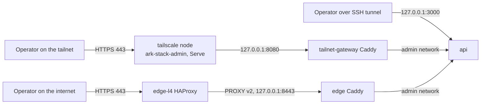

# Admin access modes

This page explains the three ways the admin UI and API are reached: the local bootstrap listener on the host, tailnet-only administration through the admin Tailscale node, and public administration through the edge. It covers how each path is built, what the `adminMode` setting controls, the requirements for switching modes, what a switch does, and how to change it safely.

## Overview

The API is the only process that serves the admin UI. It never listens publicly. Three paths reach it:

| Path                     | Reached at                                    | Transport and TLS                                                                     | Always on?                                                       |
| ------------------------ | --------------------------------------------- | ------------------------------------------------------------------------------------- | ---------------------------------------------------------------- |
| Local bootstrap listener | `http://127.0.0.1:3000` on the host           | Plain HTTP on loopback; reach it with an SSH tunnel                                   | yes                                                              |
| Tailnet administration   | `https://<admin node MagicDNS name>`          | Tailscale Serve (HTTPS) → `tailnet-gateway` Caddy → `api:3000`                        | when the `tailnet` Compose profile is running                    |
| Public administration    | `https://admin.<domain>` (the admin hostname) | HAProxy SNI router on 443 → edge Caddy (Ark's Let's Encrypt certificate) → `api:3000` | only while `adminMode` is `public` and the certificate is issued |



Every path ends at the same API with the same checks: Better Auth with mandatory MFA, sessions bound to their origin, owner-only exposure changes and single-use step-up grants ([Accounts, MFA and access](accounts-and-access.md)). Tailscale identity alone never signs anyone in. The mode only decides whether the public edge publishes the admin site. Database and mail exposure are separate settings and are never inherited from it.

## The `adminMode` setting

`platform_settings.admin_mode` is `public` or `tailnet`.

- The domain wizard sets it from **Administration exposure** (**Public HTTPS** or **Tailnet only**). In public mode the wizard also records the admin hostname (default `admin.<base domain>`), creates an `admin` endpoint and adds its A record (and AAAA once IPv6 is eligible) to the DNS plan. In tailnet mode it records no admin hostname and creates no admin endpoint.
- Every `edge.apply` renders the public Caddyfile from the current mode. In `tailnet` mode the admin site is left out of Caddy, and so out of HAProxy's 443 hostname map.
- **Settings → Administration mode** changes it later through a durable operation ([Switching modes](#switching-modes)).

The tailnet gateway's configuration does not depend on the mode. Whenever the `tailnet` profile is running and its host is registered with the API, the tailnet path serves, in either mode.

## Local bootstrap listener

The `api` service publishes `127.0.0.1:3000:3000` and nothing else (`infra/platform/docker-compose.yml`). That is the bootstrap and host-recovery path: the installer prints `Setup URL: http://localhost:3000` and the setup token.

From a remote machine, forward the port over SSH (Tailscale SSH works once the host is hardened):

```sh
ssh -L 3000:127.0.0.1:3000 <user>@<vps>
# then open http://localhost:3000 in a local browser
```

Points to know:

- **The host must be registered.** The API answers session-bearing requests only for the hosts of `BETTER_AUTH_URL` and `BETTER_AUTH_TRUSTED_ORIGINS`, and gives `421` for anything else. A fresh install uses `BETTER_AUTH_URL=http://localhost:3000` and trusts `http://localhost:5173` and `http://localhost:3000`. Keep `http://localhost:3000` in `BETTER_AUTH_TRUSTED_ORIGINS` when switching to an HTTPS admin origin. To use `http://127.0.0.1:3000` in the browser, add it explicitly to that list in `.env` and recreate the API service ([Edge Tailscale node](../operating.md#edge-tailscale-node)).
- **No proxy in front.** Requests reach the API directly. Rate limits key on the transport peer, and no forwarded header is trusted.
- **The maintenance endpoint is local only.** Both gateways answer `404` for `/api/internal/*`, `/api/metrics/prometheus` and `/api/platform/maintain`. `POST /api/platform/maintain` is therefore reachable only here. It needs an owner, the `x-maintenance-token` header (`ARK_MAINTENANCE_TOKEN`) and a `platform.update` grant. The usual maintenance path is `mise run maintain` on the host ([Maintenance](../operating.md#maintenance)).
- **Recovery.** If both remote paths fail, the tunnel still works, as long as its origin stays registered.

## Tailnet administration

### Components

| Piece             | Definition                                                            | Role                                                                                                                                                                                                                               |
| ----------------- | --------------------------------------------------------------------- | ---------------------------------------------------------------------------------------------------------------------------------------------------------------------------------------------------------------------------------- |
| `tailscale`       | Compose service, profile `tailnet`, hostname `ark-stack-admin`        | The admin Tailscale node (`tag:ark-stack-admin`). Userspace networking, every capability dropped, state in the `ark_tailscale_state` volume. It joins with `TS_AUTHKEY` and loads Serve from `TS_SERVE_CONFIG=/config/serve.json`. |
| `serve.json`      | `tmp/edge/serve.json`, seeded from `infra/platform/serve.json`        | Tailscale Serve: HTTPS on TCP 443 for `${TS_CERT_DOMAIN}`, proxied to `http://127.0.0.1:8080`. Funnel is off.                                                                                                                      |
| `tailnet-gateway` | Compose service, profile `tailnet`, `network_mode: service:tailscale` | Official Caddy 2.11.9 with [`infra/platform/TailnetCaddyfile`](../../infra/platform/TailnetCaddyfile), listening on `127.0.0.1:8080` and `[::1]:8080` only, in the admin node's namespace.                                         |
| `api`             | on the `admin` network                                                | Reached by the gateway as `api:3000`.                                                                                                                                                                                              |

The admin node is separate from the edge node (`edge-ts`, `tag:ark-edge`) and the backup node (`backup-ts`, `tag:ark-backup`): its own key, state and tag. Ark holds no Tailscale API key or OAuth client.

### What the gateway does

[`infra/platform/TailnetCaddyfile`](../../infra/platform/TailnetCaddyfile) is short and fixed:

1. Caddy's admin API is off. Only `127.0.0.1` and `::1` (Tailscale Serve in the same namespace) are trusted proxies, with strict forwarding-chain parsing, so `{client_ip}` is the tailnet client that Serve saw.
2. Client-sent `X-Ark-*` headers are removed.
3. `/api/internal/*`, `/api/metrics/prometheus` and `/api/platform/maintain` get `404`.
4. The exact Better Auth paths for sign-in, sign-out, get-session, TOTP and backup-code verification, enrolment, disabling TOTP and generating backup codes are proxied with `X-Forwarded-Proto https`, `X-Forwarded-For {client_ip}` and `X-Ark-Edge-Token` (`ARK_EDGE_GATE_TOKEN`), so the API can rate-limit per tailnet client.
5. The browser API (`/api/auth/*`, `/api/setup/status`, `/api/state`, `/api/me`, `/api/wizard`, `/api/step-up`, and the domain, project, database, mail, service, SQL, secret, backup, update, import, alert, settings, front-door and metrics prefixes) is proxied without the token.
6. Any other `/api/*` path gets `404`. Everything else (the SPA and its assets) goes to `api:3000`.

`X-Forwarded-Host` is removed on every proxied request; the API takes the origin from `Host` and checks it against its registered hosts.

### Setting it up

1. **Policy.** In the tailnet policy file, declare `tag:ark-stack-admin` under `tagOwners`. The generated [ACL snippet](../operating.md#tailnet-policy-snippet) declares the four Ark tags but never grants access to any of them, so add your own grant from the administrators' devices to `tag:ark-stack-admin` on TCP 443.
2. **Key.** Create a pre-approved auth key tagged `tag:ark-stack-admin`, and put it in `.env` as `TS_AUTHKEY`.
3. **Start the profile:**

   ```sh
   docker compose --env-file .env -f infra/platform/docker-compose.yml --profile tailnet up -d tailscale tailnet-gateway
   ```

   Tailscale Serve terminates HTTPS with the tailnet's own certificate for the node's MagicDNS name, so HTTPS certificates must be enabled for the tailnet.

4. **Register the origin.** Add `https://<admin node MagicDNS name>` to the API's `BETTER_AUTH_TRUSTED_ORIGINS`, or make it `BETTER_AUTH_URL` (an HTTPS `BETTER_AUTH_URL` gives `__Host-` cookies), and recreate `api`. Until the host is registered, the API answers the tailnet path with `421`.
5. **Sign in** at that origin with your password and TOTP.

`ARK_EDGE_GATE_TOKEN` is generated by the installer and passed to `api`, `edge` and `tailnet-gateway`. Without it the gateway's auth requests share one rate-limit bucket ([Client addresses](accounts-and-access.md#client-addresses-and-rate-limits)).

### Funnel stays disabled

Tailscale Funnel would publish the admin node to the internet. Every `edge.apply` and mode change rewrites `serve.json` from `renderTailscaleServe` in [`shared/src/edge.ts`](../../shared/src/edge.ts), which always writes an empty `AllowFunnel`. `writeEdge` refuses to write a Serve configuration with Funnel enabled, and the `edge-apply` and `mode-change` evidence records `funnel: false`.

## Public administration

In public mode the edge serves the admin hostname like any other Ark site:

1. HAProxy (`edge-l4`) owns public 443 in the `edge-ts` namespace. It routes the admin hostname by SNI to Caddy's loopback listener `127.0.0.1:8443` with PROXY v2. An unknown SNI is refused.
2. Caddy terminates TLS with the admin hostname's Let's Encrypt certificate, issued by Ark through lego. `strict_sni_host` is on, so an SNI and `Host` mismatch gets `421`.
3. The admin site applies the same allowlist as the tailnet gateway: `X-Ark-*` stripped, internal and maintenance paths `404`, the exact auth paths sent with `X-Ark-Edge-Token`, the browser API forwarded, other `/api/*` paths `404`. Caddy also pins `Host` to the admin hostname and sets `X-Forwarded-Proto https`. The client address comes from the PROXY v2 header.

The site is rendered only while `adminMode` is `public` and the admin hostname's current certificate is `issued`. Staging certificates (`ARK_ACME_STAGING=1`, the default) are recorded as untrusted and never served. Set `ARK_ACME_EMAIL` and `ARK_ACME_STAGING=0`, then reissue ([Public certificates](../operating.md#public-certificates), [Certificates](certificates.md)). Until then, the `edge-apply` operation lists the admin hostname under `awaitingCertificate`.

Set `BETTER_AUTH_URL=https://<admin hostname>` for the public origin, so cookies become `__Host-` cookies and the browser's `Origin` matches.

## Switching modes

### Requirements

**Settings → Administration mode** has two buttons, **Public HTTPS** and **Tailnet only**. Each calls `POST /api/settings/mode` with `{ "adminMode": "public" }` or `{ "adminMode": "tailnet" }`. The API checks the request; the domain worker checks the destination when it runs the `admin.mode_change` operation.

| Requirement                                                                                                                                                         | Checked by    | Refusal                                                                                                                  |
| ------------------------------------------------------------------------------------------------------------------------------------------------------------------- | ------------- | ------------------------------------------------------------------------------------------------------------------------ |
| Owner, MFA-assured session                                                                                                                                          | API           | `403`                                                                                                                    |
| An `exposure.public` grant bound to `{ adminMode }`                                                                                                                 | API           | `403` "Verify your password and MFA for exposure.public before continuing."                                              |
| A destination origin: `https://<admin hostname>` for public, `ARK_TAILNET_AUTH_ORIGIN` for tailnet                                                                  | domain worker | "The destination administration origin is not configured."                                                               |
| Public only: the admin hostname's certificate is `issued`                                                                                                           | domain worker | "The admin certificate for `<hostname>` is not issued yet."                                                              |
| The destination uses the same scheme as `BETTER_AUTH_URL`, is one of its admin hosts (`BETTER_AUTH_URL` or `BETTER_AUTH_TRUSTED_ORIGINS`) and is not the login host | domain worker | "Better Auth's admin hosts do not include `<origin>`; restart with BETTER_AUTH_URL=`<origin>` before switching ingress." |

> [!WARNING]
> The destination checks run in the **domain worker**, against that process's own `BETTER_AUTH_URL`, `BETTER_AUTH_TRUSTED_ORIGINS` and `ARK_TAILNET_AUTH_ORIGIN`. The shipped `infra/platform/docker-compose.yml` passes none of them to `domain-worker`, so they fall back to development defaults and a production mode change is refused. Give `domain-worker` the same `BETTER_AUTH_URL` and `BETTER_AUTH_TRUSTED_ORIGINS` as `api`, plus `ARK_TAILNET_AUTH_ORIGIN` for a switch to tailnet, before switching.

> [!IMPORTANT]
> The admin hostname is recorded only by the wizard, and only when public mode was chosen there. An install whose wizard chose **Tailnet only** has no admin hostname or admin endpoint, so a later switch to public is refused ("destination administration origin is not configured"). An install that started public can switch to tailnet and back.

### What a mode change does

The API audits `settings.mode` and queues `admin.mode_change` (targets `platform`). The domain worker then, under the edge lock:

1. Builds the edge plan for the destination mode and runs the checks above. A failed check fails the operation before anything is written, so routing, settings and sessions stay as they were.
2. Rewrites the edge files in `tmp/edge`: the `Caddyfile`, the closed variant the launch guard falls back to, and `serve.json` (Funnel disabled). It loads the new Caddyfile through Caddy's admin API, draining HAProxy sessions of any HTTP route the new configuration withdraws, and only then renames the files into place.
3. Stores the new `admin_mode` and the destination as `auth_origin` in `platform_settings`.
4. Queues `edge.l4_apply`, so HAProxy's 443 hostname map matches: in tailnet mode the admin hostname leaves the map.
5. Deletes **every** session row. All administrators and gate users must sign in again, and route sessions cascade (and are drained) with their parent sessions.
6. Records a `mode-change` step with `adminMode`, `sessionsRevoked: true` and the edge write result.

A mode change does not touch `.env`, `BETTER_AUTH_URL`, the tailnet profile or DNS. Switching to tailnet leaves the admin hostname's DNS records and certificate in place; the edge simply has no site for it any more. Your own session ends with everyone else's.

### Changing it safely

1. **Keep a fallback.** Open an SSH tunnel to `127.0.0.1:3000` and check you can sign in there. That origin must stay in `BETTER_AUTH_TRUSTED_ORIGINS`.
2. **Prove the destination first.**
   - To go **tailnet**: start the `tailnet` profile, register its origin, and sign in at `https://<admin node MagicDNS name>`. That path works in public mode already, so you can test it before switching.
   - To go **public**: check that the admin endpoint is ready and its certificate issued (**Domains & Endpoints**, and the latest `edge.apply` step has no `awaitingCertificate` entry for it). Keep the tunnel available while the first public certificate is provisioned.
3. **Prepare the domain worker** with the auth origins and `ARK_TAILNET_AUTH_ORIGIN` ([warning above](#requirements)).
4. **Mint the grant.** In **Settings → Sensitive-action verification**, choose **Change public exposure**, enter `{"adminMode":"tailnet"}` (or `"public"`) and your password.
5. **Switch.** Within 10 minutes press **Tailnet only** (or **Public HTTPS**). You are signed out when the operation succeeds; sign in again on the destination origin.
6. **Verify.**
   - On **Activity**, `admin.mode_change` is `succeeded` with a `mode-change` step. A failed operation shows its reason, and nothing changed.
   - For tailnet mode, check from a machine outside the tailnet that `https://<admin hostname>` no longer serves the admin UI. No automated harness proves this yet ([security review, B9](../security-review.md#b9-operator--admin-ui)).

> [!NOTE]
> A failed private path must never republish the dashboard by itself. Nothing in Ark switches the mode automatically; only an owner's step-up-bound request does.

## Comparison

|                                | Local listener                  | Tailnet                                                     | Public                                       |
| ------------------------------ | ------------------------------- | ----------------------------------------------------------- | -------------------------------------------- |
| Who can reach it               | anyone with a shell on the host | tailnet devices your policy grants to `tag:ark-stack-admin` | anyone on the internet                       |
| TLS                            | none (loopback, SSH tunnel)     | Tailscale Serve certificate                                 | Ark's Let's Encrypt certificate              |
| Proxy path allowlist           | no                              | yes (`TailnetCaddyfile`)                                    | yes (rendered admin site)                    |
| Client address for rate limits | transport peer                  | Serve's client address, with the edge token                 | PROXY v2 client address, with the edge token |
| Depends on `adminMode`         | no                              | no                                                          | yes                                          |
| Signed maintenance API         | yes                             | `404`                                                       | `404`                                        |

The trust boundary for operators is B9 in the [security review](../security-review.md#b9-operator--admin-ui); the wider picture is in the [security model](../security/security-model.md).
