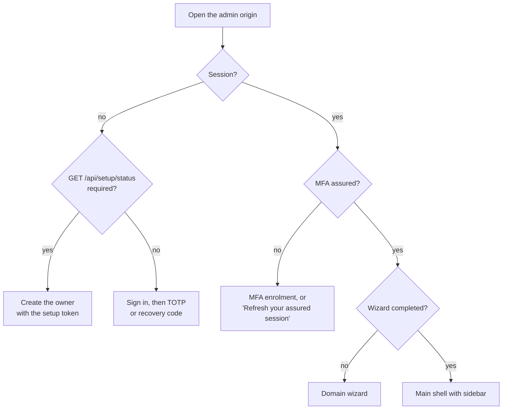

# Admin UI tour

This page walks through the administration UI screen by screen: the sign-in, MFA and wizard screens that come first, then every item in the sidebar in the order the UI shows it. For each view it lists what is shown, the actions available, who may use them, which actions need an MFA step-up, and the API endpoints behind them.

## How the UI is served

The UI is a React single-page application in `web/` ([`web/src/App.tsx`](../../web/src/App.tsx) and the views in `web/src/pages`). The production build is served by the API itself, so the UI and the API share one origin. Which origins that is (the local bootstrap listener, the tailnet gateway or the public edge) is described in [Admin access modes](admin-access-modes.md).

Every request goes to the API with the session cookie (`credentials: "include"`) and `content-type: application/json`. The API refuses a mutation unless its `Origin` header is the configured admin origin or one of the trusted origins, and unless the body is JSON (`415` otherwise). See [Accounts, MFA and access](accounts-and-access.md) for the full request checks.

### Screens before the main shell

The app decides what to render from the Better Auth session and from `GET /api/state`:

1. **Create the owner / Sign in.** While setup is open the screen is titled **Create the owner** and asks for **Name**, **Email**, **Password** (at least 12 characters) and **Setup token**. It posts to `POST /api/auth/sign-up/email` with the token in the `x-setup-token` header. Afterwards the same screen is **Sign in** (email and password through Better Auth). If the account has TOTP, a **Verify your sign-in** screen asks for a **Verification code**, with **Use a recovery code** for a backup code.
2. **MFA enrolment.** A signed-in user whose session is not MFA-assured sees **Secure the owner account**. **Confirm your password** and **Create TOTP enrollment** return the manual TOTP secret and the recovery codes, which exist only in that page's memory. **Six-digit verification code** and **Verify TOTP** finish enrolment. The user must tick **I saved the recovery codes outside this browser** before **Continue to domain setup**. If TOTP is already enrolled but the current session was created before enrolment, the screen is **Refresh your assured session** with a single **Return to sign in** button.
3. **Domain wizard.** Until the wizard has run, an MFA-assured owner sees **Choose how this host is reached, then publish DNS.** The form has **Administration exposure** (**Public HTTPS** or **Tailnet only**), **Base domain**, **Public IPv4**, **Public IPv6 (optional)**, optional admin, database and mail hostnames, **DNS provider** (**Manual / other** or **Cloudflare (publish after review)**), and **First services**: **Public database endpoint**, **Incoming mail**, **First database name** and **First mailbox local part**. **Generate DNS plan and continue** posts to `POST /api/wizard`. Only an owner with MFA can run it, and only once; later changes go through **Settings**. The [first-run guide](../getting-started/first-run.md) covers what the wizard creates.

### The main shell

The sidebar lists the views below. The current view is kept in the URL hash (`#/overview`, `#/domains`, `#/front-routes` and so on), so a view can be bookmarked or reloaded. The bottom of the sidebar shows the signed-in user's name and email and a **Sign out** button, which ends the Better Auth session and reloads the page.

| Sidebar item        | Hash             | Shown to                               |
| ------------------- | ---------------- | -------------------------------------- |
| Overview            | `#/overview`     | every role                             |
| Domains & Endpoints | `#/domains`      | every role                             |
| Projects            | `#/projects`     | every role                             |
| Databases           | `#/databases`    | every role                             |
| Email               | `#/email`        | every role                             |
| Services            | `#/services`     | every role                             |
| Activity            | `#/activity`     | every role                             |
| Backups             | `#/backups`      | every role (target management: owners) |
| Updates             | `#/updates`      | every role                             |
| Front door routes   | `#/front-routes` | every role (changes: owners)           |
| Front door ACL      | `#/front-acl`    | owners only                            |
| Gate users          | `#/gate-users`   | owners only                            |
| Settings            | `#/settings`     | every role (most changes: owners)      |

A view being visible does not mean its actions are allowed. The API enforces every rule; the UI hides some controls for convenience and otherwise shows the API's refusal. Roles are explained in [Accounts, MFA and access](accounts-and-access.md#roles-and-permissions).

**Data loading.** The shell loads `GET /api/state` once after sign-in and again after each action. That one response carries the user and role, setup flags, settings, domains and records, endpoints, certificates, clusters, databases with role metadata, mailboxes, aliases, devices, projects, services, the latest 50 operations and 200 operation steps, backups, alerts, audit entries and update candidates, all filtered to what the caller may see. While any operation is `queued` or `running`, the shell polls `GET /api/state` every 2 seconds. The **Refresh** button in the top bar reloads it on demand.

**Errors.** Buttons that fire an action without a form report a failure in a red banner at the top of the workspace, with a **Dismiss** link. Forms show their error inline under the fields. A step-up refusal reads `Verify your password and MFA for <action> before continuing.`

## Step-up in the UI

Privileged actions need a single-use step-up grant: your password, re-verified in an MFA-assured session, bound to the action and to the exact request. Grants last 10 minutes and are consumed by the one request they were minted for. The mechanism is described in [Accounts, MFA and access](accounts-and-access.md#step-up-grants).

The UI collects the password in two ways.

- **Inline.** Some forms have their own password field and mint the grant just before the request: **Region**, **Public database port limits**, the pooler-wide policy, DNS **Enable IPv6 DNS**, every front-door route form, **Gate users**, the off-VPS backup target forms and the Vercel rollover panel.
- **Settings → Sensitive-action verification.** Other buttons send the request straight away and fail with `403` until a matching grant exists. Mint it first in **Settings → Sensitive-action verification**: pick the **Action**, enter the **Request binding JSON** and your **Current password**, then press the button within 10 minutes. Key order in the JSON does not matter. IDs come from `GET /api/state`.

| Button                                        | Action              | Request binding JSON                                        |
| --------------------------------------------- | ------------------- | ----------------------------------------------------------- |
| Databases: **Reveal runtime once**            | `secret.reveal`     | `{"databaseId":"<id>","kind":"runtime"}`                    |
| Databases: **Rotate runtime**                 | `credential.rotate` | `{"databaseId":"<id>","kind":"runtime"}`                    |
| Databases: **Schema**                         | `secret.reveal`     | `{"databaseId":"<id>","kind":"schema"}`                     |
| Databases: **SQL workspace** Save             | `secret.reveal`     | `{"databaseId":"<id>","kind":"sql.query"}`                  |
| Email: mailbox **View once**                  | `secret.reveal`     | `{"mailboxId":"<id>"}`                                      |
| Email: device **Reveal once**                 | `secret.reveal`     | `{"deviceId":"<id>"}`                                       |
| Email: alias **Delete**                       | `resource.delete`   | `{"aliasId":"<id>"}`                                        |
| Backups: **Isolated restore test**            | `restore.overwrite` | `{"kind":"<kind>","targetId":"<target>","backupId":"<id>"}` |
| Backups: **Mark restore verified**            | `restore.overwrite` | `{"backupId":"<id>","verify":true}`                         |
| Updates: **Apply digest**                     | `platform.update`   | `{"serviceId":"<id>","digest":"<digest>"}`                  |
| Settings: **Public HTTPS** / **Tailnet only** | `exposure.public`   | `{"adminMode":"public"}` or `{"adminMode":"tailnet"}`       |

> [!NOTE]
> A grant is bound to the session that minted it. Signing out, or any event that revokes sessions (such as a mode change), makes unused grants useless.

## Overview

The landing view. A **Host posture** card shows the base domain (or "Awaiting domain wizard") and the current admin mode. Four counters show domains, databases, mailboxes and services. **Latest operations** lists the eight most recent operations with their status and error. **Alerts** lists firing and resolved alerts; alerts are returned only to owners and operators.

| Action         | Who                  | Step-up | Endpoint                                             |
| -------------- | -------------------- | ------- | ---------------------------------------------------- |
| **Ack**        | operator, owner; MFA | no      | `POST /api/alerts/:id/ack`                           |
| **Silence 1h** | operator, owner; MFA | no      | `POST /api/alerts/:id/silence` with `{"minutes":60}` |

See [Monitoring](monitoring.md) for the alerts themselves.

## Domains & Endpoints

One card per visible domain shows its status and its desired DNS records: type, relative name, status, purpose and the expected value. An **Endpoints** card lists every endpoint (admin, database, mail, gate, route) with hostname, kind, exposure and status.

Operators and owners get **Review DNS** on each domain, which opens the DNS review panel in place of the record list (`GET /api/domains/:id/dns`). For a manual provider, opening it calls `POST /api/domains/:id/dns/watch` and the panel re-reads the review every two minutes while the watch lasts. The panel offers:

| Control                                                                              | Who                  | Step-up                              | Endpoint                                                                          |
| ------------------------------------------------------------------------------------ | -------------------- | ------------------------------------ | --------------------------------------------------------------------------------- |
| **Publish reviewed DNS** (Cloudflare diff)                                           | operator, owner; MFA | no (bound to the reviewed plan hash) | `POST /api/domains/:id/publish`, then `GET /api/domains/:id/publish/:operationId` |
| **Recheck DNS**                                                                      | operator, owner; MFA | no                                   | `POST /api/domains/:id/verify`                                                    |
| **Reload review**                                                                    | operator, owner      | no                                   | `GET /api/domains/:id/dns`                                                        |
| **Allow Ark to withdraw its AAAA records in this review if IPv6 becomes ineligible** | owner; MFA           | no                                   | sent with the publish request                                                     |
| **Revoke automatic withdrawal**                                                      | owner; MFA           | no                                   | `DELETE /api/domains/:id/aaaa/authorization`                                      |
| **Enable IPv6 DNS** → **Confirm IPv6 publishing**                                    | owner; MFA           | `exposure.public`, inline password   | `PUT /api/domains/:id/aaaa` with `{"enabled":true}`                               |
| **Disable IPv6 DNS**                                                                 | owner; MFA           | no (tightening)                      | `PUT /api/domains/:id/aaaa` with `{"enabled":false}`                              |

The review, the Cloudflare diff and AAAA gating are covered in [Domains and DNS](domains-and-dns.md).

## Projects

A form with **Name** and **Slug** creates a project (`POST /api/projects`, operator or owner with MFA). The list below shows each visible project's name and slug. Projects and their scoping are described in [Services and workloads](services.md#projects).

## Databases

The view has four parts.

- **Create a database.** **Name**, **Exposure** (**Public TLS** or **Private only**), **Requested source CIDRs (pooler-wide policy applies)** and **pgvector**. It posts to `POST /api/databases` (operator or owner with MFA). The help text stresses that per-database CIDRs are only a request: public 5432 enforces one pooler-wide policy.
- **Database list.** Each row shows the name, its generated role kinds, the requested CIDRs, the status and the exposure, with these actions:

  | Action                  | Who                  | Step-up                              | Endpoint                                                                   |
  | ----------------------- | -------------------- | ------------------------------------ | -------------------------------------------------------------------------- |
  | **Vercel rollover**     | owner                | `credential.rotate`, inline password | opens the Vercel panel (below)                                             |
  | **Reveal runtime once** | operator, owner; MFA | `secret.reveal`                      | `POST /api/databases/:id/credential`                                       |
  | **Rotate runtime**      | operator, owner; MFA | `credential.rotate`                  | `POST /api/databases/:id/rotate` with `{"kind":"runtime"}`                 |
  | **Schema**              | operator, owner; MFA | `secret.reveal`                      | `POST /api/databases/:id/schema`, then `GET /api/sql/results/:operationId` |

  Every reveal, schema inspection and SQL query consumes its own grant, so mint a new one each time. The revealed connection string appears once in a card marked "Copy now. This response is no-store and one-time." Schema output appears in its own card.

- **Public database port (5432).** The pooler-wide source policy panel. It shows the boundary message, the requests from each database and their conflicts. An owner can edit the CIDR list or tick **Allow the internet**, enter **Current password** and press **Review and save pooler-wide policy** (`PUT /api/databases/pooler-policy`, `exposure.public` bound to the request). See [Public database access](public-database-access.md).
- **SQL workspace.** **Database**, **Role** (`readonly`, `runtime` or `migration`), **Read-only transaction** (ticked by default) and **SQL**. Saving posts `POST /api/sql/query` and polls `GET /api/sql/results/:operationId` for up to 30 seconds. Results show the role and database, a fingerprint, the byte count and whether the server truncated them. See [SQL workspace](sql-workspace.md).

The **Vercel rollover** panel (owners) lists the database's clients (`GET /api/databases/:id/clients`) and, for the selected one, the optional Vercel integration status (`GET /api/databases/:id/clients/:clientId/vercel-integration`). Connecting takes **Vercel project ID**, **Vercel team ID**, **Other project ID in the same team**, an optional preview branch, **Project token**, **Deploy hook URL** and **Your Ark password** (`PUT …/vercel-integration`). Once connected, **Test connection** (`POST …/vercel-integration/test`) and **Disconnect** (`DELETE …/vercel-integration`) each need the password again. All three use a `credential.rotate` grant. The integration is explained in [the Vercel guide](../guides/vercel-database.md#8-vercel-integration-fd-29-disabled-until-live-proof).

> [!NOTE]
> Issuing, revealing, revoking and rolling over database client certificates have no screen. They are API calls; [the Vercel guide](../guides/vercel-database.md#1-before-you-start) gives a browser-console helper for them.

## Email

All forms on this view act on the first visible domain and its first mailbox. With mail disabled (`ARK_MAIL_ENABLED=0`), the mail endpoints refuse.

- **Status cards**, one per mail domain: inbound, outbound and client status, and whether SES credentials and a Stalwart URL are configured.
- **Reconcile Stalwart** (`POST /api/mail/reconcile`) and **Reconcile SES** (`POST /api/ses/reconcile`): operator or owner with MFA.
- **Add mailbox**: **Local part**, **Display name**, **Quota GB** (`POST /api/mailboxes`).
- **Mailbox list** with the lifecycle badge, **View once** for a pending one-time password (`POST /api/mailboxes/:id/credential`, `secret.reveal`) and **Suspend** or **Resume** (`POST /api/mailboxes/:id/lifecycle`). Only purging a mailbox needs a step-up (`resource.delete`), and the UI does not offer it.
- **Add alias**: **Local part** and comma-separated **Targets** (`POST /api/aliases`). Each active alias has **Delete** (`DELETE /api/aliases/:id`, `resource.delete`).
- **Device credential**: **Mailbox** and **Device label** create a native Stalwart app password (`POST /api/mailboxes/:id/devices`). Each device row has **Reveal once** (`POST /api/devices/:id/credential`, `secret.reveal`) and **Revoke** (`POST /api/devices/:id/revoke`).
- **Refresh mail queue** reads `GET /api/mail/queue` (operator or owner) and prints state, recipient and age.

See [Mail](mail.md) for the mail model.

## Services

- **Register a service.** **Service name**, **This workload owns persistent application data** and **Approved Compose subset**, prefilled with a digest-pinned sample. It registers into the first visible project (`POST /api/services`, operator or owner with MFA). The API validates and canonicalises the Compose document before queuing it.
- **Service list.** Each row shows status, stateful or stateless and the last observation time, with **Restart** and **Stop** (`POST /api/services/:id/restart`, `POST /api/services/:id/stop`), and **Logs** and **Stats** (`POST /api/services/:id/observe`, then `GET /api/services/:id/observations/:operationId`). Output appears in a panel below the list.
- **Discover unmanaged containers** (owners with MFA) queues a host inventory (`POST /api/services/discover`) and polls `GET /api/services/discovery/:operationId`.

See [Services and workloads](services.md).

## Activity

A card per recent operation shows its kind, status, error or creation time, and its recorded steps. The **Audit** card lists the latest audit entries: action, resource type and time. Owners see every entry; other roles see only their own. The audit trail is described in [Accounts, MFA and access](accounts-and-access.md#audit-log).

## Backups

- **Off-VPS backups** (owners only) loads `GET /api/backups/targets`. It shows "Backups healthy" or "Backups unhealthy", each configured target with its append-only status and recovery points, and these actions:

  | Action                                                     | Step-up                              | Endpoint                                |
  | ---------------------------------------------------------- | ------------------------------------ | --------------------------------------- |
  | **Run append-only check**                                  | no                                   | `POST /api/backups/targets/:id/verify`  |
  | **Add an S3-compatible target** / edit, **Save target**    | `credential.rotate`, inline password | `PUT /api/backups/targets/s3`           |
  | **Add a home machine target** / edit, **Save home target** | `credential.rotate`, inline password | `PUT /api/backups/targets/tailnet_rest` |
  | **Observe the backup tailnet now**                         | no (owner with MFA)                  | `POST /api/backups/tailnet/observe`     |

- **Capture platform backup** queues a platform PostgreSQL backup (`POST /api/backups` with `{"kind":"platform-postgres","targetId":"platform"}`). The `platform` target is owner-only.
- **Backup rows** show the kind, the upload status ("On the VPS only…" for a local backup) and whether restore proof exists. **Isolated restore test** (`POST /api/backups/restore-test`) and, for an `integrity_ok` backup without proof, **Mark restore verified** after a confirmation (`POST /api/backups/:id/verify-restore`). Both need a `restore.overwrite` grant.

See [Backups](backups.md) and [the off-VPS backup guide](../guides/backups.md).

## Updates

**Resolve registry digests** (owners with MFA, `POST /api/updates/detect`) checks registries for new digests. The **Update policy** card lists each service with its current or candidate digest, its update policy and whether a candidate needs approval. **Apply digest** applies a candidate (`POST /api/updates/apply`, `platform.update` bound to `{ serviceId, digest }`). See [Maintenance and upgrades](../operations/maintenance-and-upgrades.md).

## Front door routes

Every role can see this view; only owners can change anything. It loads `GET /api/front/routes` and `GET /api/front/listeners`.

The **Routes** table shows each route's hostname, kind (HTTP route on 443, `tls` route by SNI, `tcp` route on a dedicated port, `postgres` route on 5432), listen port and any compatibility port, TLS or access mode, badges for client certificates and rate limits, who it admits (a CIDR count, "internet (confirmed)" or "nobody (empty list)"), enabled state, lifecycle status and last error.

| Control                                                                        | Who             | Step-up                                                                      | Endpoint                                                               |
| ------------------------------------------------------------------------------ | --------------- | ---------------------------------------------------------------------------- | ---------------------------------------------------------------------- |
| **Enable…** (only when `ready`) → password → **Enable**                        | owner; MFA      | `exposure.public` bound to `{ routeId }`                                     | `POST /api/front/routes/:id/enable`                                    |
| **Disable**                                                                    | owner; MFA      | no (tightening)                                                              | `POST /api/front/routes/:id/disable`                                   |
| **Controls** (HTTP routes): rate limit, client certificates, **Save controls** | owner; MFA      | `exposure.public`, asked for only when the API says the change widens access | `PATCH /api/front/routes/:id`                                          |
| **Certificates**: list, **Issue certificate**                                  | owner; MFA      | `credential.rotate`, inline password                                         | `GET` and `POST /api/front/routes/:id/client-certificates`             |
| **Certificates**: revoke                                                       | owner; MFA      | no (tightening)                                                              | `POST /api/front/routes/:id/client-certificates/:certificateId/revoke` |
| **DNS**                                                                        | operator, owner | as for the domain DNS review                                                 | `GET /api/front/routes/:id/dns`                                        |
| **Create a TLS, TCP or postgres route**                                        | owner; MFA      | `exposure.public` bound to the exact body, inline password                   | `POST /api/front/routes`                                               |

The **Controls** form sends only what changed, with the route's `version`. A tightening change saves at once. A loosening one (removing or raising a limit, switching mTLS off) is answered with `exposure_step_up_required`, and the form then shows **Verify your password to widen access**. A concurrent edit gives `409`. Switching mTLS on asks for confirmation, because open connections without a certificate are closed.

Below the table are the **Listeners** card (443, the enabled shared SNI ports, the raw range 20000–20049, 5432), **Postgres routes** guidance, the **Which protocols can be routed by name?** table and a **TLS modes** reference.

> [!NOTE]
> The creation form offers `tls`, `tcp` and `postgres` routes only. HTTP routes, SSO access lists (`PUT /api/front/routes/:id/access`) and route deletion (`DELETE /api/front/routes/:id`) are API calls; see [the front-door guide](../guides/front-door.md#31-create-a-route).

## Front door ACL

Owners only. The **Tailscale policy snippet** card has a **Scope** selector (all routes and backup targets, or one route), **Copy snippet** and **Regenerate**. It loads `GET /api/front/acl` or `GET /api/front/routes/:id/acl`. It shows the generation time and digest, a **Not granted** list for targets that could not be granted, and the snippet itself. Further cards explain **Tailnet Lock**, give an **SSH policy example** for `tag:ark-vps` with **Copy SSH example**, and list **Changes since the last generated snippet**. Ark never writes the tailnet policy; see [Tailnet policy snippet](../operating.md#tailnet-policy-snippet).

## Gate users

Owners only. Gate users are the people allowed through "Ark login" (SSO) routes; they have no access to Ark itself ([Accounts, MFA and access](accounts-and-access.md#gate-users-and-the-login-origin)).

- **Your password (confirms each change)** is entered once at the top and used for every step-up on the page.
- **Add a gate user**: **Email** and **Name (optional)**, then **Create**. The UI mints a `role.grant` grant bound to `{ ...body, gateUsers: "create" }`, calls `POST /api/gate/users`, then immediately reveals the temporary password (`secret.reveal`, `POST /api/gate/users/:id/temporary-password`). The password is shown once with a copy button and **Done, hide it**.
- **User list** (`GET /api/gate/users`): email and name, "authenticator set up" or "authenticator pending", "temporary password not shown yet", the number of live sessions, creation time and the routes the user can reach. **Reveal temporary password** appears while the password is unrevealed. **Delete** asks for confirmation, then uses a `role.grant` grant bound to `{ gateUsers: "delete", userId }` and `DELETE /api/gate/users/:id`. Deletion removes the user's sessions and route access and drains open connections on their routes.

## Settings

Every role sees this view; the API accepts most changes only from owners.

| Card                              | What it does                                                                                                                                | Who                      | Step-up                                                                     | Endpoint                       |
| --------------------------------- | ------------------------------------------------------------------------------------------------------------------------------------------- | ------------------------ | --------------------------------------------------------------------------- | ------------------------------ |
| **Sensitive-action verification** | Mints a grant for any action from **Action**, **Request binding JSON** and **Current password** ([Step-up in the UI](#step-up-in-the-ui))   | operator, owner; MFA     | is the step-up                                                              | `POST /api/step-up`            |
| **Platform settings**             | **Timezone**, **Default mailbox quota**, **Allow external alias forwarding**                                                                | owner; MFA               | no                                                                          | `PUT /api/settings`            |
| **Region**                        | Region preset and optional **VPS region label**; shows the suggested Vercel function region, `vercel.json` snippet and backup bucket region | owner; MFA (others read) | `platform.update`, inline password                                          | `PUT /api/settings/region`     |
| **Public database port limits**   | Per-source concurrent connections, new connections per second and burst on 5432                                                             | owner; MFA (others read) | `platform.update`, inline password                                          | `PUT /api/settings/db-ingress` |
| **Administrator MFA**             | Shows whether two-factor is enabled; no controls                                                                                            | every role               | n/a                                                                         | n/a                            |
| **Administration mode**           | **Public HTTPS** and **Tailnet only** queue a mode change                                                                                   | owner; MFA               | `exposure.public` bound to `{ adminMode }`, minted in the verification card | `POST /api/settings/mode`      |
| **Import inventory**              | **Source** (Orkmail, PgStack, Compose) and **Incoming domains**: a read-only compare                                                        | owner; MFA               | no                                                                          | `POST /api/import/scan`        |

The mode change and its prerequisites are covered in [Admin access modes](admin-access-modes.md). The region and port limits are covered in [Configuration](../getting-started/configuration.md) and [Public database access](public-database-access.md).

## Features with no screen

These are API-only today. Call them from the admin origin (the [console helper](../guides/vercel-database.md#1-before-you-start) works for all of them):

- the public login origin for SSO routes: `GET` and `PUT /api/settings/gate`;
- HTTP route creation, route edits other than the HTTP controls, route access lists and route deletion (`/api/front/routes…`);
- the front-door tailnet observation: `GET /api/front/tailnet` and `POST /api/front/tailnet/observe`;
- database client certificates: issue, reveal, revoke and rollover (`/api/databases/:id/clients…`);
- per-database CIDR requests after creation: `PUT /api/databases/:id/cidrs`;
- the IPv6 preflight: `GET` and `POST /api/settings/ipv6/preflight`;
- the generic one-time secret reveal: `POST /api/secrets/:id/reveal`;
- service adoption and start: `POST /api/services/adopt`, `POST /api/services/:id/start`.

The full endpoint list is in the [API reference](../reference/api.md).
