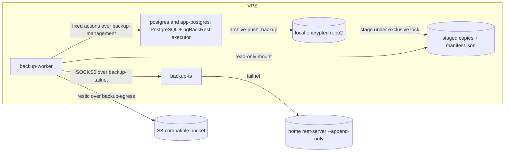

# Backups

This page explains the whole backup system: how both PostgreSQL clusters are backed up locally with pgBackRest, how the backup worker ships those backups, mail and reviewed volumes off the VPS with restic, how Ark records upload, integrity and restore proof as separate evidence, and how targets, the append-only canary, health and alerts fit together. The step-by-step setup of the S3-compatible bucket and the home machine is in [the off-VPS backups guide](../guides/backups.md).

## What is backed up

| Source                               | Mechanism                                                                    | Where it goes                                                        |
| ------------------------------------ | ---------------------------------------------------------------------------- | -------------------------------------------------------------------- |
| Control database (`postgres`)        | pgBackRest physical backups and WAL archiving into a local encrypted `repo2` | Staged copies of `repo2` as restic snapshots to every enabled target |
| Application cluster (`app-postgres`) | The same, in its own container and volumes                                   | The same                                                             |
| Mail (`mail`)                        | restic backup of a completed Stalwart snapshot directory                     | Every enabled target, directly                                       |
| Reviewed named volumes (`volume`)    | restic backup of one reviewed volume directory                               | Every enabled target, directly                                       |

There are two kinds of off-VPS target: S3-compatible buckets (`s3`) and a restic REST server on a machine you own, reached over the tailnet (`tailnet_rest`). Backups count as healthy only when at least one of each is enabled and every enabled target is healthy (see [Health](#health)).

> [!IMPORTANT]
> The design goal is that a compromised VPS cannot erase history. Nothing on the VPS ever runs `pgbackrest expire`, `stanza-delete` or `restic forget`; every off-VPS destination must prove it refuses deletes (the [append-only canary](#the-append-only-canary)); and pruning happens off-host.

## Components

| Component                    | Role                                                                                                                                                    |
| ---------------------------- | ------------------------------------------------------------------------------------------------------------------------------------------------------- |
| `postgres`, `app-postgres`   | Ark PostgreSQL images (Dockerfile targets `postgres-backup` and `app-postgres-backup`) with pgBackRest and the executor (`workers/src/pg-executor.ts`). |
| `backup-worker`              | The worker process (`workers/src/backup.ts`) that claims every `backup.*` operation, runs the schedules and runs restic.                                |
| `backup-ts`                  | A dedicated Tailscale node (`tag:ark-backup`, userspace, `--shields-up`) whose SOCKS5 proxy on `:1055` is the only route to the home target.            |
| API (`server/`)              | Target configuration, evidence records, health, alerts and metrics (`server/src/modules/offsite-backups.ts`, `server/src/modules/backups.ts`).          |
| `infra/restore/`             | A separate Compose project for isolated restores (see [Isolated restore target](#isolated-restore-target)).                                             |
| `scripts/offsite-restore.ts` | The off-VPS point-in-time recovery tool, run on a separate machine.                                                                                     |

## Enabling backup execution

Backups are planned but not executed until the operator turns execution on. All of these settings reach only `backup-worker` in the shipped Compose file.

| Setting                   | Default | Effect                                                                                                                                                                        |
| ------------------------- | ------- | ----------------------------------------------------------------------------------------------------------------------------------------------------------------------------- |
| `ARK_BACKUP_EXECUTE`      | `0`     | `1` lets pgBackRest and restic run, and starts the backup schedule. With `0`, a backup job records a `planned` row and then fails: a plan never satisfies a backup operation. |
| `ARK_BACKUP_REQUIRED`     | `0`     | With execution off, `1` makes backup and restore-test jobs fail with "Backup execution is required but ARK_BACKUP_EXECUTE is not enabled." The API still starts.              |
| `ARK_BACKUP_SCHEDULE`     | unset   | `0` stops the worker from starting the backup schedule and the `backup-ts` observation schedule; queued jobs still run.                                                       |
| `ARK_RESTORE_RUNNER`      | `0`     | `1` permits mail and volume restore tests to extract data (see [Restore tests](#restore-tests)).                                                                              |
| `ARK_MAIL_SNAPSHOT_READY` | unset   | Mail backups refuse to run unless this is `1`, set after a completed native Stalwart snapshot or quiesce step. A live RocksDB copy is not treated as a backup.                |

Set `ARK_BACKUP_EXECUTE=1` in `.env` and recreate the worker with `docker compose --env-file .env -f infra/platform/docker-compose.yml up -d backup-worker`. The installer leaves execution off.

The installer generates the per-cluster secrets the PostgreSQL containers need: `ARK_PLATFORM_PG_EXECUTOR_TOKEN`, `ARK_APP_PG_EXECUTOR_TOKEN`, `ARK_PLATFORM_PG_REPO_CIPHER_PASS` and `ARK_APP_PG_REPO_CIPHER_PASS`. Copy both cipher passes off-host: without them an off-VPS copy cannot be decrypted (see [Recovery material to keep off-host](../guides/backups.md#recovery-material-to-keep-off-host)).

## Local PostgreSQL backups

### Images and WAL archiving

Each cluster runs the pinned PostgreSQL image (`postgres:17.6` for the control database, `pgvector/pgvector:pg17` for the application cluster) plus pgBackRest 2.60 from PGDG. Debian's default `/etc/pgbackrest.conf` and its `repo1` are removed, so the only repository is `repo2`: a posix repository at `/var/lib/pgbackrest/repo2`, encrypted with `aes-256-cbc`, with automatic expiry off (`PGBACKREST_EXPIRE_AUTO=n`).

The entrypoint (`infra/backup/ark-postgres-entrypoint.sh`) turns archiving on only when the container has a repo2 cipher pass and an executor token (`ARK_PG_EXECUTOR_TOKEN`) of at least 24 characters. It then starts PostgreSQL with:

- `wal_level=replica` and `archive_mode=on`;
- `archive_command=flock -s -w 60 /var/lib/pgbackrest/ark-executor.lock pgbackrest --stanza=<stanza> archive-push %p`;
- `archive_timeout=60` (overridable with `ARK_PG_ARCHIVE_TIMEOUT`).

Without the secrets, archiving stays off, the entrypoint logs that backups are disabled, and backup health reports the cluster as not backed up. WAL is never accepted by an archive command that cannot store it.

The stanzas are `ark-platform` (service `postgres`) and `ark-app` (service `app-postgres`), defined in `shared/src/pg-backup.ts`. Each repository and its staging area are separate named volumes (`ark_platform_pgbackrest` and `ark_platform_pg_stages`; `ark_app_pgbackrest` and `ark_app_pg_stages`).

### The executor

The entrypoint supervises a small HTTP service, the executor, running as `postgres` inside the container next to PGDATA and the local socket. It listens on port 8432 on the internal `backup-management` network, which only `backup-worker` also joins (aliases `ark-platform-backup` and `ark-app-backup`). Every request needs `Authorization: Bearer <executor token>`, compared in constant time. The executor refuses to listen with a token shorter than 24 characters.

It answers only these actions (`POST /v1/<action>`):

| Action          | What it does                                                                                                                        |
| --------------- | ----------------------------------------------------------------------------------------------------------------------------------- |
| `status`        | `pgbackrest info`, `pg_stat_archiver`, repository size, free space of the repository and staging filesystems, and the newest stage. |
| `stanza-create` | Creates the stanza. The executor also does this itself at start-up, retrying until PostgreSQL is ready.                             |
| `check`         | `pgbackrest check`.                                                                                                                 |
| `backup`        | `pgbackrest --repo=2 --type=<full\|diff\|incr> --no-expire-auto backup`, under the shared lock; returns the new backup label.       |
| `stage`         | Produces (or reuses) a staged copy of `repo2`, optionally with a lease.                                                             |
| `release-stage` | Releases a stage lease.                                                                                                             |
| `prune-stages`  | Removes all but the newest `keep` stages (1–10), skipping leased ones.                                                              |

There is no generic command, no shell and no Docker socket. `assertExecutorArgv` refuses any pgBackRest argument vector containing `expire`, `stanza-delete` or `--expire-auto=y`, and `tests/security/backup-no-expire.test.ts` checks that no VPS-side source can run expire. `stanza-create`, `check`, `backup`, `stage` and `prune-stages` run one at a time; `status` is always answered.

### Schedules and backup types

When execution is on, the backup worker runs a schedule tick at start-up and then every five minutes (`PG_EXPORT_INTERVAL_MS`). Each tick:

1. queues a `backup.export` for every enabled target;
2. queues a `backup.verify_target` for any enabled target whose append-only evidence is missing or older than 6.5 days;
3. observes both executors (`status`), records the result in `backup_sources`, and queues a `backup.create` when one is due: a **full** backup when there is none or the last full is at least seven days old, otherwise a **differential** when the newest backup is at least a day old.

Queued or running operations are reused rather than duplicated, so a stopped worker does not pile them up. A completed PostgreSQL backup immediately queues a fresh export to every enabled target instead of waiting for the next tick.

### Staging and the last recoverable time

restic never reads the live repository. Live pgBackRest `*.info` files are rewritten in place, so they are never copied while they might change and never placed under an object lock. Instead the executor's `stage` action:

1. commits a small WAL marker, records the time and calls `pg_switch_wal()`;
2. waits (up to two minutes by default) until the switched segment is in `repo2`;
3. takes the executor lock **exclusively** and copies the completed repository with `cp --reflink=auto` (a clone where the filesystem supports it, a copy otherwise);
4. writes `manifest.json` next to the copy: stanza, stage ID, backup labels, archive range, WAL segment, repository size, pgBackRest version and `lastRecoverableAt`.

`archive-push` and `backup` hold the lock shared, so while a stage is copied `archive-push` waits; after 60 seconds it fails, and PostgreSQL keeps the segment in `pg_wal` and retries. WAL is fenced, never dropped.

`lastRecoverableAt` is the instant of the WAL switch, claimed only when a backup finished at least one second before it and the switched segment is inside the staged archive range; otherwise it is null. This is the recovery point Ark reports per target.

Stage IDs sort by creation time (for example `20261117T103244Z-ab12cd`). A scheduled export reuses a stage at most four minutes old, so targets exporting in the same interval upload the same copy; an export right after a backup stages afresh. Exports lease their stage for six hours and fifteen minutes and release it afterwards; pruning keeps the newest two stages and skips leased ones, so a stalled upload is never pulled from under restic.

### Local repository growth

`repo2` is never expired on the VPS, so it grows until an operator prunes it with a reviewed manual procedure, planned from a restored copy off-host. Each newer stage contains everything an older one does, which is why only two stages are kept. Watch the `backup-capacity:<source>` alert. The guide covers [local repository growth](../guides/backups.md#local-repository-growth) and [pruning from off-host only](../guides/backups.md#pruning-from-off-host-only).

## The backup worker

### Operations

The backup worker authenticates with `ARK_BACKUP_WORKER_TOKEN` and may claim only `backup.*`, `update.detect` and `import.*` operations. It runs separate bounded lanes so one kind of work cannot starve another:

| Lane                                   | Concurrency | Operation                                                                      |
| -------------------------------------- | ----------- | ------------------------------------------------------------------------------ |
| `backup.create`, `backup.restore_test` | 2           | Take a local PostgreSQL backup, or a mail/volume backup; run a restore test.   |
| `backup.export`                        | 4           | Stage and upload both PostgreSQL clusters to one target.                       |
| `backup.verify_target`                 | 2           | Run the append-only canary against one target.                                 |
| `backup.observe`                       | 1           | Read `backup-ts`'s own LocalAPI status and commit a backup tailnet generation. |
| `update.detect`, `import.*`            | default     | Unrelated read-only jobs that share this worker.                               |

The coordinator never runs two operations with overlapping target IDs at once, and the executors serialise stanza mutations. Each target has its own export operation, so one unreachable destination never delays another.

### Networks and mounts

| Network or mount                  | Purpose                                                                                                   |
| --------------------------------- | --------------------------------------------------------------------------------------------------------- |
| `control`                         | API and control database.                                                                                 |
| `backup-management` (internal)    | The two executors on port 8432, and nothing else.                                                         |
| `backup-egress`                   | Internet access to S3-compatible targets.                                                                 |
| `backup-tailnet` (internal)       | `backup-ts`'s SOCKS5 proxy only. The worker has no tailnet route of its own.                              |
| `ark_*_pg_stages`, read-only      | Staged copies at `/var/lib/ark/pg-stages/<stanza>`, read through the `postgres` group (`group_add: 999`). |
| `ark_backup_ts_socket`, read-only | `backup-ts`'s LocalAPI socket, mounted into this worker and nowhere else.                                 |

The worker never mounts the live `repo2` or PGDATA.

> [!NOTE]
> Mail backups read `/var/lib/stalwart-snapshot` and volume backups read `/var/lib/ark/volumes/<target>`. The shipped `infra/platform/docker-compose.yml` mounts neither path into `backup-worker`, so a mail or volume backup needs that source mounted there first.

### restic invocation

Every restic subprocess gets an environment built from scratch: `PATH`, `HOME`, the restic cache directory (`ARK_RESTIC_CACHE_DIR`, `/var/lib/ark/backups/restic-cache` in Compose; without it restic runs with `--no-cache`), and the target's own credentials and repository password. Proxy variables inherited by the worker are removed. Only a home target's subprocess receives exactly `HTTP_PROXY=socks5://backup-ts:1055` (`ARK_BACKUP_SOCKS5_PROXY`), so S3 uploads, executor calls and API calls never go through a proxy. `ARK_RESTIC_BIN` overrides the binary.

Each export first opens the repository with `restic cat config` and initialises it on first use (restic exit code 10). That probe is bounded (120 seconds by default, `ARK_RESTIC_PROBE_TIMEOUT_MS`), because restic would otherwise retry an unreachable backend for about 15 minutes. Uploads have a six-hour limit.

## Off-VPS export

Each target holds one restic repository: `<prefix>/restic` in the bucket for S3, or the URL path on the home server. A PostgreSQL export uploads the stage directory as a snapshot containing a relative `repo2/` tree and `manifest.json`, with:

- `--host ark` and the tags `ark`, `source=pg:<stanza>`, `stage=<stage id>` and `layout=relative-v1`;
- `--ignore-inode` and `--parent <previous snapshot>` (the last successful export of that source to the same repository), so restic reuses unchanged data across fenced copies.

Every export attempt, per target and source, is recorded in `backup_exports` with its status, stage ID, restic snapshot ID, backup labels, WAL segment, `lastRecoverableAt` and repository size, or the error. A success sets the target's `lastSuccessAt`; a failure sets `lastError`. Both sources are attempted even when one fails; the operation then fails (raising an `op-failed` alert) and the next tick retries. Local archiving continues and nothing is removed from `repo2` while a destination is down.

Mail and volume backups go to every enabled target in turn, tagged `ark` and `source=mail` or `source=volume:<target>`. The job fails if any target failed or none produced a snapshot.

### Home target transfers

A `tailnet_rest` target is pinned like a front-door route: saving it takes the StableNodeID and Tailscale address of exactly one peer from `backup-ts`'s current observation. `backup.observe` refreshes that observation every five minutes with a six-minute lease, using only `backup-ts`'s own LocalAPI (the edge node's view is never used). For each transfer (export, file backup, restore or canary):

- the pin is checked against the current backup generation first, and the transfer does not start if the observation has expired, the pinned node is absent or replaced, or the address changed;
- a local watchdog re-checks identity and freshness every second while the transfer runs, with a 1.5-second deadline per check, and stops restic (SIGTERM, then SIGKILL after two seconds) as soon as a check fails, so active transfers stop within five seconds;
- restic dials the pinned address, so a re-pointed MagicDNS name cannot redirect backups.

A stopped or refused transfer is a failed export with no recovery point and raises the critical `backup-tailnet:<target>` alert. The guide describes the mechanism in full under [home machine over the tailnet](../guides/backups.md#home-machine-over-the-tailnet-fd-30).

## Backup records and evidence

### Statuses

Every `backup.create` writes a row to `backups`. Its status moves only forward, through the state machine in `shared/src/backup-plan.ts`:

| Status             | Meaning                                                                                                                        |
| ------------------ | ------------------------------------------------------------------------------------------------------------------------------ |
| `queued`           | Column default.                                                                                                                |
| `planned`          | Execution was off; the row records the plan and the operation failed.                                                          |
| `local`            | A PostgreSQL backup exists in the VPS-local `repo2` but no off-VPS target has a stage containing it yet.                       |
| `uploaded`         | A stage containing the backup's label reached a target (PostgreSQL), or every target received the snapshot (mail and volumes). |
| `integrity_ok`     | An isolated restore test extracted the exact snapshot. This is integrity evidence only.                                        |
| `restore_verified` | An operator confirmed the restored copy booted and served its data.                                                            |
| `failed`           | Terminal; no further transition.                                                                                               |

The transitions are `upload` (to `uploaded`), `integrity` (only from `uploaded`) and `restore` (only from `integrity_ok`). Any other move is refused with "Upload, integrity, and restore are separate." The Backups page shows a `local` row as "On the VPS only; exported off-VPS with the next snapshot."

Off-VPS recovery points are tracked per target in `backup_exports`, not in `backups`: a backup row says that a backup exists and where it has got to, and the export records say which recovery time each destination can restore to.

### Restore tests

`POST /api/backups/restore-test` queues `backup.restore_test` for one exact backup row. It needs operator or owner access to the target, MFA and a single-use `restore.overwrite` step-up bound to `{ "kind": …, "targetId": …, "backupId": … }`. The grant is consumed only after the target and backup are confirmed to match, so a mistyped request does not burn it.

- **Mail and volumes.** The worker requires `ARK_BACKUP_EXECUTE=1` and `ARK_RESTORE_RUNNER=1`, finds the newest successful export of that exact restic snapshot in a target's _current_ repository revision, and runs `restic restore` with that target's sealed credentials into a fresh temporary directory. On success the row moves to `integrity_ok`, and the operation step records the restore directory and the reminder that boot and data assertions are still needed.
- **PostgreSQL.** The worker refuses: it has no live `repo2`, and database recovery uses `scripts/offsite-restore.ts` on a separate machine. With execution off it records the plan and fails. Either way no restore proof is recorded.

### Restore proof

`POST /api/backups/:id/verify-restore` records the human confirmation. The body must be exactly `{ "confirmation": "restored copy booted and served its data" }`, and the request needs target access, MFA and a `restore.overwrite` step-up bound to `{ "backupId": "<id>", "verify": true }`. It succeeds only from `integrity_ok`, sets `restore_verified` and `restoreVerified`, and is audited as `backup.restore_verified`.

Restore proof gates stateful workloads: `update.apply` for a stateful service fails with "Stateful updates require a restore-tested recovery point for this exact service" unless a backup row for that service ID is `restore_verified` (see [Services](services.md)).

## Backup targets

Targets are owner-only. They are configured under **Backups** or through `PUT /api/backups/targets/s3` and `PUT /api/backups/targets/tailnet_rest`. Saving needs MFA and a single-use `credential.rotate` step-up bound to `{ "backupTarget": "s3" | "tailnet_rest", ...body }`; the UI mints it from the **Current password** field before the PUT. Each save is audited as `backup.target_saved` and queues the append-only canary.

### S3-compatible targets

| Field                                | Rules                                                                                                                             |
| ------------------------------------ | --------------------------------------------------------------------------------------------------------------------------------- |
| `name`, `provider`                   | Provider is `aws`, `b2`, `r2`, `minio` or `other`.                                                                                |
| `endpoint`                           | `https://host[:port]` with no path, query or credentials; `http://` is accepted (intended only for a MinIO on a private network). |
| `region`                             | Lowercase letters, digits and dashes. The form suggests the region preset's hint, or `auto` for R2.                               |
| `bucket`, `prefix`, `pathStyle`      | S3 bucket naming rules; prefix of 1–4 segments, default `ark`; path style for MinIO, virtual-host style for the hosted providers. |
| `recoveryWindowDays`                 | 1–3650, default 30. Verified retention shorter than this makes the target unhealthy.                                              |
| `accessKeyId`, `secretAccessKey`     | Required when creating; on update omit both to keep them or send both to replace them.                                            |
| `repositoryPassword`                 | At least 24 characters, required when creating. It can never change; a different password for the same repository is refused.     |
| `verifierAccountId`, `verifierToken` | Optional read-only provider verifier (a Cloudflare API token for R2 lock rules). An empty token clears it.                        |

`GET /api/backups/targets` returns, per S3 target, a generated `writerPolicy` (IAM-style policy for the writer credential) and `bucketProtectionPolicy` (a bucket policy with unconditional denies under the prefix) to apply at AWS or MinIO, together with the provider recipes from `PROVIDER_RECIPES` in `shared/src/backup-targets.ts`. The recipes are in the guide under [provider recipes](../guides/backups.md#provider-recipes).

### Home target

| Field                | Rules                                                                                                                                                                                                 |
| -------------------- | ----------------------------------------------------------------------------------------------------------------------------------------------------------------------------------------------------- |
| `name`               | 1–80 characters.                                                                                                                                                                                      |
| `restUrl`            | `http://` only, a MagicDNS name ending in `.ts.net` or a Tailscale address, an explicit port, and a path of 1–4 segments whose first segment is the htpasswd user. No credentials, query or fragment. |
| `password`           | The htpasswd password, at least 8 characters. Required when creating, or when the URL's user changes.                                                                                                 |
| `repositoryPassword` | At least 24 characters, required when creating, never changeable.                                                                                                                                     |
| `recoveryWindowDays` | 1–3650, default 30.                                                                                                                                                                                   |

HTTPS is rejected because restic cannot yet dial a pinned address with hostname verification; traffic is encrypted by the tailnet. Saving fails unless `backup-ts` currently sees exactly one matching, untagged machine, so `backup-ts` must be logged in and the ACL grant in place first. `GET /api/backups/tailnet` shows what `backup-ts` sees and each target's identity; `POST /api/backups/tailnet/observe` (or **Observe the backup tailnet now**) refreshes it. Follow [setting up the home machine](../guides/backups.md#setting-up-the-home-machine) for the full sequence.

### Revisions and sealed credentials

- Every save creates a new **configuration revision** and resets the append-only verdict to `unverified`. A canary queued for an older revision cannot update a newer one.
- A change to where backups are written (S3: endpoint, bucket, prefix, path style, region, provider or recovery window; home: URL, pinned node or recovery window) also starts a new **repository revision** and clears the last success, attempt and error. Health and restores consider only exports in the current repository revision; old rows stay for audit.
- Credentials, verifier tokens and repository passwords are sealed in the secrets table with the root key and are never returned: the public target view carries only metadata, the pin and the evidence.

## The append-only canary

`backup.verify_target` runs with the **deployed** writer credentials when a target is saved, when an owner selects **Run append-only check** (`POST /api/backups/targets/:id/verify`), and from the schedule before the evidence expires.

- **S3** (`server/src/modules/backup-canary.ts`, using a small SigV4 client in `server/src/modules/s3-client.ts`). In each policy class (`data`, `index`, `snapshots`, `keys`, `config` and `ark-canary`) it writes a disposable object, records its hash, version and retention, then attempts ordinary delete, overwrite, permanent version deletion (plain and with governance bypass) and retention shortening (plain and with bypass), on canary objects only. Outcomes are judged by effect: the original version must still read back and its retention must not move earlier. Bucket-level permissions (versioning, object lock, lifecycle, bucket policy) are probed with well-formed but invalid bodies, so nothing is ever stored: `AccessDenied` proves the permission is absent. restic's `locks/` must allow create and delete. B2 key capabilities and R2 lock rules are read from the provider's own API.
- **Home** (`server/src/modules/rest-canary.ts`), through `backup-ts` to the pinned address under the same watchdog: overwrite and delete of a canary pack must be refused (403) and the pack must read back unchanged; deletes of never-existing names under `snapshots/`, `keys/` and `index/` must be refused with 403, not 404; a lock must be creatable and removable; unauthenticated requests must get 401; another user's path must be refused. It never writes or deletes `config`, keys, snapshots or index files.

| Verdict           | Label in the UI                                        | Counts as healthy                                                                                  |
| ----------------- | ------------------------------------------------------ | -------------------------------------------------------------------------------------------------- |
| `unverified`      | not verified yet                                       | No                                                                                                 |
| `append_only`     | append-only: yes                                       | Yes, while the evidence is under seven days old and, for S3, the verified retention has not passed |
| `deletable`       | deletable: a compromised server could erase backups    | No (critical alert)                                                                                |
| `unknown`         | unknown: a policy check is unsupported or unverifiable | No                                                                                                 |
| `retention_short` | retention is shorter than the recovery window          | No                                                                                                 |

Any `deletable` finding wins, then `unknown`, then `retention_short`. Evidence (version IDs, denial codes, retention deadline, read-back results) is stored without credentials. The guide details every step for [S3](../guides/backups.md#the-append-only-canary-s3).

## Health

`backupHealth()` evaluates the stored targets, exports and source observations (`evaluateBackupHealth` in `shared/src/backup-targets.ts`). Backups are healthy only when all of these hold:

- at least one enabled `s3` target **and** at least one enabled `tailnet_rest` target exist;
- every enabled target has current `append_only` evidence (under seven days old; for S3, before the verified retention deadline);
- every enabled target had a successful export within 36 hours;
- for every enabled target, the last successful export of each cluster has a `lastRecoverableAt` under 15 minutes old;
- every home target's pin is valid in `backup-ts`'s current observation;
- both executors were observed within 15 minutes with archiving on, archiving is not failing, and local storage is not nearly full.

Capacity is projected: until every destination has acknowledged the newest WAL, the VPS copy is the only one. Ark compares the local repository size with the size at the slowest destination's last acknowledged export, doubles the growth (each new byte also lands in a stage) and estimates the hours until the disk is full.

The **Backups** page shows "Backups healthy" or "Backups unhealthy" with every reason, and per target the verdict, the last check, the verified retention, the last success, the last recoverable time per cluster and the last error.

## Alerts

Backup alerts are re-evaluated after every export, canary and backup-tailnet observation, and as part of the regular alert evaluation. They are evaluated only once a target or an observed source exists, so a fresh install is not flooded; an alert resolves when its condition clears.

| Alert key                      | Severity            | When                                                                                                                             |
| ------------------------------ | ------------------- | -------------------------------------------------------------------------------------------------------------------------------- |
| `backup-no-target`             | critical            | No S3-compatible target is enabled (`backup-no-target:tailnet_rest` for no home target).                                         |
| `backup-append-only:<target>`  | critical or warning | Critical when `deletable`; warning when unverified, unknown, retention too short or evidence expired.                            |
| `backup-tailnet:<target>`      | critical            | Transfers to the home target are suspended: observation expired, or the pinned machine is absent or replaced.                    |
| `backup-target-stale:<target>` | warning             | No successful export for 36 hours.                                                                                               |
| `backup-rpo:<target>:<source>` | critical            | The last off-VPS recoverable time for a cluster on that target is more than 15 minutes old or missing.                           |
| `backup-source:<source>`       | critical            | WAL archiving or the executor is not configured or unreachable, or archiving is failing.                                         |
| `backup-capacity:<source>`     | warning or critical | Warning while WAL accumulates locally unacknowledged; critical below 10 % or 2 GiB free, or when projected full within 72 hours. |
| `backup-stale`                 | warning             | The newest backup row for some kind and target that is not `planned`, `local` or `failed` is more than 36 hours old.             |
| `op-failed:<operation>`        | warning             | Any failed operation, including a failed export or canary.                                                                       |

Alerts appear in the admin UI and, with `ARK_ALERT_WEBHOOK` set, are posted to that webhook (at most every five minutes per alert, up to five attempts). See [Monitoring](monitoring.md) for the alert pipeline.

### Metrics and Prometheus rules

`GET /api/metrics/prometheus` exposes:

| Metric                                                 | Value                                                               |
| ------------------------------------------------------ | ------------------------------------------------------------------- |
| `ark_backups_healthy`                                  | 1 when the health evaluation above passes.                          |
| `ark_backup_target_last_success_age_seconds{target}`   | Seconds since the target's last successful export, or -1 for never. |
| `ark_backup_target_append_only_verified{target}`       | 1 when the target's append-only evidence is current.                |
| `ark_backup_recovery_point_age_seconds{target,source}` | Age of the last off-VPS recovery point, or -1 for none.             |
| `ark_backups_unverified`                               | Number of backup rows without restore proof.                        |
| `ark_worker_heartbeat_stale{identity="backup"}`        | 1 when the backup worker has not sent a heartbeat for 90 seconds.   |

`infra/monitoring/alerts.yml` fires `ArkBackupsUnverified` when `ark_backups_unverified > 0` for 30 minutes, and `ArkWorkerHeartbeatStale` for a stale worker. PostgreSQL backup rows cannot reach `restore_verified` inside Ark (their restore test refuses to run on the VPS), so this gauge stays above zero once such a row exists.

## Isolated restore target

`infra/restore/docker-compose.yml` is a separate Compose project, `ark-restore-isolated`, for bringing restored data up away from the live stack. It runs a single stock PostgreSQL (`restore-postgres`) published only on `127.0.0.1:55432`, with its own volume, no Tailscale identity and no public ports, and sets `ARK_DISABLE_RECONCILIATION`, `ARK_DISABLE_OUTBOUND_MAIL` and `ARK_DISABLE_PUBLIC_INGRESS`. `mise run recover-host` prints the host-loss checklist and names this file as the isolated restore target: restore the root key first, use unique Compose project names, never reuse the failed Tailscale identity, restore the control database before application clusters and mail or volume snapshots, and keep reconciliation, outbound mail and public ingress off until ownership and credentials are verified. The full runbook is in [Recovery](../operations/recovery.md) and [operating.md](../operating.md#recovery).

## Off-VPS recovery

`scripts/offsite-restore.ts` restores a cluster to a point in time on a separate machine with Docker and Bun, using only the bucket and material kept off-host: a read-only bucket key, the restic repository password and the cluster's repo2 cipher pass. It does not use the VPS, its root key, Ark's database or any VPS-local repository. It picks the newest snapshot whose manifest covers the target time, restores it with `restic --no-lock` into a scratch volume, runs `pgbackrest --repo=2 --type=time --target-action=promote restore` into an empty PGDATA with the matching Ark PostgreSQL image, and starts PostgreSQL with no network and archiving off. Recovery fails loudly if archived WAL does not reach the target.

The tool reads S3 repositories only; recovery from the home machine is a manual restic and pgBackRest procedure. See [off-VPS point-in-time restore](../guides/backups.md#off-vps-point-in-time-restore) and [pruning and recovery from the home machine](../guides/backups.md#pruning-and-recovery-from-the-home-machine).

## API

| Endpoint                               | Access                                                                 | Purpose                                                                        |
| -------------------------------------- | ---------------------------------------------------------------------- | ------------------------------------------------------------------------------ |
| `POST /api/backups`                    | Operator or owner with target access, MFA                              | Queue `backup.create` for `{ kind, targetId }` (`platform` requires an owner). |
| `POST /api/backups/restore-test`       | Operator or owner with target access, MFA, `restore.overwrite` step-up | Queue `backup.restore_test` for one backup row.                                |
| `POST /api/backups/:id/verify-restore` | Operator or owner with target access, MFA, `restore.overwrite` step-up | Record restore proof for a row in `integrity_ok`.                              |
| `GET /api/backups/targets`             | Owner                                                                  | Targets, health, recipes, region hint and generated policies.                  |
| `PUT /api/backups/targets/:kind`       | Owner, MFA, `credential.rotate` step-up                                | Create or update an `s3` or `tailnet_rest` target; queues the canary.          |
| `POST /api/backups/targets/:id/verify` | Owner                                                                  | Queue the append-only canary for the current revision.                         |
| `GET /api/backups/tailnet`             | Owner                                                                  | `backup-ts`'s generation, lease and each home target's identity.               |
| `POST /api/backups/tailnet/observe`    | Owner, MFA                                                             | Queue `backup.observe` (read-only; a queued or running one is reused).         |

Backup rows appear in `GET /api/state`, filtered to the targets the caller can see. The step-up flow is described in [Accounts and access](accounts-and-access.md).

## The Backups page

- **Off-VPS backups** (owners only): the overall health badge and reasons, then one card per target with its verdict, health, last check, retention, last success, per-cluster last recoverable time, recent canary findings, the generated **Writer policy (AWS IAM / MinIO)** and **Bucket protection policy (AWS / MinIO)** for S3 targets, and **Run append-only check** and **Edit**.
- **Add an S3-compatible target**: the provider recipe, the target fields, **Generate** for the restic repository password (shown only for a new target), the R2 verifier fields and **Current password**; **Save target**.
- **Add a home machine target**: the home recipe, **Observe the backup tailnet now**, the target fields and **Current password**; **Save home target**.
- **Capture platform backup** queues a control-database backup.
- One card per backup row with its status and restore proof, **Isolated restore test**, and, for a row in `integrity_ok`, **Mark restore verified**. The restore-test and verify buttons do not mint the step-up themselves; create the `restore.overwrite` grant first under **Settings → Sensitive-action verification** ("Test a restore") with the exact request binding shown above.

## Verifying and testing

- Check `ark_backups_healthy` and the per-target metrics, or the badge on **Backups**.
- After saving a target, refresh after a minute and confirm **append-only: yes**.
- Look at the `backup-export` and `append-only-canary` steps of the latest operations for per-source results and canary findings.
- `mise run test:backups`, `mise run test:backups-tailnet`, `mise run test:backups-tailnet-live` and `mise run test:backups-hosted` exercise the system end to end; what each covers is listed under [testing](../guides/backups.md#testing).

## Related pages

- [Off-VPS backups guide](../guides/backups.md): provider recipes, home machine setup, recovery runbooks.
- [Databases](databases.md) and [Services](services.md): what is being protected, and how restore proof gates stateful updates.
- [Recovery](../operations/recovery.md) and [Monitoring](monitoring.md).
- [operating.md, Backups](../operating.md#backups) and the design history in `docs/design/front-door.md`.
