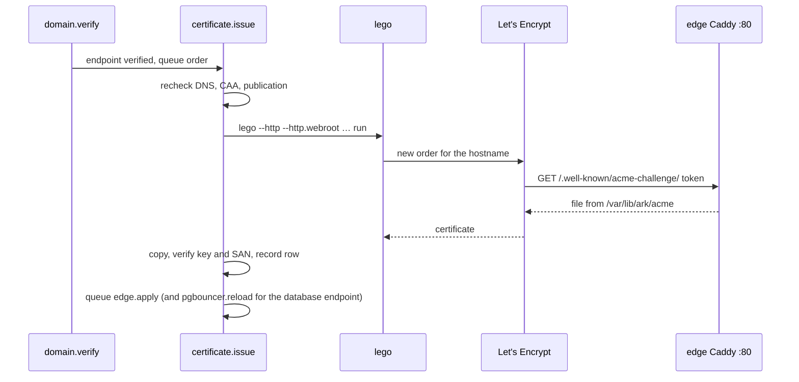

# Certificates

Ark manages two kinds of certificate: publicly trusted server certificates from Let's Encrypt for every public endpoint, and private certificate authorities that issue client certificates for database clients and front-door routes. This page explains how each is issued, stored, served, renewed and monitored.

## Overview

| Kind                        | Issued by                                            | Used for                                                                           | Lifetime      |
| --------------------------- | ---------------------------------------------------- | ---------------------------------------------------------------------------------- | ------------- |
| Public server certificate   | Let's Encrypt, through lego (HTTP-01)                | Admin and login hosts, front-door routes, the database endpoint, the mail endpoint | Set by the CA |
| Development leaf            | Local OpenSSL, only in development mode              | Local testing; recorded as untrusted and never served by the public edge           | 30 days       |
| Database client certificate | A private `db-client` CA per client generation       | PgBouncer `verify-full` mTLS for Vercel and other clients                          | 90 days       |
| Route client certificate    | A private `tcp-client` or `http-client` CA per route | `terminate_mtls` TLS-TCP routes and HTTP routes with `mtls`                        | 90 days       |

Public certificates are handled by the domain worker (`server/src/modules/certificates.ts`, `shared/src/acme.ts`). Private CAs live in `server/src/modules/pki.ts`, with route-specific parts in `server/src/modules/route-pki.ts` and `server/src/modules/route-crl.ts`.

## Public certificates

### Configuration

The domain worker reads these settings. In the production Compose file the paths and binary are fixed; the operator sets the email and the staging flag in `.env`.

| Setting                | Production value              | Meaning                                                                                                 |
| ---------------------- | ----------------------------- | ------------------------------------------------------------------------------------------------------- |
| `ARK_LEGO_BIN`         | `/usr/local/bin/lego`         | The lego binary. The `domain-worker` image copies it from the pinned `goacme/lego:v4.26.0` image.       |
| `ARK_ACME_EMAIL`       | from `.env`, empty by default | The ACME account email. Without it (or without lego), no public certificate can be issued.              |
| `ARK_ACME_STAGING`     | `1` unless set                | Any value other than `0` uses the Let's Encrypt staging directory.                                      |
| `ARK_ACME_WEBROOT`     | `/var/lib/ark/acme`           | Where lego writes HTTP-01 challenge files. The same directory is mounted read-only into the edge Caddy. |
| `ARK_CERT_DIR`         | `/var/lib/ark/certs`          | One directory per hostname with `fullchain.pem`, `privkey.pem` and lego's own state.                    |
| `ARK_CERTIFICATE_MODE` | not set                       | `development` enables the local OpenSSL fallback. The production Compose file does not pass it.         |

On the host, the certificate directory is `tmp/certs` and the webroot `tmp/acme` in the installation root. The domain worker mounts both read-write. The edge Caddy, PgBouncer and Stalwart mount the certificate directory read-only.

### Staging and production

The default is staging (`ARK_ACME_STAGING=1`) so that a first install cannot exhaust production rate limits. Staging certificates are recorded with issuer `letsencrypt-staging` and status `untrusted`, and **the public edge never serves them**. A front-door route never becomes `ready` with one; it shows "The certificate from letsencrypt-staging is not publicly trusted, so the edge will not serve it. Set ARK_ACME_STAGING=0, then verify the domain again to reissue."

To switch to production:

1. Set `ARK_ACME_EMAIL` and `ARK_ACME_STAGING=0` in `.env`.
2. Recreate the domain worker:

   ```sh
   docker compose --env-file .env -f infra/platform/docker-compose.yml up -d domain-worker
   ```

3. Select **Recheck DNS** for each domain (or `POST /api/domains/:id/verify`) to order new certificates.

Changing the flag does not convert existing staging certificates; each endpoint needs a fresh order. Keep the local SSH tunnel available while the first public certificate is provisioned, because a switch to public administration requires an issued certificate for the admin hostname. See [Public certificates](../operating.md#public-certificates) in the operator runbook.

### Development certificate mode

When `ARK_LEGO_BIN` or `ARK_ACME_EMAIL` is missing and `ARK_CERTIFICATE_MODE=development` is set (as in `.env.example`), the worker creates a local self-signed leaf with OpenSSL instead: ECDSA P-256, valid for 30 days, with the hostname as CN and subject alternative name. It is recorded with issuer `local-openssl` and status `untrusted`, and the endpoint becomes `certificate_untrusted`. It never makes an endpoint ready and is never rendered into the public Caddyfile.

Without lego and an email, and without development mode, the order fails with "Public certificate issuance is not configured. Set ARK_LEGO_BIN and ARK_ACME_EMAIL; self-signed fallback is development-only."

### How a certificate is issued

Certificates are ordered only after public DNS has been verified for the endpoint (see [DNS verification](domains-and-dns.md#dns-verification)).



In detail, `certificate.issue` (domain worker):

1. **Rechecks DNS.** The DNS check and the order are separate jobs, so the worker repeats the address, CAA and Cloudflare-proxy checks, confirms that no AAAA withdrawal or Cloudflare publication is pending, and requires every required record to resolve as expected. Otherwise it fails before contacting Let's Encrypt.
2. **Runs lego** with `--accept-tos --email <email> --http --http.webroot <webroot> --domains <hostname> --path <certdir>/<hostname>/lego` and the staging directory URL when staging is on. The command has a 120-second timeout. lego keeps one account per storage path, ACME server and email.
3. **Installs the files.** lego's certificate and key are copied atomically to `fullchain.pem` (mode 0644) and `privkey.pem` (mode 0600).
4. **Verifies the result.** The certificate's public key must match the private key, and its subject alternative names must include the hostname. Expiry and the SHA-256 fingerprint are read with OpenSSL. A certificate with missing metadata is refused rather than recorded with invented values.
5. **Records a certificate row** with the names, issuer, fingerprint, expiry and status, and updates the endpoint state.
6. **Queues `edge.apply`** so Caddy loads the new certificate. For a front-door route with an issued certificate, it also queues `edge.observe`, because the route becomes `ready` only after a fresh probe from the edge namespace.

If the DNS recheck in step 1 fails for a route, its endpoint returns to `awaiting_dns` and the next DNS check queues a new order. A failed ACME order itself is retried by an explicit **Recheck DNS**. Route states are described in the [front door guide](../guides/front-door.md).

### HTTP-01 challenges

Let's Encrypt validates each order over plain HTTP on TCP 80. The edge Caddy (published by `edge-ts`) answers `/.well-known/acme-challenge/*` from the shared webroot with a file server, for any hostname. Every other request on `:80` is redirected to HTTPS with `308` for hostnames Ark serves, or answered `404` for unknown hosts. Caddy's own automatic HTTPS is off: it never obtains certificates itself.

The API also registers `/.well-known/acme-challenge/:token`, which answers from an in-process challenge store with a 15-minute expiry. The shipped lego flow writes webroot files instead, which Caddy serves.

Because validation needs TCP 80 from the internet and Let's Encrypt prefers IPv6, keep TCP 80 open at the provider and make sure no stale AAAA record points elsewhere.

### Certificate records and trust states

Each order inserts a new row in `certificates`. Older rows are kept, so only the newest row per endpoint describes what is served.

| Certificate status | Meaning                                                                                                             |
| ------------------ | ------------------------------------------------------------------------------------------------------------------- |
| `issued`           | Publicly trusted (`letsencrypt`) and deployed. Only `issued` certificates are rendered into the edge configuration. |
| `untrusted`        | Issued by `letsencrypt-staging` or `local-openssl`. Stored, never served publicly.                                  |
| `awaiting_reload`  | A database endpoint certificate written to disk but not yet confirmed served by PgBouncer.                          |
| `pending`          | The column default; no certificate exists yet.                                                                      |

| Issuer                | Trusted | Source                                      |
| --------------------- | ------- | ------------------------------------------- |
| `letsencrypt`         | Yes     | lego against the production directory       |
| `letsencrypt-staging` | No      | lego with `ARK_ACME_STAGING` other than `0` |
| `local-openssl`       | No      | The development fallback                    |

The endpoint state follows the certificate: `testing` for a trusted certificate and `certificate_untrusted` otherwise (see [Endpoint states](domains-and-dns.md#endpoint-states)). The full certificate list, including fingerprints, is part of `GET /api/state` for the endpoints the caller may see.

### How certificates reach each service

| Service                       | How it loads the certificate                                                                                                                                                                                                                                                                                                                                                                                 |
| ----------------------------- | ------------------------------------------------------------------------------------------------------------------------------------------------------------------------------------------------------------------------------------------------------------------------------------------------------------------------------------------------------------------------------------------------------------ |
| Caddy (`edge`)                | `edge.apply` renders a site per hostname with an `issued` certificate, using `tls <fullchain> <privkey>` from `/var/lib/ark/certs/<hostname>/`, and loads it through Caddy's admin API. A hostname without one is not rendered at all. The `edge-apply` evidence lists such names as `awaitingCertificate`.                                                                                                  |
| HAProxy (`edge-l4`)           | TLS-TCP routes in `terminate` or `terminate_mtls` mode and Postgres routes read the hostname's certificate and key from the certificate directory when their HAProxy generation is rendered. Passthrough routes need no Ark certificate.                                                                                                                                                                     |
| PgBouncer (database endpoint) | The new row is `awaiting_reload`. `pgbouncer.reload` rewrites the configuration, sends `RELOAD` over the admin socket and reads the certificate PgBouncer actually serves. Only when its fingerprint matches does the row become `issued` (or `untrusted`) and the endpoint `testing`. A mismatch raises the critical alert "PgBouncer reload failed: the renewed database certificate is not being served". |
| Stalwart (mail endpoint)      | The certificate directory is mounted read-only at `/etc/stalwart/certs`. Mail client readiness requires an `issued`, unexpired certificate for the mail endpoint (see [Mail](mail.md)).                                                                                                                                                                                                                      |

### Renewal

There is no scheduled renewal job. Renewal happens through explicit domain verification: **Recheck DNS** on the Domains & Endpoints screen, or `POST /api/domains/:id/verify`.

- For a front-door route that is `ready`, an explicit check orders a new certificate when the newest one is missing, not `issued`, or expires within 30 days.
- For admin, login, database and mail endpoints, every explicit check that finds the endpoint verified queues a new `certificate.issue`.
- The scheduled two-minute DNS maintenance does not retry or renew: it orders a certificate only for an endpoint that has none yet.

The queue also defines a `certificate.renew` kind, which runs `lego renew`; no API route or schedule queues it in the current build.

> [!IMPORTANT]
> Watch for the expiry alert and run **Recheck DNS** for the affected domain when it fires, or put a recheck on your own calendar about 30 days before expiry. Nothing renews a public certificate on its own.

### Expiry alerts

| Signal                                        | Rule                                                                                                                                                                                                               |
| --------------------------------------------- | ------------------------------------------------------------------------------------------------------------------------------------------------------------------------------------------------------------------ |
| In-app alert "Certificate for … expires soon" | Critical. Raised for the newest certificate of each endpoint that expires within 14 days. Rows still `awaiting_reload` are skipped, so the previous certificate keeps alerting until PgBouncer serves the new one. |
| Prometheus `ark_certificates_expiring`        | A gauge on `/api/metrics/prometheus`: the number of stored certificate rows whose expiry is earlier than 14 days from now. Superseded and already expired rows count too.                                          |
| Prometheus alert `ArkCertificateExpiry`       | Critical, when `ark_certificates_expiring > 0` for 5 minutes (`infra/monitoring/alerts.yml`).                                                                                                                      |
| `GET /api/metrics`                            | `certificatesExpiringSoon`, the same 14-day count, for the UI.                                                                                                                                                     |

Alert delivery and the Prometheus setup are covered in [Monitoring](monitoring.md).

### Troubleshooting public certificates

| Symptom                                                                   | Cause and fix                                                                                                                                   |
| ------------------------------------------------------------------------- | ----------------------------------------------------------------------------------------------------------------------------------------------- |
| Endpoint `certificate_untrusted`, route not served                        | Staging or development certificate. Set `ARK_ACME_STAGING=0` and `ARK_ACME_EMAIL`, recreate `domain-worker`, then **Recheck DNS**.              |
| "Public certificate issuance is not configured …"                         | `ARK_ACME_EMAIL` is empty in the domain worker.                                                                                                 |
| "Public DNS for … changed. Recheck it before requesting a certificate."   | DNS changed between verification and the order. Fix DNS and select **Recheck DNS**.                                                             |
| "DNS publishing or withdrawal is pending for …"                           | A Cloudflare publish or an AAAA withdrawal is still open. Publish the reviewed diff or remove the old AAAA, then recheck.                       |
| lego fails validation                                                     | TCP 80 is blocked, a CAA record excludes Let's Encrypt, or an AAAA points elsewhere. See [Blocking checks](domains-and-dns.md#blocking-checks). |
| "Issued certificate does not match its private key" or "does not cover …" | The files in the hostname's certificate directory are inconsistent. Retry the order; inspect `tmp/certs/<hostname>/` if it persists.            |
| Database endpoint certificate stuck `awaiting_reload`                     | The PgBouncer reload or fingerprint check failed. Check the `pgbouncer.reload` operation and the `pgbouncer-public` logs.                       |

## Private certificate authorities

Ark runs its own constrained CAs for client authentication. They never sign server certificates. All encoding happens in-process (`server/src/modules/x509.ts`), so no key is ever written to disk, passed to a subprocess or logged. Submitted CSRs are parsed by the same hand-written DER parser, which is fuzzed and cross-checked against OpenSSL.

### CA policy

| Property       | Value                                                                                                                                                                          |
| -------------- | ------------------------------------------------------------------------------------------------------------------------------------------------------------------------------ |
| Purposes       | `db-client` (database clients), `tcp-client` (`terminate_mtls` routes), `http-client` (HTTP routes with `mtls`)                                                                |
| CA key         | ECDSA P-256, generated in-process                                                                                                                                              |
| CA certificate | Self-signed, 5 years, `basicConstraints` critical CA:TRUE `pathlen:0`, `keyUsage` critical `keyCertSign` and `cRLSign`, SKI and AKI                                            |
| CA subject     | `CN=Ark <purpose> CA <name>` plus a `serialNumber` attribute holding the CA ID, so every generation has a distinct DN                                                          |
| CA key storage | Sealed with AES-256-GCM under `ARK_ROOT_KEY` as a `pki.ca_key` secret with sensitivity `root`. The generic reveal endpoint refuses `root` secrets, and no API returns the key. |
| CA status      | `active`, `retired` or `revoked`                                                                                                                                               |
| CRLs           | Generated in-process with a 14-day `nextUpdate` by default. Recorded reasons follow RFC 5280; `certificateHold` is not used, so revocation is final.                           |

### Client certificate policy

| Property      | Value                                                                                                                                                                                                                               |
| ------------- | ----------------------------------------------------------------------------------------------------------------------------------------------------------------------------------------------------------------------------------- |
| Validity      | Exactly 90 days from issuance. The CA must outlive the certificate, or issuance asks for a new CA generation.                                                                                                                       |
| Extensions    | `extendedKeyUsage` `clientAuth`, `keyUsage` critical `digitalSignature`, `basicConstraints` critical CA:FALSE, SKI and AKI                                                                                                          |
| Subject       | `CN` chosen by Ark (for database clients, the login role name). Nothing is copied from a CSR.                                                                                                                                       |
| Serial        | Random, positive, non-zero 128-bit                                                                                                                                                                                                  |
| Keys          | Ark generates ECDSA P-256. A CSR may use ECDSA P-256 or P-384, or RSA from 3072 to 8192 bits with a small odd public exponent.                                                                                                      |
| CSR limits    | PEM text of at most 16 KiB with a valid signature. A CSR may not request a CA, key usages other than `digitalSignature`, `keyEncipherment` and `keyAgreement`, extended key usages other than `clientAuth`, or any other extension. |
| Generated key | Sealed as a one-time `pki.client_key` secret for a single reveal. CSR issuance stores no key at all.                                                                                                                                |
| Status        | `issued`, `revoked` or `expired`                                                                                                                                                                                                    |

Every certificate carries an authority key identifier, which strict TLS stacks such as Python 3.13 and later require.

### Database client CAs

Each database client (one app environment of one public database) gets a fresh `db-client` CA generation, a 90-day certificate and its own login role. PgBouncer trusts the bundle of active client CAs and verifies clients with `verify-full`. In summary:

- **Issue:** `POST /api/databases/:id/clients` with a `credential.rotate` step-up, optionally with your own `csrPem`. The bundle (password, certificate, any generated key, Vercel variables) is revealed exactly once.
- **Roll over:** at T−30 days Ark issues a successor from a fresh CA and reloads PgBouncer with both CAs. Alerts escalate at T−14 and T−7. You deliver the successor, redeploy and confirm. The predecessor is retired at its `not_after`, and its role's sessions are drained by `not_after + 5 s`.
- **Revoke:** `POST /api/databases/:id/clients/:clientId/revoke` removes every CA generation of the client, sets the role `NOLOGIN` and kills its sessions.

The full lifecycle, with commands, is in the Vercel guide: [issuing a client certificate](../guides/vercel-database.md#3-issue-a-client-certificate), [the 90-day lifetime and rollover alerts](../guides/vercel-database.md#6-90-day-lifetime-and-rollover-alerts), [manual rollover](../guides/vercel-database.md#7-manual-rollover) and [revoking a client](../guides/vercel-database.md#9-revoking-a-client). The operator runbooks are [Certificate rollover](../operating.md#certificate-rollover) and [Revocation](../operating.md#revocation). See also [Public database access](public-database-access.md).

### Route client CAs

Front-door routes can require client certificates from their own CA:

- **`terminate_mtls` TLS-TCP routes** get a `tcp-client` CA. HAProxy checks each client certificate against the CA and its CRL. The CRL must exist and be current, because OpenSSL refuses every certificate once the CRL is missing or expired. Revoking a certificate regenerates the CRL and changes the route's policy fingerprint, so the old HAProxy servers are fenced and their sessions drained before the new CRL loads.
- **HTTP routes with `"mtls": true`** get an `http-client` CA. Caddy has no CRL support, so the edge admits exactly the CA's certificates that are `issued`, currently valid and absent from the CRL. A missing or unreadable CRL admits nobody. Revocation goes through the gate revocation journal and drains the route's sessions around the reload.

Issue route certificates with `POST /api/front/routes/:id/client-certificates` (a `credential.rotate` step-up bound to the route and body, with a `name` or your own `csrPem`), and revoke them with `POST /api/front/routes/:id/client-certificates/:certificateId/revoke`. Generated keys are revealed once with `POST /api/secrets/:id/reveal`. To replace a certificate, issue a new one, then revoke the old one.

Route CRLs last 14 days and are regenerated when fewer than 7 days remain, or when they no longer cover every committed revocation. `edge.observe` drives the refresh: for `terminate_mtls` it schedules `edge.l4_apply`, and for HTTP mTLS it repairs the CRL and queues a Caddy apply in the same transaction. Details are in the [front door guide](../guides/front-door.md#34-rate-limits-and-client-certificates-fd-23), [TLS-TCP routes](../guides/front-door.md#4-tls-tcp-routes-by-sni) and [Certificate rollover](../operating.md#certificate-rollover).

## Related pages

- [Domains and DNS](domains-and-dns.md): verification before every order.
- [Mail](mail.md): the mail endpoint certificate and client readiness.
- [Security model](../security/security-model.md): how keys and secrets are sealed.
- [Monitoring](monitoring.md): alert delivery.
