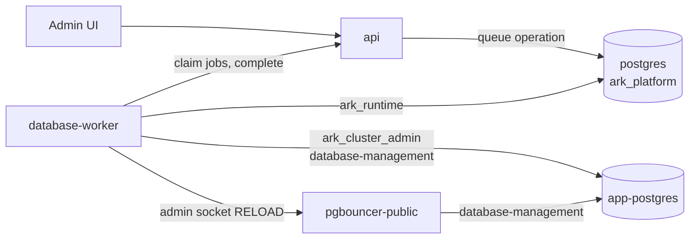

# Databases

Ark provisions application PostgreSQL databases on a dedicated cluster, with separate owner, migration, runtime and read-only roles, optional pgvector, and credentials sealed in the control plane. This page covers the cluster layout, what provisioning creates, how credentials are revealed and rotated, the database states, the API, and how the database worker runs the work.

Public access through PgBouncer is described in [Public database access](public-database-access.md), and the in-app query tool in [SQL workspace](sql-workspace.md).

## Two clusters

Ark runs two PostgreSQL clusters in the `ark-platform` Compose project. They never share an instance.

| Cluster            | Compose service | Image                                               | Holds                                                                     |
| ------------------ | --------------- | --------------------------------------------------- | ------------------------------------------------------------------------- |
| Platform (control) | `postgres`      | Pinned `postgres:17.6` plus the pgBackRest layer    | The `ark_platform` database: identity, desired state, operations, secrets |
| Application        | `app-postgres`  | Pinned `pgvector/pgvector:pg17` plus the same layer | Every database you create through Ark, and its roles                      |

Both images are built from the `Dockerfile` (`postgres-backup` and `app-postgres-backup` targets) and pinned by digest. Both clusters are backed up with pgBackRest (stanzas `ark-platform` and `ark-app`); see [Backups](backups.md).

**Platform cluster.** The bootstrap superuser is `ark_migration`, used only by the one-shot `migrate` service that applies Drizzle migrations. `infra/platform/init-control-db.sh` creates `ark_runtime` (no superuser, no `CREATEDB`, no `CREATEROLE`), which the API and workers use. The cluster sits on the internal `control` network.

**Application cluster.** The bootstrap superuser is `ark_cluster_admin` with the installer-generated `ARK_APP_DB_PASSWORD`. Only the database worker holds this credential, as `DATABASE_APP_URL`. `app-postgres` joins only the internal `database-management` network (plus `backup-management` for its backup executor). The members of `database-management` are `app-postgres`, `database-worker` and `pgbouncer-public`. The API is not on it, so the API never connects to application databases. Everything that touches them runs in the database worker.



### Cluster records

The control plane records the application cluster in `database_clusters` and each database in `managed_databases`. The domain wizard creates the cluster when you include a database endpoint: it adds a `database` endpoint (default hostname `db.<zone>`, or the hostname you enter) and an `application` cluster linked to it. If you enter a first database name in the wizard, it also records that database as `queued`.

Creating a database without a cluster fails with `Complete the domain wizard so an application cluster exists.` Database names are unique per cluster.

## Creating a database

In the admin UI, open **Databases** and fill in **Create a database**:

| Field                                                   | Meaning                                                                                         |
| ------------------------------------------------------- | ----------------------------------------------------------------------------------------------- |
| **Name**                                                | The PostgreSQL database name. It is also the prefix of every role name.                         |
| **Exposure**                                            | **Public TLS** (`public`, the default) or **Private only** (`private`).                         |
| **Requested source CIDRs (pooler-wide policy applies)** | Optional, comma-separated. A request to the pooler-wide policy, not a per-database restriction. |
| **pgvector**                                            | Install the `vector` extension.                                                                 |

The form calls `POST /api/databases`. The request body accepts:

```json
{
  "name": "orders",
  "exposure": "public",
  "withPgvector": false,
  "withTestDatabase": false,
  "sourceCidrs": [],
  "clusterId": "cl_…"
}
```

- `name` must match `^[a-z][a-z0-9_]{0,40}$`: a lowercase letter, then up to 40 lowercase letters, digits or underscores. The limit leaves room for the longest role suffix within PostgreSQL's 63-character identifier limit.
- `exposure` defaults to `public`. There is no endpoint that changes it afterwards.
- `withTestDatabase` (API only; the UI form has no checkbox for it) also creates `<name>_test`.
- `clusterId` is optional. Without it, the API uses the existing application cluster.

**Permissions.** The caller must be an owner or operator with MFA. If the cluster's endpoint belongs to a domain, the caller needs manage access to that domain; a cluster without a domain-linked endpoint is owner-only. No step-up grant is needed.

The API inserts the database as `queued`, queues a `database.provision` operation and returns `{ id, operationId }`. A database recorded by the wizard is provisioned once its database endpoint's DNS is verified: the `domain.verify` operation queues `database.provision` for every `queued` database of a cluster whose endpoint has just verified.

## What provisioning creates

`database.provision` runs in the database worker. It builds a plan with `buildProvisionPlan` (`shared/src/provision-sql.ts`) and executes it as `ark_cluster_admin` (`server/src/modules/database.ts`).

### Roles

For a database named `orders`:

| Role               | Kind        | Login | Purpose                                                            |
| ------------------ | ----------- | ----- | ------------------------------------------------------------------ |
| `orders_owner`     | `owner`     | No    | Owns the database. `NOLOGIN`, so it is never used to connect.      |
| `orders_migration` | `migration` | Yes   | Runs schema migrations: `USAGE` and `CREATE` on schema `public`.   |
| `orders_runtime`   | `runtime`   | Yes   | Application reads and writes: DML on tables, sequence use. No DDL. |
| `orders_readonly`  | `readonly`  | Yes   | Reporting and inspection: `SELECT` on tables and sequences.        |

Every role is created `NOSUPERUSER NOCREATEDB NOCREATEROLE`. Each login role gets a fresh 28-character random password. The owner also gets a generated password, which is sealed but cannot be used to log in.

### Grants and PUBLIC

The plan runs these statements, first on the cluster and then inside the new database:

1. `CREATE DATABASE`, the four roles, `REVOKE ALL ON DATABASE … FROM PUBLIC`, `GRANT CONNECT, TEMPORARY` to the four roles, and ownership to the owner role.
2. In the database: `REVOKE ALL ON SCHEMA public FROM PUBLIC`; `USAGE, CREATE` on `public` to owner and migration; `USAGE` to runtime and read-only.
3. Grants on existing objects: `SELECT, INSERT, UPDATE, DELETE` on all tables to runtime and `SELECT` to read-only; `USAGE, SELECT, UPDATE` on sequences to runtime and `SELECT` to read-only; `EXECUTE` on functions revoked from `PUBLIC` and granted to runtime and read-only.
4. The same grants as **default privileges** for objects later created by the migration role and by the owner role. Tables your migrations create are therefore usable by runtime (read and write) and read-only (`SELECT`) without extra grants, and new functions are not executable by `PUBLIC`.

The effect is that no role outside the four, other than the cluster superuser, can connect to or use the database. Roles of one database get no access to another database's objects.

> [!NOTE]
> Default privileges cover objects created by `<name>_migration` and `<name>_owner`. Objects created in other schemas, or by other roles, need their own grants.

The worker also installs a `pgbouncer` schema (with `PUBLIC` revoked) holding a `SECURITY DEFINER` function `pgbouncer.user_lookup` with a fixed `search_path` and `EXECUTE` revoked from `PUBLIC`. The generated PgBouncer configuration authenticates from its own userlist, not from this function.

### pgvector

With `withPgvector`, `CREATE EXTENSION IF NOT EXISTS vector` runs first in the database (and in the test database). The application image is the pgvector build of PostgreSQL 17, so no extra installation is needed.

### Test database

With `withTestDatabase`, the worker creates `<name>_test`, revokes `PUBLIC`, grants `CONNECT, TEMPORARY` only to the owner and migration roles, makes the owner role its owner and applies the same schema grants. The runtime and read-only roles cannot connect to it.

### Verification probe

Provisioning does not report success on the plan alone. After the statements run, the worker connects as each login role and checks the grants:

- the migration role creates a table `__ark_role_probe` with a `serial` key;
- the runtime role inserts a row and reads back its sequence value;
- the read-only role selects that row;
- the runtime role tries to create a table, and the attempt must fail.

The probe table is dropped afterwards. With a test database, the migration role also creates and drops a table there. Any failed check fails the operation, for example `Runtime role unexpectedly retained schema DDL permission.`

### Retries

Provisioning is safe to re-run. Statements that create a database or role are skipped when it already exists, and roles that already have a sealed password keep it, so a retried operation produces the same credentials.

## Database states

`managed_databases.status` moves through these values:

| Status                   | Meaning                                                                                                                                                                                         |
| ------------------------ | ----------------------------------------------------------------------------------------------------------------------------------------------------------------------------------------------- |
| `queued`                 | Recorded; provisioning has not run yet. Wizard-created databases wait here for the database endpoint's DNS verification.                                                                        |
| `awaiting_cluster`       | A private database whose provisioning ran without `DATABASE_APP_URL`. Nothing executed and the operation failed with `Database provisioning did not execute against a managed cluster.`         |
| `awaiting_configuration` | A public database that is provisioned but not yet served by the public pooler: no admitted database client, the pooler-wide policy is not publishable, or PgBouncer has not confirmed a reload. |
| `ready`                  | Private: provisioned and verified. Public: additionally mapped in PgBouncer with an admitted client, a confirmed reload and a publishable pooler-wide policy.                                   |

A public database's status is recomputed on every `pgbouncer.reload`. Provisioning a public database queues the first reload. Because PgBouncer maps only databases that have an active, admitted client, a new public database stays `awaiting_configuration` until you issue a database client and the pooler-wide policy admits someone. See [Public database access](public-database-access.md).

The **Databases** list shows each database's name, its role kinds, a status badge and its exposure. For public databases it also shows the requested CIDRs, or `unrestricted` when none were requested.

The provisioning operation itself follows the generic operation states (`queued`, `running`, `succeeded`, `failed`, `needs_recovery` and so on) described in [Operations and workers](../operations/operations-and-workers.md).

## Credentials

### How passwords are stored

Each role's password is sealed with AES-256-GCM under the root key (`ARK_ROOT_KEY`, with key ID `ARK_ROOT_KEY_ID`) in the control plane's `secrets` table, linked from `database_roles.secret_id`. The root key is not stored in PostgreSQL. The inventory (`GET /api/state`) reports a role's secret only as `stored`, never its ID or value.

| Secret               | Revealable                                                                                               |
| -------------------- | -------------------------------------------------------------------------------------------------------- |
| Owner password       | Never. It is marked `root` sensitivity, which the generic reveal endpoint refuses.                       |
| Login-role passwords | Once each (`once`). After the reveal the value stays sealed for the worker, but is never returned again. |

The database worker decrypts the sealed passwords when it needs them, for example to run SQL workspace queries as the selected role.

### Revealing the runtime password

**Reveal runtime once** on a database row calls `POST /api/databases/:id/credential`. It needs manage access to the database, MFA and a single-use `secret.reveal` step-up grant bound to `{ "databaseId": "<id>", "kind": "runtime" }`. The response is sent with `cache-control: no-store`:

```json
{
  "username": "orders_runtime",
  "password": "…",
  "connectionString": "postgresql://orders_runtime:…@db.example.com:5432/orders?sslmode=verify-full"
}
```

The host is the cluster's database endpoint hostname. The reveal is recorded as a `secret.reveal` audit event. A second reveal returns `409` with `This password was already shown. Rotate the role to generate a new one.` The UI shows the connection string once, with the note that the response is no-store and one-time.

> [!IMPORTANT]
> The public pooler admits only database client login roles that present a client certificate. The base `<name>_runtime` role is never in PgBouncer's userlist, so external applications connect as a [database client](#database-clients), not with this password.

Only the runtime role has a dedicated reveal endpoint.

### Step-up grants

Rotation and reveal need a single-use grant from `POST /api/step-up`: your current password, the action, and the exact request object the API will hash. The UI offers this under **Settings → Sensitive-action verification** (choose the action and paste the request binding JSON). A grant is bound to your session, expires after 10 minutes and is consumed by one request. The database buttons do not create the grant themselves; without one they fail with `Verify your password and MFA for secret.reveal before continuing.` (or `credential.rotate`). See [Accounts and access](accounts-and-access.md).

### Rotating a role

**Rotate runtime** calls `POST /api/databases/:id/rotate` with `{ "kind": "runtime" }`. The API also accepts `readonly` and `migration`; the owner role cannot be rotated. The call needs manage access, MFA and a `credential.rotate` grant bound to `{ "databaseId": "<id>", "kind": "<kind>" }`. It queues `database.rotate` and records a `credential.rotate` audit event.

In the database worker, `database.rotate`:

1. Generates a new password and seals it as a pending secret keyed by the operation ID, so a retried operation reuses the same password.
2. Runs `ALTER ROLE … PASSWORD …` (`rotateRoleSql`, `shared/src/rotate.ts`) as `ark_cluster_admin`.
3. Terminates the role's other sessions in that database with `pg_terminate_backend` (`terminateRoleSessionsSql`).
4. Points the role at the new secret, which can be revealed once.
5. Queues `pgbouncer.reload`.

Database clients have their own login roles and passwords. Rotating `<name>_runtime` or `<name>_readonly` does not change a client's password or close its sessions; clients only inherit the group's grants.

Passwords are embedded in SQL as dollar-quoted literals (`$ark$…$ark$`). Generation refuses a value that would collide with the tag.

## Exposure and source CIDRs

`exposure` decides whether the public pooler may ever serve the database:

- `private`: PgBouncer never maps it and database clients cannot be issued for it (`Database clients connect through the public PgBouncer; this database is private.`). Access is only from inside `database-management`, which in practice means the database worker and its SQL workspace.
- `public`: PgBouncer maps it once it has an admitted client. Privileged role names (ending in `_owner`, `_migration`, `_backup` or `_monitor`) are never admitted on the public listener.

`sourceCidrs` is a **request** to the pooler-wide source policy, not an isolation boundary. PostgreSQL's classic `SSLRequest` carries no database name, so public 5432 enforces one source policy for every Ark database. Change a database's request with `PUT /api/databases/:id/cidrs` and `{ "sourceCidrs": [...] }` (at most 50 entries, each a valid IPv4 or IPv6 CIDR). It needs manage access, MFA and an `exposure.public` grant bound to `{ "databaseId": "<id>", "cidrs": [...] }`, records a `database.cidrs` audit event and queues `pgbouncer.reload`. `GET /api/databases/:id/admission?ip=<address>` (owners and operators) reports whether an address would be admitted by the current pooler-wide policy.

The policy itself, its conflicts and the per-source port limits are described in [Public database access](public-database-access.md) and [Public database port limits](../operating.md#public-database-port-limits).

## Database clients

A database client is one application environment of one public database, for example `storefront/production`. Clients are how applications outside the VPS connect. Each client has:

- its own login role `<db>_<client>_<env>`, created `LOGIN INHERIT NOSUPERUSER NOCREATEDB NOCREATEROLE NOREPLICATION NOBYPASSRLS` with its own sealed password and a `CONNECTION LIMIT`, `IN ROLE` the database's `runtime` or `readonly` group;
- its own private CA generation and a 90-day client certificate (Ark generates the key, or signs a CSR you submit);
- a one-time reveal of the certificate, key and password bundle.

Rules from `shared/src/db-clients.ts`:

| Rule              | Value                                                                                                                                               |
| ----------------- | --------------------------------------------------------------------------------------------------------------------------------------------------- |
| Client name       | 1–24 lowercase letters or digits, starting with a letter                                                                                            |
| Environment       | 1–16 lowercase letters or digits, starting with a letter; `owner`, `migration`, `runtime`, `readonly`, `backup`, `monitor` and `admin` are reserved |
| Default role kind | `runtime` for `production`, `readonly` for every other environment                                                                                  |
| Connection limit  | 20 for runtime clients, 5 for read-only clients                                                                                                     |
| CSR size          | PEM, at most 16 KiB                                                                                                                                 |
| Issue rate        | 10 requests per user in any 10 minutes                                                                                                              |

Client operations are owner-only with MFA. Issuing (`POST /api/databases/:id/clients`) and revoking need a `credential.rotate` grant; revealing needs `secret.reveal`. The worker re-checks the actor before executing: operators are refused with `Only owners may execute database client operations.`

Issuance, reveal, revocation and the 90-day rollover are described in [Public database access](public-database-access.md). The step-by-step Vercel walkthrough, including the console helper for these API calls, is in [the Vercel guide](../guides/vercel-database.md#3-issue-a-client-certificate).

## How the database worker runs the work

The `database-worker` container (`workers/src/database.ts`) runs the coordinator's job handlers in its own process:

- **Job allowlist.** It polls `GET /api/internal/jobs` every 2 seconds with its token (`ARK_WORKER_TOKEN`, set from `ARK_DATABASE_WORKER_TOKEN`) and the prefixes `database.` and `pgbouncer.`. The API refuses a request for any prefix outside that worker's allowlist. Jobs run one at a time.
- **Kinds.** `database.provision`, `database.rotate`, `database.query`, `database.schema`, `database.client_issue`, `database.client_revoke`, `database.client_rollover`, `database.client_retire` and `pgbouncer.reload`.
- **Re-authorisation.** Before executing, the handler checks that the operation's actor still has platform access: viewers are refused, operators must still hold the project or domain grant, and database client operations are owner-only.
- **Leases.** While a job runs, the worker heartbeats its claim every 15 seconds. It completes the job with `POST /api/internal/jobs/:id/complete`, sending redacted evidence. Errors are redacted and truncated to 1,000 characters. If reporting completion fails after the handler has finished, the worker does not report the job as failed; it raises a `needs_recovery` error instead.
- **Cancellation listener.** The worker serves `POST /cancel` on `ARK_DATABASE_CANCEL_PORT` (default `:3101`), authenticated with the same worker token. The API forwards SQL workspace cancellations there through `ARK_DATABASE_WORKER_URL`.
- **Rollover scheduler.** It queues the daily `database.client_rollover` job and retires certificate generations at their `not_after`, because it owns the PgBouncer admin socket.

Only the database worker holds `DATABASE_APP_URL`, the PgBouncer admin password (`ARK_PGBOUNCER_ADMIN_PASSWORD`) and the PgBouncer admin socket. It has no Docker CLI and no Docker socket. It writes PgBouncer's files to `ARK_PGBOUNCER_DIR` and reloads PgBouncer over the socket.

In local development with `ARK_EMBEDDED_WORKERS=1`, the API runs the same handlers in-process and cancels queries directly. Production ignores that setting.

## Endpoints

| Method and path                                    | Who                    | Step-up             | Effect                                                           |
| -------------------------------------------------- | ---------------------- | ------------------- | ---------------------------------------------------------------- |
| `POST /api/databases`                              | Owner or operator, MFA | None                | Record a database and queue `database.provision`                 |
| `POST /api/databases/:id/credential`               | Manage access, MFA     | `secret.reveal`     | One-time reveal of the runtime password and connection string    |
| `POST /api/databases/:id/rotate`                   | Manage access, MFA     | `credential.rotate` | Queue `database.rotate` for `runtime`, `readonly` or `migration` |
| `PUT /api/databases/:id/cidrs`                     | Manage access, MFA     | `exposure.public`   | Replace the requested CIDRs and queue `pgbouncer.reload`         |
| `GET /api/databases/:id/admission`                 | Owner or operator      | None                | Evaluate an address against the pooler-wide policy               |
| `POST /api/databases/:id/schema`                   | Owner or operator, MFA | `secret.reveal`     | Queue a schema inspection ([SQL workspace](sql-workspace.md))    |
| `GET /api/databases/:id/clients`                   | Owner                  | None                | List database clients                                            |
| `POST /api/databases/:id/clients`                  | Owner, MFA             | `credential.rotate` | Queue `database.client_issue`                                    |
| `POST /api/databases/:id/clients/:clientId/reveal` | Owner, MFA             | `secret.reveal`     | One-time reveal of the client bundle                             |
| `POST /api/databases/:id/clients/:clientId/revoke` | Owner, MFA             | `credential.rotate` | Queue `database.client_revoke`                                   |
| `GET /api/databases/pooler-policy`                 | Owner or operator      | None                | Read the pooler-wide source policy                               |
| `PUT /api/databases/pooler-policy`                 | Owner, MFA             | `exposure.public`   | Save the pooler-wide source policy                               |

"Manage access" means owner or operator with manage rights on the database's domain (or project). The SQL workspace endpoints (`POST /api/sql/query`, `GET /api/sql/results/:operationId`, `POST /api/sql/cancel`) are described in [SQL workspace](sql-workspace.md), and the rollover and Vercel endpoints in [Public database access](public-database-access.md). There is no endpoint that deletes a database. The complete list is in the [API reference](../reference/api.md).

## Configuration

| Variable                          | Used by              | Purpose                                                               |
| --------------------------------- | -------------------- | --------------------------------------------------------------------- |
| `ARK_APP_DB_PASSWORD`             | Installer, Compose   | Password of `ark_cluster_admin` on `app-postgres`                     |
| `DATABASE_APP_URL`                | Database worker      | Admin connection to the application cluster                           |
| `ARK_DATABASE_WORKER_TOKEN`       | API, database worker | The database worker's job token                                       |
| `ARK_DATABASE_WORKER_URL`         | API                  | Where the API sends SQL cancellations (`http://database-worker:3101`) |
| `ARK_DATABASE_CANCEL_PORT`        | Database worker      | Cancellation listener port, default `3101`                            |
| `ARK_PGBOUNCER_DIR`               | Database worker      | Directory for the generated PgBouncer files                           |
| `ARK_APP_PG_HOST`                 | Database worker      | Backend host written into PgBouncer mappings, default `app-postgres`  |
| `ARK_ROOT_KEY`, `ARK_ROOT_KEY_ID` | API, workers         | Root key and key ID that seal role passwords                          |

See [Configuration](../getting-started/configuration.md) for the full list.

## Verifying and testing

- Check a provisioning run in the operation's steps: `database-provisioned` records whether the plan executed, the database name and the statement count.
- `mise run test:db` runs the database-backed server tests against a throwaway, migrated `postgres:17.6` container.
- `mise run test:pgbouncer` starts `app-postgres` and `pgbouncer-public` from the platform Compose file and tests mTLS, SCRAM, admin-socket reloads, database clients and certificate rollover.
- Client role naming and the PgBouncer rendering rules are unit-tested in `shared/src/db-clients.test.ts` and `shared/src/pgbouncer.test.ts`. `server/src/modules/database.test.ts` exercises the workspace executor against a real cluster.

## Related pages

- [Public database access](public-database-access.md): PgBouncer, mTLS, the pooler-wide policy and client certificate rollover.
- [SQL workspace](sql-workspace.md): running queries and inspecting schemas.
- [Backups](backups.md): pgBackRest backups of both clusters.
- [Database access from Vercel](../guides/vercel-database.md): the end-to-end guide.
- [B8: Internet ↔ PgBouncer](../security-review.md#b8-internet--pgbouncer): the security boundary for public database access.
