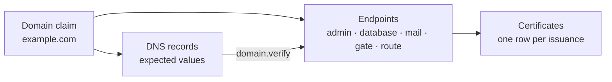
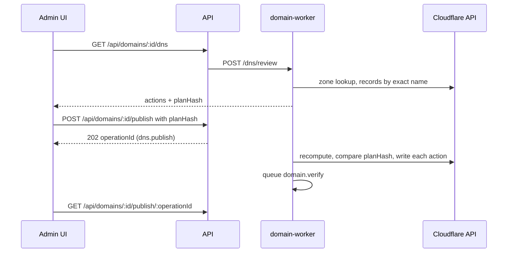

# Domains and DNS

This page explains how Ark models domains and public hostnames, which DNS records it plans for them, how those records reach Cloudflare or a manual provider, and how public DNS is verified before any certificate is requested. It also covers endpoint states, IPv6 and AAAA publication, and the region preset.

## The domain model

Everything public in Ark hangs off a **domain claim**: a zone such as `example.com` that this installation has proved it controls. Each claim owns a set of **DNS records** (what Ark expects public DNS to say) and a set of **endpoints** (public hostnames inside the zone that Ark serves, such as `db.example.com` or `login.example.com`).

The tables live in `server/src/schema.ts` (`domain_claims`, `dns_records`, `endpoints`, `certificates`).

### Domain claims

| Field            | Meaning                                                                                                                         |
| ---------------- | ------------------------------------------------------------------------------------------------------------------------------- |
| `name`           | The normalized zone name. Unique per installation.                                                                              |
| `ownershipToken` | A random `ark-own-…` value. It must appear in the `_ark-stack.<zone>` TXT record before Ark trusts the claim.                   |
| `status`         | `awaiting_dns` until the ownership TXT record is observed, then `verified`.                                                     |
| `dnsProvider`    | `manual`, `cloudflare` or `other`. Only `cloudflare` enables automatic publishing; the other two show manual rows.              |
| `mailFrom`       | The SES MAIL FROM domain. Defaults to `bounce.<zone>`.                                                                          |
| `dmarcPolicy`    | `none`, `quarantine` or `reject`. Recorded in the mail desired state (see [Mail](mail.md)).                                     |
| `aaaaEnabled`    | The per-domain AAAA switch. On by default. AAAA records are planned only when this is on **and** the IPv6 preflight has passed. |
| `lastError`      | The most recent verification or publishing error, shown on the Domains screen.                                                  |
| `dnsWatchUntil`  | The end of a manual-provider watch window (see [Rechecks and the automatic schedule](#rechecks-and-the-automatic-schedule)).    |
| `proxyAaaaHosts` | Hostnames whose public AAAA answers fall inside Cloudflare's proxy ranges. They block certificate issuance until fixed.         |

### Endpoints

An endpoint is one public hostname with a kind, an exposure and a status. Hostnames are unique across the installation.

| Kind       | Created by                                                  | Default hostname   | Served by                                     |
| ---------- | ----------------------------------------------------------- | ------------------ | --------------------------------------------- |
| `admin`    | The wizard, when administration mode is `public`            | `admin.<zone>`     | Caddy, through HAProxy on 443                 |
| `database` | The wizard, when **Public database endpoint** is ticked     | `db.<zone>`        | PgBouncer, through HAProxy on 5432            |
| `mail`     | The wizard, when **Incoming mail** is ticked                | `mail.<zone>`      | Stalwart (SMTP, submission, IMAPS)            |
| `gate`     | Enabling the public login origin (`PUT /api/settings/gate`) | `login.<zone>`     | Caddy, through HAProxy on 443                 |
| `route`    | Creating a front-door route (`POST /api/front/routes`)      | the route hostname | Caddy or HAProxy, depending on the route kind |

Exposure is per endpoint and does not follow the administration mode. The Domains & Endpoints screen lists every endpoint with its kind, exposure and status. Front-door routes are described in the [front door guide](../guides/front-door.md).

### Hostname rules

All hostnames go through `normalizeHostname` in `shared/src/hostnames.ts`:

- Surrounding whitespace and one trailing dot are removed, and the name is lowercased.
- The name must be fully qualified (at least two labels), each label 1–63 characters of `a-z`, `0-9` and inner `-`, and at most 253 characters in total.
- `localhost` and names ending in `.localhost`, `.local`, `.internal`, `.invalid`, `.example` or `.test` are refused as reserved or special-use names.
- An IPv4 literal is refused ("Use a hostname, not an IP address.").
- Labels must already be ASCII. Enter an internationalised name in its `xn--` form.

An endpoint or route hostname must be the zone itself or a name inside it. The apex and `www` need no special handling, because Ark only plans address records for them and never a CNAME at the apex.

## Creating a domain

There are two ways to create a domain claim.

**The first-run wizard** (`POST /api/wizard`, owner with MFA, once per installation) is the normal path. The **Guided setup** form asks for:

- the administration mode (**Public HTTPS** or **Tailnet only**);
- the **Base domain**, **Public IPv4** and optional **Public IPv6**;
- optional admin, database and mail hostnames (defaults `admin.`, `db.` and `mail.` under the base domain);
- the **DNS provider**: **Manual / other** or **Cloudflare (publish after review)**;
- whether to create a public database endpoint and incoming mail, with an optional first database name and first mailbox local part.

**Generate DNS plan and continue** creates the domain claim, its records and its endpoints in one request. It also stores the public addresses and provider in the platform settings, marks the wizard complete and grants the owner access to the domain. If a public IPv6 address was given, an IPv6 preflight is queued. For a manual provider it queues the first `domain.verify` at once. For Cloudflare, no verification is queued until the reviewed plan is published or **Recheck DNS** is selected. The public addresses are set only by the wizard; no other API changes them.

**`POST /api/domains`** (operator or owner, with MFA) adds a further domain claim with only its ownership TXT record. It accepts `name`, `dnsProvider`, an optional `mailFrom` and a `dmarcPolicy`. Choosing `cloudflare` requires the owner role. There is no UI form for this call.

## The DNS plan

`buildDomainPlan` in `shared/src/dns-plan.ts` turns the wizard input into a list of expected records. Each record has a type, a full name, a relative name (`@` for the apex), a value, a TTL, a purpose and a `required` flag.

| Record | Name                    | Value                                       | TTL | When                                       |
| ------ | ----------------------- | ------------------------------------------- | --- | ------------------------------------------ |
| TXT    | `_ark-stack.<zone>`     | the domain's `ark-own-…` ownership token    | 60  | Always                                     |
| A      | database hostname       | the public IPv4                             | 300 | Public database endpoint                   |
| A      | mail hostname           | the public IPv4                             | 300 | Incoming mail                              |
| MX     | `<zone>` (`@`)          | priority 10, the mail hostname              | 300 | Incoming mail                              |
| TXT    | `<zone>` (`@`)          | SPF: `v=spf1 include:amazonses.com -all`    | 300 | Incoming mail                              |
| TXT    | `_dmarc.<zone>`         | `v=DMARC1; p=none; rua=mailto:dmarc@<zone>` | 300 | Incoming mail                              |
| A      | admin hostname          | the public IPv4                             | 300 | Administration mode `public`               |
| A      | route or login hostname | the public IPv4                             | 300 | Each front-door route and the login origin |
| AAAA   | any address-record name | the public IPv6                             | 300 | Only while AAAA is allowed (see below)     |

Notes on the plan:

- **No CNAMEs, no proxying.** Ark plans A and AAAA records for hostnames, never a CNAME. Every record written to Cloudflare is DNS-only (`proxied: false`).
- **SPF is merged, not duplicated.** `mergeSpf` combines the mechanisms of an existing SPF value with Ark's and always ends with a single `-all`, so a zone never gets a second SPF record.
- **SES records are not in the plan.** The DKIM CNAMEs and MAIL FROM records that Amazon SES needs come from SES itself. See [SES relay](mail.md#ses-relay).
- **Front-door routes and the login origin** add their own address records when they are created (`routeAddressRecords`). For those names a published AAAA is `required`, because a broken AAAA breaks IPv6 clients and Let's Encrypt, which prefers IPv6.
- **Removing a route or the login origin** does not delete its records silently. They stay in the review as pending removals until they are deleted (Cloudflare) or a public lookup confirms they are gone (manual).

The Domains & Endpoints screen shows each domain's stored records with type, relative name, purpose, status and expected value. **Review DNS** opens the full review described below.

### Record statuses

| Status               | Meaning                                                                           |
| -------------------- | --------------------------------------------------------------------------------- |
| `pending`            | Expected, not yet confirmed by a public lookup.                                   |
| `verified`           | The last public lookup returned the expected value.                               |
| `error`              | The last lookup did not return the expected value, or failed.                     |
| `withdrawal_pending` | Ark wants the record gone (IPv6 withdrawal, deleted endpoint or changed address). |
| `withdrawn`          | A public lookup confirmed the old value is no longer served.                      |
| `superseded`         | A pending withdrawal that became moot because the same value is desired again.    |

In the review, rows awaiting removal carry a removal label instead of a status: **Remove at provider** (manual), **Review deletion** (Cloudflare, needs a reviewed publish), **Removal authorized** (Cloudflare AAAA with pre-authorized withdrawal) or **Waiting for DNS caches** (deleted at Cloudflare, waiting for the old TTL to pass).

## Cloudflare: the reviewed diff

With `dnsProvider: "cloudflare"`, Ark computes the exact changes against the live zone and writes them only after a person has reviewed that diff. The token lives only in the domain worker, as `DNS_API_TOKEN` (or `CLOUDFLARE_API_TOKEN`). It needs **Zone / Zone / Read** and **Zone / DNS / Edit** for the zone. The API process never holds it: it forwards review requests to the domain worker's private control endpoint (`POST /dns/review` on port 3102, authenticated with the domain worker token).

### Reading the review

`GET /api/domains/:id/dns` (operator or owner, with view access to the domain; `GET /api/front/routes/:id/dns` returns the same review for a route's domain) returns:

- `records`: the stored records with their observed values and statuses;
- `ipv6Status`: `eligible`, `withdrawal_pending` or `a_only`;
- `cloudflare.actions`: one action per record, and `cloudflare.planHash`, which binds the whole diff and the provider record sets it was computed from.

| Action    | Meaning                                                                                                                               |
| --------- | ------------------------------------------------------------------------------------------------------------------------------------- |
| `keep`    | The record already exists with the same content, TTL and DNS-only setting.                                                            |
| `update`  | One record of that type exists at the name and will be changed. A matching record that is proxied or has another TTL is also updated. |
| `create`  | No record of that type exists at the name, or an unrelated TXT record shares the name and Ark's is added beside it.                   |
| `delete`  | A record Ark owns, and wants withdrawn, will be deleted.                                                                              |
| `blocked` | Ark will not touch this record. The reason is shown, for example an existing MX record or ownership held in another Cloudflare zone.  |

The UI shows each action with the current value (and whether Cloudflare proxies it) and the value Ark will write, marked **DNS only**. If the provider review fails, the UI falls back to the local-only review (`?local=1`) and shows the provider error above it.

### Refusals

Ark refuses changes it cannot make unambiguously (`chooseCloudflareMutation` in `shared/src/cloudflare.ts` and `planCloudflare` in `server/src/modules/cloudflare-dns.ts`):

- **Several records of the same type at one name.** The review fails with `409` and "Refusing to update … records already exist. Resolve them manually." Ark never guesses which one to edit.
- **A CNAME next to a planned A or AAAA**, or more than one address record at the name: "Resolve conflicting Cloudflare records for … before publishing."
- **An existing apex MX** with another value. The MX action is `blocked`: taking over the MX would black-hole the zone's current inbound mail.
- **TXT records of another kind.** SPF only replaces SPF, DMARC only DMARC, and Ark's ownership token only an ownership token. A site-verification string or any other TXT at the same name is left alone and Ark's record is created beside it.
- **Ownership in another zone.** If the record Ark owns lives in a different Cloudflare zone, the action is `blocked` until access to the old zone is restored and the old record is confirmed removed.
- **No unique active zone.** "No unique active Cloudflare zone for … Check the zone and token scope." (`409`).

### Publishing

**Publish reviewed DNS** (shown when at least one action is not `blocked`) sends `POST /api/domains/:id/publish` with the review's `planHash` and an optional UUID `requestId`. The caller must be an operator or owner with manage access to the domain **and an MFA-verified session**. The response is `202` with an `operationId` and a `Location` header. Retrying the same submission returns the same operation.

The `dns.publish` operation runs in the domain worker:

1. It re-checks that the actor still has the role and domain access, then recomputes the review. If the hash differs, it fails with `409` ("The Cloudflare DNS plan changed. Review the latest diff before publishing.").
2. It records the plan and an audit event, then applies the non-`keep` actions one at a time.
3. Before each write it compares the record set at that name with the reviewed snapshot, and before an update or delete it checks the exact record. Any difference fails with `409` ("Cloudflare … changed. Review the current records before publishing…").
4. For a create or an update of a record it owns, it saves a write intent with a unique comment marker (`Ark DNS …`) before calling Cloudflare. Every write sets `proxied: false`, and Cloudflare's reply must confirm the exact type, name, TTL, content and marker.
5. Deletions only ever target a record Ark owns, identified by its Cloudflare ID and its exact prior content.
6. When every action has been applied, it queues `domain.verify`, which checks public DNS before any certificate is requested.

Follow progress with `GET /api/domains/:id/publish/:operationId`. It returns `status`, `applied` and `total` (shown in the UI as "Checking Cloudflare records (n of m)…"), any `error`, and the `verificationOperationId` once verification has been queued. A terminal conflict is returned as HTTP `409`.

Writers are serialized per domain with a PostgreSQL advisory lock, and one worker handles at most three domain publications at once ("A DNS change is already in progress. Retry shortly."). At most four Cloudflare reviews run at once per worker; a fifth gets `503` ("Cloudflare DNS is busy."). Each Cloudflare request times out after 8 seconds.

> [!NOTE]
> If a worker stops between a write and its confirmation, the saved intent and comment marker let the next attempt recognise its own record instead of creating a duplicate. If such an intent is still unconfirmed on a record that is being withdrawn, the review shows it as `blocked` with "The prior Cloudflare write is unconfirmed. Check the original zone and reload the review."

### Ownership and deletion

A record counts as Ark's when Ark created it, when Ark updated a record it already owned, or when a kept record carries Ark's marker comment. Ark stores the Cloudflare record ID and its exact content as ownership evidence. Only owned records are ever deleted. A withdrawal of a record Ark does not own (for example, an unexpected AAAA someone else created) is shown as **Remove at provider** and must be done by hand.

## Manual and other providers

For `manual` and `other` providers, the review lists the exact rows to create, with type, relative host, full name, value, TTL and status, and two guides:

- **Namecheap:** Domain List → Manage → Advanced DNS → Host Records → Add New Record, choose A Record or AAAA Record, host `@` or `www` (or the relative name shown), Automatic TTL. This applies to Namecheap BasicDNS, PremiumDNS and FreeDNS. Ark has no Namecheap API automation.
- **Other DNS providers:** find the authoritative provider with `dig NS <zone> +short`, enter each record as shown (use the full name if the provider asks for one), resolve conflicting records, turn off any proxy or forwarding, allow `letsencrypt.org` where CAA restricts issuance, remove the rows marked for removal, wait for the TTL, then check each name with `dig A <name> @1.1.1.1 +short` (and `dig AAAA` when AAAA is published).

A worked example of the rows for an apex and `www` route is in the [front door guide](../guides/front-door.md#82-namecheap-and-other-providers-manual).

## DNS verification

`domain.verify` is the domain worker operation that turns expected records into verified endpoints. It is queued by **Recheck DNS** (`POST /api/domains/:id/verify`, operator or owner with MFA), by a completed Cloudflare publish, by the wizard for manual providers, by AAAA switch changes and by the automatic schedule.

All lookups go to public resolvers (`1.1.1.1` and `8.8.8.8`, two tries with a 2-second timeout), never to local or tailnet DNS, because public answers are what Let's Encrypt and clients will see. In local development, `ARK_DNS_STUB=1` accepts the expected records without lookups.

### What is checked

1. **Ownership first.** The `_ark-stack.<zone>` TXT record must contain this installation's token. Until it does, no endpoint is checked and the domain shows "DNS ownership proof … is not yet published correctly."
2. **Every active record** is looked up by type (A, AAAA, TXT, MX or CNAME) and compared after normalization: quotes, trailing dots and case are ignored, IPv6 addresses are compared in canonical form, SPF mechanisms are compared as a set, and an MX value is compared with its priority. The observed value and `verified` or `error` are stored on the record.
3. **Each public endpoint with address records** then goes through the blocking checks below.
4. An endpoint becomes `verified` when it has no blocking error and all its required records verified. Otherwise it goes back to `awaiting_dns`.

### Blocking checks

These checks (`dnsBlockingError` in `server/src/modules/dns-verification.ts`) stop certificate requests for an endpoint:

| Check                                    | Message (abridged)                                                                                |
| ---------------------------------------- | ------------------------------------------------------------------------------------------------- |
| A or AAAA inside Cloudflare proxy ranges | "… resolves to Cloudflare proxy address … Switch its record to DNS only and recheck DNS."         |
| Address lookup failure                   | "Address lookup failed for … Check public DNS and recheck before requesting a certificate."       |
| Unexpected AAAA                          | "Unexpected AAAA … Remove or correct it at the DNS provider, then recheck DNS."                   |
| CAA lookup failure                       | "CAA lookup at … failed. Check its authoritative DNS and DNSSEC, then recheck DNS."               |
| CAA excludes Let's Encrypt HTTP-01       | "CAA at … blocks Let's Encrypt HTTP-01. Allow letsencrypt.org in its CAA issue records…"          |
| CAA `accounturi` mismatch                | "CAA accounturi at … does not permit Ark's active Let's Encrypt account…"                         |
| Pending IPv6 withdrawal                  | "IPv6 withdrawal is pending for … Remove the prior AAAA and wait for DNS to confirm its absence." |
| Cloudflare record not yet published      | "Review and publish the Cloudflare DNS plan for …, then recheck DNS."                             |
| Cloudflare mail MX not published         | "The incoming mail MX record needs review and public DNS verification." (mail endpoint only)      |

The CAA check walks from the hostname up to the zone and uses the nearest CAA record set. An `issue` value must name `letsencrypt.org`. If it lists `validationmethods`, they must include `http-01`. If it pins an `accounturi`, that must be Ark's active Let's Encrypt account. An `issuewild` record alone does not block a non-wildcard certificate. A critical CAA tag Ark does not understand blocks issuance.

An unexpected AAAA (one Ark did not plan) is remembered as a record with `withdrawal_pending` status, so it appears in the review until it is gone. Let's Encrypt tries IPv6 first, so a wrong AAAA fails issuance instead of falling back to IPv4.

### What happens after verification

In the same transaction that marks endpoints verified, `domain.verify`:

- queues `certificate.issue` for each verified endpoint that needs a certificate (see [Certificates](certificates.md));
- moves front-door routes waiting for DNS to `issuing_certificate`;
- marks the domain `verified` once ownership is proved, and stores the first error in `lastError`;
- raises or resolves the warning alert "IPv6 DNS removal pending for …".

Unless the check covered route endpoints only, it then queues `database.provision` for any queued database on a verified database endpoint, and `mail.provision` for any mailbox on the domain that Stalwart does not know yet (when mail is enabled).

The certificate order re-runs the address, CAA and publication checks immediately before calling Let's Encrypt, in case DNS or a setting changed between the two jobs. If public DNS no longer matches, the order fails with "Public DNS for … changed. Recheck it before requesting a certificate."

### Rechecks and the automatic schedule

The domain worker runs DNS maintenance every two minutes. A domain gets an automatic, scheduled `domain.verify` when any of these is true:

- **Cloudflare:** a record was published within the last 30 minutes for an endpoint still waiting for DNS or a certificate, or an owned record is waiting to be withdrawn.
- **Manual providers:** a watch window is open, or the endpoint or domain was created within the last 30 minutes. Opening the DNS review or selecting **Recheck DNS** opens or renews a 30-minute window (`POST /api/domains/:id/dns/watch`), and the open review reloads itself every two minutes during that window.
- **Any provider:** a withdrawal started within the last 30 minutes, or a hostname has a Cloudflare-proxied AAAA to recheck.

Scheduled checks start a certificate order only for an endpoint that has none yet, or for a route leaving `awaiting_dns`. They never retry a failed order or renew a certificate. An explicit **Recheck DNS** also retries orders and renews certificates that are due (see [Renewal](certificates.md#renewal)).

## Endpoint states

The defined endpoint states are listed in `endpointStates` in `shared/src/dns-plan.ts`. The worker, as built, sets the following ones:

| State                   | Set by                                  | Meaning                                                                                                   |
| ----------------------- | --------------------------------------- | --------------------------------------------------------------------------------------------------------- |
| `awaiting_dns`          | Creation, `domain.verify`               | Required records are not all observed, or a blocking check failed.                                        |
| `verified`              | `domain.verify`                         | Public DNS matches and no blocking check failed. A certificate order is queued.                           |
| `testing`               | `certificate.issue`, `pgbouncer.reload` | A publicly trusted certificate is issued (and, for the database endpoint, confirmed served by PgBouncer). |
| `certificate_untrusted` | `certificate.issue`, `pgbouncer.reload` | The certificate is from Let's Encrypt staging or the development fallback. The edge does not serve it.    |

The other defined values (`draft`, `issuing_certificate`, `provisioning`, `ready`, `error`) are not currently written to endpoints by the workers. Front-door routes have their own, richer lifecycle (`awaiting_dns`, `issuing_certificate`, `awaiting_acl`, `ready` and so on), described in the [front door guide](../guides/front-door.md).

## IPv6 and AAAA publication

Ark publishes AAAA records only when all three hold (`aaaaAllowed` in `shared/src/dns-plan.ts`):

1. a public IPv6 address is configured;
2. the platform IPv6 status is `passed` (the external IPv6 preflight succeeded);
3. the domain's AAAA switch is on.

The IPv6 status is one of `unchecked`, `passed`, `failed` or `not_present`. While AAAA is not allowed, the review says "Publishing A only. IPv6 is disabled or its preflight has not passed." Once it is allowed, Ark adds an AAAA row beside every public A record, and the review says "IPv6 is eligible for publishing."

**The preflight.** It requires a global IPv6 address on the host, Docker native IPv6 with the userland proxy off, and every public port answering over IPv6 from outside the VPS with the edge log matching the probe's source. It runs weekly, when the configured address or the active edge changes, and on demand with `POST /api/settings/ipv6/preflight` (owner with MFA); read the result with `GET /api/settings/ipv6/preflight?operationId=<id>`. With a managed runner configured, a failed check becomes eligible for retry after five minutes. The probe is `scripts/ipv6-preflight-probe.ts`. Setup, credentials and the manual signed-request flow are in [Native IPv6 and AAAA publication](../operating.md#native-ipv6-and-aaaa-publication) and the [front door guide](../guides/front-door.md#83-ipv6-and-the-aaaa-preflight).

**Withdrawal.** If the preflight fails or the switch is turned off, every AAAA becomes `withdrawal_pending`:

- With Cloudflare, an owner can tick **Allow Ark to withdraw its AAAA records in this review if IPv6 becomes ineligible** before publishing. Ark then deletes its own AAAA records automatically during the next `domain.verify` (audit action `dns.withdraw_aaaa`). Without that authorization, the deletion appears as `delete` in the next review and needs an ordinary publish. **Revoke automatic withdrawal** (`DELETE /api/domains/:id/aaaa/authorization`) removes the authorization.
- With a manual provider, the rows are shown as **Remove at provider**.
- Either way, the row stays pending until a public lookup confirms the old address is gone, and certificate orders for that hostname wait until then.

**The per-domain switch.** **Disable IPv6 DNS** sends `PUT /api/domains/:id/aaaa` with `{ "enabled": false }` (owner with MFA) and queues a verification. **Enable IPv6 DNS** asks for your password, takes an `exposure.public` step-up bound to `{ domainId, enabled: true }` and sends `{ "enabled": true }`.

## Regions

The region preset (`shared/src/region.ts`) is a platform setting that drives suggestions only. Ark does not choose or provision the VPS.

| Region       | Label      | Suggested Vercel region | Vercel location       | Backup bucket hint | Where to put the VPS        |
| ------------ | ---------- | ----------------------- | --------------------- | ------------------ | --------------------------- |
| `us-east`    | US East    | `iad1`                  | Washington, D.C., USA | `us-east-1`        | US East (Virginia/New York) |
| `us-west`    | US West    | `sfo1`                  | San Francisco, USA    | `us-west-1`        | US West (California)        |
| `eu-west`    | EU West    | `dub1`                  | Dublin, Ireland       | `eu-west-1`        | EU West (Ireland)           |
| `eu-central` | EU Central | `fra1`                  | Frankfurt, Germany    | `eu-central-1`     | EU Central (Frankfurt)      |

The default is `us-east`. The setting feeds the `vercel.json` `regions` snippet in the Vercel guide, the backup bucket region hint and a latency hint. An optional free-text **VPS region label** (up to 64 characters) records where the VPS actually is. Every signed-in role can read the summary with `GET /api/settings/region`. Only an owner can change it, with `PUT /api/settings/region` and a `platform.update` step-up bound to the request body. The preset never changes `AWS_REGION`, which SES uses: SES region selection stays a separate choice (see [Mail](mail.md)).

## Permissions

| Action                                        | Who                                  | Extra                                      |
| --------------------------------------------- | ------------------------------------ | ------------------------------------------ |
| Run the wizard                                | Owner                                | MFA; only once                             |
| Add a domain (`POST /api/domains`)            | Operator or owner                    | MFA; Cloudflare provider needs owner       |
| Read the DNS review                           | Operator or owner with domain access |                                            |
| Recheck DNS, open a watch window              | Operator or owner with manage access | MFA                                        |
| Publish a reviewed Cloudflare diff            | Operator or owner with manage access | MFA                                        |
| Authorize or revoke automatic AAAA withdrawal | Owner                                | MFA                                        |
| Turn the AAAA switch off / on                 | Owner                                | MFA; turning it on needs `exposure.public` |
| Start or read the IPv6 preflight              | Owner                                | MFA                                        |
| Change the region                             | Owner                                | MFA and `platform.update` step-up          |

Viewers see domains and endpoints but not the **Review DNS** button. Roles and step-up grants are explained in [Accounts and access](accounts-and-access.md).

## Troubleshooting

| Symptom                                                             | Cause and fix                                                                                                                                    |
| ------------------------------------------------------------------- | ------------------------------------------------------------------------------------------------------------------------------------------------ |
| Domain stays `awaiting_dns` with "DNS ownership proof …"            | The `_ark-stack` TXT record is missing or has another value. Copy the exact token; some providers need the full name `_ark-stack.<zone>`.        |
| "Configure a Cloudflare DNS token …"                                | `DNS_API_TOKEN` is empty in the domain worker's environment. Set it in `.env` and recreate `domain-worker`.                                      |
| "No unique active Cloudflare zone …"                                | The token cannot see the zone, or the zone is not active. Check the token's zone scope.                                                          |
| Review fails with "Refusing to update …" or "Resolve conflicting …" | Clean up duplicate records or a CNAME at that name in Cloudflare, then reload the review.                                                        |
| MX action `blocked`                                                 | The apex already has an MX for another mail system. Move or remove it in Cloudflare when you are ready to cut mail over, then reload the review. |
| Publish returns `409` "plan changed" or "local DNS state changed"   | Something changed between review and publish. Select **Reload review** and publish the new diff.                                                 |
| "… resolves to Cloudflare proxy address …"                          | The record is orange-clouded. Switch it to DNS only.                                                                                             |
| "Unexpected AAAA …"                                                 | An AAAA Ark did not plan exists. Remove it at the provider; Ark confirms its absence through public DNS.                                         |
| CAA errors                                                          | Add `0 issue "letsencrypt.org"` (or include `http-01` and Ark's account in an existing restriction), then **Recheck DNS**.                       |
| Manual records correct but nothing happens                          | The 30-minute watch window has closed. Select **Recheck DNS** or reopen the review.                                                              |

See also [Troubleshooting](../operations/troubleshooting.md).

## Related pages

- [Certificates](certificates.md): what happens after an endpoint is verified.
- [Mail](mail.md): the MX, SPF and DMARC records and SES identity records.
- [Front door guide, DNS](../guides/front-door.md#8-dns): route hostnames, the apex and `www`.
- [Public database access](public-database-access.md): the database endpoint.
- [Operations and workers](../operations/operations-and-workers.md): how `domain.verify` and `dns.publish` are queued and claimed.
