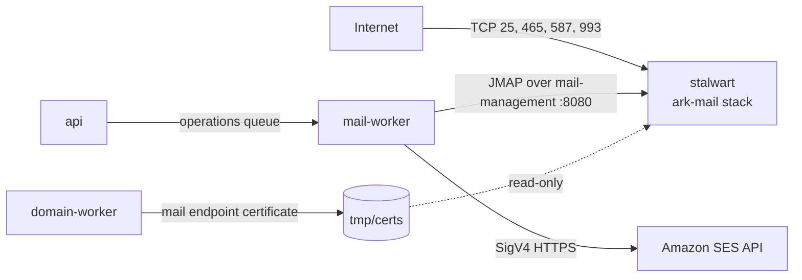

# Mail

Ark runs a Stalwart v0.16 mail server for your domains and manages its domains, mailboxes, aliases and device passwords from the admin UI and API. This page covers the components, the desired-state documents, inbound and outbound readiness, the Amazon SES relay, the mail DNS records and ports, day-to-day management, disabling mail and troubleshooting.

## Components



| Component                        | Where                                                                                                                 | Role                                                                                               |
| -------------------------------- | --------------------------------------------------------------------------------------------------------------------- | -------------------------------------------------------------------------------------------------- |
| `stalwart`                       | `infra/mail/docker-compose.yml` (Compose project `ark-mail`)                                                          | The mail server. Official multi-architecture Stalwart v0.16 image, pinned by OCI index digest.     |
| `mail-worker`                    | `infra/platform/docker-compose.yml`, `workers/src/mail.ts`                                                            | Claims `mail.*`, `mailbox.*` and `ses.*` operations and reconciles Stalwart and SES.               |
| Desired state and reconciliation | `shared/src/mail-state.ts`, `shared/src/stalwart.ts`, `server/src/modules/mail.ts`, `server/src/modules/providers.ts` | Builds the desired-state documents and applies them through Stalwart's JMAP management extensions. |
| Queue helpers                    | `shared/src/mail-queue.ts`, `server/src/modules/queue.ts`                                                             | Lists and mutates the Stalwart delivery queue.                                                     |
| SES helpers                      | `shared/src/ses.ts`                                                                                                   | SigV4 request signing, SES identity planning and SMTP password derivation.                         |

**The Stalwart container.** A reviewed RocksDB `config.json` is mounted read-only at `/etc/stalwart/config.json`, and durable data lives in the `ark_mail_data` volume at `/var/lib/stalwart`. The installer-generated recovery administrator is passed as `STALWART_RECOVERY_ADMIN` (from `STALWART_ADMIN_ADDRESS` and `STALWART_ADMIN_PASSWORD`). The certificate directory is mounted read-only at `/etc/stalwart/certs`. The container drops every Linux capability and adds back only `NET_BIND_SERVICE`, which the non-root image (UID 2000) needs for its low ports with `no-new-privileges` set. It receives no AWS credentials, DNS token or root key. Its native management HTTP endpoint (port 8080) is not published; the mail worker reaches it on the private `ark_mail_management` network.

**The mail worker** has the root key (to read sealed mailbox passwords), the Stalwart management credentials (`STALWART_URL`, default `http://stalwart:8080`; `STALWART_ADMIN_ADDRESS`, default `admin`; `STALWART_ADMIN_PASSWORD`), an optional `STALWART_CLI`, and the SES settings (`AWS_ACCESS_KEY_ID`, `AWS_SECRET_ACCESS_KEY`, `AWS_REGION` with default `eu-west-1`, `SES_SMTP_USERNAME`). It joins the `control` and `mail-management` networks only.

## Desired state

Every mailbox or alias change is first recorded in the control database, then applied by an operation. `mail.provision` and `mail.reconcile` build the complete desired state for **all** domains, mailboxes and active aliases, not a delta, and write it to `ARK_MAIL_STATE_DIR` (`tmp/mail-state` on the host) before touching Stalwart:

| File                   | Contents                                                                                                                                                  |
| ---------------------- | --------------------------------------------------------------------------------------------------------------------------------------------------------- |
| `domains.yaml`         | Each domain with `enabled` (true once the domain is verified), `mailFrom` and `dmarcPolicy`.                                                              |
| `mailboxes.yaml`       | Every mailbox that is not purged: address, display name, quota, lifecycle.                                                                                |
| `aliases.yaml`         | Every active alias with its targets.                                                                                                                      |
| `platform.yaml`        | The outbound provider (`ses`) and whether outbound is paused, with the note "Receiving starts without SES. Direct outbound delivery is never a fallback." |
| `stalwart-plan.ndjson` | The upsert and delete plan for Stalwart `Domain`, `Account` and `Alias` objects, one JSON object per line.                                                |

The files contain JSON despite the `.yaml` names. The directory is created with mode 0700 and the files with mode 0600.

> [!WARNING]
> The mailbox entries in these files carry the mailbox passwords Ark holds, in plain text. Treat `tmp/mail-state` like the rest of the installation's secret material: keep it on the host, keep its permissions, and leave it out of anything you copy off the VPS.

### Reconciliation with Stalwart

The worker then applies the state through Stalwart's JMAP management extensions (`urn:stalwart:jmap`), authenticated as the recovery administrator, in this order:

1. **Domains:** `x:Domain/query` and `x:Domain/get`, then `x:Domain/set` to create any missing domain.
2. **Accounts:** a mailbox becomes a Stalwart `User` account named by its local part in its domain. New accounts are created with their password. Existing accounts are updated with the description, and with the password while the mailbox is active on a verified domain. A mailbox that is not active has its credentials cleared. A purged mailbox's account is destroyed.
3. **Aliases:** an alias becomes a Stalwart mailing list whose recipients are the alias targets. Deleted aliases are destroyed by their stored native ID.

Any `notCreated`, `notUpdated` or `notDestroyed` entry in a `set` response fails the whole operation ("Stalwart … reconciliation returned partial … results."). Ark persists only the object IDs Stalwart returns (`nativeId` on mailboxes and aliases) and never invents them. A reconciliation without `STALWART_URL` and the admin credentials fails with "Stalwart management credentials and URL are required for reconciliation."

Reconciliation manages domains, accounts, aliases and app passwords. It does not create an outbound relay route in Stalwart.

## Readiness

Each mail domain created by the wizard has three statuses, shown as cards on the **Email** screen (`mail_domains` in `server/src/schema.ts`):

| Status   | Values             | Ready when                                                                                                                                                   |
| -------- | ------------------ | ------------------------------------------------------------------------------------------------------------------------------------------------------------ |
| Inbound  | `pending`, `ready` | The domain is verified, at least one mailbox exists, the last Stalwart reconciliation applied, and the mail endpoint has an `issued`, unexpired certificate. |
| Client   | `pending`, `ready` | The mail endpoint certificate is ready and at least one mailbox exists.                                                                                      |
| Outbound | `paused`, `ready`  | SES is in production with sending enabled and the domain identity is verified with DKIM and MAIL FROM both `SUCCESS` (see below).                            |

Inbound and outbound are deliberately independent: incoming mail can become ready while outbound stays paused, for example before SES production access is granted. A mailbox reconciliation first sets outbound from whether AWS credentials are configured, and then queues `ses.reconcile`, which sets the final outbound value from SES's own answers.

The card also shows "SES credentials present" or "not configured", and "Stalwart reachable config" or "desired-state only". These two flags come from the API process's environment. The production Compose file gives the AWS and Stalwart settings to the mail worker only, so on a production host the card can read "not configured" and "desired-state only" while the worker has both.

## SES relay

Outbound mail is meant to go through Amazon SES. Configure it in `.env` for the mail worker:

| Variable                | Meaning                                                                                          |
| ----------------------- | ------------------------------------------------------------------------------------------------ |
| `AWS_ACCESS_KEY_ID`     | Access key for the SES API.                                                                      |
| `AWS_SECRET_ACCESS_KEY` | Its secret. Also the input for the derived SMTP password.                                        |
| `AWS_REGION`            | The SES region. Defaults to `eu-west-1`. The platform region preset never changes it.            |
| `SES_SMTP_USERNAME`     | The SMTP user name recorded in the outbound plan. Without it, outbound stays paused in the plan. |

`ses.reconcile` (from **Reconcile SES** on the Email screen, `POST /api/ses/reconcile` with a `domainId`, or automatically after a mailbox reconciliation when credentials exist) calls the SES v2 API with SigV4 signatures:

1. `GET /v2/email/account` reads `ProductionAccessEnabled` and `SendingEnabled`. Without credentials it stops here and reports `missing_credentials`.
2. `POST /v2/email/identities` creates the domain identity (an existing identity, `409`, is accepted).
3. `PUT /v2/email/identities/<domain>/mail-from-attributes` sets the MAIL FROM domain (the domain's `mailFrom`, default `bounce.<domain>`) with `BehaviorOnMxFailure: REJECT_MESSAGE`.
4. `GET /v2/email/identities/<domain>` reads `VerifiedForSendingStatus`, the DKIM status and tokens, and the MAIL FROM status.

It derives the SES SMTP password from the secret key and region and seals it as a provider secret (`ses.smtp.<domainId>`). Outbound becomes `ready` only when **all** of these hold, and is `paused` otherwise:

- the account is configured, in **production** (out of the SES sandbox) and has sending enabled;
- the domain **identity** exists and is verified for sending;
- **DKIM** status is `SUCCESS`;
- **MAIL FROM** status is `SUCCESS`.

The operation's step evidence includes the identity's verification state, DKIM status and DKIM tokens, and MAIL FROM status, so you can see which requirement is missing.

> [!IMPORTANT]
> Ark's DNS plan does not include the SES records. Publish the DKIM CNAME records and the MAIL FROM MX and TXT records that SES lists for the identity at your DNS provider yourself, then run **Reconcile SES** again until DKIM and MAIL FROM report `SUCCESS`.

## Mail DNS records

With **Incoming mail** ticked, the wizard plans these records (see [The DNS plan](domains-and-dns.md#the-dns-plan)):

| Type | Name            | Value                                                                 |
| ---- | --------------- | --------------------------------------------------------------------- |
| A    | `mail.<zone>`   | The public IPv4                                                       |
| AAAA | `mail.<zone>`   | The public IPv6, only while AAAA is allowed                           |
| MX   | `<zone>`        | Priority 10, `mail.<zone>`                                            |
| TXT  | `<zone>`        | SPF `v=spf1 include:amazonses.com -all`, merged with any existing SPF |
| TXT  | `_dmarc.<zone>` | `v=DMARC1; p=none; rua=mailto:dmarc@<zone>`                           |

- The planned DMARC record always uses `p=none`. The domain's `dmarcPolicy` is recorded in the desired state.
- On Cloudflare, an existing apex MX with another value is never replaced: the MX action is `blocked` in the review until you remove it. The mail endpoint is not verified until the MX record is published and seen in public DNS ("The incoming mail MX record needs review and public DNS verification.").
- The mail endpoint gets a Let's Encrypt certificate like any other endpoint (see [Certificates](certificates.md)).

## Ports

| Port    | Protocol                                   |
| ------- | ------------------------------------------ |
| TCP 25  | SMTP, for incoming mail from other servers |
| TCP 465 | Submission with implicit TLS               |
| TCP 587 | Submission with STARTTLS                   |
| TCP 993 | IMAP over TLS                              |

Stalwart publishes these ports directly from the `ark-mail` stack on the IPv6-enabled `mail-public` network. They are not part of the front door: HAProxy never claims them, and SMTP or IMAP with STARTTLS is not offered as a front-door route. On a hardened host, `inet ark_host` admits them only while mail is enabled, and `mise run host:audit` lists them in the provider firewall inventory only then. They have no per-source connection limits in nftables (see [B1 in the security review](../security-review.md#b1-internet--vps-public-ports)). All ports are listed in [Ports and networks](../reference/ports-and-networks.md).

### Submission listener on TCP 587

`mise run mail:up` (`scripts/install-mail-submission.ts`) and the host installer start the pinned Stalwart and make sure port 587 is a STARTTLS submission listener:

1. It reads Stalwart's listeners with `x:NetworkListener/get` from inside the container, keeping the credential off the command line.
2. Any listener bound to port 587 must be SMTP with STARTTLS (not implicit TLS), and must bind the container's Docker network addresses rather than loopback only. Otherwise it stops with an error.
3. If no 587 listener exists, it creates one named `submission`, bound to `[::]:587`.
4. It probes `smtp://<container address>:587` with a required TLS upgrade, restarts Stalwart if needed (listener changes take effect at startup) and waits up to 30 seconds for the probe to pass.

`mise run mail:up` refuses to run while mail is disabled.

## Managing mail

The **Email** screen and the API offer the following. Every change needs an operator or owner with manage access to the domain, and an MFA-verified session or a step-up grant (which itself requires MFA). The Email screen's forms act on the first domain in the list; use the API for other domains.

### Mailboxes

- **Create:** **Add mailbox** (local part, display name, quota in GB) or `POST /api/mailboxes` with `domainId`, `localPart`, `displayName` and `quotaGb` (1–1000, default 10). Local parts accept the usual address characters, are lowercased, and may not start or end with a dot or contain adjacent dots. A `mail.provision` operation generates a password, seals it as a one-time secret and creates the Stalwart account. Mailboxes that have no Stalwart account yet, such as the wizard's first mailbox, are provisioned by `domain.verify` when the mail endpoint is verified.
- **Reveal the password once:** **View once** or `POST /api/mailboxes/:id/credential`, with a `secret.reveal` step-up bound to `{ mailboxId }`. A second reveal returns `409` ("No one-time mailbox credential remains."). The admin portal login and mailbox passwords are separate.
- **Lifecycle:** `POST /api/mailboxes/:id/lifecycle` with `active`, `suspended`, `retained` or `purged`. The UI offers **Suspend** and **Resume**. Any state other than `active` clears the account's credentials in Stalwart. `purged` destroys the Stalwart account, needs a `resource.delete` step-up bound to `{ mailboxId, lifecycle: "purged" }`, and is refused while an active alias targets the mailbox. A purged address stays reserved and cannot be reused or changed.
- **Reconcile now:** **Reconcile Stalwart** or `POST /api/mail/reconcile` with a `mailboxId` re-applies the full desired state.

### Aliases

- **Create:** **Add alias** (local part and comma-separated targets) or `POST /api/aliases` with `domainId`, `localPart`, optional `description`, 1–20 `targets` and `allowExternal`. The domain must already have a mailbox.
- **Update:** `PATCH /api/aliases/:id` with new `targets` (and optional `description` and `allowExternal`).
- **Delete:** **Delete** or `DELETE /api/aliases/:id`, with a `resource.delete` step-up bound to `{ aliasId }`. An alias Stalwart already knows is marked `pending_delete` and removed after the native object is destroyed.
- **Loops** in the alias graph are refused before saving ("Aliases must not form a forwarding loop."). A second alias with the same local part in a domain is refused by a unique index.
- **External forwarding:** a target outside Ark's domains needs both the owner setting **Allow external alias forwarding** (Settings) and `allowExternal: true` on the alias. The **Add alias** form does not send `allowExternal`, so external targets need the API.

### Device passwords

A device password is a native Stalwart app password for one mail client, so the mailbox's main password does not have to be shared.

- **Create:** **Device credential** (mailbox and label) or `POST /api/mailboxes/:id/devices` with a `label`. The `mailbox.device` operation calls `x:AppPassword/set` as the mailbox user and seals the one-time secret Stalwart returns.
- **Reveal once:** **Reveal once** or `POST /api/devices/:id/credential`, with a `secret.reveal` step-up bound to `{ deviceId }`.
- **Revoke:** **Revoke** or `POST /api/devices/:id/revoke`. Stalwart must confirm the app password was destroyed.

### Delivery queue

`GET /api/mail/queue` lists queued messages (ID, recipient, sender, age and `queued`, `deferred` or `bounce`) whose sender or recipient domain the caller may see. `POST /api/mail/queue` with `action` (`retry` or `delete`) and the item queues `mail.queue_retry` or `mail.queue_delete`. Mutations are limited to local recipients, and a `queued` message younger than 60 seconds cannot be deleted. **Refresh mail queue** on the Email screen shows the list.

> [!NOTE]
> The queue list is read by the API process with `STALWART_CLI` (`queue list --json`) or, failing that, Stalwart's JMAP queue query, using settings from the API's own environment. Queue mutations run in the mail worker and require `STALWART_CLI` there ("No native Stalwart queue mutation executor is configured."). The production Compose file passes neither `STALWART_URL` nor `STALWART_CLI` to `api`, so the list is empty on a default production install.

## Disabling mail

Set `ARK_MAIL_ENABLED=0` in `.env` (the value must be `0` or `1`; empty means enabled) and re-run the installer:

```sh
sudo mise run host:install
```

On a hardened host the installer first stops the firewall reconciler, then stops Stalwart, the mail worker and the old API, and applies the mail-off firewall baseline, which closes TCP 25, 465, 587 and 993. With mail disabled:

- workers never claim `mail.*`, `mailbox.*` or `ses.*` operations; already queued jobs wait and resume when mail is enabled again;
- the mail API routes answer `503` with "Mail is disabled on this installation.";
- the wizard refuses **Incoming mail**;
- signed maintenance keeps the mail worker stopped.

If the installer's build fails part-way, run it again to restore the API and the reconciler with the saved settings. The full procedure is in [VPS hardening](../operating.md#vps-hardening).

## Verifying mail

- `mise run test:stalwart` runs the native lifecycle checks (domain, account, alias and app password) against a disposable container from the pinned Stalwart image.
- Check the ports from outside the VPS: `nc -vz mail.example.com 25`, and `openssl s_client -starttls smtp -connect mail.example.com:587` for submission.
- Check DNS with `dig MX example.com @1.1.1.1 +short` and `dig TXT _dmarc.example.com @1.1.1.1 +short`.
- After **Reconcile SES**, open the `ses.reconcile` operation and read its `ses-reconcile` step for the identity, DKIM and MAIL FROM states.

## Troubleshooting

| Symptom                                                                                  | Cause and fix                                                                                                                                                                           |
| ---------------------------------------------------------------------------------------- | --------------------------------------------------------------------------------------------------------------------------------------------------------------------------------------- |
| Inbound stays `pending`                                                                  | One of: domain not verified, no mailbox, the last reconciliation failed, or the mail endpoint has no `issued` certificate (staging certificates do not count). Check each in turn.      |
| Outbound stays `paused`                                                                  | Read the `ses.reconcile` step. Typical causes: SES sandbox (no production access), sending disabled, DKIM or MAIL FROM records not published, or no AWS credentials in the mail worker. |
| "Stalwart management credentials and URL are required …"                                 | `STALWART_URL`, `STALWART_ADMIN_ADDRESS` or `STALWART_ADMIN_PASSWORD` is missing in the mail worker.                                                                                    |
| "Stalwart … reconciliation returned partial … results."                                  | Stalwart refused part of the change. Check the `stalwart` container logs, fix the cause and select **Reconcile Stalwart**.                                                              |
| "Create a mailbox on this domain before changing native mail aliases."                   | Aliases need at least one mailbox on the domain.                                                                                                                                        |
| "External alias forwarding is disabled." / "This alias does not allow external targets." | Enable **Allow external alias forwarding** and set `allowExternal: true` on the alias.                                                                                                  |
| "Mail is disabled on this installation."                                                 | `ARK_MAIL_ENABLED=0`. Enable it in `.env` and re-run `sudo mise run host:install`.                                                                                                      |
| MX `blocked` in the Cloudflare review                                                    | The zone already has an MX record. Remove it at Cloudflare when you are ready to cut over, then reload the review.                                                                      |
| `mail:up` fails on port 587                                                              | An existing 587 listener uses implicit TLS or binds only loopback. Fix or remove it in Stalwart, then rerun `mise run mail:up`.                                                         |

See also [Troubleshooting](../operations/troubleshooting.md).

## Related pages

- [Domains and DNS](domains-and-dns.md) and [Certificates](certificates.md).
- [Ports and networks](../reference/ports-and-networks.md).
- [Operations and workers](../operations/operations-and-workers.md): how mail operations are queued and claimed.
