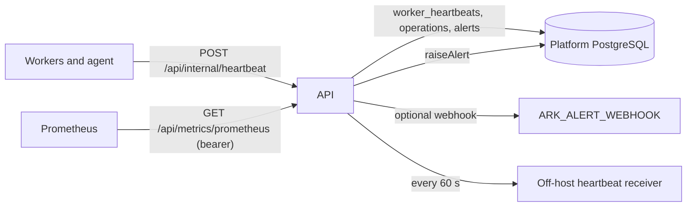

# Monitoring and alerts

This page explains how Ark Stack reports its own health: the Prometheus instance in `infra/monitoring`, every alert rule it evaluates, the metrics the API exports, worker heartbeats, the in-app alert pipeline with its optional webhook, and the off-host heartbeat that covers total host loss.

## Overview

Ark has two independent alert paths and one dead-man signal:

- **Prometheus** scrapes the API's metrics endpoint every 15 seconds and evaluates the rules in `infra/monitoring/alerts.yml`. It runs on the VPS, next to the platform.
- **In-app alerts** are rows in the `alerts` table. Workers and the API raise and resolve them as they observe problems; the Overview screen shows them, and an optional webhook (`ARK_ALERT_WEBHOOK`) delivers them elsewhere.
- **The off-host heartbeat** is a periodic HTTPS request from the API to a receiver you run somewhere else. When the VPS disappears, only that receiver can notice.



> [!IMPORTANT]
> An on-host Prometheus cannot prove that the host itself is gone. Configure the off-host heartbeat and an independent webhook receiver for that case ([Providers](../operating.md#providers)).

## Prometheus

The monitoring stack is a single Compose project, `ark-monitoring`, in `infra/monitoring/docker-compose.yml`:

| Setting          | Value                                                                                             |
| ---------------- | ------------------------------------------------------------------------------------------------- |
| Image            | `prom/prometheus:v3.5.0`, pinned by digest                                                        |
| Listener         | `127.0.0.1:9090` on the host only                                                                 |
| Retention        | `--storage.tsdb.retention.time=14d`, in the `ark_prometheus` volume                               |
| Scrape and rules | `scrape_interval` and `evaluation_interval` of 15 s (`infra/monitoring/prometheus.yml`)           |
| Target           | job `ark-stack`, `api:3000`, path `/api/metrics/prometheus`                                       |
| Credential       | bearer token read from `tmp/metrics.token`, mounted read-only at `/run/secrets/ark_metrics_token` |
| Network          | the external Docker network `ark_monitoring`, which the platform's `api` service also joins       |
| Rules            | `infra/monitoring/alerts.yml`, mounted read-only at `/etc/prometheus/alerts.yml`                  |

`mise run host:install` creates the `ark_monitoring` network, writes `tmp/metrics.token` (mode `0600`) from `ARK_METRICS_TOKEN`, and starts Prometheus as its last step, waiting up to 120 seconds for it to become healthy. To start or restart it on its own, run:

```sh
mise run monitor:up
```

That task only runs `docker compose -f infra/monitoring/docker-compose.yml up -d`, so the network and the token file must already exist.

The Prometheus UI and its **Alerts** page are reachable only from the host, at `127.0.0.1:9090`; use an SSH tunnel to view them from elsewhere. The repository ships no Alertmanager: `prometheus.yml` has no `alerting` section, so Prometheus evaluates and displays alerts but does not deliver them. Delivery to people is the job of the in-app webhook and the off-host heartbeat described below.

## Metrics endpoint

`GET /api/metrics/prometheus` serves the Prometheus text format (`text/plain; version=0.0.4`). It is one of the host-independent paths, so it answers on any `Host`, including `api:3000` on the Docker network and `127.0.0.1:3000` on the host. It never accepts an admin session; the only credential is:

```http
GET /api/metrics/prometheus
Authorization: Bearer <ARK_METRICS_TOKEN>
```

A wrong or missing token returns 401 `Invalid metrics credential.` The comparison is constant-time.

`ARK_METRICS_TOKEN` is generated by the installer and is required in production. Outside production, an unset `ARK_METRICS_TOKEN` falls back to `ARK_INTERNAL_TOKEN`; `.env.example` sets it to `dev-metrics-token`. A quick check from the host:

```sh
curl -fsS -H "Authorization: Bearer $(cat tmp/metrics.token)" http://127.0.0.1:3000/api/metrics/prometheus
```

### Exported metrics

Every value is computed from the database or from files at scrape time; nothing is cached between scrapes.

| Metric                                                  | Type    | Meaning                                                                                                                                                             |
| ------------------------------------------------------- | ------- | ------------------------------------------------------------------------------------------------------------------------------------------------------------------- |
| `ark_operations{status}`                                | gauge   | Number of operation rows in `failed`, `running`, `waiting_external` and `needs_recovery`.                                                                           |
| `ark_backups_unverified`                                | gauge   | Number of `backups` rows whose `restore_verified` flag is false.                                                                                                    |
| `ark_certificates_expiring`                             | gauge   | Number of `certificates` rows whose expiry is less than 14 days away (expired rows included).                                                                       |
| `ark_worker_heartbeat_stale{identity}`                  | gauge   | 1 when the identity has no heartbeat row or its last heartbeat is older than 90 seconds, otherwise 0. See [Worker heartbeats](#worker-heartbeats).                  |
| `ark_db_client_rollover_pending{severity}`              | gauge   | Open `db-client-rollover:` alerts by severity (`info`, `warning`, `critical`).                                                                                      |
| `ark_db_client_retirement_failures`                     | gauge   | Open `db-client-retire:` alerts.                                                                                                                                    |
| `ark_nft_counters_present{table}`                       | gauge   | 1 when the host nftables counter snapshot for `ark_db_ingress` or `ark_front` was readable and well formed.                                                         |
| `ark_nft_counters_age_seconds{table}`                   | gauge   | Age of that snapshot; omitted when the snapshot is not present.                                                                                                     |
| `ark_nft_drop_packets_total{table,chain,reason,family}` | counter | Packets dropped by Ark's named nftables counters. Reasons are `concurrent` and `rate` (both tables) and `closed` and `allowlist` (the `ark_front` dedicated ports). |
| `ark_host_reboot_required`                              | gauge   | 1 when Ubuntu has flagged that a reboot is needed. Omitted entirely on hosts without the hardening timer.                                                           |
| `ark_backup_target_last_success_age_seconds{target}`    | gauge   | Seconds since the target's last successful export, or `-1` if it never succeeded.                                                                                   |
| `ark_backup_target_append_only_verified{target}`        | gauge   | 1 when the target's append-only evidence is current.                                                                                                                |
| `ark_backup_recovery_point_age_seconds{target,source}`  | gauge   | Age of the newest off-VPS recovery point for each PostgreSQL source on each target, or `-1`.                                                                        |
| `ark_backups_healthy`                                   | gauge   | 1 when off-VPS backup health is good overall ([backups guide](../guides/backups.md#health-and-alerts)).                                                             |

Where the file-based values come from:

- **nftables counters.** The `database-ingress` host reconciler writes a snapshot of both tables' counters every 15 seconds. The API reads it from `ARK_DB_INGRESS_METRICS_DIR` (`/var/lib/ark/db-ingress`, a read-only mount of `tmp/db-ingress`). A missing or unreadable snapshot reports `ark_nft_counters_present 0` and no drop samples. Counters reset when the ruleset is reapplied with changed limits; `rate()` in the rules tolerates that ([Public database port limits](../operating.md#public-database-port-limits)).
- **Reboot flag.** On a hardened VPS, the `ark-host-reboot-metric` systemd timer copies whether `/run/reboot-required` exists into `/var/lib/ark/host-metrics/reboot-required` about every 30 seconds. The API reads it from `ARK_HOST_METRICS_DIR`; the mount source is `ARK_HOST_METRICS_SOURCE`, which the installer points at `/var/lib/ark/host-metrics` on a hardened host and at `tmp/host-metrics` otherwise. If the file is absent the metric is not exported at all.

### The JSON summary

`GET /api/metrics` is a small JSON summary for signed-in users of the admin origin: `operationsFailed`, `operationsRunning`, `backupsWithoutRestoreProof` and `certificatesExpiringSoon` (14 days). It uses the normal session and is not meant for Prometheus.

## Alert rules

All rules are in one group, `ark-stack`, in `infra/monitoring/alerts.yml`. Each entry below gives the expression, how long it must hold (`for`), its `severity` label, what it means, the usual causes and what to do.

### ArkApiDown

- **Expression:** `up{job="ark-stack"} == 0`, for 2 minutes, `critical`.
- **Meaning:** Prometheus could not scrape the metrics endpoint.
- **Likely causes:** the `api` container is stopped, restarting or unhealthy; the platform database is unreachable (`/api/health` and the metrics queries both need it); the token in `tmp/metrics.token` no longer matches `ARK_METRICS_TOKEN` (the scrape gets 401); or the `api` service is no longer attached to `ark_monitoring`.
- **What to do:** check `docker compose --env-file .env -f infra/platform/docker-compose.yml ps api` and its logs, then run the `curl` check above from the host. The **Targets** page in Prometheus shows the exact scrape error. If the token is wrong, rerun `mise run host:install` (it rewrites the token file from `.env`) and restart Prometheus.

### ArkOperationFailures

- **Expression:** `ark_operations{status="failed"} > 0`, for 5 minutes, `warning`.
- **Meaning:** at least one durable operation is in `failed`.
- **Likely causes:** any worker job that ended with an error: an ACME order, a DNS check, a PgBouncer reload, an edge observation on a host whose edge node has not joined yet, a backup export to an unreachable target, and so on.
- **What to do:** open **Latest operations** on the Overview screen and read the error and step evidence of each failed operation, then fix the cause and run the action again. The gauge counts every failed row with no time window, and a retry is a new operation that leaves the old row in `failed`, so this rule keeps firing after the cause is fixed. Treat it as "there are failed operations to review", not as a live outage signal. See [Operations and workers](../operations/operations-and-workers.md) for the lifecycle.

### ArkBackupsUnverified

- **Expression:** `ark_backups_unverified > 0`, for 30 minutes, `warning`.
- **Meaning:** at least one backup row has no restore proof.
- **Likely causes:** a backup has been taken but nobody has run a restore test and confirmed that the restored copy worked. A successful upload is never restore proof; neither is a completed restore test on its own. The gauge counts every backup row without `restore_verified`, including old and failed ones.
- **What to do:** run a restore test for a recent backup (`POST /api/backups/restore-test`, `restore.overwrite` step-up), check that the restored copy actually booted and served its data, then record it with `POST /api/backups/:id/verify-restore`. See [Backups](backups.md) and the [backups guide](../guides/backups.md).

### ArkCertificateExpiry

- **Expression:** `ark_certificates_expiring > 0`, for 5 minutes, `critical`.
- **Meaning:** a managed certificate row expires within 14 days.
- **Likely causes:** a public Let's Encrypt certificate for a route, the admin or login host or the database endpoint is due for renewal. No scheduled job queues that renewal by itself. The gauge counts every certificate row; renewal adds a new row and keeps the old one, so superseded certificates also count as they approach expiry. The in-app alert is narrower: it only considers the newest certificate per endpoint.
- **What to do:** run domain verification (**Recheck** on the Domains screen, or `POST /api/domains/:id/verify`). It renews any ready endpoint whose certificate is missing, unusable or within 30 days of expiry. A renewed database certificate is served only after `pgbouncer.reload` confirms its fingerprint. See [Certificate rollover](../operating.md#certificate-rollover) and [Certificates](certificates.md).

### ArkWorkerHeartbeatStale

- **Expression:** `ark_worker_heartbeat_stale == 1`, for 2 minutes, `critical`.
- **Meaning:** a worker identity has not reported for more than 90 seconds, sustained for two more minutes.
- **Likely causes:** the worker container is stopped or crash-looping, cannot reach `http://api:3000`, or presents a token the API does not accept. See [Worker heartbeats](#worker-heartbeats) for the identities and the details that can make one look stale.
- **What to do:** the `identity` label names the worker. Check that container's state and logs (`database-worker`, `domain-worker`, `mail-worker`, `backup-worker` or `agent`). A `Worker heartbeat failed: 401` line means the worker token and the API's copy differ.

### ArkHostRebootRequired

- **Expression:** `ark_host_reboot_required == 1`, for 5 minutes, `warning`.
- **Meaning:** unattended upgrades installed something that needs a reboot, and the flag has persisted.
- **Likely causes:** a kernel or library update. The hardening phase configures `Unattended-Upgrade::Automatic-Reboot` at `ARK_HOST_REBOOT_TIME` (default 04:00 in the server's time zone), so the alert normally clears after the next maintenance window.
- **What to do:** let the scheduled reboot happen, or reboot at a time of your choosing. If the alert survives a maintenance window, check the effective apt configuration. See [Maintenance and upgrades](../operations/maintenance-and-upgrades.md) and [VPS hardening](../operating.md#vps-hardening).

### ArkDatabaseIngressDrops

- **Expression:** `sum by (reason, family) (rate(ark_nft_drop_packets_total{table="ark_db_ingress"}[5m])) > 0`, for 10 minutes, `warning`.
- **Meaning:** the per-source limits on public 5432 have been dropping connections continuously for 10 minutes. The description reports the drop rate, the `reason` (`concurrent` or `rate`) and the address `family`.
- **Likely causes:** a legitimate client, such as a Vercel deployment behind a shared egress address, exceeds the per-source limits (by default 128 concurrent connections and 30 new connections per second with a burst of 60, per IPv4 address or IPv6 /64), or someone is abusing the public pooler.
- **What to do:** identify the source. If it is legitimate, raise the limits on the settings page or with `PUT /api/settings/db-ingress` (owner, MFA, `platform.update` step-up). See [Public database access](public-database-access.md).

### ArkDatabaseIngressCountersStale

- **Expression:** `ark_nft_counters_present{table="ark_db_ingress"} == 0`, or present with `ark_nft_counters_age_seconds` above 300, for 5 minutes, `warning`.
- **Meaning:** the database-ingress reconciler has stopped reporting its nftables counters, so `ArkDatabaseIngressDrops` can no longer see anything.
- **Likely causes:** the `database-ingress` service is stopped or failing, the snapshot file is missing, unreadable or corrupt, or the read-only mount into the API is missing.
- **What to do:** check `database-ingress` logs and `tmp/db-ingress/counters.json`. The reconciler also reports policy failures in `allowlist.status`.

### ArkDatabaseClientRolloverWarning

- **Expression:** `ark_db_client_rollover_pending{severity="warning"} > 0`, for 5 minutes, `warning`.
- **Meaning:** a database client's successor certificate has not been delivered and its current certificate expires within 14 days.
- **Likely causes:** the successor was issued at T−30 but nobody has replaced the client's certificate and key yet, or the Vercel integration could not deliver it.
- **What to do:** deliver the successor and confirm it ([manual rollover](../guides/vercel-database.md#7-manual-rollover)). This rule mirrors Ark's own `db-client-rollover:<client>` alert, which escalates from `info` at T−30 to `warning` at T−14.

### ArkDatabaseClientRolloverCritical

- **Expression:** `ark_db_client_rollover_pending{severity="critical"} > 0`, for 5 minutes, `critical`.
- **Meaning:** the same, within 7 days of expiry or after it. The alert stays critical after expiry if no successor was delivered.
- **What to do:** deliver the successor now. After `not_after`, TLS rejects the old certificate and the client cannot connect ([90-day lifetime and rollover alerts](../guides/vercel-database.md#6-90-day-lifetime-and-rollover-alerts)).

### ArkDatabaseClientRetirementFailed

- **Expression:** `ark_db_client_retirement_failures > 0`, for 1 minute, `critical`.
- **Meaning:** a retiring client certificate generation was not drained from PgBouncer by its deadline (`not_after` + 5 s), or a drain or watchdog action failed.
- **Likely causes:** the database worker is down, or PgBouncer's admin socket did not answer. The retirement task retries, and the watchdog fences admission and stops PgBouncer.
- **What to do:** check containment immediately, following [Certificate rollover](../operating.md#certificate-rollover): the `client_certificate_retirements` row (`last_error`, `watchdog_at`, the `watchdog` evidence), database worker and `pgbouncer-public` logs, and `SHOW CLIENTS` for the affected role.

### Testing the rules

`promtool` checks and unit-tests the rules in disposable containers:

- `mise run test:db-ingress` runs `promtool check rules` on `infra/monitoring/alerts.yml` and the unit tests in `scripts/db-ingress-test/alerts.test.yml` (both ingress alerts).
- `mise run test:host-hardening` includes `scripts/host-hardening-test/reboot-alert.test.yml`, which proves that `ArkHostRebootRequired` waits five minutes and clears when the flag does.

## Worker heartbeats

Every worker process proves it is alive by calling `POST /api/internal/heartbeat` with its own bearer token and a version string. The API derives the identity from the token, never from the request body, and upserts one row per identity in `worker_heartbeats` (`identity`, `version`, `last_seen_at`).

| Identity   | Process                      | Token                       | Version reported |
| ---------- | ---------------------------- | --------------------------- | ---------------- |
| `agent`    | `agent` (Go Docker agent)    | `ARK_AGENT_TOKEN`           | `go-agent-v1`    |
| `database` | `database-worker`            | `ARK_DATABASE_WORKER_TOKEN` | `ts-worker-v1`   |
| `domains`  | `domain-worker`              | `ARK_DOMAIN_WORKER_TOKEN`   | `ts-worker-v1`   |
| `mail`     | `mail-worker` (mail enabled) | `ARK_MAIL_WORKER_TOKEN`     | `ts-worker-v1`   |
| `backup`   | `backup-worker`              | `ARK_BACKUP_WORKER_TOKEN`   | `ts-worker-v1`   |

When the heartbeat is sent:

- TypeScript workers (`workers/src/runtime.ts`) send it before every job poll, which happens every 2 seconds while a polling loop has a free slot.
- The Go agent sends it at the start of every tick, every 3 seconds.

`ark_worker_heartbeat_stale` checks `agent`, `database`, `domains` and `backup`, plus `mail` only when `ARK_MAIL_ENABLED` is on. The threshold is 90 seconds, the same default that `staleObservation` in `shared/src/operations.ts` uses for observations ("stale observations are unknown, not healthy").

Details that can make a healthy worker look stale:

- A polling loop posts no liveness heartbeat while all its slots are busy. The database and mail workers have a single loop with one slot, and the agent runs its jobs inside the tick, so a job that runs for more than 90 seconds marks that identity stale until it finishes. Jobs themselves keep their claim alive separately (below), so this does not affect the job.
- The API maps a worker token to its identity only when the matching `ARK_*_WORKER_TOKEN` is set in the API's own environment. A worker that falls back to the shared `ARK_INTERNAL_TOKEN` is identified as `module`, which the metric does not track, so its expected identity reports stale.
- With embedded workers (`ARK_EMBEDDED_WORKERS=1`, development only), the coordinator runs inside the API and never posts heartbeats, so every identity reports stale.

The liveness heartbeat is distinct from the **operation lease heartbeat**. While a job runs, its worker calls `POST /api/internal/jobs/:id/heartbeat` with the claim token every 15 seconds. A running operation whose lease heartbeat is older than its lease (90 seconds by default) is put back to `queued` with the error `Previous worker lease expired; operation reclaimed.` See [Operations and workers](../operations/operations-and-workers.md).

The edge watchdog is not a heartbeat identity. It authenticates with `ARK_EDGE_WATCHDOG_TOKEN`, may only read the edge lease and report events under `/api/internal/edge/`, and is supervised by the edge launch guards instead ([Edge observer and lease watchdog](../operating.md#edge-observer-and-lease-watchdog)).

## In-app alerts

In-app alerts live in the `alerts` table and are managed by `server/src/modules/alerts.ts`.

### Lifecycle

Each alert has a unique `dedupKey`, a `severity` (`info`, `warning` or `critical`) and a `title`. `raiseAlert` is idempotent per key:

- A new key inserts an open alert and tries to notify.
- An open alert whose severity or title changes keeps its identity. If the severity goes up (for example a rollover alert going from `info` to `warning` to `critical`), the acknowledgement and the notification throttle are cleared, so it is delivered again.
- A resolved alert raised again is reopened, unacknowledged, with the new severity and title.
- `resolveAlert` sets `resolvedAt` on the open alert with that key. The code that raises an alert resolves it when the condition clears.

### Where alerts come from

| Dedup key                           | Severity                | Raised when                                                                                                     |
| ----------------------------------- | ----------------------- | --------------------------------------------------------------------------------------------------------------- |
| `op-failed:<operation>`             | warning                 | An operation is `failed` (the 100 most recent, excluding `integration.vercel_push`).                            |
| `cert:<certificate>`                | critical                | The newest served certificate of an endpoint expires within 14 days (`awaiting_reload` renewals are ignored).   |
| `backup-stale`                      | warning                 | The newest non-failed, non-planned, non-local backup of some target is older than 36 hours.                     |
| `backup-*` per target and source    | warning or critical     | Off-VPS backup health problems ([backups guide](../guides/backups.md#health-and-alerts)).                       |
| `edge-withdrawal`                   | critical                | The edge watchdog reports a failed withdrawal, a stopped proxy or an unavailable policy, or `edge.drain` fails. |
| `gate-revocation-overdue`           | critical                | A gate revocation was not applied within 5 s, so the watchdog withdrew the route.                               |
| `pgbouncer-reload`                  | critical                | A PgBouncer reload failed, including a renewed database certificate that is not being served.                   |
| `pgbouncer-revoke:<role>`           | critical                | A revoked database client may still have live PgBouncer sessions.                                               |
| `db-client-rollover:<client>`       | info, warning, critical | A client's successor certificate is undelivered at T−30, T−14 and T−7.                                          |
| `db-client-retire:<certificate>`    | critical                | A retiring generation missed its drain deadline or a drain or watchdog action failed.                           |
| `vercel-token-expiry:<integration>` | warning, critical       | A Vercel integration token expires within 30 days, or has expired.                                              |
| `vercel-push:<client>`              | warning, critical       | Automated Vercel certificate delivery failed, may have left a mismatched pair, or has an unsettled write.       |
| `dns-aaaa-withdrawal:<domain>`      | warning                 | An IPv6 DNS removal is still pending for a hostname.                                                            |

The first three rows come from the general sweep, `evaluateAlerts`, which also resolves them once their condition clears. That sweep runs at the end of each pass of the in-process coordinator (`processQueued` in `server/src/coordinator.ts`), which runs only with embedded workers. The external worker processes do not call it, so in a production deployment those three conditions are covered by the Prometheus rules `ArkOperationFailures`, `ArkCertificateExpiry` and `ArkBackupsUnverified`. Every other row is raised by the worker or API code that observes the problem, and the off-VPS backup alerts are re-evaluated after every backup observation, export and target verification.

### Viewing, acknowledging and silencing

The **Alerts** card on the Overview screen lists the 50 most recently created alerts, open and resolved, to owners and operators; viewers see none. Each open alert has two buttons:

- **Ack** calls `POST /api/alerts/:id/ack`. It marks the alert acknowledged, which stops further notifications for it until it escalates or reopens.
- **Silence 1h** calls `POST /api/alerts/:id/silence` with `{ "minutes": 60 }`. The API accepts 5 to 10,080 minutes (one week) and audits the change as `alert.silence`.

Both need the operator role or higher and MFA. Neither hides the alert or changes its state; they only affect notification.

### Webhook notifications

Set `ARK_ALERT_WEBHOOK` to an HTTPS endpoint to receive alerts. Each notification is a `POST` with a 10-second timeout:

```json
{ "title": "Certificate for www.example.com expires soon", "severity": "critical", "source": "ark-stack" }
```

A notification is attempted whenever an alert is raised, unless the alert is acknowledged, resolved or silenced, has already been delivered five times, or was last delivered less than five minutes ago. Only a 2xx response counts as delivered. Without the variable nothing is sent. The Overview state reports whether the API has a webhook configured (`providers.alertWebhook`).

The notification is sent by whichever process raises the alert: the API for watchdog and gate events, and the worker that observed the problem for most others. The variable therefore has to reach those processes. The shipped `infra/platform/docker-compose.yml` does not pass `ARK_ALERT_WEBHOOK` to any service, so a production install needs it added to the `api` and worker environments before notifications are sent; with `mise run dev`, setting it in `.env` is enough because the embedded workers run inside the API.

> [!WARNING]
> The webhook receiver must not depend on this server: not its mail service, not its DNS, not a route it publishes ([Providers](../operating.md#providers)). Otherwise the alerts that matter most cannot be delivered.

## Off-host heartbeat

`server/src/modules/offhost-heartbeat.ts` is a dead-man sender for a receiver you operate elsewhere. It starts with the API process (`server/src/index.ts`) when `ARK_OFFHOST_HEARTBEAT_URL` is set:

- It requires `ARK_OFFHOST_HEARTBEAT_TOKEN`; without it the API refuses to start with `ARK_OFFHOST_HEARTBEAT_TOKEN is required when off-host heartbeat is enabled.`
- In production the URL must be HTTPS (`Production off-host heartbeat receivers must use HTTPS.`).
- It sends one request at startup and then one every 60 seconds:

  ```http
  POST <ARK_OFFHOST_HEARTBEAT_URL>
  Authorization: Bearer <ARK_OFFHOST_HEARTBEAT_TOKEN>
  Content-Type: application/json

  {"source":"ark-stack","status":"alive","at":"2026-11-19T04:00:00.000Z"}
  ```

- Each request has a 10-second timeout. A failure or non-2xx answer is logged by the API (`Off-host heartbeat receiver returned <status>.`) and the next interval tries again.

The receiver is not part of this repository. Configure it to alert when heartbeats stop arriving, and test that by stopping a disposable host. Because the sender runs inside the API, a stopped API, a dead host and a lost network all look the same to the receiver.

The installer generates `ARK_OFFHOST_HEARTBEAT_TOKEN`; the URL is empty by default. The same receiver host can also run the managed IPv6 preflight runner, which serves `POST /preflight` with the same token (`scripts/ipv6-preflight-probe.ts serve`); see [Native IPv6 and AAAA publication](../operating.md#native-ipv6-and-aaaa-publication). The host audit's external scan is also meant to run from that off-host machine ([Provider firewall and audit](../operating.md#provider-firewall-and-audit)).

## Configuration summary

| Variable                      | Where          | Purpose                                                                                          |
| ----------------------------- | -------------- | ------------------------------------------------------------------------------------------------ |
| `ARK_METRICS_TOKEN`           | `api`          | Bearer credential for `/api/metrics/prometheus`; copied to `tmp/metrics.token` by the installer. |
| `ARK_ALERT_WEBHOOK`           | `api`, workers | Optional URL for in-app alert notifications; not set by the shipped Compose file.                |
| `ARK_OFFHOST_HEARTBEAT_URL`   | `api`          | Optional HTTPS dead-man receiver; empty disables the sender.                                     |
| `ARK_OFFHOST_HEARTBEAT_TOKEN` | `api`          | Bearer token for the receiver; generated by the installer.                                       |
| `ARK_HOST_METRICS_DIR`        | `api`          | Directory holding the `reboot-required` marker (`/var/lib/ark/host-metrics`).                    |
| `ARK_HOST_METRICS_SOURCE`     | Compose        | Host directory mounted there.                                                                    |
| `ARK_DB_INGRESS_METRICS_DIR`  | `api`          | Directory holding the nftables counter snapshot (`/var/lib/ark/db-ingress`).                     |
| `ARK_HOST_REBOOT_TIME`        | installer      | Automatic reboot time after updates, `HH:MM`, default 04:00.                                     |
| `ARK_MAIL_ENABLED`            | `api`          | Whether the `mail` heartbeat identity is expected.                                               |

For every other setting see [Configuration](../getting-started/configuration.md). For what to do about specific symptoms see [Troubleshooting](../operations/troubleshooting.md).
