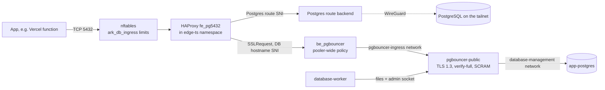

# Public database access

This page explains how applications outside the VPS, such as Vercel functions, reach Ark-managed PostgreSQL databases on public TCP 5432. It covers the PgBouncer pooler and its mTLS and SCRAM checks, the HAProxy router on 5432, the pooler-wide source policy, the per-source port limits, Postgres routes to tailnet databases, and the lifecycle of database client certificates. For step-by-step setup, see [Database access from Vercel](../guides/vercel-database.md) and [the front-door guide, §6](../guides/front-door.md#6-postgresql-the-ark-pooler-and-postgres-routes).

## Overview

Application PostgreSQL (`app-postgres`) never listens on a public address. Public traffic for Ark databases terminates on a dedicated PgBouncer, `pgbouncer-public`. Ark generates its whole configuration from the database clients an owner has issued, and nothing else can connect. Each client is one app environment, for example the production deployment of a storefront. It gets its own login role, its own private CA and a 90-day client certificate.

Vercel functions have no stable egress addresses, so Ark cannot rely on IP allowlists. Admission is instead layered, and a connection must pass every layer:

| Layer                   | Where                                          | What it checks                                                                                                         |
| ----------------------- | ---------------------------------------------- | ---------------------------------------------------------------------------------------------------------------------- |
| Per-source limits       | Host nftables, table `inet ark_db_ingress`     | Concurrent connections and new-connection rate per IPv4 address or IPv6 /64.                                           |
| Protocol and SNI router | HAProxy `fe_pg5432` in the edge namespace      | The first bytes are a PostgreSQL `SSLRequest`, `GSSENCRequest`, `CancelRequest` or a TLS ClientHello, sent within 5 s. |
| Pooler source policy    | HAProxy `be_pgbouncer`                         | The source address is in the pooler-wide policy, or the policy allows the internet.                                    |
| TLS                     | PgBouncer                                      | TLS 1.3 only, with Ark's publicly trusted certificate for the database hostname.                                       |
| Client certificate      | PgBouncer (`client_tls_sslmode = verify-full`) | The certificate chains to a CA generation of an active client.                                                         |
| Password                | PgBouncer (`pg_hba.conf`, `scram-sha-256`)     | SCRAM for a login role in the generated userlist.                                                                      |
| Database privileges     | `app-postgres`                                 | The login role inherits only the `runtime` or `readonly` grants of its database.                                       |



Two network rules hold the shape together. `pgbouncer-public` publishes no port and joins the internal `pgbouncer-ingress` network, which it shares only with `edge-ts`. `app-postgres` stays on the internal `database-management` bridge, which the edge namespace never joins. HAProxy can reach PgBouncer, but never the database server itself.

For the roles behind each login, and for creating public and private databases, see [Databases](databases.md).

## The PgBouncer pooler

### Container

`pgbouncer-public` runs PgBouncer 1.26.1 from a digest-pinned image (`infra/platform/docker-compose.yml`). Releases before 1.25.2 are affected by CVE-2026-6664, and `tests/security/pgbouncer-public.test.ts` enforces the minimum version. The service:

- runs `/usr/bin/pgbouncer` directly on the generated `/var/lib/ark/pgbouncer/pgbouncer.ini`, bypassing the image's own entrypoint, which builds a configuration from environment variables;
- runs as uid 1000, with every capability dropped and `no-new-privileges`, because Ark writes its files as uid 1000 with mode 0600;
- mounts the generated state (`tmp/pgbouncer`) and the certificates (`tmp/certs`) read-only;
- shares the admin console socket volume `ark_pgbouncer_socket` only with `database-worker`;
- uses a TCP-only health check (`nc -z`), so health probes never show up as failed logins.

### Generated files

The database worker renders four files and writes each one atomically: a `<name>.next` file, then a rename, with mode 0600. The CA bundle, HBA file and userlist are written before the INI file that references them. The renderers are pure functions in `shared/src/pgbouncer.ts`. Planning, writing and the admin socket live in `server/src/modules/pgbouncer.ts`. The templates in `infra/database/` show the rendered shape.

| File                   | Contents                                                                                                                                                |
| ---------------------- | ------------------------------------------------------------------------------------------------------------------------------------------------------- |
| `pgbouncer.ini`        | One `[databases]` entry per public database with an admitted client, one `[users]` entry per admitted login role, and the fixed `[pgbouncer]` settings. |
| `pg_hba.conf`          | The fixed, ordered access rules below.                                                                                                                  |
| `userlist.txt`         | One line per admitted login role with its password, plus the console administrator's SCRAM verifier.                                                    |
| `client-ca-bundle.pem` | The current, pending and retiring CA generations of active clients, or a deny-all CA when nobody is admitted.                                           |

The fixed settings include:

| Setting                                       | Value                                                    |
| --------------------------------------------- | -------------------------------------------------------- |
| `listen_port`                                 | 5432, inside the container only                          |
| `pool_mode`                                   | `transaction`                                            |
| `max_prepared_statements`                     | 200, so driver-side prepared statements work             |
| `client_tls_sslmode`                          | `verify-full`                                            |
| `client_tls_protocols`                        | `tlsv1.3`                                                |
| `client_tls_cert_file`, `client_tls_key_file` | The database hostname's certificate under `ARK_CERT_DIR` |
| `server_tls_sslmode`                          | `disable` (the internal `database-management` bridge)    |
| `max_client_conn`                             | 2000                                                     |
| `default_pool_size`                           | 10                                                       |
| `client_login_timeout`                        | 10 s                                                     |
| `query_wait_timeout`                          | 30 s                                                     |
| `idle_transaction_timeout`                    | 60 s                                                     |
| `client_idle_timeout`                         | 900 s                                                    |
| `server_idle_timeout`, `server_lifetime`      | 60 s and 3600 s                                          |

Each mapped database gets `pool_size=10`, `max_db_connections=30` and `max_db_client_connections=500`. Each admitted login role gets `max_user_connections` from its PostgreSQL `CONNECTION LIMIT` (20 for a runtime client, 5 for a read-only client) and `max_user_client_connections` of 300 for the `production` environment and 100 for any other environment.

Because the pool runs in transaction mode, session state does not survive between transactions. `SET`, advisory locks and `LISTEN` are not reliable through the pooler.

### Authentication

`pg_hba.conf` is ordered and first match wins:

```text
local   pgbouncer  ark_pgbouncer_admin                     scram-sha-256
local   all        all                                     reject
host    all        ark_pgbouncer_admin  0.0.0.0/0           reject
host    all        ark_pgbouncer_admin  ::/0                reject
hostssl all        all                  0.0.0.0/0           scram-sha-256
hostssl all        all                  ::/0                scram-sha-256
host    all        all                  0.0.0.0/0           reject
host    all        all                  ::/0                reject
```

- The console administrator `ark_pgbouncer_admin` is accepted only on the local unix socket. It is rejected on every network transport, even with a valid application certificate. It is never a PostgreSQL role and never appears in `[users]`.
- Every network client must use TLS (`hostssl`). PgBouncer's global `verify-full` check requires a client certificate from a trusted generation before SCRAM runs.
- Plaintext connections are rejected.

HAProxy does not send the PROXY protocol to PgBouncer, which does not support it. PgBouncer therefore sees HAProxy's address, and the HBA rules match every address. Source filtering happens in HAProxy and nftables.

The server certificate is the Let's Encrypt certificate of the database endpoint (for example `db.example.com`), which the domain wizard creates. Clients verify it against the system trust store and need no custom CA. A staging or development certificate is recorded as untrusted, and clients that verify the server certificate refuse it.

### Admitted roles

Only database **client** login roles are admitted. The plan (`planPgbouncer`) admits a client only if all of these hold:

- the client is `active`;
- its database has `exposure: "public"`;
- its role has a stored password;
- at least one of its certificate generations is trusted (see [Client CA bundle](#client-ca-bundle)).

A database is mapped only when it has at least one admitted client. The renderers refuse to admit any role whose name ends in `_owner`, `_migration`, `_backup` or `_monitor`, or the administrator's name, even if the plan asked for it. Client role names are built so that they cannot take such a suffix. Owner, migration, backup and bootstrap identities can never log in through the public pooler.

### Client CA bundle

`selectClientCaBundle` picks the CA generations PgBouncer trusts. For each active client it follows the client's certificates through the CA pointer and the `superseded_by` chain, so a rollover's predecessor and successor are both found. A generation is trusted only while:

- it has an issued, unrevoked certificate whose `not_after` plus 5 s has not passed;
- its CA is an unrevoked, unexpired CA with purpose `db-client`;
- its CA is not linked to any revoked client. This fails closed even if an active client shares the CA.

The bundle is never empty. With nobody admitted, it contains only a freshly generated self-signed CA whose private key is discarded before the function returns, so no certificate can satisfy `verify-full`. An empty or unset `client_tls_ca_file` would let PgBouncer's TLS layer fall back to the system trust store, so Ark never writes one.

### Closed by default

With no admitted client, the plan is closed: no mappings, no users, the deny-all CA, and `routed: false`. Before rendering anything, the worker records a durable pooler fence (`no-admitted-client`) and waits for the edge to confirm it. HAProxy's `edge.l4_apply` then omits `be_pgbouncer`. The fence stays until a confirmed reload with an admitted client lifts it.

The installer writes this closed configuration on a fresh install. It replaces the legacy permissive placeholder and any pre-mTLS configuration, preserves a current one, and keeps the administrator verifier in step with `ARK_PGBOUNCER_ADMIN_PASSWORD`. See [infra/database/README.md](../../infra/database/README.md).

### Reloads and the admin socket

Every change to the pooler goes through a `pgbouncer.reload` operation, or through the client operations below, all in the database worker. Planning and reloading share one PostgreSQL advisory lock (`server/src/modules/pgbouncer-lock.ts`), so two workers never interleave writes. A reload:

1. loads databases, roles, clients, certificates and CAs, and builds the plan;
2. fences the pooler at the edge if nobody is admitted;
3. writes the four files;
4. runs `RELOAD` on the admin console over the unix socket;
5. if a renewed database endpoint certificate is waiting (`awaiting_reload`), reads the certificate PgBouncer actually serves and checks its SHA-256 fingerprint before marking the certificate as issued;
6. applies the current per-source limits, lifts the fence when clients are admitted, and queues an edge apply;
7. sets each public database to `ready` when it is mapped, the reload was confirmed and the pooler policy is published, and to `awaiting_configuration` otherwise.

The worker has no Docker CLI and no Docker socket. The admin socket accepts only an allowlisted set of console commands: `RELOAD`, `SHOW …`, `KILL_CLIENT <id>`, `DISABLE`/`ENABLE <database>` and `SET client_login_timeout`. `SHUTDOWN` is reserved for the retirement watchdog.

Reloads are retried with a linear backoff, three attempts by default (`ARK_PGBOUNCER_RELOAD_ATTEMPTS`, `ARK_PGBOUNCER_RELOAD_RETRY_MS`). If every attempt fails, the operation fails and the critical `pgbouncer-reload` alert is raised. The alert clears on the next successful reload. In production, or with `ARK_PGBOUNCER_RELOAD=1`, the reload is required and `ARK_PGBOUNCER_ADMIN_PASSWORD` must be set. Without it, local development writes the files but never claims that a renewed certificate is being served.

## The 5432 router

Public 5432 belongs to the HAProxy edge (`edge-l4`), which runs in the `edge-ts` network namespace and binds both IPv4 and IPv6. The frontend `fe_pg5432` (`shared/src/edge-l4.ts`) waits up to 5 s for the first bytes and routes on them:

| First bytes                                              | Goes to                     |
| -------------------------------------------------------- | --------------------------- |
| `SSLRequest` (classic negotiation, used by most drivers) | `be_pgbouncer`              |
| `GSSENCRequest`                                          | `be_pgbouncer`              |
| Plaintext `CancelRequest`                                | `be_pgbouncer`              |
| TLS ClientHello with the Ark database hostname as SNI    | `be_pgbouncer` (direct TLS) |
| TLS ClientHello without SNI                              | `be_pgbouncer`              |
| TLS ClientHello with a Postgres route's hostname as SNI  | That route's backend        |
| Anything else, or nothing within 5 s                     | Rejected                    |

`fe_pg5432` and `be_pgbouncer` each cap connections at 2000. `be_pgbouncer` exists only while the pooler is publishable (see [Status values](#status-values)). While it is absent, classic and no-SNI connections have no backend and are rejected. With neither the pooler nor any Postgres route, the frontend still binds 5432 but rejects every connection.

Classic negotiation sends the 8-byte `SSLRequest` before TLS starts. The StartupMessage that names the database is encrypted afterwards, so HAProxy cannot tell which Ark database a classic connection is for. This is why the source policy is pooler-wide.

Direct TLS (`sslnegotiation=direct`) with the database hostname as SNI also reaches PgBouncer and saves one round trip per connection. It is optional for Ark databases.

### Postgres routes

A `postgres` front-door route publishes a PostgreSQL server on your tailnet through the same port, selected by the SNI of a direct-TLS ClientHello. Clients must use `sslnegotiation=direct` with `sslmode=verify-full` (or `require`). A classic `SSLRequest` to a route hostname lands on PgBouncer and fails on the certificate name.

| `tlsMode`        | Use for                          | Behaviour                                                                                                                                                |
| ---------------- | -------------------------------- | -------------------------------------------------------------------------------------------------------------------------------------------------------- |
| `passthrough`    | PostgreSQL 17 and later          | The default. The target terminates TLS itself, ideally with `clientcert=verify-full` against an Ark route CA.                                            |
| `terminate`      | Older servers                    | HAProxy terminates TLS with ALPN `postgresql` and forwards plaintext over WireGuard. Needs a restricted, non-empty `sourceCidrs` and no `allowInternet`. |
| `terminate_mtls` | Older servers, with client certs | Like `terminate`, but HAProxy also requires a client certificate from the route's CA, checked against its CRL.                                           |

- Each route has its own source allowlist and connection limits. The defaults for `postgres` routes are 50 connections in total, 10 concurrent per source and 20 new connections per source per 10 s.
- A `passthrough` route can set `compatPort` to a port from 20000–20049 for drivers without direct TLS. On that port, raw TCP goes to the target, which answers `SSLRequest` itself under the route's allowlist and limits.
- Plaintext `CancelRequest` on 5432 always goes to PgBouncer. Query cancellation for a route on 5432 needs a driver that sends the cancel over direct TLS with the route's SNI, or the compatibility port.
- The route form shows a hardening checklist for the target (`POSTGRES_TARGET_CHECKLIST` in `shared/src/front-routes.ts`). Its first item is to prefer an Ark-managed database through PgBouncer where you can.

A route is the way to give one database its own source isolation, because route allowlists are enforced per route. For route creation, driver options and examples, see [the front-door guide, §6.2](../guides/front-door.md#62-postgres-routes). For withdrawal and revocation of routes, see [the front-door guide, §9](../guides/front-door.md#9-withdrawal-revocation-and-what-to-audit).

## Pooler-wide source policy

HAProxy's `be_pgbouncer` enforces one explicit allowlist for every Ark database (`shared/src/pooler-policy.ts`). It is stored in platform settings as `pooler_source_cidrs`, or as `pooler_allow_internet` once an owner has confirmed that with an `exposure.public` step-up. An empty list denies every source.

> [!IMPORTANT]
> A source admitted for one database is admitted for all of them. A database's own CIDRs are a request for the pooler policy, not an enforced isolation. If a database needs its own source isolation, keep it private or publish it through a separate listener, such as a Postgres route.

### Requests and conflicts

Two things create requests for the policy:

- every public database. Its `sourceCidrs` (set at creation or with `PUT /api/databases/:id/cidrs`) is a restricted request. An empty list is an unrestricted request.
- every active legacy Vercel integration client of a public database, meaning one connected before Vercel scope verification existed. It always requests an unrestricted pooler, because Vercel egress has no stable addresses. Verified Vercel connections use the reviewed policy and add no request.

Requests are never enforced per database and never merged automatically. When the distinct requests differ, the policy reports a conflict:

- `different_cidrs`: two restricted requests list different CIDRs;
- `restricted_with_unrestricted`: a restricted request shares the pooler with an unrestricted one.

A conflict, or any difference between the requests and the saved policy, keeps PgBouncer off 5432 until an owner reviews and saves one common policy.

### Status values

`GET /api/databases/pooler-policy` (owners and operators) returns the evaluation. Other roles see the status, message and boundary in the inventory.

| Status                 | Meaning                                                                                                                             |
| ---------------------- | ----------------------------------------------------------------------------------------------------------------------------------- |
| `no_public_databases`  | No database is public. PgBouncer is not routed and `SSLRequest` connections are rejected.                                           |
| `invalid_policy`       | The saved policy cannot be rendered.                                                                                                |
| `unconfirmed_internet` | `pooler_allow_internet` is set without an owner `exposure.public` confirmation. Save the policy again.                              |
| `deny_all`             | The policy is empty, so every source is denied.                                                                                     |
| `review_required`      | The saved policy differs from the requests and has not been reviewed against the current set of requests.                           |
| `published`            | PgBouncer is routed on 5432 behind the policy.                                                                                      |
| `fenced`               | A safety fence (no admitted client, or the retirement watchdog) has closed PgBouncer at the edge until a confirmed reload lifts it. |

The pooler is publishable only in `published`. The policy is published when a public database exists, the policy admits someone (a non-empty list or a confirmed internet policy), and either every request equals the saved policy or the owner has reviewed the saved policy against exactly the current requests.

### Saving the policy

In the admin UI, the **Databases** view has a **Public database port (5432)** panel. It shows the status, the boundary text above, the saved policy, every request and any conflicts. An owner edits **Pooler-wide source CIDRs** (one per line or comma-separated), or ticks **Allow the internet**, enters their password and clicks **Review and save pooler-wide policy**. Turning on internet access asks for a separate confirmation in the browser.

Through the API, an owner with MFA saves the policy with an `exposure.public` step-up bound to the exact body:

```http
PUT /api/databases/pooler-policy
{ "sourceCidrs": ["203.0.113.0/24"], "allowInternet": false, "reviewedRequests": "<requestsFingerprint from GET>" }
```

- `reviewedRequests` must equal the current `requestsFingerprint`, a hash of the distinct requests. If a database or client changed the requests since the owner loaded them, the save fails with 409 and the owner must review again. The API checks this before consuming the single-use step-up.
- Restricted lists use the same rules as route allowlists. Open or near-open prefixes (shorter than /8 for IPv4 or /16 for IPv6) are refused with 422; use `allowInternet` instead.
- The body accepts at most 64 CIDRs.
- Saving re-renders the edge at once, so tightening does not wait for PgBouncer, and queues a `pgbouncer.reload` that updates every public database's status.
- Narrowing the policy affects new connections only. To cut a client's live sessions, revoke the client.

Vercel clients need **Allow the internet**. Roles, passwords and client certificates then remain the gate.

### Checking a source address

`GET /api/databases/:id/admission?ip=<address>` (owners and operators) answers whether that address would reach PgBouncer. The answer always comes from the pooler-wide policy and says so (`scope: "pooler-wide"`, `databaseCidrsEnforced: false`). It also returns the database's `requestedCidrs` for comparison.

## Public database port limits

The host's nftables table `inet ark_db_ingress` limits every source on 5432, whatever the source policy says. IPv4 sources are counted per address and IPv6 sources per /64. The rules run on the `input` hook and on the `forward` hook (Docker DNAT to `edge-ts`).

| Setting                           | Default | Bounds                                        |
| --------------------------------- | ------- | --------------------------------------------- |
| Concurrent connections per source | 128     | 1 to 65535                                    |
| New connections per second        | 30      | 1 to 10000                                    |
| New-connection burst              | 60      | 1 to 100000, and at least the per-second rate |

The defaults are generous because many Vercel function instances can share one AWS egress address. An owner changes them under **Settings** → **Public database port limits**, or with `PUT /api/settings/db-ingress` (MFA and a `platform.update` step-up). The change is applied through a `pgbouncer.reload` operation by the host-namespace `database-ingress` reconciler. Drops are counted per reason and exported as `ark_nft_drop_packets_total`.

Changing a cap does not cut established sessions. Sources with sessions under the old cap may not open new ones until those drain. The details of rule generations, the drop guard and upgrade behaviour are in [Public database port limits](../operating.md#public-database-port-limits).

## Database clients

A database client is the identity one app environment uses to connect: a login role, a password and a certificate chain. Clients exist only for public databases. Every client endpoint is owner-only, and the API applies them in `server/src/modules/db-clients.ts`. There is no UI for issuing, revealing or revoking clients yet; the [Vercel guide](../guides/vercel-database.md#1-before-you-start) gives a browser-console helper for these calls.

### Issuing a client

`POST /api/databases/:id/clients` takes `name`, `environment`, an optional `roleKind` and an optional `csrPem`. It needs MFA and a `credential.rotate` step-up bound to the database ID and the exact body.

- **Names.** The client name is 1–24 lowercase letters or digits, and the environment 1–16. Both start with a letter. Environment names that look like role kinds (`owner`, `migration`, `runtime`, `readonly`, `backup`, `monitor`, `admin`) are reserved.
- **Login role.** The role is `<database>_<client>_<environment>`, for example `appdb_storefront_production`, at most 63 characters. It is created `LOGIN INHERIT NOSUPERUSER NOCREATEDB NOCREATEROLE NOREPLICATION NOBYPASSRLS` and `IN ROLE <database>_runtime` or `<database>_readonly`, so it inherits only that group's grants.
- **Role kind.** `production` defaults to `runtime` (read and write); every other environment defaults to `readonly`. An explicit `roleKind` overrides the default. The response reports `readOnly`.
- **Key.** By default Ark generates an ECDSA P-256 key. With `csrPem` (PEM, at most 16 KiB) Ark signs your CSR instead and never sees the key. CSRs are parsed by Ark's in-process DER parser, and must use ECDSA P-256 or P-384, or RSA of at least 3072 bits.
- **Rate limit.** Each owner can submit 10 issue requests in 10 minutes; more return 429.

The `database.client_issue` operation creates a fresh `db-client` CA (five-year lifetime), signs a 90-day certificate with the role name as its subject, creates the role with a generated password sealed under the root key, and reloads PgBouncer so the role joins `[users]` and its CA joins the bundle. `GET /api/databases/:id/clients` lists the client as `provisioning` until issuance completes, then `active`.

### One-time reveal

`POST /api/databases/:id/clients/:clientId/reveal` (MFA and `secret.reveal`) returns the credentials exactly once, with `cache-control: no-store`:

- the password, the certificate and, for an Ark-generated key, the private key;
- `server`: host, port 5432, database, user, `sslmode: "verify-full"` and TLS 1.3;
- `vercel`: the environment variables with base64-encoded PEM values, the `vercel env add` commands, the node-postgres module and the `vercel.json` region snippet.

The sealed key is deleted in the same transaction, and a second reveal returns 409. To get new credentials, revoke the client and issue a new one. `GET /api/databases/:id/clients/:clientId/vercel` returns the same guide with placeholders instead of secrets at any time.

The environment variable names never change: `ARK_DB_HOST`, `ARK_DB_NAME`, `ARK_DB_USER`, `ARK_DB_PASSWORD`, `ARK_DB_CLIENT_CERT_B64` and `ARK_DB_CLIENT_KEY_B64`. For the commands and the connection code, see [the Vercel guide, §3–§5](../guides/vercel-database.md#3-issue-a-client-certificate).

### Revoking a client

`POST /api/databases/:id/clients/:clientId/revoke` (MFA and `credential.rotate`) queues `database.client_revoke`, which:

1. marks the client, every certificate and every CA generation in its chain as revoked, so the bundle drops all of them;
2. rotates the role's password to a value nobody sees and sets it `NOLOGIN`;
3. reloads PgBouncer;
4. runs `KILL_CLIENT` on every PgBouncer session of that role, repeating until none remains;
5. deletes any Vercel integration credentials for the client.

New handshakes then fail with `unknown ca`, and established sessions are closed. Other clients and their sessions are untouched. A revoked client's name and environment cannot be reused for that database. See [Revocation](../operating.md#revocation).

## Certificate lifetime and rollover

Client certificates are valid for exactly 90 days. Each renewal comes from a **fresh** CA generation, so retiring the old generation removes trust in the old certificate without touching the new one. The role and password stay the same, and only the values of `ARK_DB_CLIENT_CERT_B64` and `ARK_DB_CLIENT_KEY_B64` change.

### Timeline

The database worker runs the rollover scheduler, because it holds the admin socket. It queues one `database.client_rollover` job per UTC day, re-evaluates rollover alerts hourly, and watches retirement deadlines.

| When            | What happens                                                                                                                                                                                                                                                                             |
| --------------- | ---------------------------------------------------------------------------------------------------------------------------------------------------------------------------------------------------------------------------------------------------------------------------------------- |
| T−30 days       | The daily job issues one successor from a fresh CA, adds it to the bundle beside the current generation and reloads PgBouncer. The successor is `pending`. Alert `db-client-rollover:<client>` opens at `info`. A CSR client gets `needs_csr` instead, because it must submit a new CSR. |
| T−14 days       | The alert escalates to `warning`.                                                                                                                                                                                                                                                        |
| T−7 days        | The alert escalates to `critical`, and stays critical after expiry if no successor was delivered.                                                                                                                                                                                        |
| T (`not_after`) | TLS refuses new handshakes with the old certificate. A retirement task removes the old CA from the bundle and drains the role.                                                                                                                                                           |
| T + 5 s         | The drain deadline. If sessions remain, the watchdog escalates.                                                                                                                                                                                                                          |

`GET /api/databases/:id/clients/:clientId/rollover` reports the cycle's `status` (`none`, `pending`, `delivered`, `retired`), the `current`, `successor` and `predecessor` certificates, `retirementDeadline`, `nextRolloverAt`, any open alert, the manual guide and the full `history`.

### Manual delivery

Manual delivery is the default:

1. Optionally start a rollover early with `POST /api/databases/:id/clients/:clientId/rollover` (`credential.rotate`). A CSR client sends a new `csrPem` here.
2. Reveal the successor once with `POST …/rollover/reveal` (`secret.reveal`). This works only after PgBouncer has reloaded with both CAs.
3. Replace the two certificate variables in the app and redeploy.
4. Check database access on the new deployment.
5. Confirm with `POST …/rollover/confirm` and the successor's `certificateId` (MFA, no step-up).

Confirmation promotes the successor to `current`, marks the predecessor `superseded` and resolves the alert. Ark cannot see which certificate a session used, so confirmation records delivery, not observed use. The old certificate keeps admitting new connections until its own `not_after`. For the full procedure, see [the Vercel guide, §6–§7](../guides/vercel-database.md#7-manual-rollover).

### Retirement and the watchdog

At `not_after`, the retirement task (`retireGeneration`) runs these steps:

1. It runs `DISABLE <database>`, so PgBouncer refuses any client that finishes login, including one whose handshake with the old certificate completed before the reload.
2. It writes the reduced bundle and runs `RELOAD`.
3. It shortens `client_login_timeout` to 1 s and kills every session of the role until none is left, including sessions that already use the successor, because PgBouncer cannot tell certificates apart. The shortened timeout closes pre-authentication sockets that connected before the reload.
4. It restores the login timeout and runs `ENABLE <database>`.

This normally takes about 0.1 s. Apps reconnect with the successor immediately.

An independent watchdog loop checks every open retirement every 250 ms by default. If a retirement is still open after `not_after + 5 s`, the watchdog fences admission (`DISABLE`) and stops PgBouncer (`SHUTDOWN`), so it restarts from the reduced files with no sessions. If the admin socket is unusable, it closes PgBouncer at the edge with a durable pooler fence instead. It raises the critical `db-client-retire:<certificate>` alert, and the drain is retried. See [Certificate rollover](../operating.md#certificate-rollover) for how to check containment.

### Vercel integration

An optional per-client integration would automate delivery: write both variables through the Vercel API, trigger a deploy hook, wait for the deployment and record delivery. The **Vercel rollover** panel under each database in the **Databases** view (owners only) shows the integration, its token expiry and last delivery.

Connection is disabled in this build. `connectEnabled` stays `false` until a reviewed live scope proof is recorded in `server/src/modules/vercel-api.ts`, and the panel says "Connection is disabled pending live verification of Vercel’s project token scope. Use manual rollover." Every rollover is therefore manual. For the token rules and the trade-off of storing a project token, see [the Vercel guide, §8](../guides/vercel-database.md#8-vercel-integration-fd-29-disabled-until-live-proof).

## Endpoints

All of these require an admin-origin session. "Step-up" means a single-use grant from `POST /api/step-up`, bound to the action and the exact request.

| Endpoint                                                            | Who                           | Extra checks                                                           |
| ------------------------------------------------------------------- | ----------------------------- | ---------------------------------------------------------------------- |
| `GET /api/databases/pooler-policy`                                  | Owner, operator               |                                                                        |
| `PUT /api/databases/pooler-policy`                                  | Owner                         | MFA, `exposure.public` step-up                                         |
| `PUT /api/databases/:id/cidrs`                                      | Manage access to the database | `exposure.public` step-up                                              |
| `GET /api/databases/:id/admission`                                  | Owner, operator               |                                                                        |
| `GET /api/settings/db-ingress`                                      | Admin users                   |                                                                        |
| `PUT /api/settings/db-ingress`                                      | Owner                         | MFA, `platform.update` step-up                                         |
| `GET /api/databases/:id/clients`                                    | Owner                         |                                                                        |
| `POST /api/databases/:id/clients`                                   | Owner                         | MFA, `credential.rotate` step-up, rate limit                           |
| `POST /api/databases/:id/clients/:clientId/reveal`                  | Owner                         | MFA, `secret.reveal` step-up                                           |
| `POST /api/databases/:id/clients/:clientId/revoke`                  | Owner                         | MFA, `credential.rotate` step-up                                       |
| `GET /api/databases/:id/clients/:clientId/vercel`                   | Owner                         |                                                                        |
| `GET /api/databases/:id/clients/:clientId/rollover`                 | Owner                         |                                                                        |
| `POST /api/databases/:id/clients/:clientId/rollover`                | Owner                         | MFA, `credential.rotate` step-up                                       |
| `POST /api/databases/:id/clients/:clientId/rollover/reveal`         | Owner                         | MFA, `secret.reveal` step-up                                           |
| `POST /api/databases/:id/clients/:clientId/rollover/confirm`        | Owner                         | MFA                                                                    |
| `GET /api/databases/:id/clients/:clientId/vercel-integration`       | Owner                         |                                                                        |
| `PUT /api/databases/:id/clients/:clientId/vercel-integration`       | Owner                         | MFA, `credential.rotate` step-up; refused while connection is disabled |
| `POST /api/databases/:id/clients/:clientId/vercel-integration/test` | Owner                         | MFA, `credential.rotate` step-up                                       |
| `DELETE /api/databases/:id/clients/:clientId/vercel-integration`    | Owner                         | MFA, `credential.rotate` step-up                                       |

The full API is listed in the [API reference](../reference/api.md).

## Monitoring and alerts

| Signal                                                                                                 | Meaning                                                                                   |
| ------------------------------------------------------------------------------------------------------ | ----------------------------------------------------------------------------------------- |
| `pgbouncer-reload` (critical)                                                                          | A reload failed after its retries, or a renewed database certificate is not being served. |
| `db-client-rollover:<client>`, `ArkDatabaseClientRolloverWarning`, `ArkDatabaseClientRolloverCritical` | A successor certificate is undelivered at T−14 or T−7.                                    |
| `db-client-retire:<certificate>`, `ArkDatabaseClientRetirementFailed`                                  | A retiring generation was not drained by `not_after + 5 s`.                               |
| `ArkDatabaseIngressDrops`                                                                              | The 5432 per-source limits have dropped packets for 10 minutes.                           |
| `ArkDatabaseIngressCountersStale`                                                                      | The `database-ingress` reconciler stopped reporting nftables counters.                    |

The Prometheus rules are in `infra/monitoring/alerts.yml`. Each reload also records a `pgbouncer-reload` step on its operation, with the number of mappings and users, the trusted and excluded CA generations and the pooler status.

## Verification and tests

- `mise run test:pgbouncer` starts the pinned PgBouncer against a disposable `app-postgres`. It checks the closed bootstrap, the rendered files, the mTLS matrix, TLS 1.2 refusal, a read-only preview role, revocation with `unknown ca`, and rollover with retirement.
- `mise run test:edge` runs `scripts/test-edge-pg5432.ts`: the pooler-wide policy, the isolation of `app-postgres` from the edge namespace, and the client certificate lifecycle through 5432.
- `mise run test:db-ingress` checks the rendered nftables rules and exercises them with real connections in a privileged container.
- The unit tests `shared/src/pgbouncer.test.ts`, `shared/src/pooler-policy.test.ts`, `shared/src/edge-pg5432.test.ts` and `server/src/modules/pgbouncer.test.ts` cover the renderers, the policy and admission.

The trust boundary and its full test list are in [the security review, B8](../security-review.md#b8-internet--pgbouncer). For a local end-to-end connectivity check with node-postgres and postgres.js, see [the Vercel guide's verification section](../guides/vercel-database.md#verification).

## Related pages

- [Databases](databases.md): clusters, provisioning and the owner, migration, runtime and readonly roles.
- [Database access from Vercel](../guides/vercel-database.md): the step-by-step guide.
- [Front door guide](../guides/front-door.md): Postgres routes, and every other public route kind.
- [PostgreSQL router (5432)](../operating.md#postgresql-router-5432) and [Vercel certificate rollover recovery](../operating.md#vercel-certificate-rollover-recovery): operator runbooks.
- [Security model](../security/security-model.md) and [Ports and networks](../reference/ports-and-networks.md).
