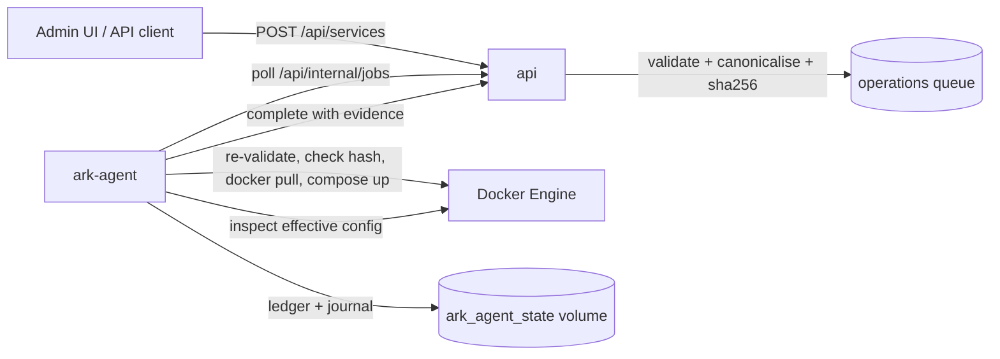
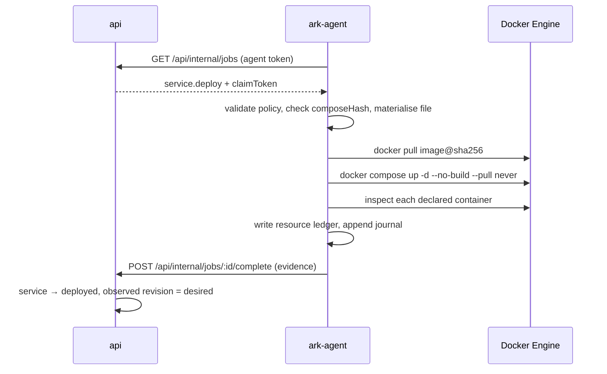

# Services and workloads

This page explains how Ark runs application containers: projects, the supported Compose subset and its policy, the hardening Ark injects into every workload, the Go Docker agent that executes deployments, adoption of existing containers, logs and stats, and image updates with deployment revisions and stateful recovery points.

## Overview

A **project** groups the services of one application. A **service** is one registered Compose document inside a project. Ark never passes a caller's Compose file straight to Docker. The API validates it against a default-deny policy, rewrites it into a canonical document with mandatory sandboxing, hashes it and queues an operation. The Docker agent, the only component with the host Docker socket, validates the canonical document again, checks the hash, deploys it with a fixed command line and then inspects the running containers before it records them as owned.



The API container has no Docker socket ([security review](../security-review.md#privilege-boundaries)). The agent makes outbound calls to the API for work and exposes no listener.

## Projects

A project has a display name and a slug. Create one on the **Projects** page (fields **Name** and **Slug**) or with `POST /api/projects`:

```json
{ "name": "Shop", "slug": "shop" }
```

| Rule        | Value                                                                                       |
| ----------- | ------------------------------------------------------------------------------------------- |
| Name        | 1–80 characters                                                                             |
| Slug        | `^[a-z][a-z0-9-]{0,40}$`                                                                    |
| Reserved    | `platform`, `mail`, `monitoring`, `restore` and `control` are refused for platform stacks   |
| Permissions | Operator or owner with MFA. The creator is granted access to the new project automatically. |

Every service in a project runs in the Compose project `ark-<slug>`. The agent refuses any workload project that does not match `^ark-[a-z][a-z0-9-]{0,40}$` or that equals, or starts with, `ark-platform-`, `ark-mail-`, `ark-monitoring-` or `ark-restore-` (or those names exactly). This stops a workload deploy from recreating the platform's own containers, because `docker compose -p <project> up` takes over everything already running under that project name. A slug such as `platform-x` passes the API's slug check but produces `ark-platform-x`, which the agent rejects.

Project access is part of the role model described in [accounts and access](accounts-and-access.md): operators see and change only the services of projects they are granted, and owners see all of them.

## Templates

`templates/` holds three reviewed starting points. They are reference files to copy into the registration form; no part of the code loads them. Each one passes the Compose policy as shipped, but its image digest is a placeholder (`sha256:aaaa…`) that you must replace with the real digest you intend to run. None of them sets CPU, memory, PID, capability or read-only controls, because canonicalisation adds those.

| Template                   | Service  | Shape                                                                                                                              |
| -------------------------- | -------- | ---------------------------------------------------------------------------------------------------------------------------------- |
| `templates/http-app.yml`   | `app`    | Stateless HTTP application (`traefik/whoami`), host port 8088 published to container port 80, with a `wget` health check           |
| `templates/worker.yml`     | `worker` | Background process (`python -m http.server 8080`) with no published ports                                                          |
| `templates/persistent.yml` | `store`  | Redis writing to the named volume `store_data` at `/var/lib/store`; the read-only root means it may write only there and in `/tmp` |

Register the persistent template with **This workload owns persistent application data** ticked, so that updates are gated on a recovery point (see [Stateful workloads and recovery points](#stateful-workloads-and-recovery-points)).

## The Compose policy

The API checks every submitted document with `validateComposeSource` in `shared/src/compose-policy.ts`. The agent runs its own independent check (`agent/policy.go`) on the canonical document before every deploy or adoption. Both are default-deny: an unknown field is rejected, never ignored.

### Document limits

| Check          | Rule                                                                                                                                               |
| -------------- | -------------------------------------------------------------------------------------------------------------------------------------------------- |
| Size           | At most 64 KiB                                                                                                                                     |
| Interpolation  | Any `$` anywhere in the document is rejected                                                                                                       |
| Includes       | `include:` is rejected                                                                                                                             |
| YAML features  | Duplicate keys and merge keys are rejected. The agent also rejects anchors, aliases, more than one YAML document and nesting deeper than 32 levels |
| Top-level keys | Only `services`, `volumes` and `networks`. A `secrets` block is refused with a pointer to platform secret references                               |
| Services       | 1 to 20                                                                                                                                            |

### Allowed service fields

A service may use only these keys:

`image`, `command`, `entrypoint`, `environment`, `ports`, `expose`, `volumes`, `networks`, `depends_on`, `restart`, `healthcheck`, `labels`, `user`, `working_dir`, `stop_grace_period`.

Everything else is rejected, including `build`, `extends`, `env_file`, `secrets`, `configs`, `privileged`, `devices`, `cap_add`, `cap_drop`, `security_opt`, `read_only`, `tmpfs`, `init`, `pids_limit`, `mem_limit`, `cpus`, `pid`, `ipc`, `userns_mode`, `uts`, `network_mode`, `container_name`, `cgroup_parent`, `runtime`, lifecycle hooks (`hooks`, `post_start`, `pre_stop`), `volumes_from`, `extra_hosts`, `logging`, `sysctls`, `ulimits` and `profiles`. The sandboxing keys are refused in the submitted document because Ark sets them itself.

### Images

- Every service needs a prebuilt `image`. Raw `build` is disabled.
- The image must be pinned by an immutable digest (`@sha256:` followed by 64 hex characters). A tag alone is refused, because the agent only ever pulls digests.
- The registry must be one of `docker.io`, `ghcr.io`, `public.ecr.aws` or `quay.io`. A name without a registry host counts as `docker.io`.

### Ports

- Port ranges and other ambiguous publish syntax are rejected.
- Long-form port entries may use only `published`, `target` and `protocol` (agent check).
- These host ports are reserved for platform listeners and refused: 25, 80, 443, 465, 587, 993, 5432 and 5433.

Public HTTP exposure of a workload goes through the front door, not through a published host port; see [the front-door guide](../guides/front-door.md).

### Volumes and networks

- Only named volumes are allowed. Bind mounts, host paths (`/…`, `./…`, `../…`, `~…`), anything mentioning `docker.sock`, and mount types other than `volume` and `tmpfs` are rejected. The agent refuses `bind` mounts and any long-form mount option other than `type`, `source`, `target` and `read_only`.
- Every volume or network a service uses must be declared at the top level of the same document, so it is owned by the workload's Compose project.
- Top-level volumes and networks may not carry any options: no drivers, `external`, driver options or caller-chosen global names.
- Resource names must match `^[a-z0-9][a-z0-9_-]{0,62}$` (case-insensitive) and may not start with `ark_`, `ark-`, `platform`, `control` or `docker`.
- Per-service network options are not allowed.

A rejected registration returns HTTP 422 with every violation message joined together.

## Canonicalisation and injected hardening

`canonicalizeComposeSource` validates the document again and then sets these controls on every service:

| Control        | Value                                  |
| -------------- | -------------------------------------- |
| `read_only`    | `true` (read-only root filesystem)     |
| `init`         | `true`                                 |
| `pids_limit`   | `256`                                  |
| `mem_limit`    | `512m`                                 |
| `cpus`         | `1`                                    |
| `tmpfs`        | `/tmp:rw,noexec,nosuid,nodev,size=64m` |
| `cap_drop`     | `ALL`                                  |
| `security_opt` | `no-new-privileges:true`               |

The result is serialised with sorted keys. This canonical text is what the API stores on the service row, what it hashes (SHA-256) into the operation's `composeHash`, and the only document the agent will execute. Approval and execution therefore cannot diverge.

The agent's `validateSandbox` refuses a document unless every service carries exactly these values. After `compose up` it also inspects each container's effective Docker configuration (see [Deployment](#deployment)), so a Compose or engine change that silently dropped a control would fail the deploy.

> [!NOTE]
> The limits are fixed. There is no per-service setting for more memory, more CPU or a writable root filesystem. A workload that needs to write must use a declared named volume or `/tmp`.

## Registering and deploying a service

On the **Services** page, the **Register a service** form has **Service name**, the **This workload owns persistent application data** checkbox and an **Approved Compose subset** text area pre-filled with a sample. The form registers the service into the first project you can see, with the default `notify` update policy. The API equivalent is `POST /api/services`:

```json
{
  "projectId": "prj_…",
  "name": "app",
  "compose": "services:\n  app:\n    image: docker.io/traefik/whoami:v1.11.0@sha256:…\n",
  "updatePolicy": "notify",
  "stateful": false
}
```

| Field          | Rule                                                             |
| -------------- | ---------------------------------------------------------------- |
| `name`         | 1–63 characters                                                  |
| `compose`      | 1 byte to 64 KiB                                                 |
| `updatePolicy` | `notify` (default) or `auto_stateless`                           |
| `stateful`     | Default `false`. A stateful service cannot use `auto_stateless`. |

It needs an operator or owner with MFA and access to the project.

> [!TIP]
> Give the service the same name as its Compose service key (for example `app` for `templates/http-app.yml`). Start, stop, restart, logs and stats find the container by matching the registered service name against the container's Compose service label or container name.

### What the API does

1. Validates the Compose document; violations return 422.
2. Writes the canonical document to `<ARK_COMPOSE_DIR>/<serviceId>/compose.yml` (mode 0600, written to a temporary file and renamed into place), before any database row exists, so a failed write leaves no orphan service. Without `ARK_COMPOSE_DIR` the directory is `tmp/compose/<serviceId>` under the API's working directory.
3. Inserts the service with status `registered`, the canonical Compose text and a new desired revision ID.
4. Queues a `service.deploy` operation whose payload carries the approved image list, the canonical Compose text, its `composeHash`, the service name and the Compose project `ark-<slug>`.
5. Records an audit event and returns `{ id, operationId, preview }`, where `preview` lists the services, images and published ports the policy accepted.

### Deployment

The agent claims the operation only if its payload contains `compose`, `composeHash` and `project`. It then:

1. Validates the canonical document with its own policy.
2. Requires exactly one target, a project and a hash, and validates the project name (see [Projects](#projects)) before any Docker call.
3. Materialises the document at `<ARK_AGENT_STATE_DIR>/workloads/<serviceId>/compose.yml` (mode 0600, directory 0700), after checking that the SHA-256 of the text equals `composeHash`, and that the directory is a real, non-symlinked path under the state root.
4. Pulls each approved image by digest with `docker pull` (5-minute timeout). Only references containing `@sha256:` may be pulled.
5. Runs `docker compose -f <file> -p <project> up -d --no-build --pull never` with a 2-minute timeout and `COMPOSE_IGNORE_ORPHANS=1`, so that sibling services in the same project keep running. The child process gets a fixed environment: a fixed `PATH`, `HOME` (or the parent of `ARK_DOCKER_CONFIG` when that is an absolute path), `DOCKER_CONFIG` when set, and `DOCKER_HOST` pointing at the agent's socket.
6. Lists the containers of that Compose project whose service is declared in this document and inspects each one. A container must not be privileged, must not use host or joined (`container:`/`service:`) network, PID or IPC namespaces, must have network attachments, no bind mounts, no added capabilities or devices, a read-only root, `CapDrop` containing `ALL`, `no-new-privileges`, a PID limit of 1–256, memory of at most 512 MiB, at most one CPU, no Docker socket mount and no attachment to a protected platform network. The image must equal the manifest's image exactly.
7. If a container fails inspection, the agent stops it and the containers it has already inspected, and fails the operation, rather than leave unledgered containers running.
8. Records the workload in the ownership ledger and completes the operation.

On success the service becomes `deployed` and its observed revision is set to the desired revision. On failure it becomes `failed`.



## The Docker agent

The agent is a small Go program in `agent/`. Its image is built from `agent/Dockerfile`: a static Go binary on the digest-pinned `docker:28.4.0-cli` image with `docker-cli-compose` added. In `infra/platform/docker-compose.yml` the `agent` service mounts `/var/run/docker.sock` and the `ark_agent_state` volume, joins only the internal `control` network, and runs with `no-new-privileges` and a PID limit of 128.

> [!WARNING]
> Treat the agent as host-privileged. Access to the Docker socket is equivalent to root on the host, whatever the container's own restrictions. The policy, the hash binding and the ledger limit what the agent will do on Ark's behalf; they do not make a compromise of the agent harmless.

### Configuration

| Variable              | Default                 | Purpose                                                                              |
| --------------------- | ----------------------- | ------------------------------------------------------------------------------------ |
| `ARK_AGENT_TOKEN`     | none (required)         | Bearer token for the internal API; generated by the installer                        |
| `ARK_API_URL`         | `http://127.0.0.1:3000` | API base URL (`http://api:3000` in the platform Compose file)                        |
| `ARK_AGENT_STATE_DIR` | `/var/lib/ark-agent`    | Ledger and materialised workload files                                               |
| `ARK_AGENT_JOURNAL`   | `journal.jsonl`         | Path of the append-only local journal (relative to the working directory by default) |
| `ARK_DOCKER_CONFIG`   | unset                   | Absolute path of a Docker client config for registry credentials during pulls        |
| `DOCKER_SOCKET`       | `/var/run/docker.sock`  | Engine socket used for API calls and passed to the `docker` CLI children             |

### Work loop

The agent repeats this cycle, sleeping 3 seconds between passes:

1. Sends a worker heartbeat (`POST /api/internal/heartbeat`, version `go-agent-v1`), which feeds the missing-worker alerts described in [monitoring](monitoring.md).
2. Polls `GET /api/internal/jobs`. The API claims at most one agent job per poll and only service kinds and `update.apply` whose payloads have the expected shape. It re-checks that the actor who queued the job still has platform access, is not a viewer and still holds the project grant; otherwise the job fails immediately.
3. Executes the job. While it runs, the agent renews the claim every 15 seconds (`POST /api/internal/jobs/:id/heartbeat`). If a renewal is rejected, the agent cancels the job's context and reports the failure.
4. Appends a journal entry and completes the job (`POST /api/internal/jobs/:id/complete`) with its claim token, status and evidence.

The queue never runs two operations with an overlapping target at once, so deploys, actions and updates on one service are serialised. The general queue, claim tokens and operation states are described in [operations and workers](../operations/operations-and-workers.md).

The agent accepts these job kinds and rejects any other:

| Kind                                               | Effect                                                                       |
| -------------------------------------------------- | ---------------------------------------------------------------------------- |
| `service.deploy`, `update.apply`                   | Validate, check hash, pull, `compose up`, inspect, record in the ledger      |
| `service.adopt`                                    | Validate, check hash, inspect an existing container, record it in the ledger |
| `service.start`, `service.stop`, `service.restart` | Engine API call on the ledger-owned container                                |
| `service.logs`                                     | Bounded, redacted log tail of the owned container                            |
| `service.stats`                                    | One whitelisted stats sample of the owned container                          |
| `service.discover`                                 | Redacted inventory of all containers on the host                             |

### Ownership ledger

The ledger is `resource-ledger.json` in the state directory (version 1). For each service ID it records the Compose project, the canonical `composeHash`, the exact container IDs, and the IDs of networks and names of volumes labelled with that Compose project.

- Labels alone never prove ownership. Start, stop, restart, logs and stats act only on a container whose ID is in the service's ledger entry and whose Compose project label still matches.
- Before acting, the agent re-inspects the container: its project label, every attached network (which must be one of the ledger's network IDs) and every volume mount (which must be one of the ledger's volumes). A mismatch fails with an identity error.
- Writes are durable: the previous ledger is copied to `resource-ledger.json.bak`, the new one is written and synced as `resource-ledger.json.next`, renamed into place, and the directory is synced. If the main file is torn or unreadable, the agent falls back to the backup copy.

### Journal

The journal is a JSON-lines file opened in append mode (mode 0600). Each entry has the operation `id`, `action` (the job kind), `target`, `status` (`succeeded`, `failed`, or `rejected` when the policy refused the Compose document before execution), a UTC timestamp `at` and a `note` with any error. It gives a host-local record of what the agent did, independent of the API.

If the agent executes a job but cannot report completion, it logs a `needs_recovery:` error for that operation instead of retrying the side effect.

## Service actions

The service list shows each service's name, status, stateful or stateless, and when it was last observed, with **Restart**, **Stop**, **Logs** and **Stats** buttons. The API also offers `start`:

```http
POST /api/services/:id/restart
POST /api/services/:id/stop
POST /api/services/:id/start
```

Each needs an operator or owner with MFA and project access, and queues `service.restart`, `service.stop` or `service.start`. Any other action name returns 404. The agent finds the owned container (see [Ownership ledger](#ownership-ledger)) and calls the Engine API. For stop and restart it reads the container's configured stop timeout (0–600 seconds, otherwise Docker's 10 s default) and allows that plus 30 seconds for the call, so a long `stop_grace_period` is not reported as a failure. On success the service status becomes `stopped` after a stop and `running` after a start or restart.

## Logs and stats

Logs and stats are operations, not live streams. **Logs** and **Stats** queue an observation and poll for its result:

```http
POST /api/services/:id/observe
GET /api/services/:id/observations/:operationId
```

The `observe` body is `{ "kind": "logs" }` or `{ "kind": "stats" }`. Queuing needs an operator or owner with MFA and project access; reading needs an operator or owner with project access. The result is `{ status, available, … }`: while the operation is not yet `succeeded`, `available` is `false` and any error is returned. The UI polls every 500 ms for up to 40 attempts.

**Logs.** The agent reads the last 200 lines of stdout and stderr with timestamps from the Engine API and decodes Docker's multiplexed stream. It then redacts values following `password`, `secret`, `token` or `api_key`/`api-key`/`apikey` (with `=` or `:`), replaces credentials in `http(s)://user:pass@` URLs, strips control characters other than newline and tab, and keeps at most 500 lines and 64 KiB. The API returns at most the last 500 lines.

**Stats.** One non-streaming sample, reduced to a fixed set of fields:

| Field                                           | Meaning                        |
| ----------------------------------------------- | ------------------------------ |
| `readAt`                                        | Sample time reported by Docker |
| `pids`                                          | Current process count          |
| `memoryUsage`, `memoryLimit`                    | Bytes                          |
| `cpuTotalUsage`, `systemCpuUsage`, `onlineCpus` | Raw CPU counters               |
| `networkRxBytes`, `networkTxBytes`              | Summed over all interfaces     |
| `blockReadBytes`, `blockWriteBytes`             | Summed block I/O               |

Environment variables are never part of either result.

## Discovery and adoption

### Discovery

**Discover unmanaged containers** (owner only, with MFA) queues `service.discover` against the `platform` target and polls for the result:

```http
POST /api/services/discover
GET /api/services/discovery/:operationId
```

The agent lists all containers on the host, removes any label whose key contains `secret` or `token`, keeps at most 100 containers, and reduces each container's labels to `com.docker.compose.project` and `com.docker.compose.service`. The API returns two lists: `protected`, the containers of the `ark-platform`, `ark-mail` and `ark-monitoring` projects, and `unmanaged`, every other container whose Compose service (or name) does not match a registered service name. Discovery is read-only; it never restarts or rewrites anything it finds.

### Adoption

Adoption brings an existing Compose container under Ark's management without redeploying it. There is no UI form for it; use `POST /api/services/adopt` (operator or owner with MFA and project access):

```json
{
  "projectId": "prj_…",
  "name": "app",
  "compose": "services:\n  app:\n    image: …@sha256:…\n",
  "containerId": "3f2a9c1b7d4e"
}
```

`containerId` must be 12–64 hex characters. The Compose document must pass the same policy; an unsupported one returns 422 and cannot be adopted. The API writes the canonical document, inserts the service with status `adoption_pending` and update policy `notify`, and queues `service.adopt` with the canonical text and its hash.

The agent materialises and hash-checks the document, then inspects the container. Adoption is refused when:

- the container is protected: label `com.ark-stack.protected=true`, or a project or name starting with `ark-platform` or `ark-mail`;
- it has no Compose project or service label, or its service label differs from `name`;
- its configured image is not exactly the image the canonical manifest declares for that service;
- it fails any of the effective-isolation checks listed under [Deployment](#deployment) (privileges, namespaces, mounts, capabilities, devices, read-only root, PID, memory and CPU limits, protected networks);
- it is attached to a network, or mounts a volume, not labelled with its own Compose project;
- it is already owned by another workload in the ledger.

On success the agent records the container, the project's networks and its volumes in the ledger, and the service becomes `adopted`. In practice only a container that was already started with Ark's sandbox controls can be adopted.

## Service states

| Status             | Set when                                                                      |
| ------------------ | ----------------------------------------------------------------------------- |
| `registered`       | The service was created and its first deploy is queued                        |
| `adoption_pending` | An adoption was requested                                                     |
| `deployed`         | A deploy or update completed                                                  |
| `adopted`          | An adoption completed                                                         |
| `running`          | A start or restart completed                                                  |
| `stopped`          | A stop completed                                                              |
| `updating`         | An update was planned and handed to the agent                                 |
| `failed`           | An agent operation on the service failed (logs, stats and discovery excepted) |

Each service also carries a desired and an observed revision ID and the time of the last observation. A service whose observed revision differs from its desired revision has a change that has not yet completed.

## Image updates

Ark detects new digests for a service's tag and applies them only on request.

### Detecting candidates

**Resolve registry digests** on the **Updates** page calls `POST /api/updates/detect` (owner with MFA), which queues `update.detect` for the backup worker. For every service it takes the first `image:` line of the stored Compose document, asks the registry for the manifest of that image's tag, and records the digest as the service's update candidate. For a multi-architecture index it picks the `linux` manifest for the worker's CPU architecture. Registry authentication follows the registry's bearer challenge, with `ARK_REGISTRY_USERNAME` and `ARK_REGISTRY_PASSWORD` used for the token request when set, and `GHCR_TOKEN` sent directly to `ghcr.io`. A response without a `sha256:` digest is an error.

Each candidate records the image, the current and candidate digests, `requiresApproval` (true unless the service is stateless with `auto_stateless`) and `rollbackSafe` (true only for stateless services). The page lists each service with its candidate digest, its update policy and "approval required" or "auto allowed".

> [!NOTE]
> Nothing applies a candidate automatically. `auto_stateless` changes how the candidate is labelled, but every update still goes through `POST /api/updates/apply`. Only the first image in a service's Compose document is checked and updated.

### Applying an update

**Apply digest** sends `POST /api/updates/apply` with `{ "serviceId": "…", "digest": "sha256:…" }`. The request needs project access and a single-use `platform.update` step-up grant bound to exactly that service and digest: call `POST /api/step-up` first with your password, `"action": "platform.update"` and `"request": { "serviceId": "…", "digest": "…" }`. Grants expire after 10 minutes and are consumed only once the service is found and in scope. Without a grant the request returns 403 asking you to verify your password and MFA.

The `update.apply` operation is planned by the coordinator's `applyUpdate`, then executed by the agent:

1. The digest must equal the service's current update candidate; otherwise the update fails as stale.
2. A stateful service must have a restore-verified recovery point (next section).
3. The first `image:` line of the stored Compose document is rewritten to `<name>:<tag>@<digest>`, and the result is validated and canonicalised.
4. A new deployment revision row is inserted with status `planned`, holding the full new Compose document and the digest. The service's desired revision moves to it and its status becomes `updating`. The service's stored Compose text and digest are not changed yet.
5. The operation is requeued for the agent with the canonical document, hash, image list, project, name and digest. Planning does not run again for a requeued payload.
6. The agent deploys it exactly as in [Deployment](#deployment).
7. On success the API checks that the planned revision's digest equals the requested digest, then promotes the revision's Compose text and digest onto the service, marks it `deployed` and sets the revision to `deployed`. On failure the service becomes `failed` and the revision `failed`, and the stored Compose text and digest stay those of the last confirmed deploy.

> [!IMPORTANT]
> Only the Docker agent is allowed to run `update.apply`; module workers are given `update.detect` only. In the shipped worker split no external worker requests the planning half, so with external workers the planning step runs only where the coordinator runs (`ARK_EMBEDDED_WORKERS=1`, which has no effect when `NODE_ENV` is `production`).

### Deployment revisions

`deployment_revisions` keeps one immutable row per planned update: service, desired revision ID, the complete Compose document, the image digest, the status (`planned`, `deployed` or `failed`) and the creation time. The service row only ever holds what was last confirmed deployed, so a failed rollout never appears as the running state and a later deploy cannot ship an unapproved digest.

There is no rollback endpoint. An update can only move to the current candidate digest for the service's tag; Ark does not redeploy an arbitrary earlier image.

## Stateful workloads and recovery points

Mark a service stateful when it owns application data. Stateful services:

- cannot use the `auto_stateless` update policy (registration fails validation);
- always have candidates marked as requiring approval and not rollback-safe;
- cannot be updated until a recovery point for that exact service exists.

A recovery point is a backup whose target is the service's own ID and whose status is `restore_verified`. Upload, integrity and restore proof are separate steps:

1. `POST /api/backups` with `{ "kind": "volume", "targetId": "<serviceId>" }` creates a backup. When backup execution is enabled (`ARK_BACKUP_EXECUTE=1`), volume backups read `/var/lib/ark/volumes/<serviceId>` and upload to the enabled off-VPS targets.
2. `POST /api/backups/restore-test` with the kind, target and exact `backupId` restores it in the isolated runner (needs `ARK_BACKUP_EXECUTE=1` and `ARK_RESTORE_RUNNER=1`) and moves the backup to `integrity_ok`. Extracted bytes are only integrity evidence.
3. After confirming that the restored copy booted and served its data, `POST /api/backups/:id/verify-restore` with `{ "confirmation": "restored copy booted and served its data" }` moves it to `restore_verified`.

Steps 2 and 3 each need a `restore.overwrite` step-up. The backup system, its states and the restore runner are described in [backups](backups.md).

## Local development mode

With `ARK_EMBEDDED_WORKERS=1` the API runs the coordinator itself. If Docker is reachable (`DOCKER_HOST` is set, `ARK_DOCKER=1`, or `/var/run/docker.sock` exists), deploys, actions and updates run through the `docker` CLI from the API process (`server/src/modules/docker.ts`): `docker compose pull --policy missing` then `up -d --no-build --pull never`, with a 60-second timeout per command and a reduced child environment. After an embedded update, Ark compares the running container's repository digest with the approved digest and fails on a mismatch.

> [!WARNING]
> The embedded path skips the agent's second policy check, hash binding, effective-configuration inspection and ownership ledger. It exists for local development only: `ARK_EMBEDDED_WORKERS` has no effect when `NODE_ENV` is `production`, and without it every service operation is delegated to the agent.

## Endpoint summary

| Endpoint                                          | Who                                                               | Purpose                           |
| ------------------------------------------------- | ----------------------------------------------------------------- | --------------------------------- |
| `POST /api/projects`                              | Operator or owner, MFA                                            | Create a project                  |
| `POST /api/services`                              | Operator or owner, MFA, project access                            | Register and deploy a service     |
| `POST /api/services/:id/:action`                  | Operator or owner, MFA, project access                            | `start`, `stop` or `restart`      |
| `POST /api/services/:id/observe`                  | Operator or owner, MFA, project access                            | Queue a logs or stats observation |
| `GET /api/services/:id/observations/:operationId` | Operator or owner, project access                                 | Read the observation              |
| `POST /api/services/discover`                     | Owner, MFA                                                        | Queue host discovery              |
| `GET /api/services/discovery/:operationId`        | Owner                                                             | Read classified discovery results |
| `POST /api/services/adopt`                        | Operator or owner, MFA, project access                            | Adopt an existing container       |
| `POST /api/updates/detect`                        | Owner, MFA                                                        | Resolve candidate digests         |
| `POST /api/updates/apply`                         | Operator or owner, MFA, project access, `platform.update` step-up | Apply a candidate digest          |

Services, their statuses and revisions, and update candidates are part of `GET /api/state`, filtered to the projects you can see. The full API list is in the [API reference](../reference/api.md).

## Testing

- `mise run test:agent` runs the Go policy, hash-binding, Docker-boundary and ledger tests in `agent/`.
- `mise run test:agent-integration` (sets `ARK_DOCKER_INTEGRATION=1`) needs a disposable Docker daemon. It pulls a pinned BusyBox digest, deploys a canonical manifest to a uniquely named project, inspects the effective controls, persists and reloads the ledger, performs a ledger-scoped restart and removes the project.
- `shared/src/compose-policy.test.ts` covers the TypeScript policy.

See [testing](../development/testing.md) for the rest of the suite.
