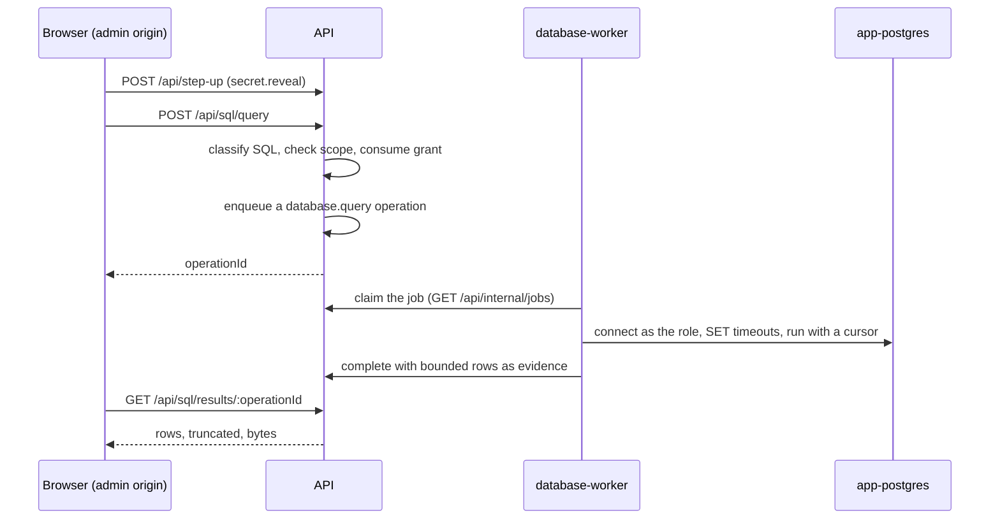

# SQL workspace and schema browser

The SQL workspace runs one bounded SQL statement against an application database as one of its generated roles, and the schema browser lists that database's tables and columns. This page explains where the SQL runs, who may run it, the read-only and write behaviour, the result caps, cancellation, the endpoints and the errors you can see.

Both features work on application databases only, never on the control-plane database. For the roles themselves, how databases are created and how credentials rotate, see [Databases](databases.md).

## Where queries run

The browser-facing API never connects to an application database to run workspace SQL. It validates the request, consumes a step-up grant, and queues a durable operation. The database worker claims the operation, decrypts the chosen role's password, connects to the application cluster as that role, runs the statement and returns a bounded result as the operation's completion evidence. The browser then fetches the result through a database-scoped endpoint.



The pieces are:

| Piece           | Where                                                        | What it does                                                                                                               |
| --------------- | ------------------------------------------------------------ | -------------------------------------------------------------------------------------------------------------------------- |
| Request routes  | [app.ts](../../server/src/app.ts)                            | `POST /api/sql/query`, `GET /api/sql/results/:operationId`, `POST /api/sql/cancel`, `POST /api/databases/:id/schema`       |
| Statement guard | [sql-guard.ts](../../shared/src/sql-guard.ts)                | `classifySql`: empty, size, multi-statement and read-only checks, plus the fingerprint                                     |
| Job handlers    | `server/src/coordinator.ts`                                  | `database.query` and `database.schema` load the role and its secret and call the executor                                  |
| Executor        | [database.ts](../../server/src/modules/database.ts)          | `executeWorkspaceQuery`, `cancelWorkspaceQuery`, `inspectDatabaseSchema`: timeouts, read-only transaction, cursor and caps |
| Schema SQL      | [schema-browser.ts](../../shared/src/schema-browser.ts)      | The two fixed catalogue queries and the grouping of their rows                                                             |
| Database worker | [workers/src/database.ts](../../workers/src/database.ts)     | Runs `database.` and `pgbouncer.` jobs and serves the private `/cancel` listener                                           |
| UI              | [Views.tsx](../../web/src/pages/Views.tsx) (`DatabasesView`) | The **SQL workspace** form and the **Schema** button on the Databases page                                                 |

The worker is the `database-worker` service in `infra/platform/docker-compose.yml`. It reaches the application cluster through `DATABASE_APP_URL` (the `app-postgres` host and port), but it authenticates workspace sessions as the selected database role, not as the cluster administrator. The cluster administrator URL is used only to cancel a running statement.

In local development with `ARK_EMBEDDED_WORKERS=1` the same job handlers run inside the API process, and cancellation is handled in-process. Production refuses that mode.

> [!NOTE]
> `workers/src/pg-executor.ts` and `server/src/modules/pg-executor-client.ts` are not part of the SQL workspace. Despite the name, they are the pgBackRest executor inside the PostgreSQL containers and its client, used by the backup worker. See [Backups](backups.md).

## Who can run SQL

Every workspace and schema call needs an owner or operator; viewers get 403. On top of the role, each call checks the database's scope, MFA and, for running SQL or reading the schema, a single-use step-up grant.

| Check          | Rule                                                                                                                                                                                                 |
| -------------- | ---------------------------------------------------------------------------------------------------------------------------------------------------------------------------------------------------- |
| Role           | `owner` or `operator` (`requireOperator`).                                                                                                                                                           |
| Database scope | A database attached to a project needs a grant on that project. Otherwise, a database whose cluster endpoint belongs to a domain needs the domain grant. A database with neither is owner-only.      |
| MFA            | The user must have MFA enrolled, and the session must have been created after enrolment.                                                                                                             |
| Step-up        | `POST /api/sql/query` and `POST /api/databases/:id/schema` each consume one `secret.reveal` grant. `POST /api/sql/cancel` needs MFA but no grant. `GET /api/sql/results/:operationId` needs neither. |
| At execution   | When the worker runs the job, the actor must still have platform access, must not have been demoted to viewer, and must still hold the project or domain grant.                                      |

### Step-up grants

A step-up grant is minted by `POST /api/step-up` after the user re-enters their password. It is bound to the action and to the exact request object, belongs to the current session, expires after 10 minutes and is consumed by the first matching call. Running SQL is treated as a secret reveal, because it reads data with a stored role credential.

| Call                             | `action`        | `request` the grant is bound to                 |
| -------------------------------- | --------------- | ----------------------------------------------- |
| `POST /api/sql/query`            | `secret.reveal` | `{ "databaseId": "<id>", "kind": "sql.query" }` |
| `POST /api/databases/:id/schema` | `secret.reveal` | `{ "databaseId": "<id>", "kind": "schema" }`    |

The grant is bound to the database, not to the SQL text or the role, and each statement consumes a fresh grant. The API consumes the grant only after the SQL has passed the guard and the database scope check, so a typo, a multi-statement rejection or a 404 does not burn a password round.

```http
POST /api/step-up
content-type: application/json

{ "password": "…", "action": "secret.reveal", "request": { "databaseId": "db_…", "kind": "sql.query" } }
```

> [!IMPORTANT]
> The Databases page does not request this grant itself. Without one, the workspace form and the **Schema** button show `Verify your password and MFA for secret.reveal before continuing.` Mint the grant first, for example with the console helper from [the Vercel guide](../guides/vercel-database.md#1-before-you-start) on the admin origin: `await stepUp("secret.reveal", { databaseId, kind: "sql.query" })`. Then submit the form within 10 minutes.

## Using the workspace in the UI

Open **Databases** in the admin UI. Below the database list and the pooler policy is a card titled **SQL workspace**, described as "Bound to one database and role. Read-only by default. Results stay with this workspace."

| Field                     | Meaning                                                                              |
| ------------------------- | ------------------------------------------------------------------------------------ |
| **Database**              | The application database to run against.                                             |
| **Role**                  | `readonly` (the default), `runtime` or `migration`. The owner role is never offered. |
| **Read-only transaction** | Checked by default. Unchecked, the request is sent with `readOnly: false`.           |
| **SQL**                   | One statement. The default text is `select current_user, current_database()`.        |

Press **Save** to submit. The page generates a fresh `executionId` (a UUID), sends it with the database ID as `workspaceId`, then polls `GET /api/sql/results/:operationId` every 500 ms. When the result arrives it shows a **Results** card headed with `role@database`, the fingerprint, the byte count and, if the worker stopped early, "truncated at server limit". Rows are shown as JSON.

The page polls for at most 30 seconds (60 attempts). If the operation is still queued or running after that, it shows `Database operation is still queued; check Operations for progress.` If the operation failed, it shows the operation's error. The UI has no cancel button; cancellation is an API call (see [Cancellation](#cancellation)).

## Request lifecycle

### Submitting a query

`POST /api/sql/query` takes this body (`sqlInput` in `shared/src/schemas.ts`):

| Field         | Type and limits                      | Notes                                                                  |
| ------------- | ------------------------------------ | ---------------------------------------------------------------------- |
| `executionId` | string, 8 to 100 characters          | Chosen by the caller. Cancellation refers to it.                       |
| `databaseId`  | string                               | The managed database.                                                  |
| `workspaceId` | string                               | Echoed in the result and the audit event. The UI uses the database ID. |
| `role`        | `runtime`, `readonly` or `migration` | The database role to connect as.                                       |
| `sql`         | string, 1 to 20,000 characters       | One statement.                                                         |
| `readOnly`    | boolean, default `true`              | Controls the guard and the transaction mode.                           |

The API then, in order:

1. Classifies the SQL with `classifySql` (see [The statement guard](#the-statement-guard)). A rejection is a 422.
2. Checks the database scope in `manage` mode.
3. Consumes the `secret.reveal` grant.
4. Confirms the database exists and that the chosen role has a stored credential.
5. Enqueues a `database.query` operation whose payload carries the execution ID, workspace ID, role, SQL, read-only flag and fingerprint.
6. Writes an `sql.execute` audit event.

The response is immediate and does not contain rows:

```json
{
  "operationId": "op_…",
  "status": "queued",
  "databaseId": "db_…",
  "workspaceId": "db_…",
  "role": "readonly",
  "fingerprint": "select current_user, current_database()"
}
```

### Execution in the database worker

The standalone database worker claims one job at a time, polling every two seconds, and it shares that single lane with PgBouncer and client rollover jobs. A query can therefore wait behind other database work. The job holds a lease that the worker renews every 15 seconds while it runs.

For a `database.query` job the worker:

1. Re-checks that the actor is still authorised for the target (see [Who can run SQL](#who-can-run-sql)).
2. Re-runs `classifySql` on the stored SQL and read-only flag, and refuses any role outside `readonly`, `runtime` and `migration`.
3. Loads the role and decrypts its secret.
4. Refuses to start if the same user already has two queries running against the same database in this worker.
5. Opens a single connection to the database as that role, with an 8 second connect timeout.
6. Sets `statement_timeout = 8000`, `lock_timeout = 4000` and `idle_in_transaction_session_timeout = 8000`, and, when `readOnly` is true, `default_transaction_read_only = on`.
7. Records the session's backend PID under the execution ID, so it can be cancelled.
8. Runs the statement through a cursor that fetches 50 rows at a time, adding rows until a cap is reached, then closes the cursor.
9. Removes the execution ID, closes the connection, and completes the operation with the rows as evidence.

Each statement gets its own connection and session. Nothing (temporary tables, `SET` values, open transactions) carries over to the next statement.

### Fetching the result

`GET /api/sql/results/:operationId` serves both query and schema operations. It needs an owner or operator with `manage` scope on the operation's database; it does not require the caller to be the user who ran the query.

- While the operation is not `succeeded`, it answers `{ "status": "<state>", "available": false, "error": … }`.
- On success it returns `{ "status": "succeeded", "available": true, "query": { … } }` (or `"schema"` for an inspection).

The result object of a query is:

| Field         | Meaning                                      |
| ------------- | -------------------------------------------- |
| `databaseId`  | The database.                                |
| `workspaceId` | As submitted.                                |
| `role`        | The role the statement ran as.               |
| `fingerprint` | The statement fingerprint.                   |
| `rows`        | Up to 200 row objects, keyed by column name. |
| `truncated`   | `true` if the worker stopped at a cap.       |
| `rowLimit`    | `200`.                                       |
| `byteLimit`   | `196608` (192 KiB).                          |
| `bytes`       | The JSON size of the returned rows.          |

Results are stored as the operation's completion evidence in the control-plane database. `GET /api/state` lists the operation and its steps but never their evidence or payload, so rows and SQL text are only returned by this endpoint.

## Read-only and write behaviour

Three layers decide what a statement can do: the statement guard, the transaction mode, and the privileges of the role it runs as. The guard is a coarse filter; the role's grants and PostgreSQL's read-only transaction are what actually stop a write.

### The statement guard

`classifySql` (in `shared/src/sql-guard.ts`) runs in the API before anything is queued and again in the worker before execution. It rejects:

- an empty or whitespace-only statement;
- a statement over 20,000 characters (the request schema enforces the same limit first);
- more than one statement: any `;` followed by further non-space text. A single trailing `;` is allowed;
- in read-only mode, any statement containing one of these words: `insert`, `update`, `delete`, `drop`, `alter`, `create`, `truncate`, `grant`, `revoke`, `copy`, `call`, `do`, `comment`, `security`, `listen`, `notify`, `vacuum`, `reindex`, `cluster`, `refresh`, `lock`.

The guard also returns the fingerprint: the trimmed statement with runs of whitespace collapsed to one space, cut to 200 characters.

> [!NOTE]
> The guard matches whole words anywhere in the text, case-insensitively, including identifiers, string literals and comments. In read-only mode `SELECT comment FROM posts` or `WHERE status = 'update'` is therefore rejected, and a `;` inside a string literal followed by more text counts as a second statement. Uncheck **Read-only transaction** and choose the `readonly` role if you need such a query to run with read-only privileges.

### Read-only transactions

With `readOnly: true` (the default) the worker sets `default_transaction_read_only = on` for the session before the statement runs, so PostgreSQL itself refuses writes even if a statement passes the guard. With `readOnly: false` the guard skips the keyword check and the session is a normal read-write session, limited only by the role's privileges.

### Choosing a role

The role decides which privileges the statement has. The grants come from the provisioning plan in `shared/src/provision-sql.ts`; [Databases](databases.md) describes them in full.

| Role        | Typical use in the workspace                                                                           |
| ----------- | ------------------------------------------------------------------------------------------------------ |
| `readonly`  | Inspecting data. `SELECT` on tables and sequences in `public`, `EXECUTE` on its functions.             |
| `runtime`   | Data fixes as the application sees them. `SELECT`, `INSERT`, `UPDATE`, `DELETE` on tables in `public`. |
| `migration` | Schema changes. `USAGE` and `CREATE` on schema `public`.                                               |

To write, uncheck **Read-only transaction** (send `readOnly: false`) and choose `runtime` or `migration`. With the `readonly` role and read-only off, a write reaches PostgreSQL and fails with a permission error. The owner role, and the cluster administrator, cannot be selected.

## Limits

| Limit                                    | Value                     | Enforced by                       |
| ---------------------------------------- | ------------------------- | --------------------------------- |
| Statement length                         | 20,000 characters         | Request schema and `classifySql`  |
| Statements per request                   | 1                         | `classifySql`                     |
| Rows returned                            | 200                       | Worker cursor                     |
| Result size                              | 192 KiB of row JSON       | Worker cursor                     |
| Cursor batch                             | 50 rows                   | Worker                            |
| Statement runtime                        | 8 s (`statement_timeout`) | PostgreSQL                        |
| Lock wait                                | 4 s (`lock_timeout`)      | PostgreSQL                        |
| Idle in transaction                      | 8 s                       | PostgreSQL                        |
| Connect timeout                          | 8 s                       | Worker                            |
| Concurrent queries per user and database | 2                         | Worker                            |
| API request and worker completion body   | 256 KiB                   | `bodyLimit` on `/api/*`           |
| UI wait for a result                     | 30 s                      | `waitForDatabaseResult` in the UI |
| Step-up grant lifetime                   | 10 minutes, single use    | `POST /api/step-up`               |

The 192 KiB cap sits below the 256 KiB limit on worker completion bodies, leaving room for the operation envelope and JSON expansion. Each row's JSON size is counted before it is added; the first row that would cross the cap is dropped and the cursor is closed, so PostgreSQL stops producing rows. A result with exactly 200 rows is also reported as `truncated`, because the worker stops as soon as it holds 200 rows without checking for more.

### Redaction

Completion evidence is redacted before it is sent and again before it is stored. Any column whose name looks like a secret, for example one containing `password`, `secret`, `token`, `credential`, `apikey`, `dsn` or `database…url`, comes back as `<redacted>`. String values containing `password=…`, `token=…` and similar pairs, or credentials embedded in a URL (`postgres://user:pw@host`), are masked as well. The rules are in `shared/src/redact.ts`.

## Cancellation

`POST /api/sql/cancel` stops a running statement by its execution ID:

```http
POST /api/sql/cancel
content-type: application/json

{ "executionId": "3f1c…", "databaseId": "db_…" }
```

It needs an owner or operator with MFA and `manage` scope on the database; no step-up grant is needed. The API forwards the request to the database worker's private listener at `ARK_DATABASE_WORKER_URL` (`http://database-worker:3101` in the platform compose file) with the database worker token as a bearer credential and a 5 second timeout. The listener (port set by `ARK_DATABASE_CANCEL_PORT`, `3101` by default) is exposed only on the internal compose networks, accepts only `POST /cancel`, and checks the token with a constant-time comparison.

The worker cancels only if the execution ID is currently running in that worker, for the same user and the same database. It then calls `pg_cancel_backend` on the statement's backend PID through the cluster administrator connection. The response is:

```json
{ "executionId": "3f1c…", "cancelled": true }
```

`cancelled: false` means there was nothing to cancel: the statement had already finished, had not started yet, belongs to another user or database, or the ID is unknown. A cancelled statement fails in PostgreSQL ("canceling statement due to user request"), and the `database.query` operation is marked `failed` with that error. A queued operation that has not started cannot be cancelled this way.

## Schema browser

The **Schema** button on each row of the Databases page calls `POST /api/databases/:id/schema` (empty body, `secret.reveal` grant bound to `{ databaseId, kind: "schema" }`). The API checks that the database has a `readonly` role with a credential and enqueues a `database.schema` operation; the page then polls the same results endpoint and prints the schema as JSON in a **Schema · name** card.

The worker runs two fixed queries from `shared/src/schema-browser.ts`, each through the same executor as workspace SQL, always as the `readonly` role, with `readOnly: true`, the same timeouts and the same caps:

- **Columns**: `information_schema.columns`, excluding the `pg_catalog`, `information_schema` and `pgbouncer` schemas, ordered by schema, table and column position.
- **Sizes**: every ordinary table (`relkind = 'r'`) outside `pg_catalog` and `information_schema`, with `pg_size_pretty(pg_total_relation_size(...))`, largest first.

The columns are grouped by schema and table. The result is:

```json
{
  "status": "succeeded",
  "available": true,
  "schema": {
    "schemas": { "public": { "orders": [{ "column": "id", "type": "integer", "nullable": "NO" }] } },
    "sizes": [{ "schema": "public", "table": "orders", "size": "16 kB" }]
  }
}
```

Keep these limitations in mind:

- Both queries are capped at 200 rows. The columns query returns at most 200 columns in total, and the `truncated` flag is not passed on, so a larger database shows only the first 200 columns in schema, table and position order. Use a workspace query with a `WHERE` clause for the rest.
- `information_schema.columns` lists only columns the `readonly` role has privileges on, so objects that role cannot read do not appear.
- The UI shows only `schemas`; `sizes` is available through the API.
- A second schema request for the same database while one is in flight returns the in-flight operation, but it still consumes its own grant.
- Schema inspections use internal execution IDs and cannot be cancelled through the API.

## Audit trail

| Event                 | When                           | Recorded details                              |
| --------------------- | ------------------------------ | --------------------------------------------- |
| `auth.step_up`        | A grant is minted              | The action and expiry                         |
| `auth.step_up_failed` | A step-up password is wrong    | The action                                    |
| `sql.execute`         | A query is accepted and queued | Fingerprint, role, workspace ID, operation ID |
| `database.schema`     | A schema inspection is queued  | Operation ID                                  |

The audit event carries the fingerprint, not the full statement. The full SQL text is held in the operation payload in the control-plane database. Cancellation does not write an audit event.

## Endpoints

| Endpoint                            | Role            | MFA | Step-up                                              | Scope check | Result                                            |
| ----------------------------------- | --------------- | --- | ---------------------------------------------------- | ----------- | ------------------------------------------------- |
| `POST /api/sql/query`               | owner, operator | yes | `secret.reveal`, `{ databaseId, kind: "sql.query" }` | manage      | `operationId`, status, fingerprint                |
| `GET /api/sql/results/:operationId` | owner, operator | no  | none                                                 | manage      | Bounded `query` or `schema` result once succeeded |
| `POST /api/sql/cancel`              | owner, operator | yes | none                                                 | manage      | `{ executionId, cancelled }`                      |
| `POST /api/databases/:id/schema`    | owner, operator | yes | `secret.reveal`, `{ databaseId, kind: "schema" }`    | view        | `operationId`, status                             |
| `POST /api/step-up`                 | owner, operator | yes | (mints the grant)                                    | none        | `{ action, expiresAt }`                           |

The scope column matters only for databases attached to a domain endpoint, where `manage` needs operator rights on the domain. For project databases both modes need the project grant.

## Errors

API errors are returned as `{ "error": "<message>" }`.

| Status | Message                                                                               | Cause                                                                 |
| ------ | ------------------------------------------------------------------------------------- | --------------------------------------------------------------------- |
| 403    | `Operator access is required.`                                                        | The user is a viewer.                                                 |
| 403    | `Enroll and verify administrator MFA before making changes.`                          | No MFA, or a session older than the MFA enrolment.                    |
| 403    | `Verify your password and MFA for secret.reveal before continuing.`                   | No unused, unexpired grant for this session, action and request.      |
| 403    | `You do not have access to this project.` / `…to this domain.` / `…to this database.` | Scope check failed.                                                   |
| 404    | `Database not found.`                                                                 | Unknown database ID.                                                  |
| 404    | `That role is not available for this database.`                                       | The role has no stored credential.                                    |
| 404    | `Readonly role is not available.`                                                     | Schema inspection on a database without a `readonly` credential.      |
| 404    | `Database result was not found.`                                                      | The operation ID is not a query or schema operation.                  |
| 409    | `Database worker completed without a bounded result.`                                 | The operation succeeded but its evidence has no result object.        |
| 422    | Request validation message                                                            | A field is missing, too short or too long.                            |
| 422    | `SQL cannot be empty.`                                                                | Whitespace-only SQL.                                                  |
| 422    | `Multiple SQL statements are not allowed.`                                            | A `;` followed by more text.                                          |
| 422    | `This workspace is read-only. Write SQL requires an explicit grant.`                  | A write keyword with `readOnly: true`.                                |
| 503    | `Database cancellation worker is unavailable.`                                        | `ARK_DATABASE_WORKER_URL` is not set on the API.                      |
| 503    | `Database cancellation worker rejected the request.`                                  | The worker listener refused the call (bad token or incomplete scope). |

Errors raised while the job runs mark the operation `failed`; the results endpoint returns them in `error` (redacted and cut to 1,000 characters), and the UI shows them. Common ones:

| Operation error                                                                                                                   | Cause                                                                  |
| --------------------------------------------------------------------------------------------------------------------------------- | ---------------------------------------------------------------------- |
| `The per-user database query concurrency limit has been reached.`                                                                 | Two queries by the same user on the same database are already running. |
| `DATABASE_APP_URL is not configured.`                                                                                             | The worker has no application cluster connection.                      |
| `Operation actor no longer has platform access.`, `Database project grant was revoked.` and similar                               | The actor lost access between queueing and execution.                  |
| `Requested database role is not available.`, `Database role credential is missing.`                                               | The role or its secret disappeared after queueing.                     |
| PostgreSQL errors, such as a statement or lock timeout, a cancellation, a permission denial or a write in a read-only transaction | Raised by the database for the statement.                              |

## Related pages

- [Databases](databases.md): clusters, the four roles, credentials and rotation.
- [Public database access](public-database-access.md): PgBouncer, client certificates and the pooler policy.
- [Accounts and access](accounts-and-access.md): roles, MFA and step-up grants.
- [Operations and workers](../operations/operations-and-workers.md): the operation queue, worker leases and states.
- [Security model](../security/security-model.md): privilege boundaries and secret handling.
