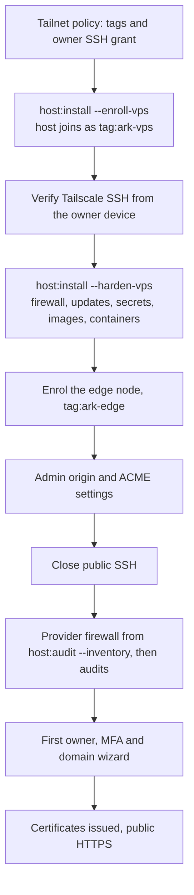

# Production install

This page takes you from a fresh Ubuntu VPS to a hardened, running Ark Stack. One command does the whole install: prerequisites, Tailscale enrolment, a Tailscale SSH safety check, hardening and installation, the edge node, the admin origin and certificate settings, closing public SSH, the provider firewall rules and the local audit. The [manual phases](#what-the-installer-does--manual-install) it runs are documented below, with links to the [operator runbooks](../operating.md) for the full detail.

## Before you start

You need:

| Item             | Requirement                                                                                                                                                                                                                                                                                                                                                                                                      |
| ---------------- | ---------------------------------------------------------------------------------------------------------------------------------------------------------------------------------------------------------------------------------------------------------------------------------------------------------------------------------------------------------------------------------------------------------------- |
| VPS              | An Ubuntu VPS with a public IPv4 address (a global IPv6 address is optional) and a provider firewall you control. Keep the provider's console or rescue access working throughout. On Hetzner Cloud, an API token lets setup apply the firewall itself ([Provider firewall adapters](#provider-firewall-adapters)).                                                                                              |
| Operating system | Ubuntu 22.04, 24.04 or 26.04 LTS on x86_64 or aarch64, with `apt` and systemd. Anything else is refused before any change.                                                                                                                                                                                                                                                                                       |
| Access           | Root, or a user with `sudo`. The installer installs Docker Engine with Compose v2, `git`, `curl`, `jq`, OpenSSL, mise and the Tailscale package itself, from their signed apt repositories, if they are missing.                                                                                                                                                                                                 |
| Tailscale        | A tailnet where you can edit the policy file and create auth keys, and an untagged owner device with Tailscale for SSH. A local non-root user with `sudo` on the VPS to log in as over Tailscale SSH (if it does not exist yet, an interactive setup offers to create it). Optionally one API credential, so setup does the policy and the keys for you ([Tailscale API automation](#tailscale-api-automation)). |
| Domain           | A domain whose DNS you control, at Cloudflare (for reviewed automatic publishing) or any other provider (manual records).                                                                                                                                                                                                                                                                                        |
| Let's Encrypt    | An email address for the ACME account.                                                                                                                                                                                                                                                                                                                                                                           |
| Optional         | An Amazon SES account for outbound mail, an S3-compatible bucket and a home machine for off-VPS backups, and an independent HTTPS host for the off-host heartbeat.                                                                                                                                                                                                                                               |

## Install with one command

On the VPS, as a user with `sudo` (or as root, without `sudo`):

```sh
curl -fsSL https://raw.githubusercontent.com/arkaydeus/ark-stack/main/install.sh | sudo bash
```

`install.sh` is one function called on its last line, so a truncated download runs nothing. Run without root it changes nothing: it explains what it will do, prints the exact `sudo` command and checks the operating system, architecture and `sudo`. As root it:

1. refuses an unsupported OS, snap Docker, a distribution `docker.io` without Compose v2, or standalone distribution runtimes such as `containerd` and `runc` that conflict with a fresh Docker Engine install. Package installation refuses removals;
2. installs whatever is missing of `git`, `curl`, `ca-certificates`, `jq`, `openssl` and `iproute2`; Docker Engine with the Compose v2 and buildx plugins from Docker's apt repository and its signed key; mise from its signed repository (enabled with `extrepo`); and the Tailscale package from Tailscale's signed repository. It starts Docker if its daemon is stopped;
3. clones the repository into `/opt/ark-stack`, or fast-forwards a clean checkout there (it refuses local changes or a non-fast-forward). `ARK_REF` picks a branch or tag (default `main`) and `ARK_INSTALL_DIR` another directory, for example `curl … | sudo ARK_REF=v1.2.0 bash`. Run as `sudo ./install.sh` from a checkout, it uses that checkout instead;
4. runs `mise trust`, `mise install` and `bun install`, then starts the guided setup, `mise run host:setup`, passing on any arguments (`curl … | sudo bash -s -- --keep-public-ssh`).

### The questions

The guided setup asks everything up front, with defaults in brackets, and shows the settings for a final yes. Secrets are read without echo. Every answer can also be given as a flag or an environment variable:

| Question                          | Flag                                               | Variable               | Default                                               |
| --------------------------------- | -------------------------------------------------- | ---------------------- | ----------------------------------------------------- |
| Your domain                       | `--domain`                                         | `ARK_SETUP_DOMAIN`     | none (required)                                       |
| Admin hostname                    | `--admin-host`                                     | `ARK_SETUP_ADMIN_HOST` | `admin.<domain>`                                      |
| Let's Encrypt account email       | `--acme-email`                                     | `ARK_ACME_EMAIL`       | empty (no certificates can be issued without it)      |
| Trusted or staging certificates   | `--trusted-certificates`, `--staging-certificates` | `ARK_ACME_STAGING`     | trusted (`ARK_ACME_STAGING=0`) when an email is given |
| Incoming mail                     | `--mail`, `--no-mail`                              | `ARK_MAIL_ENABLED`     | on                                                    |
| Shared SNI ports                  | `--sni-ports`                                      | `ARK_EDGE_SNI_PORTS`   | none (443 only)                                       |
| Cloudflare DNS token              | (environment only)                                 | `DNS_API_TOKEN`        | none (manual DNS records)                             |
| Automatic reboot time             | `--reboot-time`                                    | `ARK_HOST_REBOOT_TIME` | `04:00`                                               |
| Your local user for Tailscale SSH | `--ssh-user`                                       | `ARK_SETUP_SSH_USER`   | the user who ran `sudo`                               |

On a rerun, installed `.env` values take precedence over saved answers. Flags and environment variables can override both. Adding your first ACME email enables trusted certificates unless you selected staging.

### What you do during the install

The installer guides you through these steps:

1. **Tailnet policy and the host key.** It first asks for an optional Tailscale API credential. With one, it shows the exact policy change (the `tag:ark-vps` and `tag:ark-edge` tag owners and the owner-only Tailscale SSH rule in `check` mode), applies it after your `yes` and mints every auth key itself ([Tailscale API automation](#tailscale-api-automation)). Without one (press Enter), it prints the policy you need (see [Plan the Tailscale identities](#plan-the-tailscale-identities)) and asks you to paste a one-off `tag:ark-vps` auth key. Either way the key is passed to enrolment through stdin.
2. **The Tailscale SSH check.** After enrolment, interactive setup offers to create the selected local user if it is missing. It requires an unused `/home/<user>` and, where OpenSSH is installed, a policy that denies that user or disables both `PasswordAuthentication` and `KbdInteractiveAuthentication` for them. If OpenSSH would still accept a password for that user (the stock Ubuntu cloud image sets `PasswordAuthentication yes`), setup writes `/etc/ssh/sshd_config.d/10-ark-ssh-user-<user>.conf` with a `Match User <user>` block that turns both off for that account only. It validates a new drop-in with `sshd -t`, checks the effective policy for the selected user, and waits for the active Ubuntu SSH service to reload before creating the account. When the standard SSH socket is idle, the service loads the verified policy on activation. Setup preserves files that were already at the drop-in path and removes only a file it added during a failed validation or reload. If setup cannot verify the listeners, their startup configuration, or the effective policy (including group or connection-specific `Match` rules), create a protected local account manually and select it with `--ssh-user`. Setup prompts for the new user's sudo password without echo. Next it prints `tailscale ssh <user>@<vps-magicdns-name>`. Open that from your own device, keep it open, and type `yes` once it works. A newly created account always needs a fresh login check. Setup pauses before firewall hardening and the public SSH cutover until you confirm, and prints the resume command. Any per-user drop-in added by setup stays in effect during the pause.
3. **The edge key.** It asks for a one-off `tag:ark-edge` key, or mints one with the API credential (Enter skips this step, and the summary says how to finish it), brings up `edge-ts`, `edge` and `edge-l4`, rejoins the namespace, checks the node is tagged exactly `["tag:ark-edge"]` and then empties `TS_EDGE_AUTHKEY` in `.env`. A minted key never reaches `.env`, and it is revoked once the node has joined. With `--backup-node` the backup node (`backup-ts`, `tag:ark-backup`) is enrolled the same way.
4. **Closing public SSH.** Hardening preserves OpenSSH access from your current OpenSSH client's IP. From a console or Tailscale session, give that client's IP with `--ssh-recovery-source IP` if public OpenSSH is active. Setup arms a five-minute systemd rollback timer, stops the units serving public listeners, and asks you to test a fresh Tailscale SSH login from your device. After confirmation, it disables those units and removes the recovery rule and unambiguously public UFW SSH allowances. If verification fails or the session drops before confirmation, rollback restores the OpenSSH units and preserves the scoped firewall path. With `--keep-public-ssh`, setup retains OpenSSH and its audit and provider allowances.
5. **The provider firewall.** Setup prints the inbound rules for your provider and asks you to confirm them, or, on Hetzner Cloud with an API token, shows the planned changes to an Ark firewall and applies them after your `yes`. It then runs the local audit of the firewall and listeners. Keep the listed OpenSSH allowance while cutover is pending. After cutover, setup prints the external scan command to run from another machine.

Then it prints the summary: the SSH tunnel command, `http://localhost:3000` and the setup token, the DNS records to create (or the Cloudflare review), every skipped or pending step with the command that finishes it, and the recovery material to copy off the host. Continue with [First login and the domain wizard](#first-login-and-the-domain-wizard).

### Scripted installs

`--non-interactive` never prompts. Provision the local user with a login shell and sudo access before starting. A missing required answer fails with a message that names its flag or variable. Supply the Tailscale keys in the environment (`TS_VPS_AUTHKEY` or a private `TS_VPS_AUTHKEY_FILE`, and `TS_EDGE_AUTHKEY`) and confirm the two human checks with flags:

```sh
curl -fsSL https://raw.githubusercontent.com/arkaydeus/ark-stack/main/install.sh \
  | sudo TS_VPS_AUTHKEY_FILE=/root/ark-vps-authkey bash -s -- --non-interactive \
      --domain example.com --ssh-user alice --acme-email ops@example.com --skip-edge
```

Without `--tailscale-ssh-confirmed` (or `ARK_SETUP_TAILSCALE_SSH_CONFIRMED=1`), a first non-interactive run stops before hardening with status 2. Check Tailscale SSH and rerun with the flag. A changed Tailscale node or SSH account requires a new confirmation. Scripted setup leaves public SSH cutover pending unless you opt in with `--verify-ssh-cutover`. Run its printed command from a separate tailnet client while setup waits for proof. The target user needs sudo access to write the proof on the VPS. Without `--provider-firewall-applied` (`ARK_SETUP_PROVIDER_FIREWALL_APPLIED=1`), setup prints the provider rules and lists confirmation as pending. With a Tailscale API credential instead of the keys, add `--approve-tailnet-policy` (`ARK_SETUP_APPROVE_TAILNET_POLICY=1`); without it a scripted run prints the policy change and stops before enrolment. With `HCLOUD_TOKEN` on Hetzner Cloud, `--approve-provider-firewall` (`ARK_SETUP_APPROVE_PROVIDER_FIREWALL=1`) applies the firewall plan; without it the plan is printed and left pending. `mise run host:setup --help` lists every option.

```sh
curl -fsSL https://raw.githubusercontent.com/arkaydeus/ark-stack/main/install.sh \
  | sudo bash -c '
    TS_API_KEY="$(< /root/ts-api-key)" HCLOUD_TOKEN="$(< /root/hcloud-token)" exec bash -s -- "$@"
  ' bash \
      --non-interactive --domain example.com --ssh-user alice --acme-email ops@example.com \
      --tailscale-ssh-confirmed --approve-tailnet-policy --approve-provider-firewall
```

### Re-running and resuming

Run the same command again, or `cd /opt/ark-stack && sudo mise run host:setup`. Setup records progress in the root-only `tmp/host-setup/state.json` file and verifies completed steps on rerun. The install step runs again if its settings or Git commit changed, or if the live firewall or platform health check fails. Configuration checks that both the API and the domain worker are ready with the expected Compose configuration. Secrets in `.env` are never rotated. Progress is one line per step, and details are in `tmp/host-setup/setup.log`. The setup token appears only in the final terminal summary.

If account creation is interrupted or cleanup fails, use the recovery session to inspect the account and follow the printed recovery command. Setup preserves the home directory and mail spool. Inspect and move aside a leftover home directory before retrying with the same user name.

### Tailscale API automation

With one Tailscale API credential, setup does the tailnet steps itself: you never edit the policy file or create an auth key by hand. Give the credential in the environment, or paste it (read without echo) when setup first needs a key. Pressing Enter there keeps the manual steps above. Use one of:

| Credential                  | Variables                                                                                                                                 | What it needs                                                                                                                                                                                                                                                               |
| --------------------------- | ----------------------------------------------------------------------------------------------------------------------------------------- | --------------------------------------------------------------------------------------------------------------------------------------------------------------------------------------------------------------------------------------------------------------------------- |
| API access token (simplest) | `TS_API_KEY=tskey-api-…`                                                                                                                  | Generated by a tailnet Owner, Admin or Network admin under **Settings → Keys → Generate access token**, with the shortest expiry (1 day). Keys it mints belong to that user, who owns the Ark tags through `autogroup:admin`. No other prerequisite. Revoke it after setup. |
| OAuth client                | `TS_OAUTH_CLIENT_SECRET=tskey-client-…`; `TS_OAUTH_CLIENT_ID` if it cannot be read from the secret; `TS_OAUTH_TAG` if not `tag:ark-setup` | Write for **Policy File** (`policy_file`), **Auth Keys** (`auth_keys`) and **Device Posture Attributes** (`devices:posture_attributes`). Read for **Devices Core** (`devices:core:read`). Assign the tag `tag:ark-setup`.                                                   |

`TS_TAILNET` picks the tailnet (default `-`, the credential's own). The credential is never accepted as a flag, because flags are visible in the process list.

**Order of operations for an OAuth client.** An OAuth client can mint keys only for its own tags or for tags those tags own, and the admin console offers only tags the policy already declares. So:

1. In **Access controls**, declare the client's tag once: `"tagOwners": { "tag:ark-setup": ["autogroup:admin"] }`.
2. Create the OAuth client with the four scopes above and the tag `tag:ark-setup`. The [Tailscale scope reference](https://tailscale.com/docs/reference/trust-credentials#scopes) lists the two device scopes as dependencies of policy write access.
3. Run setup with `TS_OAUTH_CLIENT_SECRET`. The merged policy makes `tag:ark-setup` an owner of `tag:ark-vps`, `tag:ark-edge` and, with `--backup-node`, `tag:ark-backup`, next to `autogroup:admin`. The client can then mint their keys. An existing Ark tag entry gets `tag:ark-setup` added to its owners.
4. Delete the OAuth client when setup has finished, or keep it for reruns.

What setup does with the credential:

- **Policy.** Setup adds missing tag owners and grants `autogroup:owner` TCP 22 and Tailscale SSH access in `check` mode to `tag:ark-vps`, using Tailscale's default check period. Existing entries and comments are preserved. If the matching owner access requires device posture, setup asks you to review the policy and proceed manually with a compliant device. Setup shows the diff and any catch-all warnings, validates it with Tailscale, and asks for `yes` even if the approve flag is set. Scripted writes require both `--non-interactive` and `--approve-tailnet-policy`. Setup uses the policy's ETag to reject concurrent edits. Rerun to review the new version.
- **Keys.** Each key is minted just before its node joins with **Reusable** off, **Ephemeral** off, **Pre-approved** on, one tag and a one-hour expiry. Setup attempts revocation after a successful or failed join, retries transient failures, and reports the key ID if revocation remains unconfirmed. A key you give explicitly (`TS_VPS_AUTHKEY`, `TS_VPS_AUTHKEY_FILE`, `TS_EDGE_AUTHKEY`, `TS_BACKUP_AUTHKEY`) is used as given.
- **Secrets.** Setup keeps the API credential and minted keys in memory. The host, edge and backup enrolment commands receive their respective keys on stdin, without values in process arguments, Docker container configuration, `.env`, state or logs.

`--backup-node` (`ARK_SETUP_BACKUP_NODE=1`) also enrols `backup-ts` as `tag:ark-backup` for a home backup target, with a minted key or one given in `TS_BACKUP_AUTHKEY`. Its grant to the home machine still comes from the generated snippet ([backups guide](../guides/backups.md#setting-up-the-home-machine)).

### Provider firewall adapters

The firewall step passes the inventory's `providerRules` and any retained OpenSSH allowance to the first `ProviderFirewall` adapter in `scripts/host-setup/provider-firewall.ts` whose `detect` succeeds, or to the one named by `--provider-firewall` (`hetzner` or `manual`). It never runs before the Tailscale SSH check has passed, and TCP 22 stays in the rules while public OpenSSH is retained. The local `host:audit` runs after the rules are applied or confirmed.

**Hetzner Cloud (`hetzner`).** Used when the Hetzner metadata service identifies the server and a Hetzner Cloud API token is available, in `HCLOUD_TOKEN` or pasted (without echo) on an interactive run. Create a **Read & Write** token in the project that holds the server (**Security → API tokens**) and delete it after setup. The token stays in memory. The adapter:

- checks that the server's public IPv4 is this host's;
- plans one firewall named `ark-stack-<server id>` and labelled `managed-by=ark-stack`, with one inbound rule per port or contiguous port range from the inventory, each for `0.0.0.0/0` and `::/0`: TCP 80, 443 and 5432, the enabled SNI and raw route ports, TCP 25, 465, 587 and 993 when mail is on, UDP 41641 and 41642, any retained OpenSSH allowance, and ICMP and ICMPv6. It prints the diff against that firewall's current rules and attachments;
- after `yes` (scripted: `--non-interactive --approve-provider-firewall`), rechecks ownership, attachments and rules, then creates or updates the firewall. The local audit waits until Hetzner reports the association as applied;
- never modifies, detaches or deletes any other firewall. It refuses a firewall with the Ark name but without the label, or one also applied to other resources. It lists other firewalls applied to the server, because Hetzner allows whatever any of them allows;
- makes no API change on a rerun with the same rules, and still shows notices about other attached firewalls. A rerun without a token reuses the recorded apply for the same host and rules and reports that it needs the token to verify at Hetzner. After public SSH is closed, the next approved run with a token removes the TCP 22 rule.

**Any other provider (`manual`).** Prints the rules and waits for `yes` (scripted: `--provider-firewall-applied`). It is the fallback on Hetzner without a token or an applicable recorded result. It reuses an earlier confirmation for the same VPS and rules.

**Adding a provider.** Add one module to `scripts/host-setup/provider-firewalls/` that returns a `ProviderFirewall`, as `hetzner.ts` does:

- `id` and `label`;
- `detect(context)`: true only when the VPS runs on that provider (a metadata service, for example) and a credential is available, from `context.env` or `context.ui.askSecret` when `context.interactive`. Pass the credential to `context.secret` so it is redacted, and keep it in memory;
- `plan(rules, context)`: map each `ProviderRule` (protocol, ports and source CIDRs for both address families) to the provider's rules, add its ICMP and ICMPv6 allowance, compare them with a single Ark-named and Ark-labelled firewall for this server, and return `inSync`, readable `changes` and any `state` that `apply` needs;
- `apply(plan, context)`: call `approveProviderChange` from `provider-firewalls/common.ts` first, change only the Ark firewall and its attachment to this server, and return `{ status: "applied" }`.

Then list it before `manualProviderFirewall` in `providerFirewalls` and test it against a mock HTTP server, as `scripts/host-setup.test.ts` does for Hetzner. Tailscale keys come from a `TailscaleKeySource` the same way: `scripts/host-setup/tailscale-keys.ts` is the manual source and `scripts/host-setup/tailscale-api.ts` the API source.

## What the installer does / manual install

The guided setup drives the phases below in this order. You can also run each one yourself, for example to install step by step or to repair a single phase.



For a manual install, first install Docker Engine with the Compose v2 plugin, `git`, OpenSSL, `jq` and [mise](https://mise.jdx.dev) (available to root as `sudo mise …`), configure the [Tailscale Ubuntu package source](https://tailscale.com/kb/1347/installation), check out the repository and run `mise trust` and `mise install` in it.

### Plan the Tailscale identities

The VPS carries up to four Tailscale identities. Each has its own tag and its own one-off auth key, and none is ever reused for another purpose.

| Tag                   | Node                            | Key setting                                                  | When                                            |
| --------------------- | ------------------------------- | ------------------------------------------------------------ | ----------------------------------------------- |
| `tag:ark-vps`         | The host's `tailscaled`         | A private file named by `TS_VPS_AUTHKEY_FILE`                | Enrolment, before hardening                     |
| `tag:ark-edge`        | `edge-ts`                       | `TS_EDGE_AUTHKEY` in `.env` or the environment               | During or after install, before creating routes |
| `tag:ark-backup`      | `backup-ts`                     | `TS_BACKUP_AUTHKEY` in `.env`, or `host:setup --backup-node` | Only if you back up to a home machine           |
| `tag:ark-stack-admin` | `tailscale` (profile `tailnet`) | `TS_AUTHKEY`                                                 | Only for tailnet-only administration            |

In the tailnet policy file:

1. Declare the tags you will use in `tagOwners`, owned by the admins who enrol hosts, for example `"tag:ark-vps": ["autogroup:admin"]` and the same for `tag:ark-edge`.
2. Grant `autogroup:owner` TCP 22 to `tag:ark-vps` and add a Tailscale SSH rule with the same source in `check` mode. Once Ark is running, the **Front door ACL** page offers a separate SSH example. Review its source selector before applying it.
3. Do not add any grant with `tag:ark-edge` or `tag:ark-backup` as the source yet, and check that no catch-all rule (such as the default `"src": ["*"], "dst": ["*"]`) covers them. With no grants they can reach nothing. Their grants come from the generated [tailnet policy snippet](../operating.md#tailnet-policy-snippet).

Create each auth key when you need it, under **Settings → Keys → Generate auth key**: **Reusable** off, **Ephemeral** off, **Pre-approved** on, the single tag for that node, and a short expiry (1 day). Revoke each key after its node has joined.

### Enrol the host

Create the `tag:ark-vps` key, write it to a private file on the VPS, and run the enrolment phase as root:

```sh
sudo install -m 600 /dev/null /root/ark-vps-authkey   # then paste the key into this file
sudo TS_VPS_AUTHKEY_FILE=/root/ark-vps-authkey mise run host:install --enroll-vps
```

`--enroll-vps` does only this and exits:

- refuses to run unless it is root on Linux;
- installs the `tailscale` package with `apt` if the command is missing, and enables `tailscaled.service`;
- if the node is not already running with exactly `tag:ark-vps` on the host TUN interface, runs `tailscale up` with the key file, `--advertise-tags=tag:ark-vps` and `--accept-dns=false`. `TS_VPS_AUTHKEY_FILE` must be an absolute path to a regular file with no group or other permissions;
- verifies the node is running, online and tagged only `tag:ark-vps`, then enables Tailscale SSH (`tailscale set --ssh`).

It refuses a node that is already running with other tags or in userspace mode. Delete the key file and revoke the key afterwards.

From the owner's device, open a new session and keep it open for the rest of the install:

```sh
tailscale ssh <user>@<vps-magicdns-name>
```

### Decide the install-time settings

A few settings are read when the installer runs. Set them in the installer's environment or, on later runs, in `.env`:

| Setting                | Default          | Effect                                                                                                                                |
| ---------------------- | ---------------- | ------------------------------------------------------------------------------------------------------------------------------------- |
| `ARK_MAIL_ENABLED`     | `1`              | `0` installs without Stalwart, its worker and its public ports (25, 465, 587, 993).                                                   |
| `ARK_EDGE_SNI_PORTS`   | empty (443 only) | Comma-separated shared SNI ports for TLS-TCP routes, from 8883, 5671, 636 and 6380. Changing them later recreates the edge namespace. |
| `ARK_HOST_REBOOT_TIME` | `04:00`          | Daily automatic-reboot time for unattended upgrades, `HH:MM` in the server's time zone.                                               |
| `TS_EDGE_AUTHKEY`      | empty            | The edge node's one-off key. On a terminal the installer asks for it without echoing; press Enter to skip.                            |

> [!IMPORTANT]
> Let the installer create `.env` on a fresh host. It writes the file before running Compose and passes it explicitly with `--env-file`, so the first run can use the generated values. Edit this root-owned file as root and keep its permissions at `0600`.
>
> Exported variables in the installer process take precedence, including values that mise loaded from an existing file when the task started. Avoid starting from a copy of `.env.example` in production. If stale exports or example values caused a failure, remove the stale exports and retry with the generated file. Use `--env-file .env` when running Compose manually to select the file explicitly.

### Harden the host and install

With the Tailscale SSH session open, run the hardening install as root:

```sh
sudo mise run host:install --harden-vps
```

`host:install` accepts no flag, `--enroll-vps [--key-stdin]` or `--harden-vps`. On Ubuntu it holds a lock, so an overlapping install or signed maintenance run is refused. Once a host is hardened (`/etc/nftables.d/ark-host.nft` exists), every later `sudo mise run host:install` re-applies the hardening without the flag.

#### What hardening does

Hardening refuses to run unless the host node is enrolled with `tag:ark-vps` and Tailscale SSH is enabled. It then:

- installs `nftables`, `iproute2`, `netbase` and `unattended-upgrades`, writes `/etc/apt/apt.conf.d/52ark-unattended-upgrades` (daily package lists and upgrades, automatic reboot at `ARK_HOST_REBOOT_TIME`), checks the effective `apt-config` (daily schedule, the Ubuntu security origin, reboot settings), runs `unattended-upgrades --dry-run` and enables the apt timers;
- installs a reboot-required metric (`ark-host-reboot-metric.timer`, every 30 seconds) that the API exports as `ark_host_reboot_required` and Prometheus alerts on as `ArkHostRebootRequired`;
- installs the `ark_host` nftables baseline in `/etc/nftables.d/ark-host.nft` and `ark-host-firewall.service`, which loads it before `network-pre.target` and before Docker (a Docker drop-in requires it). Incoming connections are accepted on loopback and `tailscale0`; public traffic is limited to the enabled service ports, with the necessary ICMP, neighbour discovery and DHCPv6 control traffic. The forward chain checks the original destination port of Docker's DNAT, so a stray Docker publication is not exposed. The baseline boots with dedicated route ports closed; the `database-ingress` reconciler restores them from the verified front policy.

[VPS hardening](../operating.md#vps-hardening) has the full description, including disabling mail on an existing install.

#### What the install does

Every run, hardened or not:

1. **Secrets.** Merges `.env`: every installer secret that is missing, empty or an example placeholder gets a fresh random value; every other existing value is kept, so secrets are never rotated by a re-run. The file is set to mode `0600`. The secrets are listed in [Configuration](configuration.md#secrets-the-installer-generates).
2. **Edge key and SNI ports.** Keeps an existing `TS_EDGE_AUTHKEY`, or writes the one supplied (it must look like `tskey-…`); writes `ARK_EDGE_SNI_PORTS` and one `ARK_EDGE_SNI_PORT_<n>` publication per enabled port; records `ARK_MAIL_ENABLED`, `ARK_HOST_HARDENING` and the host metric and IPv6 evidence paths.
3. **Files.** Creates the `tmp/` state directories; seeds the first HAProxy generation (every hostname to Caddy); writes a self-signed `tmp/certs/database` certificate if none exists; copies the initial `Caddyfile` and `serve.json` into `tmp/edge`; writes the closed PgBouncer bootstrap configuration (no mappings, no admitted users, a deny-all client CA); writes `tmp/metrics.token` (mode `0600`). As root on Linux it gives these directories to uid 1000 (`ARK_CONTAINER_UID` and `ARK_CONTAINER_GID` override it).
4. **Images.** Checks that the pinned HAProxy image runs as uid 99 and that group 4400 is free in the images; creates the external networks `ark_mail_management` and `ark_monitoring`; builds the Ark images.
5. **IPv6.** On a hardened host, enables Docker IPv6, IPv6 firewall processing and live restore, migrates the published networks and verifies dual-stack addresses before turning off the userland proxy. The first such run can interrupt Docker traffic. See [Native IPv6 and AAAA publication](../operating.md#native-ipv6-and-aaaa-publication).
6. **Containers.** Starts `postgres` and `app-postgres`; starts Stalwart and ensures STARTTLS submission on TCP 587 when mail is enabled; sets the `ark_runtime` password; runs the migrations as `ark_migration`; starts `database-ingress`, then `api`, the workers, `agent`, `edge-ts`, `edge-watchdog`, `haproxy-validator`, `edge`, `edge-l4` and `pgbouncer-public`, waiting up to 120 seconds for them to be healthy; puts `edge` and `edge-l4` back into the live `edge-ts` namespace; starts Prometheus.
7. **Output.** Prints the setup URL (`http://localhost:3000`) and the setup token, and, if `TS_EDGE_AUTHKEY` is empty, how to enrol the edge node.

Check the result:

```sh
docker compose --env-file .env -f infra/platform/docker-compose.yml ps
curl -fsS http://127.0.0.1:3000/api/health
```

### Close public SSH

After confirming a new Tailscale SSH session works with the baseline active:

- remove public TCP 22 at the provider firewall;
- stop Ubuntu's public OpenSSH listener, or bind it to a private address (Tailscale SSH is served by `tailscaled`, not OpenSSH);
- remove UFW rules that conflict with nftables;
- keep the provider's required ICMP and ICMPv6 allowances.

### Provider firewall and audit

Generate the inbound rules from the VPS after the front policy has reconciled, apply the generated `providerRules` in your provider's firewall, then audit:

```sh
sudo mise run host:audit --inventory > ark-host-inventory.json
sudo mise run host:audit
```

The inventory covers TCP 80, 443 and 5432, the enabled SNI and raw route ports, UDP 41641 (host) and UDP 41642 (edge), and TCP 25, 465, 587 and 993 when mail is enabled, for IPv4 and IPv6. The local audit checks the installed baseline, `ss` and Docker port mappings; an unexpected public listener fails it even if the firewall blocks it.

Then scan from outside, from a machine with Nmap and raw-socket permission, giving it the VPS's public addresses:

```sh
sudo mise run host:audit --external ark-host-inventory.json <public-ipv4> <public-ipv6>
```

Keep the provider firewall in step whenever mail, the shared SNI ports or raw routes change. [Provider firewall and audit](../operating.md#provider-firewall-and-audit) explains the results.

### Enrol the edge node

The edge serves ACME challenges and public HTTPS without a Tailscale key, but it cannot reach tailnet services until `edge-ts` joins as `tag:ark-edge`:

1. Create a one-off, pre-approved, non-ephemeral, 1-day key tagged `tag:ark-edge`.
2. Supply it to the installer when prompted, or put it in `.env` as `TS_EDGE_AUTHKEY=tskey-auth-…`. The installer never replaces an existing value and never prints it.
3. Start the node and rejoin its dependents:

   ```sh
   sudo docker compose --env-file .env -f infra/platform/docker-compose.yml up -d edge-ts edge edge-l4
   sudo mise run edge:rejoin
   sudo docker compose --env-file .env -f infra/platform/docker-compose.yml exec edge-ts \
     tailscale --socket=/var/run/tailscale/tailscaled.sock status --json | jq '.Self.Tags'
   ```

   The last command must print `["tag:ark-edge"]`.

4. Empty `TS_EDGE_AUTHKEY` in `.env` and revoke the key. The node authenticates from its `ark_edge_ts_state` volume from now on.
5. With Tailnet Lock enabled, sign the new node from a trusted signing node.
6. Allow UDP 41642 at the provider for direct WireGuard paths; without it, edge traffic is relayed through DERP.

After any restart or replacement of `edge-ts`, run `sudo mise run edge:rejoin`. [Edge Tailscale node](../operating.md#edge-tailscale-node) covers re-enrolment and upgrades. The backup node is enrolled the same way with `TS_BACKUP_AUTHKEY`; see [Home machine over the tailnet](../guides/backups.md#home-machine-over-the-tailnet-fd-30).

### Set the admin origin and ACME

After setting the admin origin, ACME and any Cloudflare credentials in `.env`, recreate the services that read them:

```sh
sudo docker compose --env-file .env -f infra/platform/docker-compose.yml up -d api domain-worker
```

**Admin origin.** The API answers only the hosts in `BETTER_AUTH_URL` and `BETTER_AUTH_TRUSTED_ORIGINS` (plus the login host, once enabled); any other host gets `421`. A first install keeps the example values, `http://localhost:3000` and `http://localhost:5173,http://localhost:3000`.

- For public administration, set `BETTER_AUTH_URL=https://admin.<domain>` and include that origin in `BETTER_AUTH_TRUSTED_ORIGINS`. Over HTTPS, cookies become host-only `__Host-` cookies.
- Keep the local bootstrap origin you use through the SSH tunnel (for example `http://localhost:3000`) in `BETTER_AUTH_TRUSTED_ORIGINS` while you still sign in that way.
- `ARK_EDGE_GATE_TOKEN` is already generated; it lets the edge and tailnet gateway pass the real client address on the exact auth paths, which the per-client sign-in limits depend on.

**Certificates.** The domain worker defaults to `ARK_ACME_STAGING=1`. Staging certificates are recorded as untrusted and never served. For public HTTPS, set `ARK_ACME_EMAIL` and `ARK_ACME_STAGING=0`. Without `ARK_ACME_EMAIL` the domain worker cannot issue at all: `certificate.issue` fails with "Public certificate issuance is not configured". Certificates issued while staging was on must be reissued; changing the flag does not make them trusted. See [Public certificates](../operating.md#public-certificates).

**Cloudflare DNS.** For automatic publishing, set `DNS_API_TOKEN` with [the required permissions for your zones](configuration.md#dns-providers).

**Backups.** `ARK_BACKUP_EXECUTE` defaults to `0`, which plans backups without running pgBackRest or restic. Set it to `1` and recreate `backup-worker` once you have configured targets. See [Guide: off-VPS backups](../guides/backups.md).

## First login and the domain wizard

The raw API is bound only to `127.0.0.1:3000` on the VPS. Reach it through an SSH tunnel over the tailnet, for example:

```sh
ssh -L 3000:127.0.0.1:3000 <user>@<vps-magicdns-name>
```

Then open `http://localhost:3000` (registered by default). Create the owner with the setup token, enrol MFA and run the domain wizard. If you installed with `ARK_MAIL_ENABLED=0`, clear **Incoming mail** before submitting. [First run and domain wizard](first-run.md) walks through every screen, the DNS records and the endpoint states.

## Going public

Public administration is served by the edge only after its certificate is issued:

1. In the wizard, choose **Public HTTPS** and give the admin hostname (default `admin.<domain>`), with `BETTER_AUTH_URL` set to it as above.
2. Create the DNS records, or publish the reviewed Cloudflare diff, and recheck until the endpoints leave `awaiting_dns`.
3. With `ARK_ACME_STAGING=0`, the domain worker issues a trusted certificate and queues `edge.apply`; the `edge-apply` operation evidence lists hostnames still `awaitingCertificate`. Once the admin certificate is `issued`, Caddy serves `https://admin.<domain>`.
4. Keep the SSH tunnel available until you have signed in through the public origin.

Later switches between public and tailnet administration are durable `admin.mode_change` operations that rewrite the edge configuration and revoke every session; see [Admin access modes](../features/admin-access-modes.md). To publish tailnet services or put routes behind the Ark login, continue with the [front-door guide](../guides/front-door.md). For Vercel apps, see [Guide: database access from Vercel](../guides/vercel-database.md).

## After the install

- **Re-running the installer** is safe: it keeps every existing secret, re-applies hardening and the firewall, rebuilds and recreates changed containers, and rejoins the edge namespace. Run it as root on a hardened host.
- **Upgrades** go through signed release bundles with `mise run maintain`; see [Maintenance and upgrades](../operations/maintenance-and-upgrades.md).
- **Monitoring** runs locally on `127.0.0.1:9090`. For host loss, configure `ARK_OFFHOST_HEARTBEAT_URL` to an independently hosted receiver; see [Monitoring and alerts](../features/monitoring.md).
- **Recovery material.** Copy `ARK_ROOT_KEY`, `ARK_ROOT_KEY_ID`, `ARK_MFA_RECOVERY_TOKEN`, both pgBackRest cipher passes and every backup target's restic password off the host. See [Recovery](../operations/recovery.md).
