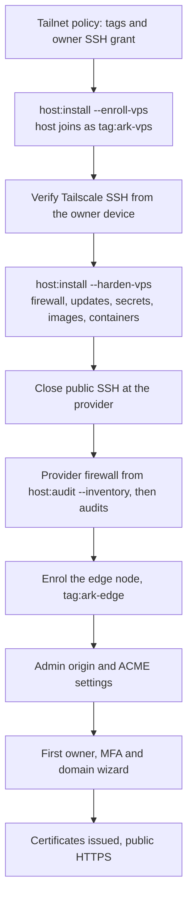

# Production install

This page takes you from a fresh Ubuntu VPS to a hardened, running Ark Stack: Tailscale tags and keys, host enrolment, hardening and installation, the edge node, the provider firewall and audit, certificate settings and the switch to public HTTPS. It summarises each step and links to the [operator runbooks](../operating.md) for the full detail.

## Before you start

You need:

| Item             | Requirement                                                                                                                                                                                                                            |
| ---------------- | -------------------------------------------------------------------------------------------------------------------------------------------------------------------------------------------------------------------------------------- |
| VPS              | An Ubuntu VPS with a public IPv4 address (a global IPv6 address is optional) and a provider firewall you control. Keep the provider's console or rescue access working throughout.                                                     |
| Operating system | Ubuntu with `apt`, systemd and a `VERSION_CODENAME` in `/etc/os-release`. Hardening installs `nftables`, `iproute2` and `unattended-upgrades`, and requires the `<codename>-security` origin in the unattended-upgrades configuration. |
| Docker           | Docker Engine with the Compose v2 plugin, installed before you start. The installer does not install Docker.                                                                                                                           |
| Tools            | `git`, OpenSSL, and [mise](https://mise.jdx.dev) available to root (`sudo mise …`). The repository checked out on the VPS, with `mise trust` and `mise install` run in it.                                                             |
| Tailscale        | A tailnet where you can edit the policy file and create auth keys, the [Tailscale Ubuntu package source](https://tailscale.com/kb/1347/installation) configured on the VPS, and an untagged owner device for SSH.                      |
| Domain           | A domain whose DNS you control, at Cloudflare (for reviewed automatic publishing) or any other provider (manual records).                                                                                                              |
| Let's Encrypt    | An email address for the ACME account.                                                                                                                                                                                                 |
| Optional         | An Amazon SES account for outbound mail, an S3-compatible bucket and a home machine for off-VPS backups, and an independent HTTPS host for the off-host heartbeat.                                                                     |

The overall sequence:



## Plan the Tailscale identities

The VPS carries up to four Tailscale identities. Each has its own tag and its own one-off auth key, and none is ever reused for another purpose.

| Tag                   | Node                            | Key setting                                    | When                                            |
| --------------------- | ------------------------------- | ---------------------------------------------- | ----------------------------------------------- |
| `tag:ark-vps`         | The host's `tailscaled`         | A private file named by `TS_VPS_AUTHKEY_FILE`  | Enrolment, before hardening                     |
| `tag:ark-edge`        | `edge-ts`                       | `TS_EDGE_AUTHKEY` in `.env` or the environment | During or after install, before creating routes |
| `tag:ark-backup`      | `backup-ts`                     | `TS_BACKUP_AUTHKEY` in `.env`                  | Only if you back up to a home machine           |
| `tag:ark-stack-admin` | `tailscale` (profile `tailnet`) | `TS_AUTHKEY`                                   | Only for tailnet-only administration            |

In the tailnet policy file:

1. Declare the tags you will use in `tagOwners`, owned by the admins who enrol hosts, for example `"tag:ark-vps": ["autogroup:admin"]` and the same for `tag:ark-edge`.
2. Add an owner-only grant for TCP 22 to `tag:ark-vps` and a Tailscale SSH rule for it in `check` mode. Once Ark is running, the **Front door ACL** page shows this SSH policy for you.
3. Do not add any grant with `tag:ark-edge` or `tag:ark-backup` as the source yet, and check that no catch-all rule (such as the default `"src": ["*"], "dst": ["*"]`) covers them. With no grants they can reach nothing. Their grants come from the generated [tailnet policy snippet](../operating.md#tailnet-policy-snippet).

Create each auth key when you need it, under **Settings → Keys → Generate auth key**: **Reusable** off, **Ephemeral** off, **Pre-approved** on, the single tag for that node, and a short expiry (1 day). Revoke each key after its node has joined.

## Enrol the host

Create the `tag:ark-vps` key, write it to a private file on the VPS, and run the enrolment phase as root:

```sh
sudo install -m 600 /dev/null /root/ark-vps-authkey   # then paste the key into this file
sudo TS_VPS_AUTHKEY_FILE=/root/ark-vps-authkey mise run host:install --enroll-vps
```

`--enroll-vps` does only this and exits:

- refuses to run unless it is root on Linux;
- installs the `tailscale` package with `apt` if the command is missing, and enables `tailscaled.service`;
- if the node is not already running with exactly `tag:ark-vps` on the host TUN interface, runs `tailscale up` with the key file, `--advertise-tags=tag:ark-vps` and `--accept-dns=false`. `TS_VPS_AUTHKEY_FILE` must be an absolute path to a regular file with no group or other permissions;
- verifies the node is running, online and tagged only `tag:ark-vps`, then enables Tailscale SSH (`tailscale set --ssh`).

It refuses a node that is already running with other tags or in userspace mode. Delete the key file and revoke the key afterwards.

From the owner's device, open a new session and keep it open for the rest of the install:

```sh
tailscale ssh <user>@<vps-magicdns-name>
```

## Decide the install-time settings

A few settings are read when the installer runs. Set them in the installer's environment or, on later runs, in `.env`:

| Setting                | Default          | Effect                                                                                                                                |
| ---------------------- | ---------------- | ------------------------------------------------------------------------------------------------------------------------------------- |
| `ARK_MAIL_ENABLED`     | `1`              | `0` installs without Stalwart, its worker and its public ports (25, 465, 587, 993).                                                   |
| `ARK_EDGE_SNI_PORTS`   | empty (443 only) | Comma-separated shared SNI ports for TLS-TCP routes, from 8883, 5671, 636 and 6380. Changing them later recreates the edge namespace. |
| `ARK_HOST_REBOOT_TIME` | `04:00`          | Daily automatic-reboot time for unattended upgrades, `HH:MM` in the server's time zone.                                               |
| `TS_EDGE_AUTHKEY`      | empty            | The edge node's one-off key. On a terminal the installer asks for it without echoing; press Enter to skip.                            |

> [!IMPORTANT]
> Let the installer create `.env` on a fresh host. It writes the file before running Compose and passes it explicitly with `--env-file`, so the first run can use the generated values.
>
> Exported variables in the installer process take precedence, including values that mise loaded from an existing file when the task started. Avoid starting from a copy of `.env.example` in production. If stale exports or example values caused a failure, remove the stale exports and retry with the generated file. Use `--env-file .env` when running Compose manually to select the file explicitly.

## Harden the host and install

With the Tailscale SSH session open, run the hardening install as root:

```sh
sudo mise run host:install --harden-vps
```

`host:install` accepts no flag, `--enroll-vps` or `--harden-vps`. On Ubuntu it holds a lock, so an overlapping install or signed maintenance run is refused. Once a host is hardened (`/etc/nftables.d/ark-host.nft` exists), every later `sudo mise run host:install` re-applies the hardening without the flag.

### What hardening does

Hardening refuses to run unless the host node is enrolled with `tag:ark-vps` and Tailscale SSH is enabled. It then:

- installs `nftables`, `iproute2` and `unattended-upgrades`, writes `/etc/apt/apt.conf.d/52ark-unattended-upgrades` (daily package lists and upgrades, automatic reboot at `ARK_HOST_REBOOT_TIME`), checks the effective `apt-config` (daily schedule, the Ubuntu security origin, reboot settings), runs `unattended-upgrades --dry-run` and enables the apt timers;
- installs a reboot-required metric (`ark-host-reboot-metric.timer`, every 30 seconds) that the API exports as `ark_host_reboot_required` and Prometheus alerts on as `ArkHostRebootRequired`;
- installs the `ark_host` nftables baseline in `/etc/nftables.d/ark-host.nft` and `ark-host-firewall.service`, which loads it before `network-pre.target` and before Docker (a Docker drop-in requires it). Incoming connections are accepted on loopback and `tailscale0`; public traffic is limited to the enabled service ports, with the necessary ICMP, neighbour discovery and DHCPv6 control traffic. The forward chain checks the original destination port of Docker's DNAT, so a stray Docker publication is not exposed. The baseline boots with dedicated route ports closed; the `database-ingress` reconciler restores them from the verified front policy.

[VPS hardening](../operating.md#vps-hardening) has the full description, including disabling mail on an existing install.

### What the install does

Every run, hardened or not:

1. **Secrets.** Merges `.env`: every installer secret that is missing, empty or an example placeholder gets a fresh random value; every other existing value is kept, so secrets are never rotated by a re-run. The file is set to mode `0600`. The secrets are listed in [Configuration](configuration.md#secrets-the-installer-generates).
2. **Edge key and SNI ports.** Keeps an existing `TS_EDGE_AUTHKEY`, or writes the one supplied (it must look like `tskey-…`); writes `ARK_EDGE_SNI_PORTS` and one `ARK_EDGE_SNI_PORT_<n>` publication per enabled port; records `ARK_MAIL_ENABLED`, `ARK_HOST_HARDENING` and the host metric and IPv6 evidence paths.
3. **Files.** Creates the `tmp/` state directories; seeds the first HAProxy generation (every hostname to Caddy); writes a self-signed `tmp/certs/database` certificate if none exists; copies the initial `Caddyfile` and `serve.json` into `tmp/edge`; writes the closed PgBouncer bootstrap configuration (no mappings, no admitted users, a deny-all client CA); writes `tmp/metrics.token` (mode `0600`). As root on Linux it gives these directories to uid 1000 (`ARK_CONTAINER_UID` and `ARK_CONTAINER_GID` override it).
4. **Images.** Checks that the pinned HAProxy image runs as uid 99 and that group 4400 is free in the images; creates the external networks `ark_mail_management` and `ark_monitoring`; builds the Ark images.
5. **IPv6.** On a hardened host, enables Docker IPv6, IPv6 firewall processing and live restore, migrates the published networks and verifies dual-stack addresses before turning off the userland proxy. The first such run can interrupt Docker traffic. See [Native IPv6 and AAAA publication](../operating.md#native-ipv6-and-aaaa-publication).
6. **Containers.** Starts `postgres` and `app-postgres`; starts Stalwart and ensures STARTTLS submission on TCP 587 when mail is enabled; sets the `ark_runtime` password; runs the migrations as `ark_migration`; starts `database-ingress`, then `api`, the workers, `agent`, `edge-ts`, `edge-watchdog`, `haproxy-validator`, `edge`, `edge-l4` and `pgbouncer-public`, waiting up to 120 seconds for them to be healthy; puts `edge` and `edge-l4` back into the live `edge-ts` namespace; starts Prometheus.
7. **Output.** Prints the setup URL (`http://localhost:3000`) and the setup token, and, if `TS_EDGE_AUTHKEY` is empty, how to enrol the edge node.

Check the result:

```sh
docker compose --env-file .env -f infra/platform/docker-compose.yml ps
curl -fsS http://127.0.0.1:3000/api/health
```

## Close public SSH

After confirming a new Tailscale SSH session works with the baseline active:

- remove public TCP 22 at the provider firewall;
- stop Ubuntu's public OpenSSH listener, or bind it to a private address (Tailscale SSH is served by `tailscaled`, not OpenSSH);
- remove UFW rules that conflict with nftables;
- keep the provider's required ICMP and ICMPv6 allowances.

## Provider firewall and audit

Generate the inbound rules from the VPS after the front policy has reconciled, apply the generated `providerRules` in your provider's firewall, then audit:

```sh
sudo mise run host:audit --inventory > ark-host-inventory.json
sudo mise run host:audit
```

The inventory covers TCP 80, 443 and 5432, the enabled SNI and raw route ports, UDP 41641 (host) and UDP 41642 (edge), and TCP 25, 465, 587 and 993 when mail is enabled, for IPv4 and IPv6. The local audit checks the installed baseline, `ss` and Docker port mappings; an unexpected public listener fails it even if the firewall blocks it.

Then scan from outside, from a machine with Nmap and raw-socket permission, giving it the VPS's public addresses:

```sh
sudo mise run host:audit --external ark-host-inventory.json <public-ipv4> <public-ipv6>
```

Keep the provider firewall in step whenever mail, the shared SNI ports or raw routes change. [Provider firewall and audit](../operating.md#provider-firewall-and-audit) explains the results.

## Enrol the edge node

The edge serves ACME challenges and public HTTPS without a Tailscale key, but it cannot reach tailnet services until `edge-ts` joins as `tag:ark-edge`:

1. Create a one-off, pre-approved, non-ephemeral, 1-day key tagged `tag:ark-edge`.
2. Supply it to the installer when prompted, or put it in `.env` as `TS_EDGE_AUTHKEY=tskey-auth-…`. The installer never replaces an existing value and never prints it.
3. Start the node and rejoin its dependents:

   ```sh
   docker compose --env-file .env -f infra/platform/docker-compose.yml up -d edge-ts edge edge-l4
   mise run edge:rejoin
   docker compose --env-file .env -f infra/platform/docker-compose.yml exec edge-ts \
     tailscale --socket=/var/run/tailscale/tailscaled.sock status --json | jq '.Self.Tags'
   ```

   The last command must print `["tag:ark-edge"]`.

4. Empty `TS_EDGE_AUTHKEY` in `.env` and revoke the key. The node authenticates from its `ark_edge_ts_state` volume from now on.
5. With Tailnet Lock enabled, sign the new node from a trusted signing node.
6. Allow UDP 41642 at the provider for direct WireGuard paths; without it, edge traffic is relayed through DERP.

After any restart or replacement of `edge-ts`, run `mise run edge:rejoin`. [Edge Tailscale node](../operating.md#edge-tailscale-node) covers re-enrolment and upgrades. The backup node is enrolled the same way with `TS_BACKUP_AUTHKEY`; see [Home machine over the tailnet](../guides/backups.md#home-machine-over-the-tailnet-fd-30).

## Set the admin origin and ACME

Two groups of settings in `.env` decide how the admin UI is reached and whether certificates are publicly trusted. After changing them, recreate the services that read them:

```sh
docker compose --env-file .env -f infra/platform/docker-compose.yml up -d api domain-worker
```

**Admin origin.** The API answers only the hosts in `BETTER_AUTH_URL` and `BETTER_AUTH_TRUSTED_ORIGINS` (plus the login host, once enabled); any other host gets `421`. A first install keeps the example values, `http://localhost:3000` and `http://localhost:5173,http://localhost:3000`.

- For public administration, set `BETTER_AUTH_URL=https://admin.<domain>` and include that origin in `BETTER_AUTH_TRUSTED_ORIGINS`. Over HTTPS, cookies become host-only `__Host-` cookies.
- Keep the local bootstrap origin you use through the SSH tunnel (for example `http://localhost:3000`) in `BETTER_AUTH_TRUSTED_ORIGINS` while you still sign in that way.
- `ARK_EDGE_GATE_TOKEN` is already generated; it lets the edge and tailnet gateway pass the real client address on the exact auth paths, which the per-client sign-in limits depend on.

**Certificates.** The domain worker defaults to `ARK_ACME_STAGING=1`. Staging certificates are recorded as untrusted and never served. For public HTTPS, set `ARK_ACME_EMAIL` and `ARK_ACME_STAGING=0`. Without `ARK_ACME_EMAIL` the domain worker cannot issue at all: `certificate.issue` fails with "Public certificate issuance is not configured". Certificates issued while staging was on must be reissued; changing the flag does not make them trusted. See [Public certificates](../operating.md#public-certificates).

**Backups.** `ARK_BACKUP_EXECUTE` defaults to `0`, which plans backups without running pgBackRest or restic. Set it to `1` and recreate `backup-worker` once you have configured targets. See [Guide: off-VPS backups](../guides/backups.md).

## First login and the domain wizard

The raw API is bound only to `127.0.0.1:3000` on the VPS. Reach it through an SSH tunnel over the tailnet, for example:

```sh
ssh -L 3000:127.0.0.1:3000 <user>@<vps-magicdns-name>
```

Then open `http://localhost:3000` (registered by default). Create the owner with the setup token, enrol MFA and run the domain wizard. [First run and domain wizard](first-run.md) walks through every screen, the DNS records and the endpoint states.

## Going public

Public administration is served by the edge only after its certificate is issued:

1. In the wizard, choose **Public HTTPS** and give the admin hostname (default `admin.<domain>`), with `BETTER_AUTH_URL` set to it as above.
2. Create the DNS records, or publish the reviewed Cloudflare diff, and recheck until the endpoints leave `awaiting_dns`.
3. With `ARK_ACME_STAGING=0`, the domain worker issues a trusted certificate and queues `edge.apply`; the `edge-apply` operation evidence lists hostnames still `awaitingCertificate`. Once the admin certificate is `issued`, Caddy serves `https://admin.<domain>`.
4. Keep the SSH tunnel available until you have signed in through the public origin.

Later switches between public and tailnet administration are durable `admin.mode_change` operations that rewrite the edge configuration and revoke every session; see [Admin access modes](../features/admin-access-modes.md). To publish tailnet services or put routes behind the Ark login, continue with the [front-door guide](../guides/front-door.md). For Vercel apps, see [Guide: database access from Vercel](../guides/vercel-database.md).

## After the install

- **Re-running the installer** is safe: it keeps every existing secret, re-applies hardening and the firewall, rebuilds and recreates changed containers, and rejoins the edge namespace. Run it as root on a hardened host.
- **Upgrades** go through signed release bundles with `mise run maintain`; see [Maintenance and upgrades](../operations/maintenance-and-upgrades.md).
- **Monitoring** runs locally on `127.0.0.1:9090`. For host loss, configure `ARK_OFFHOST_HEARTBEAT_URL` to an independently hosted receiver; see [Monitoring and alerts](../features/monitoring.md).
- **Recovery material.** Copy `ARK_ROOT_KEY`, `ARK_ROOT_KEY_ID`, `ARK_MFA_RECOVERY_TOKEN`, both pgBackRest cipher passes and every backup target's restic password off the host. See [Recovery](../operations/recovery.md).
