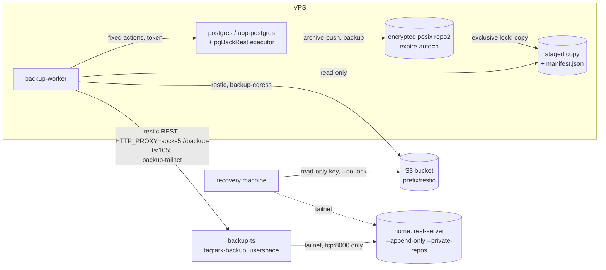

# Off-VPS backups (S3-compatible and home machine, append-only)

This guide covers FD-21 and FD-30 (`docs/design/front-door.md` §3.18): backups of both PostgreSQL clusters, mail and reviewed volumes to **two** destinations that a compromised VPS cannot erase: an S3-compatible bucket, and `rest-server --append-only` on your home machine, reached over the tailnet through a dedicated backup node. "Backups healthy" needs both.

## How it works



- **Each PostgreSQL container** (`postgres` and `app-postgres`) runs the pinned image plus pgBackRest 2.60 (PGDG) and a small executor (`workers/src/pg-executor.ts`). WAL is archived into a local, encrypted (`aes-256-cbc`) pgBackRest `repo2` on its own volume, with `archive_timeout=60`. Debian's default `repo1` is removed from the image, so `repo2` is the only repository.
- **The executor** answers a fixed set of token-authenticated actions on the internal `backup-management` network: `status`, `stanza-create`, `check`, `backup` (full, diff or incr), `stage`, `release-stage` and `prune-stages`. There is no generic command, no shell and no Docker socket, and **`pgbackrest expire` is never run on the VPS** (enforced by `tests/security/backup-no-expire.test.ts`).
- **Staging.** Every repo2 writer takes the executor lock: `archive-push` and `backup` shared, staging exclusive. A stage forces a WAL switch, waits until that segment is in repo2, then copies the completed repository under the exclusive lock (`cp --reflink=auto`, which clones where the filesystem can and copies otherwise). While the copy runs, `archive-push` waits; PostgreSQL keeps the segment in `pg_wal` and retries, so WAL is fenced, never dropped. The stage's `manifest.json` records the stanza, backup labels, WAL segment and the **last recoverable time**: the instant of the WAL switch, claimed only when a backup finished before it.
- **Export.** The backup worker (on `backup-egress`) uploads each stage as an immutable restic snapshot to `s3:<endpoint>/<bucket>/<prefix>/restic`, tagged `source=pg:<stanza>` and `stage=<id>`, and records a per-destination manifest (`backup_exports`). Each target has its own export operation, and bounded export lanes let healthy destinations continue while another destination stalls. Mail snapshots and reviewed volumes go to the same restic repository.
- **Schedules.** Weekly full and daily differential backups per cluster, an export to every target every five minutes, and the append-only canary weekly and whenever a target is saved.

Live pgBackRest `*.info` files are never put under a lock or in the bucket: they are mutable. Only completed, staged copies are exported, so each restic snapshot keeps its own `backup.info` and `archive.info`, and the metadata history is immutable too.

## Setting up the S3-compatible target

In **Backups → Add an S3-compatible target** (owner only; saving needs your password), pick the provider recipe, then enter:

| Field               | Notes                                                                                                          |
| ------------------- | -------------------------------------------------------------------------------------------------------------- |
| Endpoint            | `https://host[:port]`. Examples below. `http://` is accepted for a local MinIO only.                           |
| Region              | Suggested from the region setting (FD-03), for example `us-east-1` for US East. R2 uses `auto`.                |
| Bucket, prefix      | The restic repository lives at `<prefix>/restic`; canaries at `<prefix>/ark-canary/` and in each policy class. |
| Path style          | On for MinIO; off (virtual-host style) for AWS, B2 and R2.                                                     |
| Recovery window     | Days of history the lock or retention must cover. A shorter retention makes the target unhealthy.              |
| Keys                | The writer credential from the recipe. Write-only: Ark seals them and never shows them again.                  |
| Repository password | The restic password. Generate it, **store it off-host**, and never change it (a new prefix means a new repo).  |

The API is `GET /api/backups/targets`, `PUT /api/backups/targets/s3` (with `id` to update) and `POST /api/backups/targets/:id/verify`. More than one S3 target may be configured; each is exported and checked independently.

### Provider recipes

The UI shows the same recipes (`PROVIDER_RECIPES` in `shared/src/backup-targets.ts`), and the generated writer policy for each target.

**AWS S3** (`https://s3.<region>.amazonaws.com`, virtual-host style)

1. Create the bucket with Object Lock enabled (this enables versioning). Set a default retention in COMPLIANCE mode, or GOVERNANCE mode with no principal holding `s3:BypassGovernanceRetention`, of at least the recovery window.
2. Create an IAM user for Ark with only the generated policy (including read-only `GetBucketPolicy`): `PutObject`, `GetObject`, `GetObjectVersion`, `GetObjectRetention` and listing under the prefix; `DeleteObject` **only** on `<prefix>/restic/locks/*`; and an explicit deny of `DeleteObjectVersion`, `BypassGovernanceRetention`, `PutObjectRetention`, `PutObjectLegalHold`, `PutBucketVersioning`, `PutBucketObjectLockConfiguration`, `PutLifecycleConfiguration`, `PutBucketPolicy`, `DeleteBucketPolicy` and `DeleteBucket`.

3. Attach the generated `bucketProtectionPolicy` from `GET /api/backups/targets` as a **bucket policy** too. Its unconditional all-principal denies cover permanent version deletion and retention changes/bypass on the exact config key and prevent deleting this policy. Keep permission to replace the policy on an independent off-host administrator; the VPS writer must have neither replacement nor deletion permission. A sibling canary alone cannot prove exact-key permissions. If the policy cannot be read and evaluated, verification stays unknown.

restic deletes its own lock files under `locks/` when a backup ends, so a credential with no delete permission at all would break `restic backup`. On a versioned bucket that delete only adds a delete marker.

**Backblaze B2** (`https://s3.<region>.backblazeb2.com`, virtual-host style)

1. Enable Object Lock on the bucket with a default retention of at least the recovery window. B2 keeps file versions natively.
2. Create an application key scoped to the bucket **without** `deleteFiles`, `bypassGovernance`, `writeBucketRetentions`, `writeBuckets`, `deleteBuckets` and `writeFileLegalHolds`. `writeFiles` still lets restic hide its lock files; hidden versions remain recoverable. The canary reads the key's own capabilities from `b2_authorize_account`.

**Cloudflare R2** (`https://<account-id>.r2.cloudflarestorage.com`, region `auto`, virtual-host style)

1. Add bucket lock rules on `<prefix>/restic/data/`, `index/`, `snapshots/`, `keys/`, `<prefix>/restic/config` and `<prefix>/ark-canary/` with **Indefinite** retention. Finite Age/Date rules expire on old config, keys and reused packs even when recent snapshots still depend on them. **Do not lock `<prefix>/restic/locks/`**: restic must remove its lock files.
2. R2 tokens have no no-delete level ("Object Read & Write"), so the lock rules are the only control. Scope the token to this bucket.
3. Give Ark a separate **read-only** Cloudflare API token (with the account ID) so the canary can read the lock rules. Without it the target stays "unknown", never healthy.

A direct, live pgBackRest S3 repository (`repo1`) is never the R2 recipe: `backup.info`, `backup.info.copy` and `archive.info` are rewritten in place and cannot sit under a non-overwrite lock.

**MinIO** (path style)

1. `mc mb --with-lock <alias>/<bucket>` (object locking turns on versioning), then `mc retention set --default COMPLIANCE <days>d <alias>/<bucket>`.
2. Create a user with the same IAM-style policy as AWS (`mc admin policy create`, then `mc admin policy attach … --user …`), and attach the generated protection document as a bucket policy as described above.

## Home machine over the tailnet (FD-30)

The second destination is a restic REST repository on a machine you own, served by [`rest-server`](https://github.com/restic/rest-server) in **append-only** mode. The VPS reaches it only through its own Tailscale node, `backup-ts`, never through the public edge node.

### How it works

- **`backup-ts`** (Compose service, pinned `tailscale/tailscale:v1.86.2`, the same image as `edge-ts`) joins the tailnet as `tag:ark-backup` with its own key, in **userspace** networking (no tun device, no capabilities) and with `--shields-up`, so nothing on the tailnet can connect to it. It exposes a SOCKS5 proxy on `:1055` on the internal `backup-tailnet` network, whose only other member is the backup worker. Its own egress network (`backup-ts-egress`) has no other member.
- **Only the home target's restic subprocess is proxied.** It gets exactly `HTTP_PROXY=socks5://backup-ts:1055` and no other proxy variable; every restic environment is built from scratch, so a `HTTP_PROXY`, `NO_PROXY` or `ALL_PROXY` inherited by the worker can neither redirect it nor leak into S3 subprocesses. S3 uploads, executor calls and API calls never see a proxy. restic 0.19.1 honours the `socks5://` scheme for its REST backend (Go's `ProxyFromEnvironment`), which `mise run test:backups-tailnet` proves, so the shared-namespace fallback from the design is not needed.
- **Pinned like a route.** `backup.observe` reads `backup-ts`'s **own** LocalAPI status every five minutes (the socket volume `ark_backup_ts_socket` is mounted read-only into the backup worker and nowhere else; as uid 1000 every LocalAPI write is refused) and commits a complete `source = backup` tailnet generation with a six-minute lease. When you save the target, its host must be exactly one peer in that generation: Ark pins the StableNodeID and Tailscale address. For `http://` URLs restic dials the **pinned address** (the URL path, user and repository are unchanged), so a re-pointed MagicDNS name cannot redirect backups. The edge node's snapshot and grants are never used.
- **Identity and freshness during transfers.** Before every transfer (export, file backup, restore, canary) the pin is checked against the current backup generation, and a local watchdog re-checks it **every second while the transfer runs**. Each control read has a 1.5-second deadline, and a local hard lease timer aborts independently of database reads. Observation has its own worker lane, so blocked canaries cannot delay renewal. Canary sockets are destroyed immediately on abort. If the observation expires, the pinned node disappears, the name now identifies a different node, or the address changes, the transfer does not start, or the running restic is stopped (SIGTERM, SIGKILL after 2 s): **active REST transfers stop within 5 s** of the change. Nothing waits for the next scheduled backup, and no edge grant or manual step is involved. A stopped transfer is a failed export with no recovery point, and a critical `backup-tailnet:<target>` alert is raised.
- **Append-only canary** (`backup.verify_target`, weekly and on save), with the deployed htpasswd credentials, through `backup-ts` to the pinned address: it writes a canary pack, then requires overwrite and delete of it to be refused (403) and the pack to read back unchanged; deletes of never-existing names under `snapshots/`, `keys/` and `index/` must be refused (403, not 404); restic must be able to create and remove a lock; unauthenticated requests must get 401; and another user's path must be refused (`--private-repos`). It never writes or deletes `config`, keys, snapshots or index files. A server without `--append-only` is reported **deletable**.

### Setting up the home machine

1. **Join the tailnet.** Install Tailscale on the home machine and name it, for example, `backup-home` (MagicDNS `backup-home.<tailnet>.ts.net`). Do **not** give it any `tag:ark-*` tag: Ark refuses Ark-tagged nodes as targets.
2. **Install rest-server 0.14.0** (the version V-18 verified) from the [releases](https://github.com/restic/rest-server/releases), or use the image `restic/rest-server:0.14.0`.
3. **Create one htpasswd user for Ark.** The user name is the first path segment of the URL you will give Ark (`ark` below), because `--private-repos` only lets a user reach paths under its own name:

   ```sh
   htpasswd -B -c /srv/restic/.htpasswd ark   # bcrypt; enter a long random password
   ```

4. **Run rest-server in append-only mode on the tailnet address only**, port 8000:

   ```sh
   rest-server --path /srv/restic --listen "$(tailscale ip -4):8000" \
     --append-only --private-repos --htpasswd-file /srv/restic/.htpasswd
   ```

   As a container (with host networking so it can bind the tailnet address):

   ```sh
   docker run -d --name rest-server --restart unless-stopped --network host \
     -v /srv/restic:/data restic/rest-server:0.14.0 \
     rest-server --path /data --listen "$(tailscale ip -4):8000" \
       --append-only --private-repos --htpasswd-file /data/.htpasswd
   ```

   Keep it running under systemd or the container's restart policy. Never point Ark at an instance without `--append-only`.

5. **Create the backup node's key.** In the Tailscale admin console, add `tag:ark-backup` to `tagOwners` (the generated snippet declares it) and create a **one-off, pre-approved, non-ephemeral** auth key tagged `tag:ark-backup`. Never reuse the edge key. Put it in `.env` as `TS_BACKUP_AUTHKEY=tskey-auth-…` and start the node: `docker compose -f infra/platform/docker-compose.yml up -d backup-ts backup-worker`. After the first join, empty `TS_BACKUP_AUTHKEY` and revoke the key; the node keeps its identity in `ark_backup_ts_state`.
6. **Bootstrap the ACL grant before observing or saving.** Merge this grant into the tailnet policy first, replacing `100.66.2.9` with the home machine's actual Tailscale IPv4 address. No saved target is needed for this manual grant. Add `tag:ark-backup` to `tagOwners` if it is not already declared:

   ```jsonc
   "hosts": { "ark-backup-home": "100.66.2.9" },
   "grants": [
     { "src": ["tag:ark-backup"], "dst": ["ark-backup-home"], "ip": ["tcp:8000"] }
   ],
   "tests": [
     { "src": "tag:ark-edge", "deny": ["ark-backup-home:8000"] },
     { "src": "tag:ark-backup", "accept": ["ark-backup-home:8000"] }
   ]
   ```

   Never give `tag:ark-edge` a grant to the home machine, and never give `tag:ark-backup` anything else: backup reach and route reach must not share grants (§3.7).

7. **Observe and add the target in Ark** (owner, MFA and your password): `PUT /api/backups/targets/tailnet_rest` with

   ```json
   {
     "name": "home",
     "restUrl": "http://backup-home.tail1234.ts.net:8000/ark",
     "password": "<the htpasswd password>",
     "repositoryPassword": "<a new restic password, stored off-host>"
   }
   ```

   Home targets require `http://` over the encrypted tailnet. HTTPS is rejected until pinned-IP dialing with hostname verification is supported for restic. The URL must be the home machine's MagicDNS name or Tailscale address, with an explicit port and a path starting with the htpasswd user; credentials never go in the URL. Saving pins the machine from `backup-ts`'s current observation, so it fails until `backup-ts` is logged in **and** the bootstrap grant above is in place (`POST /api/backups/tailnet/observe` refreshes the observation; `GET /api/backups/tailnet` shows what `backup-ts` sees and each target's identity). Saving queues the canary. The **Backups** page has the same form.

8. **Confirm the generated policy.** After saving, open **Front door ACL** (`GET /api/front/acl`) and merge or compare the generated home-target sections with the bootstrap grant. Keep only the backup-node-to-home TCP port grant and the generated edge deny tests.

### Pruning and recovery from the home machine

Pruning happens **on the home machine**, never from the VPS: append-only mode refuses Ark's deletes (V-18: `restic forget` from the VPS leaves every snapshot in place). Run `restic forget --prune` there directly against `/srv/restic/ark` (or through a second, non-append-only rest-server instance bound to localhost), with the repository password you stored off-host.

To recover, a machine on the tailnet uses the same repository with `restic -r rest:http://backup-home.<tailnet>.ts.net:8000/ark/ restore …` (`RESTIC_REST_USERNAME`, `RESTIC_REST_PASSWORD`, `RESTIC_PASSWORD`), or restores directly from `/srv/restic/ark` on the home machine. PostgreSQL snapshots have the same layout as on S3 (`source=pg:<stanza>`, `stage=<id>`), so the pgBackRest restore steps below apply after `restic restore`.

## The append-only canary (S3)

`backup.verify_target` runs with the **deployed writer credentials**, weekly and whenever a target is saved:

1. In each policy class (`restic/data`, `index`, `snapshots`, `keys`, `config`, and `ark-canary/`) it writes a disposable object and records its hash, version ID, retention mode and deadline.
2. It attempts ordinary delete and overwrite, permanent deletion of the recorded version (plain and with the governance-bypass header), and shortening the canary's retention (plain and with bypass). Destructive attempts address canary objects only. Both a supported, conclusive authorization/WORM denial and unchanged original/retention readback are required. An unchanged object after a timeout, 501 or 5xx never proves refusal.
3. Bucket-level permissions (versioning, object lock, lifecycle and bucket policy changes) are probed **without changing anything**: each request carries a well-formed but invalid configuration, so `AccessDenied` proves the permission is absent and a validation error proves it is present. Nothing is stored either way.
4. restic's `locks/` must allow create and delete.
5. Exact config protection needs independent read-only evaluation: an unconditional bucket-policy denial that overrides IAM exceptions (AWS/MinIO), B2 key-wide no-delete/no-bypass capabilities, or R2 indefinite prefix locks. R2 unsupported S3 policy operations can be supplemented by verifier evidence; transport failures and 5xx responses remain unknown.

The verdict is one of **append-only: yes**, **deletable: a compromised server could erase backups**, **unknown** (an unsupported or unverifiable check), or **retention shorter than the recovery window**. Only "append-only: yes" with evidence under seven days old and retention not yet expired counts as healthy. A full-access key on a merely versioned bucket is "deletable", even though ordinary deletes leave history. Every save creates a new configuration revision and resets verification. Old in-flight canaries cannot update a newer revision. Moving repositories also clears success timestamps and excludes old exports from current recovery health; historical rows remain for audit. Evidence (version IDs, denial codes, retention deadline, read-back result) is stored in `append_only_evidence` without credentials.

## Health and alerts

"Backups healthy" (`ark_backups_healthy`) needs at least one enabled S3 target **and** at least one enabled home (tailnet REST) target, and every enabled target healthy: current append-only evidence, a successful export within 36 hours, and a recovery point under 15 minutes old for both clusters; a home target also needs a valid pin in `backup-ts`'s current observation. Either destination stale makes backups unhealthy. Alerts:

| Alert                          | When                                                                                                                                                                                                                            |
| ------------------------------ | ------------------------------------------------------------------------------------------------------------------------------------------------------------------------------------------------------------------------------- |
| `backup-append-only:<target>`  | Deletable (critical), unknown, retention too short or evidence expired (warning).                                                                                                                                               |
| `backup-rpo:<target>:<source>` | The last off-VPS recoverable time is more than 15 minutes old; the title names the time (critical).                                                                                                                             |
| `backup-target-stale:<target>` | No successful export for 36 hours.                                                                                                                                                                                              |
| `backup-capacity:<source>`     | WAL is accumulating locally because a destination has not acknowledged it (warning); critical below 10 % or 2 GiB free, or when the growth since the slowest destination's acknowledgement would fill the disk within 72 hours. |
| `backup-source:<source>`       | Archiving is off, failing, or the executor is unreachable.                                                                                                                                                                      |
| `backup-no-target`             | No S3-compatible target is configured (`backup-no-target:tailnet_rest`: no home target).                                                                                                                                        |
| `backup-tailnet:<target>`      | Transfers to the home target are suspended: `backup-ts`'s observation expired, or the pinned machine is absent or replaced (critical).                                                                                          |

Metrics on `/api/metrics/prometheus`: `ark_backup_target_last_success_age_seconds`, `ark_backup_target_append_only_verified`, `ark_backup_recovery_point_age_seconds` and `ark_backups_healthy`.

When a destination is unavailable, the other destinations keep exporting, local archiving continues and nothing is removed from repo2; the failed export records no recovery point and the operation fails and retries every five minutes.

### Local repository growth

repo2 is never expired on the VPS, so it grows until an operator prunes it. Staged copies are pruned automatically (the newest two are kept; each newer stage contains everything an older one does). Watch `backup-capacity` and plan pruning from a restored copy off-host (below). Older backups remain in the off-VPS snapshots, which is what the recovery window protects.

## Recovery material to keep off-host

Store these somewhere that does not depend on the VPS:

- the restic repository password of each target (you generated it when saving the target), and the home rest-server's htpasswd password;
- `ARK_PLATFORM_PG_REPO_CIPHER_PASS` and `ARK_APP_PG_REPO_CIPHER_PASS` from `.env` (generated by the installer);
- a **read-only** key for the bucket (list and get only), separate from the writer;
- the image references `ark-postgres` and `ark-app-postgres` for the running Ark version.

## Off-VPS point-in-time restore

`scripts/offsite-restore.ts` runs on a separate recovery machine with Docker and Bun. It uses only the bucket and the material above: no VPS, root key, Ark database or local repository.

```sh
ARK_RESTORE_ENDPOINT=https://s3.us-east-1.amazonaws.com ARK_RESTORE_REGION=us-east-1 \
ARK_RESTORE_BUCKET=ark-backups ARK_RESTORE_PREFIX=ark ARK_RESTORE_PATH_STYLE=0 \
ARK_RESTORE_ACCESS_KEY_ID=<read-only key> ARK_RESTORE_SECRET_ACCESS_KEY=<secret> \
ARK_RESTORE_RESTIC_PASSWORD=<restic password> ARK_RESTORE_CIPHER_PASS=<repo2 cipher pass> \
ARK_RESTORE_CLUSTER=platform ARK_RESTORE_TARGET_TIME=2026-11-17T10:00:00Z \
ARK_RESTORE_IMAGE=ghcr.io/arkaydeus/ark-postgres:<version> \
bun scripts/offsite-restore.ts
```

It picks the newest snapshot whose manifest covers the target time (or `ARK_RESTORE_SNAPSHOT`), restores it with `restic --no-lock` into a scratch volume, runs `pgbackrest --repo=2 --type=time --target-action=promote restore` into an empty PGDATA with the matching Ark PostgreSQL image, and starts PostgreSQL with no network and archiving off. Recovery fails loudly if the archived WAL does not reach the target. Inspect the result with `docker exec -it <name>-pg psql -U ark_migration -d ark_platform` (app cluster: `ark_cluster_admin`, `postgres`), then `pg_dump` what you need or promote it to a new host.

### Pruning, from off-host only

`pgbackrest expire` and `restic forget --prune` never run from the VPS. To reclaim space, an admin restores a recent snapshot off-host as above and runs `pgbackrest expire` against that scratch copy to plan what is still needed; bucket history itself expires only through the provider's lifecycle after the lock period. Local repo2 pruning on the VPS is a manual, reviewed runbook step. The home repository is pruned on the home machine (above).

## Testing

- `mise run test:backups` runs the required suite locally against a pinned MinIO, the actual Compose clusters and a throwaway control database. It covers the append-only policy classes, the R2 lock recipe emulated with MinIO object lock, an unavailable destination, and full PITR recovery of both clusters after every VPS-local copy is deleted, all path-style. It also runs the deployed backup worker through API claims with blocked jobs, validates its private executor interface, restores exact mail/volume snapshots, checks restic parent reuse, and exercises idle and microsecond recovery boundaries.
- `mise run test:backups-tailnet` runs the FD-30 suite locally: the shipped `backup-ts` service (offline tailscaled, userspace, SOCKS5), `rest-server --append-only --private-repos` on a Docker network inside 100.64.0.0/10 that only `backup-ts` joins, a mocked LocalAPI for `backup-ts`'s tailnet view, MinIO and a throwaway control database. It checks LocalAPI uid-1000 read access and write denial, pinning from the backup observation with disjoint edge and backup views, that the worker has no direct tailnet route and that REST traffic reaches rest-server only from `backup-ts` while S3 subprocesses and API calls get no proxy, the canary and V-18 (`restic forget` removes nothing), active transfers stopping within 5 s after replacement, removal or lease expiry, and two-destination health.
- `mise run test:backups-tailnet-live` is opt-in: with `ARK_TEST_TS_BACKUP_AUTHKEY` and `ARK_TEST_TS_HOME_AUTHKEY` (and optionally `ARK_TEST_TS_EDGE_AUTHKEY`, `ARK_TEST_TS_POLICY_API_KEY`) for a scratch tailnet whose policy holds only the generated snippet, it backs up to a real home `rest-server` through `backup-ts` with only the `tag:ark-backup → home:8000` grant and shows that an ungranted port and the edge node cannot reach it. It skips with a message otherwise. The generated snippet's edge isolation is also asserted locally by `shared/src/tailnet-acl.test.ts`.
- `mise run test:backups-hosted` runs the same backup and restore scenario against AWS S3, B2 or R2 (virtual-host style) when `ARK_TEST_S3_*` credentials are set, and skips with a message otherwise. See the header of `scripts/test-backups-hosted.ts`.

## Execution and restore safeguards

The worker runs separate bounded lanes for local backups (two), exports (four), canaries and `backup.observe` (two), and other work. Claims exclude overlapping target IDs, and executors serialize stanza mutations. Exports lease stages for their bounded upload lifetime; pruning skips leased copies even when a destination stalls. Scheduled exports are enqueued before executor observations, so an unreachable executor does not postpone scheduling other targets.

New PostgreSQL snapshots store a relative `repo2/` tree plus `manifest.json`, with the stage identifier in tags. An explicit previous snapshot per source/repository and `--ignore-inode` preserve restic parent reuse across fenced copies. The recovery tool also reads older snapshots containing absolute stage paths.

File restore tests resolve the exact recorded successful snapshot and its current target repository and sealed credentials. They extract into a fresh isolated directory. PostgreSQL restore tests in the application refuse execution because the worker has no live repo2; use the off-VPS tool for actual database recovery. No restore proof is fabricated by the refusal.

The off-VPS recovery tool preserves timestamps to microsecond precision. Each stage commits a small WAL marker before switching segments so the default manifest time is reachable on an idle cluster. Restore resource names must be unused; cleanup checks a unique attempt label and removes only resources created by that attempt. Existing containers and volumes are never adopted or removed.
