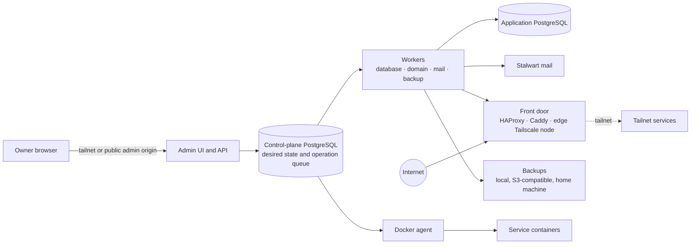

# Ark Stack documentation

Ark Stack is a single-host infrastructure control plane. It runs on one VPS joined to your Tailscale tailnet and gives you one administration UI for identity, domains and certificates, application PostgreSQL, Stalwart mail, Docker workloads, public routes to tailnet services, database access from Vercel and off-host backups.

These pages explain how the product works, how to install it and how to use and operate every feature. Use the navigation on the left to move between sections, the "On this page" list on the right to move within a page, and the search box (press `/`) to find a setting, endpoint or error by name.

## Where to start

| If you want to…                         | Read                                                                                                                                                        |
| --------------------------------------- | ----------------------------------------------------------------------------------------------------------------------------------------------------------- |
| Understand what Ark Stack is and is not | [Overview](introduction/overview.md), then [Core concepts](introduction/concepts.md)                                                                        |
| See what runs on the host               | [System components](introduction/components.md) and [Ports and networks](reference/ports-and-networks.md)                                                   |
| Try it on a laptop                      | [Local development](getting-started/local-development.md)                                                                                                   |
| Install it on a VPS                     | [Production install](getting-started/production-install.md), then [First run and domain wizard](getting-started/first-run.md)                               |
| Look up a setting                       | [Configuration](getting-started/configuration.md)                                                                                                           |
| Publish a tailnet service on the web    | [Front door guide](guides/front-door.md)                                                                                                                    |
| Connect a Vercel app to a database      | [Public database access](features/public-database-access.md) and the [Vercel guide](guides/vercel-database.md)                                              |
| Keep backups off the VPS                | [Backup system](features/backups.md) and the [off-VPS backups guide](guides/backups.md)                                                                     |
| Run it day to day                       | [Monitoring](features/monitoring.md), [Maintenance and upgrades](operations/maintenance-and-upgrades.md) and the [operator runbooks](operating.md)          |
| Fix something                           | [Troubleshooting](operations/troubleshooting.md) and [Recovery](operations/recovery.md)                                                                     |
| Review its security                     | [Security model](security/security-model.md) and the [security review checklist](security-review.md)                                                        |
| Work on the code                        | [Repository and conventions](development/repository.md), [Testing](development/testing.md), [HTTP API](reference/api.md), [Commands](reference/commands.md) |

## How the documentation is organised

- **Introduction** explains the product, the vocabulary it uses and every component that runs on the host. [Architecture notes](architecture.md) records what was built, decision by decision.
- **Getting started** takes you from an empty machine to a working installation: local development, a hardened VPS install, the first owner account and the domain wizard, and the full configuration reference.
- **Administration** covers the admin UI, accounts, roles and MFA, and the ways the admin UI can be reached (local tunnel, tailnet only, or public).
- **Domains and mail** covers DNS planning and publication, public and private certificates, and the Stalwart mail server with its SES relay.
- **Databases and services** covers application PostgreSQL, the SQL workspace, public database access through the TLS pooler, Vercel client certificates, and Docker workloads run through the policy-enforcing agent.
- **Front door** is the guide to public HTTP, TLS-TCP, raw TCP and PostgreSQL routes to services on the tailnet, including the Ark login gate.
- **Backups** covers local PostgreSQL backups, their evidence (upload, integrity, restore test) and the off-VPS S3-compatible and home-machine copies.
- **Operations** covers monitoring and alerts, the operation queue and workers, maintenance, upgrades, recovery, troubleshooting and the detailed runbooks.
- **Security** gives the security model and the review checklist with the front-door trust boundaries.
- **Development** and **Reference** are for contributors and for looking things up: repository layout, tests, every HTTP endpoint, every `mise` task and every port.
- **Design history** keeps the original implementation plan, the front-door design and review records. Where they differ from the code, the code and the as-built pages win.

## The product in one picture



The API records what you asked for as desired state and queues durable operations. Separate workers, each limited to its own job types and token, carry the operations out and report evidence. The administration UI shows that evidence, so a resource is reported ready only when the work behind it has been verified. [Core concepts](introduction/concepts.md) explains this model in detail.

## Building this site

The site is generated from the Markdown files in `docs/` (and the project `README.md`) by `scripts/docs-site/build.ts`, using the navigation in `docs/nav.json`. Every page also reads correctly on GitHub.

```sh
mise run docs:serve   # build, serve on http://127.0.0.1:4321/ and rebuild on change
mise run docs:build   # write the static site to dist/docs
mise run docs:check   # check links, anchors, paths, tasks, endpoints, env vars and ports
```

To add a page, create the Markdown file under `docs/`, add it to a section in `docs/nav.json`, and run `mise run docs:check`. The build refuses Markdown under `docs/` that is missing from the navigation.
