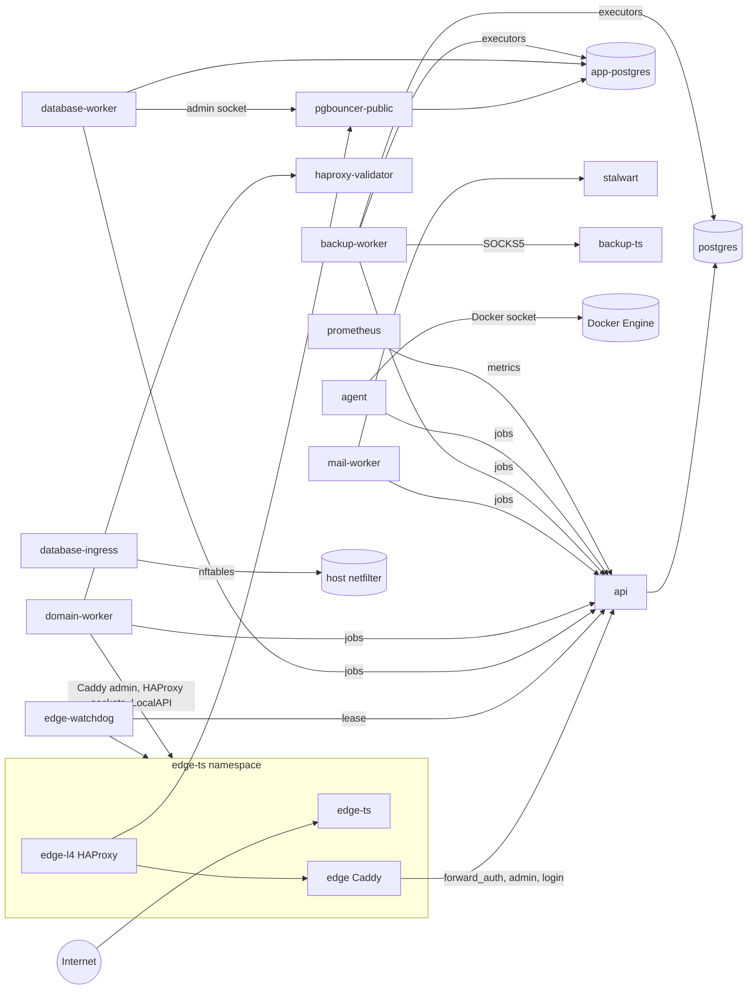

# System components

This page describes every container Ark Stack runs: what it does, which image it uses, which networks it joins, what it may talk to and which secrets it holds. It covers the platform Compose file `infra/platform/docker-compose.yml` and the mail, monitoring and restore Compose files next to it.

## Compose projects and files

Ark runs as four Compose projects. Each file sets its project name, so `docker compose -f <file>` always addresses the same containers.

| File                                    | Project                | Started by                                                                         | Contents                                                                         |
| --------------------------------------- | ---------------------- | ---------------------------------------------------------------------------------- | -------------------------------------------------------------------------------- |
| `infra/platform/docker-compose.yml`     | `ark-platform`         | `mise run host:install`, `mise run maintain`                                       | Control plane, both PostgreSQL clusters, workers, agent, front door, backup node |
| `infra/platform/docker-compose.dev.yml` | (override)             | `mise run db:up`, `mise run db:down`                                               | Loopback ports 5433 and 5434 for the two clusters in local development           |
| `infra/mail/docker-compose.yml`         | `ark-mail`             | `mise run host:install` and `mise run mail:up`, when `ARK_MAIL_ENABLED` is not `0` | Stalwart                                                                         |
| `infra/monitoring/docker-compose.yml`   | `ark-monitoring`       | `mise run host:install`, `mise run monitor:up`                                     | Prometheus                                                                       |
| `infra/restore/docker-compose.yml`      | `ark-restore-isolated` | By hand during recovery                                                            | An isolated PostgreSQL restore target                                            |

The platform, mail and monitoring projects are linked by two external networks that the installer creates if they are missing: `ark_mail_management` (mail worker to Stalwart) and `ark_monitoring` (Prometheus to the API).

## Compose profiles

| Profile   | Services                       | Started                                                                                                                                                                                             |
| --------- | ------------------------------ | --------------------------------------------------------------------------------------------------------------------------------------------------------------------------------------------------- |
| (none)    | Every other platform service   | By `docker compose up` without `--profile`. The installer starts them by name.                                                                                                                      |
| `tailnet` | `tailscale`, `tailnet-gateway` | Only when requested with `--profile tailnet`. The installer does not start them on a fresh install; when they are already running, it restarts them after it migrates the published Docker network. |

The `migrate` service has no profile but runs once: the installer starts it with `docker compose run --rm migrate`, and `api` waits for it to complete successfully.

## Component diagram

Every worker and the agent talk to the API over HTTP on the internal `control` network to poll, heartbeat and complete operations. The four workers also connect to the control-plane database as `ark_runtime`; the agent and the watchdog do not.

## Common hardening

The Ark-built application images (`api`, `migrate`, the four workers, `database-ingress` and `edge-watchdog`) share one Compose anchor: `restart: unless-stopped`, `no-new-privileges`, every capability dropped, a read-only root filesystem, a 64 MB `noexec` tmpfs on `/tmp` and a limit of 256 processes. They run as the image's non-root `bun` user unless stated below. Every third-party image is pinned by version and OCI digest. Other services list their own controls below.

The Ark images are built from the repository `Dockerfile` (one stage per service; `api` and `migrate` use the last stage) on the pinned `oven/bun:1.4.2` image, which sets `NODE_ENV=production`. Images are tagged `${ARK_VERSION:-local}`.

## Control plane

### postgres

The control-plane PostgreSQL cluster (database `ark_platform`), holding desired state, the operation queue, audit events, sessions and sealed secrets.

- **Image.** `ark-stack-postgres`, built from the `postgres-backup` stage: the pinned `postgres:17.6` digest plus pgBackRest, the backup executor and WAL archiving into an encrypted local repository (repo2).
- **Networks.** `control`; `backup-management` with the alias `ark-platform-backup`, where the executor listens on port 8432 for the backup worker only.
- **Volumes.** `ark_platform_pg` (data), `ark_platform_pgbackrest` (repo2, never expired on the VPS), `ark_platform_pg_stages` (staged read-only copies for export). `init-control-db.sh` creates or updates the `ark_runtime` login.
- **Secrets.** `ARK_CONTROL_DB_PASSWORD` (the owner role `ark_migration`), `ARK_API_DB_PASSWORD` (to set the `ark_runtime` password), `ARK_PLATFORM_PG_EXECUTOR_TOKEN`, `ARK_PLATFORM_PG_REPO_CIPHER_PASS`. Without a cipher pass WAL archiving stays off and backup health reports it.
- **Controls.** All capabilities dropped, then `CHOWN`, `DAC_OVERRIDE`, `FOWNER`, `SETUID` and `SETGID` added back so the official entrypoint can drop to the `postgres` user. `init: true` reaps the executor supervisor. No host port in production.

### migrate

A one-shot container that applies the SQL migrations in `server/drizzle` as `ark_migration`.

- **Image.** `ark-stack-app`. **Network.** `control`. **Secret.** `ARK_CONTROL_DB_PASSWORD` only, in its `DATABASE_URL`. It is the only Ark service that connects as the schema owner.

### api

The Hono API, Better Auth and the built admin UI, served on port 3000. It owns identity, authorisation, desired state and the operation queue, and serves the internal worker endpoints, the edge lease and the Prometheus metrics.

- **Image.** `ark-stack-app`. Runs `bun run --cwd server start` with `ARK_EMBEDDED_WORKERS=0`.
- **Networks.** `control` (database, workers), `admin` (reached by the edge and the tailnet gateway as `api:3000`), `monitoring` (scraped by Prometheus).
- **Ports.** `127.0.0.1:3000` on the host, for bootstrap and local recovery only.
- **May talk to.** `postgres` as `ark_runtime`; `database-worker:3101` (SQL cancellation) and `domain-worker:3102`; the optional off-host heartbeat receiver.
- **Secrets.** `BETTER_AUTH_SECRET`, `ARK_ROOT_KEY`, `ARK_SETUP_TOKEN`, `ARK_INTERNAL_TOKEN`, `ARK_AGENT_TOKEN`, every worker token, `ARK_MAINTENANCE_TOKEN`, `ARK_MFA_RECOVERY_TOKEN`, `ARK_METRICS_TOKEN`, `ARK_OFFHOST_HEARTBEAT_TOKEN`, `ARK_EDGE_GATE_TOKEN`, `ARK_EDGE_WATCHDOG_TOKEN`, and `ARK_API_DB_PASSWORD` in its `DATABASE_URL`.
- **Mounts.** Read-only database-ingress counters and host metrics. It never mounts the Docker socket or any Tailscale socket.

### database-worker

Runs `database.*` and `pgbouncer.*` operations: provisioning and rotating application databases and roles, SQL queries and schema inspection, client certificates and rollover, and rendering and reloading PgBouncer.

- **Image.** `ark-stack-database-worker` (`database-worker` stage). **Networks.** `control`, `database-management`.
- **Port.** 3101 inside the network, a private listener for SQL cancellation authenticated by the database worker token.
- **May talk to.** `app-postgres` as `ark_cluster_admin`; PgBouncer's admin console over the `ark_pgbouncer_socket` unix socket, with `RELOAD` and `KILL_CLIENT`. It has no Docker CLI, no Docker socket and no internet egress.
- **Secrets.** `ARK_DATABASE_WORKER_TOKEN`, `ARK_ROOT_KEY`, `ARK_API_DB_PASSWORD`, `ARK_APP_DB_PASSWORD`, `ARK_PGBOUNCER_ADMIN_PASSWORD`.
- **Writes.** `tmp/pgbouncer` (configuration, HBA, userlist and client CA bundle).

### domain-worker

Runs `domain.*`, `dns.*`, `certificate.*`, `edge.*`, `admin.*` and `integration.*` operations: DNS verification and Cloudflare publishing, ACME issuance with lego, the IPv6 preflight, rendering the Caddy and HAProxy configurations, tailnet observation, admin mode changes and the optional Vercel integration. It is the only worker with external egress for providers.

- **Image.** `ark-stack-domain-worker` (runtime plus `lego` v4.26.0 and OpenSSL). **Networks.** `control`, `admin`, `edge-control`. **Port.** 3102 inside the network.
- **May talk to.** Caddy's admin API at `edge-admin:2019`; HAProxy's master and admin sockets and the validator socket, through the shared group 4400; the edge node's tailscaled LocalAPI through a read-only socket mount, where tailscaled allows only reads; DNS, Let's Encrypt and Cloudflare on the internet. No Docker access.
- **Secrets.** `ARK_DOMAIN_WORKER_TOKEN`, `ARK_ROOT_KEY`, `ARK_API_DB_PASSWORD`, `DNS_API_TOKEN` or `CLOUDFLARE_API_TOKEN`, `ARK_ACME_EMAIL`, `ARK_OFFHOST_HEARTBEAT_TOKEN` (for the managed IPv6 preflight runner).
- **Writes.** `tmp/certs`, `tmp/edge` (Caddyfile and its closed variant), `tmp/acme` (HTTP-01 webroot) and immutable HAProxy generations in `tmp/edge-l4`.

### mail-worker

Runs `mail.*`, `mailbox.*` and `ses.*` operations: reconciling Stalwart domains, mailboxes, aliases and device credentials through JMAP, the mail queue, and the SES relay. Not built or started when mail is disabled.

- **Image.** `ark-stack-mail-worker`. **Networks.** `control`, `mail-management` (the external `ark_mail_management`).
- **May talk to.** `stalwart:8080` (Stalwart's management API, never exposed publicly); Amazon SES.
- **Secrets.** `ARK_MAIL_WORKER_TOKEN`, `ARK_ROOT_KEY`, `ARK_API_DB_PASSWORD`, `STALWART_ADMIN_PASSWORD`, `AWS_ACCESS_KEY_ID`, `AWS_SECRET_ACCESS_KEY`, `SES_SMTP_USERNAME`.

### backup-worker

Runs `backup.*`, `update.detect` and `import.*` operations: scheduling and observing pgBackRest backups, exporting restic snapshots off the VPS, verifying targets and canaries, restore tests, update detection and import scans.

- **Image.** `ark-stack-backup-worker` (runtime plus pgBackRest and the pinned restic 0.19.1). **Networks.** `control`, `backup-management` (executors only), `backup-egress` (S3-compatible targets on the internet), `backup-tailnet` (only `backup-ts`).
- **May talk to.** The executors at `ark-platform-backup:8432` and `ark-app-backup:8432`; S3-compatible targets; the home `rest-server` only through `backup-ts`'s SOCKS5 proxy, which is given to the home target's restic subprocess alone; `backup-ts`'s LocalAPI through a read-only socket.
- **Secrets.** `ARK_BACKUP_WORKER_TOKEN`, `ARK_ROOT_KEY`, `ARK_API_DB_PASSWORD`, `ARK_PLATFORM_PG_EXECUTOR_TOKEN`, `ARK_APP_PG_EXECUTOR_TOKEN`. Target credentials and restic passwords are sealed in the database and passed only to restic's own process environment.
- **Mounts.** Staged pgBackRest copies of both clusters, read-only through group 999. It never mounts the live repository or PGDATA.

### agent

The Go Docker agent: deploys, starts, stops, restarts, inspects, discovers and adopts service containers, and applies service updates.

- **Image.** `ark-stack-agent`, a static Go binary on the pinned `docker:28.4.0-cli` image with the Compose plugin. **Network.** `control`.
- **May talk to.** The API, and the Docker Engine through `/var/run/docker.sock`. It is the only container that mounts the socket.
- **Secrets.** `ARK_AGENT_TOKEN`. Its state volume `ark_agent_state` holds the resource ledger.
- **Controls.** `no-new-privileges`, 128 processes. It does not drop capabilities, because it drives Docker.

## Databases and pooler

### app-postgres

The application PostgreSQL cluster that holds your databases.

- **Image.** `ark-stack-app-postgres`, built from the `app-postgres-backup` stage: the pinned `pgvector/pgvector:pg17` image plus the same pgBackRest layer.
- **Networks.** `database-management`; `backup-management` with the alias `ark-app-backup`.
- **Volumes.** `ark_app_pg`, `ark_app_pgbackrest`, `ark_app_pg_stages`.
- **Secrets.** `ARK_APP_DB_PASSWORD` (the cluster administrator `ark_cluster_admin`), `ARK_APP_PG_EXECUTOR_TOKEN`, `ARK_APP_PG_REPO_CIPHER_PASS`.
- **Controls.** As for `postgres`. Never reachable from the edge namespace.

### pgbouncer-public

The public database pooler: PgBouncer 1.26.1 with TLS 1.3 only, `verify-full` client certificates from Ark's private CAs, and SCRAM for runtime and read-only roles.

- **Image.** `edoburu/pgbouncer:v1.26.1-p0`, pinned by digest, run directly on the generated `pgbouncer.ini` (the image's own entrypoint is bypassed) as uid 1000.
- **Networks.** `database-management` (to `app-postgres`), `pgbouncer-ingress` (shared only with `edge-ts`). It publishes no port: HAProxy's `fe_pg5432` owns public 5432.
- **Secrets.** None in its environment. It reads the generated configuration, userlist and its TLS key read-only, and shares its admin console socket only with the database worker.
- **Controls.** All capabilities dropped, `no-new-privileges`. A TCP-only health check avoids failed-login noise.

See [infra/database/README.md](../../infra/database/README.md) for the generated files and the closed bootstrap configuration.

### database-ingress

A host-namespace reconciler for nftables: the `ark_front` policy for front-door ports and the per-source limits on TCP 5432 (`ark_db_ingress`). It exports drop counters every 15 seconds for the API.

- **Image.** `ark-stack-database-ingress`. **Network.** `network_mode: host`.
- **Controls.** Runs as root with only `NET_ADMIN` and `DAC_OVERRIDE`, to run `nft` and read the installer-owned policy files. 64 processes.
- **Secrets.** None. It reads the policy written by the database and domain workers and writes counters to `tmp/db-ingress`.

## Front door

The four front-door containers share the network namespace of `edge-ts`. See [Core concepts](concepts.md#the-front-door) and the [front-door guide](../guides/front-door.md).

### edge-ts

The edge's own Tailscale node (`tag:ark-edge`, hostname `ark-edge`), in kernel mode with `--shields-up`. It owns the namespace that `edge` and `edge-l4` join, so it publishes every front-door port.

- **Image.** `tailscale/tailscale:v1.86.2`, pinned by digest.
- **Ports.** TCP 80, 443 and 5432; the shared SNI ports 8883, 5671, 636 and 6380 (each published publicly only when enabled in `ARK_EDGE_SNI_PORTS`, otherwise on an ephemeral loopback port); TCP 20000–20049; UDP 41642 for WireGuard.
- **Networks.** `admin`; `edge-control` with the alias `edge-admin`; `pgbouncer-ingress`.
- **Secrets.** `TS_EDGE_AUTHKEY`, used once to join; afterwards the node authenticates from `ark_edge_ts_state`.
- **Controls.** All capabilities dropped, then `NET_ADMIN` and `NET_RAW`; `/dev/net/tun`. `TS_ACCEPT_DNS=false` keeps Docker's resolver. Its LocalAPI socket is shared read-only with the domain worker only.

### edge-l4

HAProxy 3.2, the SNI and port router. It owns 443, 5432, 20000–20049 and the enabled SNI ports inside the namespace, and sends HTTP hostnames to Caddy on `127.0.0.1:8443` with PROXY v2.

- **Image.** `haproxy:3.2.26-alpine`, pinned by digest. **Network.** `service:edge-ts`.
- **Secrets.** None in its environment. It reads immutable configuration generations, written by the domain worker, from `tmp/edge-l4`.
- **Controls.** Read-only root, all capabilities dropped, uid 99. A launch guard starts it from the closed configuration unless the watchdog confirms the lease. Its master and admin sockets (group 4400) are shared with the domain worker and the watchdog.

### edge

Caddy 2.11.9 with the pinned `caddy-ratelimit` plugin. It serves `:80` (ACME challenges, HTTPS redirects, `404` for unknown hosts) and the HTTPS sites behind HAProxy: the public admin hostname, the login origin and front-door HTTP routes, including the login gate's `forward_auth` to the API.

- **Image.** `ark-stack-edge-caddy`, built from the `edge-caddy` stage on the official Caddy digest until a published digest is pinned. **Network.** `service:edge-ts`.
- **Secrets.** `ARK_EDGE_GATE_TOKEN`, sent to the API only on the allowlisted auth and gate paths and resolved at request time, never written into the Caddyfile. It reads Ark-issued certificates and keys read-only.
- **Controls.** uid 1000, all capabilities dropped. Its admin API listens only on the internal `edge-control` network. A launch guard starts `Caddyfile.closed` unless the watchdog confirms the lease.

### edge-watchdog

The lease watchdog. Every second it reads the read-only lease from the API and withdraws tailnet backends the lease no longer allows from the running Caddy and HAProxy, closing only the affected sessions. It keeps working while the operation workers are stopped.

- **Image.** `ark-stack-edge-watchdog` (the runtime image with nothing added). **Networks.** `control`, `edge-control`. **Port.** 2021 inside the network, for the launch guards.
- **Secrets.** `ARK_EDGE_WATCHDOG_TOKEN`, which can only read `/api/internal/edge/` endpoints. No database credential, root key, Docker or Tailscale socket.

### haproxy-validator

Checks HAProxy configuration generations before they are activated, by running only `haproxy -c` on a generation named by its hash.

- **Image.** `ark-stack-haproxy-validator`: the exact `edge-l4` image plus Bun. **Network.** `network_mode: none`.
- **Secrets.** None. Read-only configuration, all capabilities dropped, socket shared only with the domain worker.

## Tailscale nodes

### backup-ts

The backup node (`tag:ark-backup`, hostname `ark-backup`), separate from the edge so that backup reach and route reach never share an identity. Userspace networking, `--shields-up`, SOCKS5 on port 1055, WireGuard on UDP 41643.

- **Image.** `tailscale/tailscale:v1.86.2`. **Networks.** `backup-tailnet` (alias `backup-ts`, reached only by the backup worker), `backup-ts-egress` (its own path to Tailscale).
- **Secrets.** `TS_BACKUP_AUTHKEY`, used once. Without it the node waits for login and the home target stays suspended.

### tailscale and tailnet-gateway (profile `tailnet`)

The optional tailnet-only admin path. `tailscale` is a userspace node (hostname `ark-stack-admin`, tagged `tag:ark-stack-admin` by its auth key) running Tailscale Serve with `tmp/edge/serve.json`. `tailnet-gateway` is the official Caddy 2.11.9 image in its namespace, listening only on loopback port 8080 with `infra/platform/TailnetCaddyfile`: it strips client `X-Ark-*` headers, answers `404` for internal paths, forwards an allowlist of browser API paths to `api:3000`, and sends the gate token only on the exact admin auth paths.

- **Networks.** `admin` (the gateway shares the node's namespace).
- **Secrets.** `TS_AUTHKEY` (node), `ARK_EDGE_GATE_TOKEN` (gateway).
- **Controls.** All capabilities dropped, `no-new-privileges`. See [Admin access modes](../features/admin-access-modes.md).

## Mail project

### stalwart

The Stalwart v0.16 mail engine: SMTP on 25, implicit-TLS submission on 465, STARTTLS submission on 587 and IMAPS on 993. Its management API on port 8080 is exposed only on `mail-management`.

- **Image.** `stalwartlabs/stalwart`, pinned by OCI index digest, with the reviewed RocksDB `infra/mail/config.json`.
- **Networks.** `mail-public` (IPv6-enabled, carries the public ports), `mail-management` (the mail worker).
- **Secrets.** `STALWART_ADMIN_ADDRESS` and `STALWART_ADMIN_PASSWORD` as the recovery administrator. It reads certificates read-only. It never receives AWS, DNS or root keys.
- **Controls.** All capabilities dropped except `NET_BIND_SERVICE`, `no-new-privileges`, 256 processes. Data lives in `ark_mail_data`.

See [infra/mail/README.md](../../infra/mail/README.md) and [Mail](../features/mail.md).

## Monitoring project

### prometheus

Prometheus 3.5 with 14-day retention. It scrapes `api:3000/api/metrics/prometheus` every 15 seconds with a bearer token and evaluates `infra/monitoring/alerts.yml`.

- **Image.** `prom/prometheus:v3.5.0`, pinned by digest. **Network.** `ark_monitoring`. **Port.** `127.0.0.1:9090` on the host.
- **Secrets.** `ARK_METRICS_TOKEN`, mounted read-only from `tmp/metrics.token`, which the installer writes with mode `0600`.

See [Monitoring and alerts](../features/monitoring.md).

## Restore project

### restore-postgres

An isolated PostgreSQL 17.6 target for restoring a backup before any cutover. It has no public port (only `127.0.0.1:55432`), no Tailscale identity and no outbound mail, and it never restarts by itself. Its environment marks reconciliation, outbound mail and public ingress as disabled (`ARK_DISABLE_RECONCILIATION`, `ARK_DISABLE_OUTBOUND_MAIL`, `ARK_DISABLE_PUBLIC_INGRESS`). See [Recovery](../operations/recovery.md).

## Networks

| Network               | Internal  | Members                                                                                          | Purpose                                                  |
| --------------------- | --------- | ------------------------------------------------------------------------------------------------ | -------------------------------------------------------- |
| `control`             | yes       | `postgres`, `api`, `migrate`, all workers, `agent`, `edge-watchdog`                              | API, control-plane database and worker traffic           |
| `admin`               | no (IPv6) | `api`, `domain-worker`, `edge-ts` (with `edge`, `edge-l4`), `tailscale` (with `tailnet-gateway`) | Edge and tailnet gateway to the API                      |
| `edge-control`        | yes       | `domain-worker`, `edge-watchdog`, `edge-ts` (alias `edge-admin`)                                 | Caddy admin API, unreachable from the API or the gateway |
| `database-management` | yes       | `app-postgres`, `database-worker`, `pgbouncer-public`                                            | Application cluster access                               |
| `pgbouncer-ingress`   | yes       | `edge-ts`, `pgbouncer-public`                                                                    | HAProxy to PgBouncer only                                |
| `backup-management`   | yes       | `postgres`, `app-postgres`, `backup-worker`                                                      | pgBackRest executors                                     |
| `backup-egress`       | no        | `backup-worker`                                                                                  | S3-compatible targets                                    |
| `backup-tailnet`      | yes       | `backup-worker`, `backup-ts`                                                                     | SOCKS5 to the home target                                |
| `backup-ts-egress`    | no        | `backup-ts`                                                                                      | Tailscale coordination, DERP and peers                   |
| `ark_mail_management` | external  | `mail-worker`, `stalwart`                                                                        | Stalwart management API                                  |
| `ark_monitoring`      | external  | `api`, `prometheus`                                                                              | Metrics scraping                                         |
| `mail-public`         | no (IPv6) | `stalwart`                                                                                       | Public mail ports                                        |

[Ports and networks](../reference/ports-and-networks.md) lists every published and internal port.

## Named volumes

| Volume                                                            | Used by                                                | Contents                                              |
| ----------------------------------------------------------------- | ------------------------------------------------------ | ----------------------------------------------------- |
| `ark_platform_pg`, `ark_app_pg`                                   | `postgres`, `app-postgres`                             | Cluster data directories                              |
| `ark_platform_pgbackrest`, `ark_app_pgbackrest`                   | `postgres`, `app-postgres`                             | Encrypted pgBackRest repo2                            |
| `ark_platform_pg_stages`, `ark_app_pg_stages`                     | clusters (read-write), `backup-worker` (read-only)     | Staged copies for export                              |
| `ark_agent_state`                                                 | `agent`                                                | Resource ledger                                       |
| `ark_edge_ts_state`, `ark_backup_ts_state`, `ark_tailscale_state` | the three Tailscale containers                         | Node identities. Removing one deletes that identity.  |
| `ark_edge_ts_socket`, `ark_backup_ts_socket`                      | node (read-write), one worker (read-only)              | tailscaled LocalAPI sockets                           |
| `ark_edge_data`                                                   | `edge`                                                 | Caddy data directory                                  |
| `ark_pgbouncer_socket`                                            | `pgbouncer-public`, `database-worker`                  | tmpfs, uid 1000, mode `0700`: PgBouncer admin console |
| `ark_haproxy_run`, `ark_haproxy_validator_run`                    | `edge-l4`, `domain-worker`, `edge-watchdog`; validator | tmpfs, group 4400: HAProxy and validator sockets      |
| `ark_mail_data`                                                   | `stalwart`                                             | Mail store                                            |
| `ark_prometheus`                                                  | `prometheus`                                           | Metrics                                               |

Host bind mounts live under `tmp/` in the checkout (`tmp/certs`, `tmp/edge`, `tmp/edge-l4`, `tmp/acme`, `tmp/pgbouncer`, `tmp/db-ingress`, `tmp/mail-state`, `tmp/backups`, `tmp/restore-runs`). On Linux the installer creates them and gives them to uid 1000, the user the containers run as.
