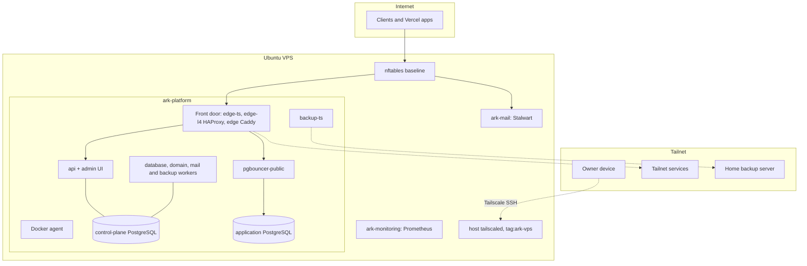

# Overview

Ark Stack is a self-hosted control plane for one Linux VPS. This page explains what it is, who it is for, the problems it solves, what each feature does, what it deliberately leaves out, and how a deployment is laid out.

## What Ark Stack is

Ark Stack turns a single VPS into a managed host for small production workloads: application PostgreSQL databases, a Stalwart mail server, Docker Compose services, and public routes to services that run elsewhere on your Tailscale tailnet. One administration UI, backed by one TypeScript API, owns identity, authorisation and desired state. Separate workers and a small Go Docker agent carry out the changes, each with its own credential and a fixed list of job types.

Everything runs as Docker Compose services on the host. The platform's own state lives in a dedicated control-plane PostgreSQL instance, separate from the application cluster that holds your databases. Secrets are encrypted with a root key that is never stored in that database.

The defining habit of the product is that it reports evidence, not intent. A domain is `verified` only after public DNS has been observed, an endpoint is served only after a publicly trusted certificate has been issued for it, a database is `ready` only after the pooler has been reloaded and confirmed, and a backup is "verified" only after a restore test has passed. [Core concepts](concepts.md) explains this model.

## Who it is for

Ark Stack is built for a small number of trusted administrators who run their own infrastructure on one host and want it hardened by default:

- an owner who wants databases, mail and a few services on a VPS they control, without hand-maintaining Caddy, PgBouncer, nftables and certificate renewals;
- teams who deploy front ends on platforms such as Vercel and need those apps to reach a self-hosted PostgreSQL safely, with client certificates rather than IP allowlists;
- operators who already use Tailscale and want to publish selected tailnet services under their own public hostnames, optionally behind a login.

It is not a multi-tenant hosting product. Administrators are trusted, and the host and its Docker daemon are a single failure and trust domain.

## Problems it solves

| Problem                                                                                           | What Ark Stack does                                                                                                                                                                                                                                |
| ------------------------------------------------------------------------------------------------- | -------------------------------------------------------------------------------------------------------------------------------------------------------------------------------------------------------------------------------------------------- |
| Setting up DNS, certificates and endpoints for a new domain is error-prone.                       | A domain wizard generates the exact DNS records, verifies them publicly, checks CAA and proxy conflicts, and only then requests Let's Encrypt certificates. Cloudflare zones can be updated through a reviewed diff.                               |
| Exposing PostgreSQL to serverless platforms usually means opening the port to the whole internet. | Public database access goes through PgBouncer with TLS 1.3, a required client certificate from a private CA per client, and SCRAM. Per-source connection limits in nftables protect the port.                                                      |
| A container manager with the Docker socket is a root shell for anyone who reaches it.             | Only the Go agent holds the socket. It accepts typed jobs, validates every Compose document against a default-deny policy, tracks exact resource ownership, and checks the effective Docker settings after deployment.                             |
| Publishing a tailnet service on the web tends to grant the public proxy far more than it needs.   | The front door has its own Tailscale node with no inbound connections and one tailnet grant per target `host:port`. Every route is pinned to its target machine, and a watchdog withdraws routes within seconds when that pin cannot be confirmed. |
| Backups that "succeeded" are often never restored, and local backups die with the host.           | Backups record upload, integrity and restore-test separately. PostgreSQL is archived with pgBackRest and copied off the VPS with restic to an S3-compatible bucket and a home machine reached over the tailnet.                                    |
| Credentials and admin access drift: shared passwords, missing MFA, sessions that outlive changes. | Better Auth with mandatory TOTP MFA for administrators, single-use step-up grants bound to the exact request for privileged actions, generated credentials shown once, and session revocation on access-mode changes.                              |

## Features

Each feature has its own page. The summaries below describe what the feature does today.

### Administration

- **Admin UI.** A React interface with views for the overview, domains and endpoints, projects, databases, email, services, activity, backups, updates, front-door routes, the front-door ACL, gate users and settings. Every change it makes is an API call that records desired state and queues an operation. See [Admin UI tour](../features/admin-ui.md).
- **Accounts, roles and MFA.** The first owner is created with a single-use setup token. The authorisation model defines the roles `owner`, `operator` and `viewer`, with operator and viewer access scoped to granted projects and domains; the API has no endpoint for inviting further administrators. Gate users are separate accounts that sign in only to SSO routes. TOTP MFA is required before any administrative mutation, and privileged actions need a fresh password step-up. See [Accounts, MFA and access](../features/accounts-and-access.md).
- **Admin access modes.** The UI is reached through an SSH tunnel to the loopback bootstrap listener, through Tailscale only (tailnet mode), or at a public HTTPS hostname such as `admin.example.com` (public mode). Changing mode is a durable operation that rewrites the edge configuration and revokes sessions. See [Admin access modes](../features/admin-access-modes.md).

### Domains, certificates and mail

- **Domains and DNS.** A domain claim is proved with an installation-bound `_ark-stack` TXT record. Ark plans A, AAAA, MX, SPF and DMARC records, verifies them against public DNS, and keeps checking for drift. Cloudflare zones can be published from a reviewed diff; other providers get exact manual rows. AAAA records are published only after an external IPv6 preflight passes. See [Domains and DNS](../features/domains-and-dns.md).
- **Certificates.** The domain worker issues certificates with lego and HTTP-01 against Let's Encrypt, staging by default. Staging certificates are recorded as untrusted and never served publicly. See [Certificates](../features/certificates.md).
- **Mail.** A pinned Stalwart v0.16 engine receives and stores mail and serves IMAP and submission. Ark reconciles domains, mailboxes, aliases and device credentials through Stalwart's JMAP management extensions. Incoming mail works without Amazon SES; outbound relay stays paused until SES is verified. Mail can be disabled for the whole installation. See [Mail](../features/mail.md).

### Databases and services

- **Application databases.** Databases are created in the separate application PostgreSQL cluster (with pgvector available) with owner, migration, runtime and read-only roles and `PUBLIC` revoked. Credentials are generated and revealed once. See [Application databases](../features/databases.md).
- **SQL workspace.** Queries and schema inspection run in the database worker as durable operations, never in the browser-facing API, with capped results and cancellation. See [SQL workspace](../features/sql-workspace.md).
- **Public database access.** One TLS pooler serves every public database on TCP 5432 with mutual TLS and SCRAM. Client certificates last 90 days and roll over from a fresh CA. A step-by-step Vercel guide covers environment variables and rollover. See [Public database access](../features/public-database-access.md) and [Guide: database access from Vercel](../guides/vercel-database.md).
- **Services and the Docker agent.** Services are Compose documents grouped into projects, validated against a default-deny policy (pinned digests, read-only root, dropped capabilities, resource limits), deployed by the agent, and observable through bounded, redacted logs and whitelisted stats. Existing containers can be discovered and adopted. Reviewed starting points live in `templates/`. See [Services and the Docker agent](../features/services.md).

### Front door

- **Public routes to tailnet services.** HTTP routes (HTTPS and WebSocket on 443), TLS-TCP routes by SNI, raw TCP routes on ports 20000–20049, and PostgreSQL routes by SNI on 5432, each pinned to a target on your tailnet. HTTP routes can be public or sit behind the Ark login gate (SSO), with optional per-client rate limits and required client certificates. The owner merges a generated Tailscale ACL snippet by hand; Ark never holds a key that can change the tailnet policy. See [Guide: public routes](../guides/front-door.md).

### Backups

- **Backups.** Each PostgreSQL cluster archives WAL into an encrypted local pgBackRest repository. The backup worker exports restic snapshots to an S3-compatible target and to an append-only `rest-server` on a home machine through a dedicated Tailscale node. Append-only behaviour is checked with canaries, and an off-VPS tool restores either cluster to a point in time from the bucket alone. See [Backup system](../features/backups.md) and [Guide: off-VPS backups](../guides/backups.md).

### Operations

- **Monitoring and alerts.** Workers send durable heartbeats. A local Prometheus with 14-day retention scrapes the API and alerts on a down API, failed operations, unverified backups, certificate expiry, stale workers, pending host reboots, database ingress drops and client-certificate rollover. An optional off-host heartbeat supports a separately hosted dead-man receiver. See [Monitoring and alerts](../features/monitoring.md).
- **Operations and workers.** Every change is a durable operation with states, steps, evidence and an audit record. See [Operations and workers](../operations/operations-and-workers.md).
- **Host hardening.** The installer enrols the VPS in Tailscale with Tailscale SSH, installs an nftables baseline that starts before Docker, configures unattended security upgrades with a scheduled reboot, and audits listeners against the provider firewall. See [Production install](../getting-started/production-install.md).
- **Maintenance and upgrades.** Signed release bundles pin the exact Compose file and image digests; maintenance verifies them before pulling and restarting. Service image updates are detected and applied as operations. See [Maintenance and upgrades](../operations/maintenance-and-upgrades.md).
- **Recovery.** A local CLI inspects bootstrap state, a token-gated command resets a locked-out owner's MFA, and a host-loss checklist plus an isolated restore Compose project guide a rebuild. See [Recovery](../operations/recovery.md).
- **Import.** `mise run import -- inventory.json` compares an Orkmail or PgStack inventory with this installation without importing anything, and never promotes legacy users to owners. See [Import](../operating.md#import).

## What it deliberately does not do

These limits are design decisions, not missing work:

- **One host only.** There is no multi-host scheduling, clustering or high availability. Workloads keep running while the administration app is down, but host loss means restoring from off-host backups.
- **No isolation for hostile code.** Services share one kernel and one Docker daemon. Running untrusted customer workloads safely needs separate hosts or VMs.
- **No builds from source, no plugins, no root terminals.** Services run prebuilt, digest-pinned images in a supported subset of Compose. The browser never sends raw Docker API calls, shell commands or host paths.
- **No customer self-service.** There is no sign-up, billing or tenant management. The only sign-up is the token-gated creation of the first owner.
- **No webmail and no direct outbound mail.** Stalwart provides SMTP, submission and IMAP. Outbound mail goes only through Amazon SES and stays paused until SES is ready.
- **No automatic database major upgrades.** Stateful images change only with a reviewed migration and recovery plan.
- **No control over your tailnet.** Ark holds no Tailscale API key or OAuth client. It generates the ACL snippet; you review and merge it. Tailscale Funnel stays disabled.
- **No DNS hosting.** Ark either publishes a reviewed diff to a Cloudflare zone with a token you scope, or shows the rows you create at your provider.
- **No claims without evidence.** Staging certificates are never served, a successful upload is not reported as a verified restore, and outbound mail is not reported as working without SES.

## Deployment model

A production installation is one Ubuntu VPS joined to your Tailscale tailnet. The repository is checked out on the host, and `mise run host:install` generates secrets, pulls the prebuilt images for its commit (building them only when they are not published) and starts three Compose projects: `ark-platform` (the control plane, databases, workers, agent and front door), `ark-mail` (Stalwart, when mail is enabled) and `ark-monitoring` (Prometheus). A fourth project, `ark-restore-isolated`, is used only during recovery.

The tailnet carries all private access. The host itself is a Tailscale node (`tag:ark-vps`) that the owner reaches with Tailscale SSH, so public SSH can be closed at the provider. The front door, the optional tailnet admin gateway and the backup path each have their own Tailscale node, key and tag, so a compromise of one does not grant the reach of another. The raw API listens only on `127.0.0.1:3000` on the host, for bootstrap and local recovery through an SSH tunnel.

Public traffic reaches the host only on the ports the enabled features need: 80 and 443 for HTTP, 5432 for the database pooler and PostgreSQL routes, the shared SNI ports and raw route ports you enable, the mail ports when mail is enabled, and UDP for direct WireGuard paths. [System components](components.md) lists every container, and [Ports and networks](../reference/ports-and-networks.md) lists every port.

## Where to go next

- [Core concepts](concepts.md) explains desired state, operations, workers, the tailnet, the front door and the security model's vocabulary.
- [System components](components.md) describes every container and what it may reach.
- [Local development](../getting-started/local-development.md) runs the stack on a laptop.
- [Production install](../getting-started/production-install.md) installs and hardens a VPS, and [First run and domain wizard](../getting-started/first-run.md) takes you from the setup token to a working domain.
