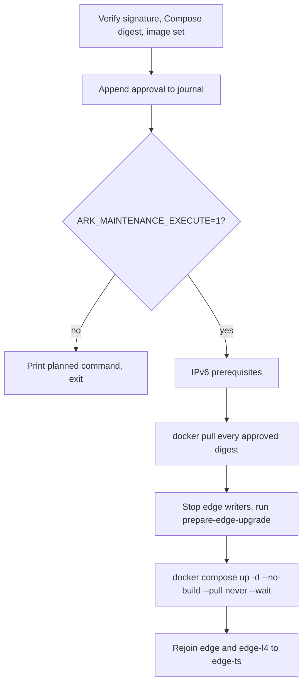

# Maintenance and upgrades

This page covers keeping an Ark host current: operating-system updates and the reboot window, upgrading Ark itself with the installer or a signed maintenance bundle, database migrations, image pins and publishing, secret rotation and certificate renewal.

## Routine at a glance

| Task                                 | How                                                                                            | Cadence                                                      |
| ------------------------------------ | ---------------------------------------------------------------------------------------------- | ------------------------------------------------------------ |
| Ubuntu security updates              | `unattended-upgrades`, configured by the hardening installer                                   | Daily, automatic                                             |
| Reboot after updates                 | Automatic at `ARK_HOST_REBOOT_TIME` (default 04:00, host time zone)                            | When `/run/reboot-required` exists                           |
| Upgrade Ark                          | `mise run host:install` from the release checkout, or `mise run maintain` with a signed bundle | Per release                                                  |
| Database migrations                  | The `migrate` Compose service (`server/src/migrate.ts`)                                        | Every install and upgrade                                    |
| Third-party image bumps              | By hand, following [Third-party image pins](../operating.md#third-party-image-pins)            | When upstream releases matter                                |
| Public certificate renewal           | Domain verification (**Recheck**)                                                              | When the 30-day window opens or `ArkCertificateExpiry` fires |
| Database client certificate rollover | Automatic successor at T−30, manual delivery                                                   | Every 90 days per client                                     |
| Firewall audit                       | `mise run host:audit`                                                                          | After port, mail or route changes                            |
| Backup health                        | **Backups** page and the backup alerts                                                         | Continuously                                                 |

Watch the alerts described in [Monitoring](../features/monitoring.md); most maintenance is prompted by one of them.

## Operating-system updates and the reboot window

The hardening phase (`sudo mise run host:install --harden-vps`, implemented in `scripts/install-host-hardening.ts`) installs `unattended-upgrades` and writes `/etc/apt/apt.conf.d/52ark-unattended-upgrades`:

```text
APT::Periodic::Enable "1";
APT::Periodic::Update-Package-Lists "1";
APT::Periodic::Unattended-Upgrade "1";
Unattended-Upgrade::Automatic-Reboot "true";
Unattended-Upgrade::Automatic-Reboot-Time "04:00";
```

The reboot time comes from `ARK_HOST_REBOOT_TIME` in the installer environment or `.env`. It must be a 24-hour `HH:MM` value in the host's time zone; anything else stops the installer. After writing the file, the installer reads the effective configuration with `apt-config dump` and refuses to continue unless:

- periodic package-list updates and unattended upgrades are both `1` (daily);
- automatic reboot is enabled at exactly the configured time;
- the allowed origins include `Ubuntu:<codename>-security`.

It then runs `unattended-upgrades --dry-run` and enables `apt-daily.timer` and `apt-daily-upgrade.timer`. On an already hardened host, rerun the installer as root to change the window.

### Reboot-required metric

The installer also installs `ark-host-reboot-metric.service` and its timer, which run 30 seconds after boot and every 30 seconds after that. The service writes whether `/run/reboot-required` exists into the host metrics directory. The API reads that file (`ARK_HOST_METRICS_DIR`) and exports `ark_host_reboot_required`. Prometheus raises `ArkHostRebootRequired` (warning) once the value has been 1 for five minutes. Normally the automatic reboot clears it at the next window; reboot by hand if you need the update sooner.

### What happens on reboot

- The `ark_host` nftables baseline loads before Docker starts. Dedicated route ports start closed and the `database-ingress` reconciler restores them from the verified front policy.
- `edge` and `edge-l4` start through their launch guards. Until the edge watchdog confirms a valid lease they start from the closed configurations, so tailnet routes fail closed while ACME, redirects and the admin site keep working. See [Edge observer and lease watchdog](../operating.md#edge-observer-and-lease-watchdog).
- Workers resume their queues. Operations that were `running` when the host went down are reclaimed when their 90-second lease expires (see [Operations and workers](operations-and-workers.md)).

If `edge-ts` was restarted under `edge` and `edge-l4` by anything other than Compose, run `mise run edge:rejoin`.

## Upgrading Ark

There are two supported ways to move a host to a new Ark release. On Linux, both use `flock` on the checkout's `tmp/host-deployment.lock`. Root runs also hold `/run/ark-stack/deployment.lock`. Guided setup and the bootstrap share those locks and refuse concurrent deployment changes.

### With the installer

Update the repository checkout on the host to the release, then run the installer from it:

```sh
sudo mise run host:install      # on a hardened VPS, run as root
```

`scripts/install.ts` is idempotent. It keeps every existing `.env` value (it replaces only missing values and published placeholders), keeps an existing `TS_EDGE_AUTHKEY`, re-applies the hardening baseline on a hardened host, then:

1. builds the first-party images (`api`, `migrate`, the workers, `edge`, `edge-watchdog`, `haproxy-validator`, `agent`, `database-ingress`);
2. prepares native IPv6 publication when the release needs it;
3. starts `postgres` and `app-postgres` (and Stalwart when mail is enabled), refreshes the runtime role and runs `migrate`;
4. recreates `database-ingress`, then brings up the API, workers, agent and edge services with `--wait`;
5. puts `edge` and `edge-l4` back in the live `edge-ts` namespace, installs the IPv6 observer on a hardened host and starts Prometheus.

This is also the staged upgrade that signed maintenance asks for when a release needs host-level changes (for example the Docker IPv6 migration described in [Native IPv6 and AAAA publication](../operating.md#native-ipv6-and-aaaa-publication)).

### With signed maintenance

`mise run maintain` (`scripts/maintain.ts`) applies a release bundle signed by a trusted publisher. It never builds images; it pulls the exact digests the bundle approves and runs Compose with them.

```sh
mise run maintain -- infra/platform/release.json infra/platform/docker-compose.yml
```

The two arguments default to those paths. The runner needs:

| Variable                  | Purpose                                                                                                    |
| ------------------------- | ---------------------------------------------------------------------------------------------------------- |
| `ARK_MAINTENANCE_TOKEN`   | Must be set; the runner refuses to start without it.                                                       |
| `ARK_RELEASE_PUBLIC_KEY`  | The publisher's Ed25519 public key (PEM; literal `\n` sequences are accepted).                             |
| `ARK_MAINTENANCE_EXECUTE` | `1` to apply. Without it the runner verifies, journals and prints the planned Compose command, then exits. |
| `ARK_MAINTENANCE_JOURNAL` | Approval journal path, default `tmp/maintenance.jsonl`.                                                    |

#### The bundle

A bundle is JSON (`MaintenanceBundle` in `shared/src/maintenance.ts`):

```json
{
  "version": "0.1.0",
  "images": ["ghcr.io/<namespace>/ark-api@sha256:<64 hex>", "…"],
  "digest": "sha256:<sha256 of the sorted image list joined by newlines>",
  "composeDigest": "sha256:<sha256 of the exact Compose file>",
  "allowStateful": false,
  "signature": "<base64 Ed25519 signature>"
}
```

`verifyMaintenanceRelease` accepts it only when all of these hold:

- it has a version and at least one image, and `digest` equals `bundleDigest(images)`;
- every image is pinned as `…@sha256:<64 hex>`;
- no image names a stateful component (`postgres`, `stalwart`, `ark-agent`, `ark-api`, `ark-control`) unless `allowStateful` is true;
- `composeDigest` equals the SHA-256 of the exact Compose file being applied;
- `signature` verifies with `ARK_RELEASE_PUBLIC_KEY` over `maintenanceSignaturePayload(bundle)`, the JSON of `version`, the sorted `images`, `digest`, `composeDigest` and `allowStateful`;
- the set of distinct `image:` values in the Compose file equals the bundle's image list exactly.

Because of the last two rules, a release Compose file pins every service image by digest. The repository ships the verifier, not a signing tool: sign `maintenanceSignaturePayload` with the publisher's private key outside the host (`scripts/maintain.test.ts` shows the exact construction). The sample `infra/platform/release.json` is unsigned and lists only the Caddy pin; it is used by the pin checks and is not applicable as it stands.

> [!IMPORTANT]
> Set `allowStateful` only after a reviewed migration and recovery plan. The runner refuses unattended stateful images with `Refusing unattended stateful images: …`.

#### What the runner does



1. **Lock and verify.** With `ARK_MAINTENANCE_EXECUTE=1` it takes the host deployment lock first. It verifies the bundle and appends `{ at, digest, composeDigest, images }` to the journal.
2. **Mail state.** The installed `.env` value of `ARK_MAIL_ENABLED` wins. With mail disabled it stops `mail-worker` and scales it to zero.
3. **IPv6 prerequisites.** If the Compose file enables IPv6 on the `admin` network and contains `edge-ts`, the runner requires native Docker IPv6 to be ready: on a hardened host a fresh observer snapshot, an IPv6 `edge-ts` publication matching it and, with mail enabled, a dual-stack Stalwart publication. Otherwise it stops with `Native Docker IPv6 must be ready before applying this signed release.` Run the staged `mise run host:install` from the release checkout and retry once the observer has refreshed.
4. **Pull.** `docker pull` for every approved digest.
5. **Edge cutover.** When the Compose file contains `edge-l4`, it stops `domain-worker`, `edge`, `edge-l4`, `edge-watchdog` and `database-ingress`, then runs the approved domain-worker image once as root with only `CHOWN`, `FOWNER` and `DAC_OVERRIDE` to execute `scripts/prepare-edge-upgrade.ts`.
6. **Apply.** `docker compose -f <file> -p ark-platform up -d --no-build --pull never --wait --wait-timeout 120`.
7. **Rejoin.** It recreates `edge` and `edge-l4` if `edge-ts` was replaced or restarted under them.

`scripts/prepare-edge-upgrade.ts` calls `prepareEdgeUpgrade` from `scripts/install-edge-l4.ts`. It seeds the HAProxy generation tree if it is missing, sets its ownership (uid 1000, group 4400) and modes, and converts the persisted `Caddyfile` and `Caddyfile.closed` to the loopback listener behind HAProxy while keeping their routes, pins and certificate paths. `ARK_EDGE_L4_DIR`, `ARK_EDGE_DIR`, `ARK_CONTAINER_UID` and `ARK_CONTAINER_GID` override its defaults. Details: [Maintenance cutover](../operating.md#haproxy-sni-router-edge-l4).

#### Recording an approval in the API

`POST /api/platform/maintain` lets an owner record an approved bundle (`version`, `images`, `digest`, `allowStateful`) as a `platform.maintain` operation and an audit event. It requires the `x-maintenance-token` header to equal `ARK_MAINTENANCE_TOKEN` (503 when the token is not configured) and a single-use `platform.update` step-up. The API cannot apply maintenance itself: the operation's step says to apply through `scripts/maintain.ts`, and the handler fails on purpose if it is ever executed. No worker allowlist includes `platform.`.

### Database migrations

Migrations are plain SQL files in `server/drizzle/`, applied in file-name order by `server/src/migrate.ts`. The runner creates `ark_migrations` if needed, skips files already recorded there, runs each new file and records it. There are no down migrations; a migration is undone only by restoring the database.

| Context     | How migrations run                                                                                                                                                                                       |
| ----------- | -------------------------------------------------------------------------------------------------------------------------------------------------------------------------------------------------------- |
| Production  | The one-shot `migrate` Compose service (`bun run --cwd server db:migrate`) connects as `ark_migration`. The API depends on it completing successfully, so every `up` that starts the API migrates first. |
| Development | `mise run db:migrate` against the database in `.env`.                                                                                                                                                    |
| New schema  | Edit `server/src/schema.ts`, then `mise run db:generate` to create the next SQL file. Review it before committing.                                                                                       |

`mise run test:upgrade` (`scripts/test-upgrade-migrations.ts`) checks that a database created by an older schema upgrades cleanly, including sign-in with an existing password hash, and that the host nft policy activates at startup. It refuses a non-loopback `DATABASE_URL`. See [Testing](../development/testing.md).

### After an upgrade

- Check **Activity** for failed operations and the alert list for new alerts.
- Check `GET /api/front/tailnet` (owner) or the **Front door routes** page: routes should return to `ready` after the next `edge.observe`.
- Run `mise run host:audit` if the release changed ports or publications.
- An upgrade that changes auth cookies (such as the move to `__Host-` cookies) signs every admin out once.

## Images

### Publishing first-party images

`mise run images:publish` (`scripts/publish-images.ts`) builds all twelve Bake targets of the default group (`imageTargets` in `scripts/check-image-plan.ts`) for `linux/amd64` by default, tags them with the first 12 characters of `HEAD` and `latest`, pushes them and prints immutable digest references after pushing. Compose builds the `edge` Caddy (`edge-caddy`: Caddy 2.11.9 with the pinned rate-limit plugin) locally until its published digest is pinned with `mise run images:pin-edge-caddy` (see [Third-party image pins](#third-party-image-pins)).

```sh
mise run images:publish -- --dry-run
mise run images:publish -- --tag v0.1.0 --no-latest
mise run images:publish -- --platform linux/amd64,linux/arm64
```

| Setting                   | Effect                                                                                                                                                    |
| ------------------------- | --------------------------------------------------------------------------------------------------------------------------------------------------------- |
| `ARK_IMAGE_REGISTRY`      | Registry prefix, default `ghcr.io/arkaydeus`. Only lowercase `ghcr.io/<namespace>` prefixes are accepted; other registry hosts are rejected before login. |
| `ARK_IMAGE_PLATFORMS`     | Default platforms (default `linux/amd64`); `--platform` overrides it.                                                                                     |
| `GHCR_TOKEN`, `GHCR_USER` | Use an explicit token. Without both, the publisher uses the `gh` CLI login, which needs `write:packages`.                                                 |
| `--allow-dirty`           | Allow a dirty tree. Tags and the revision label get `-dirty`, `latest` is omitted and `--tag latest` is refused.                                          |

**Credentials.** Set both `GHCR_TOKEN` and `GHCR_USER` to use an explicit token without a GitHub CLI login. Otherwise, log in with `gh` and grant its token package access:

```sh
gh auth refresh -h github.com -s write:packages
```

Login and push use a temporary Docker configuration, removed on success or failure. The existing Docker context and Buildx builder are preserved.

**Clean trees and dry runs.** Publishing requires a clean tree unless `--allow-dirty` is supplied. Dirty builds append `-dirty` to both automatic and explicit tags and to the revision label, omit `latest`, and reject `--tag latest`. Dry runs allow dirty trees and print the same tags and labels without accessing credentials.

**Checks.** Before publishing, `bun scripts/check-image-plan.ts` confirms the Bake plan has exactly the expected targets, each with the source label, annotation and minimal provenance. CI runs it, checking the resolved Bake plan for repository source annotations and minimal provenance on every target, and builds every target with `--no-cache` to exercise the filtered build context. The publisher's command tests (`scripts/publish-images.test.ts`) and its dedicated TypeScript check (`scripts/tsconfig.publish.json`) run in CI and in the normal local `mise run test` and `mise run typecheck` tasks.

**GHCR publish check.** The manually dispatched **GHCR publish check** workflow (`.github/workflows/ghcr-publish-check.yml`) uses the repository's Actions token to push a tiny image that inherits Bake's common settings. It verifies the pushed index annotation, SLSA provenance and GitHub package repository linkage, then deletes its uniquely named smoke package and its temporary Docker configuration. Run it in `arkaydeus/ark-stack`, whose source URL is configured in Bake; it needs permission to create and delete packages. It does not publish release tags.

### Third-party image pins

Caddy, HAProxy, Tailscale, PgBouncer, PostgreSQL, Stalwart and the `oven/bun` base are pinned as `name:version@sha256:<digest>`. Dependabot (`.github/dependabot.yml`) covers only the bun workspace and GitHub Actions, so image bumps are manual:

1. Read the upstream release notes between the pinned and target versions.
2. Resolve the multi-arch index digest from the registry (`docker buildx imagetools inspect <image>:<version>`), not from a local pull, and confirm it lists `linux/amd64` and `linux/arm64`.
3. Replace every reference in one change: Compose, `Dockerfile` stages, test harness constants and the sample release bundle. The runbook lists every file per image.
4. Run the image's integration task: `mise run test:edge` (Caddy, Tailscale, HAProxy), `mise run test:pgbouncer`, `mise run test:backups-tailnet` (backup-ts), `mise run test:backups` (PostgreSQL) or `mise run test:stalwart`.
5. Run `bun scripts/check-image-plan.ts` and `mise run images:publish -- --dry-run`.
6. Record the digest, how it was verified and the test output in the PR, then roll it out with signed maintenance.

The custom edge Caddy (`edge-caddy`: Caddy with the pinned rate-limit plugin) is built locally until a published digest is pinned. After publishing, `mise run images:pin-edge-caddy -- ghcr.io/<namespace>/ark-edge-caddy@sha256:<digest>` checks the registry image (amd64, the expected Caddy version and the bounded rate-limit handler), replaces the `edge` build in Compose with that reference and adds it to the sample release bundle. The complete procedure is [Third-party image pins](../operating.md#third-party-image-pins).

### Service image updates

Images of workloads Ark manages are a separate, in-app flow on the **Updates** page: `POST /api/updates/detect` queues `update.detect`, which records a candidate digest per service, and `POST /api/updates/apply` (with a `platform.update` step-up) queues `update.apply`, which plans a deployment revision for the agent. Stateful services always require approval. See [Services](../features/services.md).

## Secret rotation

Ark rotates the credentials it issues to workloads through operations. The host's own install secrets are generated once and kept.

| Credential                       | How to rotate                                                                                                                                                                                                                                                            |
| -------------------------------- | ------------------------------------------------------------------------------------------------------------------------------------------------------------------------------------------------------------------------------------------------------------------------ |
| Managed database role passwords  | `POST /api/databases/:id/rotate` with `kind` `runtime`, `readonly` or `migration` and a `credential.rotate` step-up. `database.rotate` seals a new password, changes the role and queues `pgbouncer.reload`.                                                             |
| PgBouncer client certificates    | Automatic successor at T−30 days; deliver it and confirm. Start early with `POST /api/databases/:id/clients/:clientId/rollover`. See [Certificate rollover](../operating.md#certificate-rollover) and [Vercel guide §7](../guides/vercel-database.md#7-manual-rollover). |
| Route client certificates (mTLS) | Issue a new one with `POST /api/front/routes/:id/client-certificates`, then revoke the old one.                                                                                                                                                                          |
| Mail device credentials          | Issue a new device credential on the mailbox and revoke the old device with `POST /api/devices/:id/revoke`.                                                                                                                                                              |
| Tailscale auth keys              | One-off keys are used once at enrolment; remove them from `.env` and revoke them in the Tailscale console afterwards.                                                                                                                                                    |
| Install secrets in `.env`        | Generated by the installer (`installEnvKeys` in `shared/src/install.ts`) and never replaced on a re-run. Ark has no rotation command for them.                                                                                                                           |

The API checks required startup secrets and rejects published example values in any install secret it receives (`assertNoPlaceholderSecrets`). With separate workers, keep worker and cluster secrets in the services that use them.

> [!WARNING]
> Operational secrets are sealed with `ARK_ROOT_KEY` (AES-256-GCM). There is no re-encryption path, so changing the root key makes every sealed secret unreadable. Keep `ARK_ROOT_KEY` and `ARK_ROOT_KEY_ID` off-host; they are the first item of the host-loss checklist in [Recovery](recovery.md).

For revoking access rather than rotating it (routes, gate users, database clients, the edge and backup nodes), follow [Revocation](../operating.md#revocation).

## Certificate renewal

| Certificate                                                    | Lifetime and renewal                                                                                                                                                                                                                                                                    |
| -------------------------------------------------------------- | --------------------------------------------------------------------------------------------------------------------------------------------------------------------------------------------------------------------------------------------------------------------------------------- |
| Public Let's Encrypt (routes, admin, login, database endpoint) | Domain verification renews any ready endpoint whose certificate is missing, unusable or within 30 days of expiry. No schedule queues renewal on its own, so run **Recheck** (`POST /api/domains/:id/verify`) when the window opens. `ArkCertificateExpiry` fires 14 days before expiry. |
| Database endpoint certificate                                  | Served only after a `pgbouncer.reload` that verifies the served fingerprint.                                                                                                                                                                                                            |
| Database client certificates                                   | 90 days; successor at T−30, alerts at T−14 and T−7, predecessor retired at `not_after`.                                                                                                                                                                                                 |
| Route client CA CRLs                                           | 14 days; `edge.observe` refreshes them when less than 7 days remain.                                                                                                                                                                                                                    |

Staging certificates (`ARK_ACME_STAGING=1`, the default) are `untrusted` and never served publicly; switching to production requires reissuing. See [Certificates](../features/certificates.md) and [Public certificates](../operating.md#public-certificates).

## Prometheus

`mise run monitor:up` starts Prometheus from `infra/monitoring/docker-compose.yml` with 14-day retention; the installer starts it too. Its rules are in `infra/monitoring/alerts.yml`. See [Monitoring](../features/monitoring.md).

Related pages: [Operations and workers](operations-and-workers.md), [Recovery](recovery.md), [Troubleshooting](troubleshooting.md), [Commands](../reference/commands.md).
