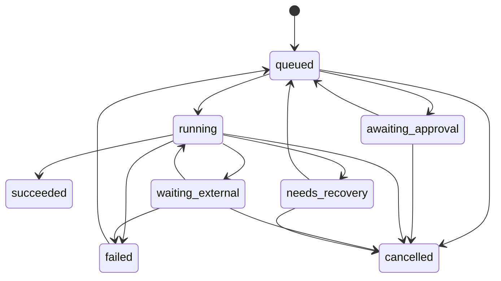
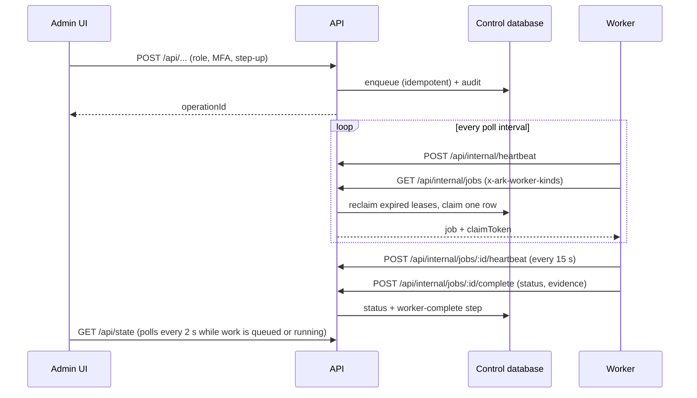
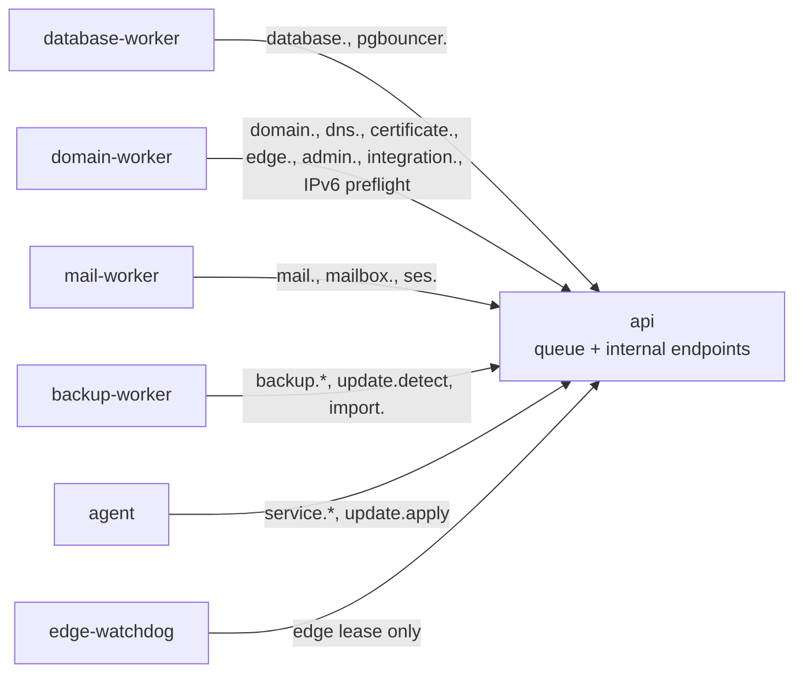

# Operations and workers

Every change Ark makes to the host runs as a durable operation: a row in the control database that a separately credentialed worker claims, executes and completes. This page explains the operation queue, its states, leases and evidence, and every worker process with its job allowlist, token and responsibilities.

## Why operations

The API never mutates DNS, certificates, databases, mail, containers or the edge inline. A request validates its input, checks the caller's role and step-up grant, writes an operation row and an audit event, and returns `{ "operationId": "…" }`. A worker then does the work. This gives three properties:

- **Durability.** Operations survive API and worker restarts. The UI says so on the Overview page ("Operations survive API restarts").
- **Privilege separation.** Each worker holds only the credentials, sockets and networks its operation kinds need. The API container has no Docker socket, no Tailscale LocalAPI socket and no PgBouncer admin socket.
- **Evidence.** Each operation records what happened in step rows, so "queued" is never mistaken for "done" (the Overview card reads "Queued work is not a success. Watch the step history.").

The queue is implemented in `server/src/coordinator.ts` (enqueue, claim, heartbeat, execute) and `server/src/app.ts` (the internal worker endpoints). The state machine is in `shared/src/operations.ts`. The table definitions are `operations` and `operation_steps` in `server/src/schema.ts`.

> [!NOTE]
> `server/src/modules/queue.ts` is not the operation queue. It is the adapter for Stalwart's outbound mail queue, used by the `mail.queue_retry` and `mail.queue_delete` operations.

## The operation record

| Column            | Meaning                                                                                             |
| ----------------- | --------------------------------------------------------------------------------------------------- |
| `id`              | `op_…` identifier returned to the caller.                                                           |
| `kind`            | The operation kind, for example `domain.verify` (see [Operation kinds](#operation-kinds)).          |
| `status`          | One of the [operation states](#states-and-transitions).                                             |
| `actor_id`        | The user who requested it, or empty for scheduled and system work.                                  |
| `idempotency_key` | Unique. Defaults to `<kind>:<targetIds>:<planHash(payload)>`.                                       |
| `plan_hash`       | Hash of the payload.                                                                                |
| `target_ids`      | The resources the operation touches (a domain, database, service, mailbox, endpoint or `platform`). |
| `payload`         | Kind-specific input, for example a canonical Compose file for the agent.                            |
| `claim_token`     | The current lease holder's token while `running`.                                                   |
| `heartbeat_at`    | Last lease heartbeat.                                                                               |
| `error`           | Redacted failure message, at most 1000 characters.                                                  |

Steps (`operation_steps`) belong to an operation and carry a `name`, a `status`, a JSON `evidence` object and an optional `error`. They are deleted with their operation.

## States and transitions

`shared/src/operations.ts` defines eight states and the transitions allowed between them:

| State               | Meaning in the current code                                                                                                                                                                                |
| ------------------- | ---------------------------------------------------------------------------------------------------------------------------------------------------------------------------------------------------------- |
| `queued`            | Waiting for a worker whose allowlist covers the kind. Also the state an operation returns to when it is delegated to the agent or its lease expires.                                                       |
| `running`           | Claimed by exactly one worker, which holds the `claim_token` and heartbeats the lease.                                                                                                                     |
| `succeeded`         | The worker completed it. Terminal.                                                                                                                                                                         |
| `failed`            | The worker reported a failure; `error` says why. The state machine allows `failed → queued`, but no API endpoint requeues an operation (see [Retries](#retries-and-repeated-requests)).                    |
| `awaiting_approval` | Defined in the state machine and counted as in flight, but no current code path stores it.                                                                                                                 |
| `waiting_external`  | Defined, counted in flight and exported as a metric; no current code path stores it.                                                                                                                       |
| `needs_recovery`    | Defined and exported as a metric, and the UI treats it as a failure. Workers use the `needs_recovery:` prefix in their logs when a completion call fails after a mutation (see [Completion](#completion)). |
| `cancelled`         | Defined and terminal; no current API endpoint cancels an operation.                                                                                                                                        |

`isInFlight` treats `queued`, `running`, `awaiting_approval` and `waiting_external` as in flight. `isTerminal` is true for `succeeded` and `cancelled` only, because a failed operation can in principle be requeued.

## Lifecycle

### Enqueue and idempotency

`enqueue()` computes the idempotency key (or uses an explicit one), takes a transaction-scoped advisory lock on it, and looks for related rows with the same key or a `<key>:<suffix>` successor:

- For most kinds, an in-flight related operation is returned instead of creating a new one. Repeating a click while the first request is queued or running returns the same operation.
- For `edge.apply` and `edge.l4_apply`, only a `queued` successor is reused. A running apply may already have read an older desired state, so every change during it leaves a new queued apply behind.
- When the earlier operations are all finished, a new row is inserted with a suffixed key, so the history is kept.

Some schedules use fixed keys so they queue at most once: the daily client-certificate rollover uses `database.client_rollover:daily:<UTC date>`, DNS maintenance uses `dns.maintenance:<domainId>`, and the IPv6 preflight uses `ipv6.preflight`.

### Claiming

A worker asks for work with `GET /api/internal/jobs`, its bearer token and an `x-ark-worker-kinds` header listing the kind prefixes it wants. The API rejects the request with 403 unless every requested entry is in that identity's allowlist. Claiming (`claimQueued`) then:

1. Queues a gate-revocation drain if a revocation is pending without one (a durable retry for the login gate).
2. Returns every `running` operation whose `heartbeat_at` is older than the lease (90 seconds) to `queued`, with the error `Previous worker lease expired; operation reclaimed.`
3. Under a global advisory lock, claims the oldest matching `queued` row, one at a time, with `FOR UPDATE SKIP LOCKED`. A row is skipped while any other `running` operation shares one of its target IDs, so two operations never work on the same resource concurrently.
4. Skips `mail.*`, `mailbox.*` and `ses.*` while `ARK_MAIL_ENABLED` is off. Those jobs stay queued and resume when mail is enabled again.
5. Gives each claim a fresh `claim_…` token and sets `running`, `claim_token` and `heartbeat_at`.

The IPv6 preflight (`domain.ipv6_preflight`) is claimed only by a worker that asks for it by exact name, and is always fenced on its own target ID (`ipv6-preflight`), so it never blocks or waits for domain work.

### Execution authorization

Before running, `assertExecutionAuthorized` re-checks the requesting user's current access, so a revoked grant stops queued work:

- the actor must still have platform access and must not be a viewer;
- owners may run anything;
- only owners may run `domain.ipv6_preflight`, the database client kinds (`database.client_issue`, `database.client_revoke`, `database.client_rollover`) and `integration.vercel_push`, and anything targeting `platform`;
- an operator's project and domain grants must still cover every target service, database, mailbox and domain.

Scheduled operations without an actor skip this check. For agent jobs the API repeats the check when it hands out the job, on every heartbeat and before accepting a successful completion; a job whose actor lost access is marked `failed` instead of being handed out.

### Heartbeats and leases

Workers renew the lease every 15 seconds with `POST /api/internal/jobs/:id/heartbeat` and the claim token. The API answers 409 when the lease is stale or owned by someone else, and 403 when the identity may not execute that kind. A lease that is not renewed for 90 seconds is reclaimed by the next claim, so a crashed worker's operation runs again elsewhere. Long operations (ACME issuance, restores, Compose pulls) stay claimed only because of these heartbeats.

### Completion

`POST /api/internal/jobs/:id/complete` takes `status` (`succeeded` or `failed`), an optional `error`, optional `evidence` and the `claimToken`. It is accepted only when the operation is still `running`, the identity may execute the kind and the token matches. The update and the `worker-complete` step are written in one transaction, conditional on the same token, so a stale worker cannot overwrite a newer claim (fencing). For agent jobs the same transaction updates the service row and the deployment revision.

The TypeScript worker runtime (`workers/src/runtime.ts`) completes as follows:

- The executor returns: `succeeded`, with evidence `{ worker, contractVersion: 1, … }`.
- The executor throws: `failed`, with the redacted message.
- A heartbeat failed during execution: the job is reported as failed rather than succeeded.
- The completion call itself fails after the mutation ran: the worker logs `needs_recovery: worker completion failed after a mutation: …`. The row stays `running` until its lease expires and it is reclaimed. The Go agent logs the same prefix in the same situation.

### Delegation to the agent

Some operations have a planning half that runs in a TypeScript worker and an execution half that runs in the Docker agent. The planning half throws `DelegateToAgent` with a new payload (the canonical Compose file and its hash). The operation goes back to `queued` with that payload and no claim, and the agent can then claim it. The agent only claims rows whose payload is complete: `service.deploy` and `update.apply` need `compose`, `composeHash` and `project`; `service.adopt` needs `compose`, `composeHash`, `containerId` and `name`; start, stop, restart, logs and stats need `name`; `service.discover` needs `request: "redacted-inventory-v1"`.

### Evidence

Steps are the operation's evidence. The coordinator adds named steps while it works (for example `dns-verified`, `backup`, `backup-export`, `append-only-canary`, `edge-drain`, `update-detect`, `import-scan`, `platform-maintain`), and the completion adds a `worker-complete` step with the worker's evidence. Evidence and errors pass through `redactValue` and `redactLogLine` before they are stored. The agent also writes a local journal (`ARK_AGENT_JOURNAL`, default `journal.jsonl`) and a resource ledger under `ARK_AGENT_STATE_DIR`.

`GET /api/state` returns the latest 50 operations and the latest 200 steps (filtered by what the caller may see). The **Activity** page lists each operation with its kind, status, error or creation time, and its steps. Some features have their own result endpoints, for example `GET /api/sql/results/:operationId` and `GET /api/services/discovery/:operationId`.

### Retries and repeated requests

There is no generic retry or cancel endpoint. Recovery from a failed operation is one of:

- **Repeat the action** in the UI or API. Because the earlier operation is finished, a new operation with a suffixed idempotency key is created.
- **Wait for a schedule.** Observations and maintenance jobs are queued again on their own timers (see [Schedules](#schedules)).
- **Automatic requeue** in specific paths: an expired lease, a pending gate revocation without a drain, an edge watchdog event (which queues `edge.apply`), IPv6 preflight retries after five minutes when a managed runner is configured, and client-certificate retirement drains that retry with backoff.

Failed operations are visible as alerts: Prometheus raises `ArkOperationFailures` when `ark_operations{status="failed"}` stays above zero for five minutes. With embedded workers, the coordinator also raises an in-app warning `Operation <kind> failed` after each pass. See [Monitoring](../features/monitoring.md).

## Workers

Each worker is its own container in `infra/platform/docker-compose.yml`. The four TypeScript operation workers are built from their own `Dockerfile` targets, started with `bun run --cwd workers <name>`, and given `ARK_RUNTIME_ROLE=worker`, `ARK_EMBEDDED_WORKERS=0`, `ARK_API_URL=http://api:3000` and their token as `ARK_WORKER_TOKEN`. The agent is built from `agent/Dockerfile` and gets `ARK_AGENT_TOKEN`. The TypeScript workers share `runWorker` from `workers/src/runtime.ts`: each lane heartbeats the worker identity, polls for one job every 2 seconds, runs up to its concurrency limit (default 1, maximum 16), and on `SIGTERM` or `SIGINT` stops polling and waits for running jobs.

### Identities, tokens and allowlists

The API identifies the caller by its bearer token in the `/api/internal/*` middleware. A dedicated worker identity is recognised only when the matching variable is set in the API's environment; otherwise the worker's token falls back to `ARK_INTERNAL_TOKEN` and the caller becomes the `module` identity. The installer generates every token.

| Identity        | Token (API side)            | Allowlist (`workerPrefixes` in `server/src/app.ts`)                                                                                                 |
| --------------- | --------------------------- | --------------------------------------------------------------------------------------------------------------------------------------------------- |
| `database`      | `ARK_DATABASE_WORKER_TOKEN` | `database.`, `pgbouncer.`                                                                                                                           |
| `domains`       | `ARK_DOMAIN_WORKER_TOKEN`   | `domain.`, `dns.`, `certificate.`, `edge.`, `admin.`, `integration.`, `domain.ipv6_preflight`                                                       |
| `mail`          | `ARK_MAIL_WORKER_TOKEN`     | `mail.`, `mailbox.`, `ses.`                                                                                                                         |
| `backup`        | `ARK_BACKUP_WORKER_TOKEN`   | `backup.` and each `backup.*` kind by name, `update.detect`, `import.`                                                                              |
| `agent`         | `ARK_AGENT_TOKEN`           | `service.`, `update.apply`                                                                                                                          |
| `module`        | `ARK_INTERNAL_TOKEN`        | `database.`, `pgbouncer.`, `mail.`, `mailbox.`, `ses.`, `domain.`, `dns.`, `certificate.`, `edge.`, `admin.`, `backup.`, `update.detect`, `import.` |
| `edge-watchdog` | `ARK_EDGE_WATCHDOG_TOKEN`   | No jobs. May only call `/api/internal/edge/*`; every other identity is refused there.                                                               |

An entry ending in `.` is a prefix; any other entry must match the kind exactly. The same allowlist is enforced on claim, heartbeat and completion. `update.apply` belongs to the agent alone: module workers get only `update.detect`, so they never re-plan an update the agent is waiting to execute.

### database-worker

`workers/src/database.ts`. Runs the `database.` and `pgbouncer.` kinds: provisioning, role password rotation, SQL workspace queries and schema reads, database client certificates (issue, revoke, rollover, retire) and PgBouncer reloads.

- **Reach.** The platform database as `ark_runtime`, the application cluster as `ark_cluster_admin` on `database-management`, and the PgBouncer admin console over the shared Unix socket (`ARK_PGBOUNCER_SOCKET_DIR`). It has no Docker CLI or socket.
- **Control endpoint.** `POST /cancel` on port 3101 (`ARK_DATABASE_CANCEL_PORT`), authenticated with the worker token. The API calls it through `ARK_DATABASE_WORKER_URL` to cancel a running SQL workspace query.
- **Scheduler.** Because it owns the PgBouncer admin socket, it runs the rollover scheduler: every second (`ARK_ROLLOVER_TICK_MS`) it queues the day's `database.client_rollover` once, re-evaluates rollover and Vercel token alerts hourly, runs certificate retirements at their `not_after`, and runs the retirement watchdog. See [Public database access](../features/public-database-access.md).

### domain-worker

`workers/src/domains.ts`. The only worker with external egress. It runs three lanes so long work never blocks the edge:

- `domain.`, `dns.`, `certificate.`, `edge.`, `admin.`: domain verification, reviewed DNS publishing, ACME certificates with `lego`, Caddy and HAProxy configuration (`edge.apply`, `edge.l4_apply`), edge observation and drains, and admin mode changes;
- `integration.`: the Vercel push, which can poll a deployment for up to 30 minutes;
- `domain.ipv6_preflight`: the IPv6 preflight.

Its schedules and control endpoint:

- `edge.observe` every 5 minutes, when the edge node's LocalAPI socket is mounted (`ARK_EDGE_TS_SOCKET`).
- DNS maintenance every 120 seconds: a scheduled, route-aware `domain.verify` for each domain that is due, and the IPv6 preflight when it is due.
- `POST /dns/review` on port 3102 (`ARK_DOMAIN_WORKER_PORT`), which the API calls through `ARK_DOMAIN_WORKER_URL` to read the live DNS review.
- At startup, an `edge.apply` when the active Caddyfile predates the IPv6 preflight HTTP logging.

It mounts the certificate, edge and ACME directories, the HAProxy generation tree and sockets (group 4400) and the edge node's LocalAPI socket read-only. See [Domains and DNS](../features/domains-and-dns.md) and [Certificates](../features/certificates.md).

### mail-worker

`workers/src/mail.ts`. Runs `mail.`, `mailbox.` and `ses.` kinds against Stalwart (`STALWART_URL`, admin credentials, optional `STALWART_CLI`) and Amazon SES. It is reachable only on `control` and `mail-management`. With `ARK_MAIL_ENABLED=0` the installer and signed maintenance keep it stopped, and the API stops handing out mail jobs. See [Mail](../features/mail.md).

### backup-worker

`workers/src/backup.ts`. Runs five lanes with separate capacity, so observation always has a slot:

| Lane kinds                             | Concurrency |
| -------------------------------------- | ----------- |
| `backup.create`, `backup.restore_test` | 2           |
| `backup.export`                        | 4           |
| `backup.verify_target`                 | 2           |
| `backup.observe`                       | 1           |
| `update.detect`, `import.`             | 1           |

When `ARK_BACKUP_EXECUTE=1` (and `ARK_BACKUP_SCHEDULE` is not `0`), it runs the backup schedule: every 5 minutes it queues a `backup.export` per enabled target, a `backup.verify_target` canary when a target's last check is older than six and a half days, and a full or differential `backup.create` per PostgreSQL cluster when one is due. When backup-ts's socket is mounted (`ARK_BACKUP_TS_SOCKET`), it queues `backup.observe` every 5 minutes. It talks to the pgBackRest executors inside each PostgreSQL container (`ARK_PLATFORM_PG_EXECUTOR_URL`, `ARK_APP_PG_EXECUTOR_URL`) and reaches S3 targets on `backup-egress` and the home target only through backup-ts's SOCKS5 proxy. See [Backups](../features/backups.md) and [the backups guide](../guides/backups.md#execution-and-restore-safeguards).

### agent

`agent/main.go`, the Go Docker agent. It is the only component with the Docker socket. Every 3 seconds it heartbeats as `go-agent-v1`, claims one job, validates any Compose payload against the policy in `agent/policy.go` (a rejected Compose is completed as `failed` without touching Docker), executes it with a 15-second lease heartbeat and completes it. It runs `service.deploy`, `update.apply`, `service.adopt`, `service.start`, `service.stop`, `service.restart`, `service.logs`, `service.stats` and `service.discover`. It records project, container, network and volume bindings in its resource ledger. See [Services](../features/services.md).

### edge-watchdog

`workers/src/edge-watchdog.ts`, with one `ProxyWatchdog` (`workers/src/proxy-watchdog.ts`) per proxy. It is not an operation worker: it holds no database credential, root key, Docker socket or tailscaled socket, and its token can only read `GET /api/internal/edge/lease` and post `POST /api/internal/edge/watchdog-event`. At least every second (`ARK_EDGE_WATCHDOG_INTERVAL_MS`, at most 1000 ms) it reads the lease and withdraws every tailnet backend the lease does not allow from Caddy (admin API) and from HAProxy (master socket, when `ARK_HAPROXY_MASTER_SOCKET` is set). If it cannot read the lease for 5 seconds (`ARK_EDGE_WATCHDOG_STALE_MS`) it withdraws all of them. It keeps working with every operation worker stopped.

It serves the launch guards on port 2021 (`ARK_EDGE_WATCHDOG_PORT`): `GET /v1/launch` answers `open` or `closed`, `GET /v1/supervise` answers only after a recently verified enforcement pass, and `GET /v1/health` reports counts and timings. Each event it reports (`withdrawn`, `withdrawal_failed`, `proxy_stopped`, `stop_failed`, `policy_unavailable`) is audited and queues `edge.apply`; every event other than `withdrawn` also raises a critical alert. See [Edge observer and lease watchdog](../operating.md#edge-observer-and-lease-watchdog).

### Other first-party processes

These run beside the workers but take no operations:

- `haproxy-validator` (`workers/src/haproxy-validator.ts`): a socket daemon with no network that re-hashes a candidate HAProxy generation and runs only `haproxy -c` on it for the domain worker.
- The pgBackRest executors (`workers/src/pg-executor.ts`): run inside each PostgreSQL container and answer a fixed set of token-authenticated backup actions for the backup worker.
- `database-ingress` (`scripts/database-ingress.ts`): the host-namespace nftables reconciler for the public ports. The API queues its reconciliation on every startup.

### Heartbeats

Every poll first calls `POST /api/internal/heartbeat`, which upserts `worker_heartbeats` with the identity, version (`ts-worker-v1` or `go-agent-v1`) and time. `GET /api/metrics/prometheus` exports `ark_worker_heartbeat_stale{identity=…}` as 1 when the agent, database, domains, backup or (with mail enabled) mail identity has not been seen for 90 seconds, and Prometheus raises `ArkWorkerHeartbeatStale` after two minutes.

## Operation kinds

The worker column is the production identity that claims the kind. "Embedded" means the [embedded coordinator](#embedded-workers-in-development), which claims every kind.

| Kind                                               | Worker               | What it does                                                                                                                                                                                                  | Queued by                                                                                    |
| -------------------------------------------------- | -------------------- | ------------------------------------------------------------------------------------------------------------------------------------------------------------------------------------------------------------- | -------------------------------------------------------------------------------------------- |
| `domain.verify`                                    | domains              | Checks public DNS for a domain's endpoints, marks them verified or `awaiting_dns`, and queues certificates, database provisioning and mailbox provisioning.                                                   | `POST /api/domains/:id/verify`, the wizard, DNS maintenance, edge observation, route changes |
| `domain.ipv6_preflight`                            | domains (own lane)   | External IPv6 reachability check that gates AAAA publication.                                                                                                                                                 | `POST /api/settings/ipv6/preflight`, DNS maintenance when due                                |
| `dns.publish`                                      | domains              | Publishes a reviewed DNS change set to Cloudflare.                                                                                                                                                            | The reviewed DNS publish                                                                     |
| `certificate.issue`                                | domains              | Issues or renews an endpoint certificate with `lego`.                                                                                                                                                         | `domain.verify`                                                                              |
| `certificate.renew`                                | domains              | The same handler with lego's `renew` action. No current API path queues it; renewals arrive as `certificate.issue`.                                                                                           | Not queued in production code                                                                |
| `edge.apply`                                       | domains              | Renders and loads the Caddy configuration, then queues `edge.l4_apply`.                                                                                                                                       | Route, gate and mode changes, edge observation, watchdog events                              |
| `edge.l4_apply`                                    | domains              | Writes, validates and activates an HAProxy generation.                                                                                                                                                        | `edge.apply` and pooler or route changes                                                     |
| `edge.observe`                                     | domains              | Reads the edge node's LocalAPI status and commits a tailnet generation and lease.                                                                                                                             | Every 5 minutes, `POST /api/front/tailnet/observe`                                           |
| `edge.drain`                                       | domains              | Withdraws disallowed backends from Caddy and HAProxy and closes their sessions.                                                                                                                               | Route removal and narrowing, gate revocations, edge observation                              |
| `admin.mode_change`                                | domains              | Switches public and tailnet administration.                                                                                                                                                                   | `POST /api/settings/mode`                                                                    |
| `integration.vercel_push`                          | domains (own lane)   | Pushes rolled-over client certificates to Vercel.                                                                                                                                                             | Database client rollover                                                                     |
| `database.provision`                               | database             | Creates a managed database and its roles.                                                                                                                                                                     | `POST /api/databases`, `domain.verify`                                                       |
| `database.rotate`                                  | database             | Rotates a role password and queues `pgbouncer.reload`.                                                                                                                                                        | `POST /api/databases/:id/rotate`                                                             |
| `database.query`                                   | database             | Runs a SQL workspace query.                                                                                                                                                                                   | `POST /api/sql/query`                                                                        |
| `database.schema`                                  | database             | Reads a database schema.                                                                                                                                                                                      | `POST /api/databases/:id/schema`                                                             |
| `database.client_issue`                            | database             | Issues a PgBouncer client certificate.                                                                                                                                                                        | Database client creation                                                                     |
| `database.client_revoke`                           | database             | Revokes a client, disables its role and kills its sessions.                                                                                                                                                   | `POST /api/databases/:id/clients/:clientId/revoke`                                           |
| `database.client_rollover`                         | database             | Issues successors for clients that are due.                                                                                                                                                                   | Daily scheduler, early rollover                                                              |
| `database.client_retire`                           | database             | Retires a certificate generation at `not_after` and drains its sessions.                                                                                                                                      | Rollover scheduler                                                                           |
| `pgbouncer.reload`                                 | database             | Regenerates PgBouncer configuration and reloads it over the admin socket.                                                                                                                                     | Rotations, renewals, pooler policy changes                                                   |
| `mail.provision`                                   | mail                 | Creates a mailbox in Stalwart.                                                                                                                                                                                | Mailbox creation, `domain.verify`                                                            |
| `mail.reconcile`                                   | mail                 | Reconciles Stalwart with Ark's mail state.                                                                                                                                                                    | Mail changes, `POST /api/mail/reconcile`                                                     |
| `mail.queue_retry`                                 | mail                 | Retries a message in Stalwart's outbound queue (needs `STALWART_CLI`).                                                                                                                                        | `POST /api/mail/queue`                                                                       |
| `mail.queue_delete`                                | mail                 | Deletes a message from Stalwart's outbound queue (needs `STALWART_CLI`).                                                                                                                                      | `POST /api/mail/queue`                                                                       |
| `mailbox.device`                                   | mail                 | Issues or revokes a per-device mail credential.                                                                                                                                                               | `POST /api/mailboxes/:id/devices`, `POST /api/devices/:id/revoke`                            |
| `ses.reconcile`                                    | mail                 | Reconciles Amazon SES identity and sending state.                                                                                                                                                             | `POST /api/ses/reconcile`, domain changes                                                    |
| `backup.create`                                    | backup               | Takes a backup (PostgreSQL into the local repo2, or mail and volume snapshots) and queues exports.                                                                                                            | `POST /api/backups`, backup schedule                                                         |
| `backup.restore_test`                              | backup               | Restores an exact recorded snapshot into an isolated directory.                                                                                                                                               | `POST /api/backups/restore-test`                                                             |
| `backup.export`                                    | backup               | Stages and uploads both PostgreSQL clusters to one target.                                                                                                                                                    | Backup schedule, after `backup.create`                                                       |
| `backup.verify_target`                             | backup               | The append-only canary for a target.                                                                                                                                                                          | Target changes, backup schedule                                                              |
| `backup.observe`                                   | backup               | Reads backup-ts's LocalAPI status and renews its lease.                                                                                                                                                       | Every 5 minutes, `POST /api/backups/tailnet/observe`                                         |
| `update.detect`                                    | backup               | Resolves current image digests and records update candidates.                                                                                                                                                 | `POST /api/updates/detect`                                                                   |
| `import.scan`                                      | backup               | Compares an external inventory with Ark's domains, databases and services.                                                                                                                                    | `POST /api/import/scan`                                                                      |
| `service.deploy`                                   | agent                | Deploys a policy-checked Compose project.                                                                                                                                                                     | Service creation                                                                             |
| `service.start`, `service.stop`, `service.restart` | agent                | Container lifecycle actions.                                                                                                                                                                                  | `POST /api/services/:id/:action`                                                             |
| `service.logs`, `service.stats`                    | agent                | Redacted observations of a service.                                                                                                                                                                           | `POST /api/services/:id/observe`                                                             |
| `service.discover`                                 | agent                | Redacted inventory of unmanaged containers.                                                                                                                                                                   | `POST /api/services/discover`                                                                |
| `service.adopt`                                    | agent                | Adopts an existing container under a reviewed Compose file.                                                                                                                                                   | `POST /api/services/adopt`                                                                   |
| `update.apply`                                     | embedded, then agent | Plans a deployment revision for a new digest (coordinator), then deploys it (agent). No external worker allowlist includes the planning half.                                                                 | `POST /api/updates/apply`                                                                    |
| `platform.maintain`                                | none (embedded)      | Records an approved maintenance bundle. No worker allowlist includes `platform.`; with embedded workers it is claimed and fails on purpose, because self-maintenance runs only through `scripts/maintain.ts`. | `POST /api/platform/maintain`                                                                |

## Embedded workers in development

With `ARK_EMBEDDED_WORKERS=1` and `NODE_ENV` not `production`, the API process runs the coordinator itself (`startCoordinator` in `server/src/coordinator.ts`) and logs a warning that provider adapters run inside the API. `.env.example` sets it for local development, so `mise run dev` and `mise run dev:server` need no worker containers. The production Compose file sets `ARK_EMBEDDED_WORKERS=0` for the API and every worker.

The embedded coordinator ticks every 1.5 seconds with three independent lanes: up to eight core operations per pass (everything except `integration.` and the IPv6 preflight), one `integration.` operation and one IPv6 preflight. Each claimed operation is heartbeated every 15 seconds like an external worker's. It also starts every schedule the external workers would run: the rollover scheduler, edge observation, DNS maintenance, and, when enabled, the backup schedule and backup observation.

Service operations run in-process through the local Docker CLI when Docker is available (`DOCKER_HOST`, `ARK_DOCKER=1` or `/var/run/docker.sock`); otherwise they are delegated to the agent as in production. Without embedded workers, the API never executes `service.*` kinds or delegated `update.apply` payloads.

> [!WARNING]
> Embedded workers give the API process every worker's credentials and reach. They exist for local development only and are ignored when `NODE_ENV=production`.

## Schedules

| Schedule           | Runs in         | Interval              | Queues                                                   |
| ------------------ | --------------- | --------------------- | -------------------------------------------------------- |
| Rollover scheduler | database worker | 1 s tick, daily job   | `database.client_rollover`, retirements                  |
| Edge observation   | domain worker   | 5 minutes             | `edge.observe`                                           |
| DNS maintenance    | domain worker   | 120 s                 | `domain.verify` (scheduled), `domain.ipv6_preflight`     |
| Backup schedule    | backup worker   | 5 minutes             | `backup.export`, `backup.verify_target`, `backup.create` |
| Backup observation | backup worker   | 5 minutes             | `backup.observe`                                         |
| Edge watchdog      | edge-watchdog   | at least every second | `edge.apply` through watchdog events                     |

Schedules reuse queued or running operations through idempotency, so a stopped worker does not pile up duplicates.

## Inspecting the queue

- **UI.** **Activity** lists recent operations and their steps; the Overview card shows the latest eight.
- **API.** `GET /api/state` returns `operations` and `steps`.
- **Metrics.** `ark_operations{status=…}` for `failed`, `running`, `waiting_external` and `needs_recovery`, and `ark_worker_heartbeat_stale`.
- **Logs.** `docker compose --env-file .env -f infra/platform/docker-compose.yml logs domain-worker` (or any worker). Worker log lines are redacted.

Related pages: [Maintenance and upgrades](maintenance-and-upgrades.md), [Recovery](recovery.md), [Troubleshooting](troubleshooting.md), [API reference](../reference/api.md).
