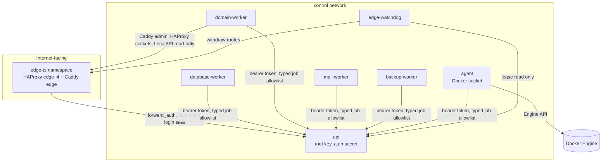

# Security model

This page is a reader's overview of how Ark Stack protects itself and the things it runs: what it defends against, how privilege is split between the API, the workers, the Docker agent, the edge and the watchdog, how credentials and secrets are held, what the host firewall and workload policy enforce, and where the front-door trust boundaries sit. The test-backed checklist, the per-boundary evidence and the open gaps are in the [security review](../security-review.md).

## Scope and threat model

Ark manages one Linux VPS, operated by trusted administrators. It runs several application projects on that host, but it does not offer isolation suitable for hostile customer code: a compromised host or Docker daemon affects the whole installation ([implementation plan](../implementation-plan.md)). Within that scope the design aims for least privilege between components, fail-closed defaults and evidence before any "ready" state.

The main threats it is built against:

| Attacker                                 | Typical attempts                                                                                                                              | Main controls                                                                                          |
| ---------------------------------------- | --------------------------------------------------------------------------------------------------------------------------------------------- | ------------------------------------------------------------------------------------------------------ |
| Anonymous internet client                | port scans, forged `Host`, SNI and forwarding headers, forged PROXY headers, SSRF through route targets, credential stuffing, slow handshakes | host nftables, HAProxy SNI router, strict Caddy configuration, registered-host guard, rate limits, MFA |
| Holder of leaked application secrets     | connect to a database with a leaked Vercel certificate or password                                                                            | per-environment client CAs, SCRAM, 90-day certificates, revocation that closes sessions                |
| Compromised route target or upstream app | steal gate cookies, set cross-domain cookies, inject redirects                                                                                | host-only `__Host-` cookies, cookie and header stripping, `Location` rewriting                         |
| Compromised tailnet device               | reach the edge, backup or admin nodes; take over a route by renaming a machine                                                                | `--shields-up`, per-route ACL grants, StableNodeID pinning with lease-based withdrawal                 |
| Operator or viewer without owner rights  | create or widen public exposure                                                                                                               | owner-only exposure changes, step-up grants bound to the exact request                                 |
| Compromised provider account             | Cloudflare, Vercel, object storage, Tailscale coordination                                                                                    | scoped tokens, reviewed DNS diffs, append-only backups, no Tailscale policy credential in Ark          |
| Root on the VPS                          | everything                                                                                                                                    | damage limits only (below)                                                                             |

The full asset list, attacker model and residual risks are in the front-door design's [threat model](../design/front-door.md#23-threat-model).

### What a full host compromise exposes

Root on the VPS can read `.env` and the Docker volumes, so every Ark secret falls with it: the root key (and so every sealed secret and private CA key), `BETTER_AUTH_SECRET` (so sessions can be forged), the Tailscale node keys, and any connected Vercel project token. What still limits the damage:

- **Tailnet reach is limited to granted ports.** The edge node reaches only the `host:port` pairs granted to `tag:ark-edge`, and the backup node only the home backup server. This holds only if the tailnet policy has no broad rules, which is why the generated snippet carries `tests`.
- **The tailnet policy is out of reach.** Ark holds no Tailscale API key or OAuth client, so it cannot widen grants or add nodes. Tailnet Lock, when enabled, stops new nodes from joining with stolen keys.
- **Existing backups survive.** Off-VPS credentials are write-only or append-only, and pruning happens off-host ([backups guide](../guides/backups.md)).
- **Client certificates expire.** Database client certificates last 90 days, and retirement drains their sessions by `not_after + 5 s`.

## Components and privilege boundaries

Each component gets only the credentials and mounts its job needs. The Compose definitions are in `infra/platform/docker-compose.yml`.

| Component                      | Holds                                                                                                    | Can reach                                                                                                                                  | Does not have                                                                           |
| ------------------------------ | -------------------------------------------------------------------------------------------------------- | ------------------------------------------------------------------------------------------------------------------------------------------ | --------------------------------------------------------------------------------------- |
| `api`                          | `ARK_ROOT_KEY`, `BETTER_AUTH_SECRET`, the setup, worker, agent, metrics, maintenance and recovery tokens | the control database; listens on `127.0.0.1:3000` and the internal networks                                                                | the Docker socket, any tailscaled socket, the Caddy admin API                           |
| `database-worker`              | root key, its worker token, the PgBouncer admin socket                                                   | the application PostgreSQL cluster on `database-management`                                                                                | the edge, the Docker socket                                                             |
| `domain-worker`                | root key, its worker token, the DNS provider token, certificate and edge directories                     | Caddy's admin API on `edge-control`, HAProxy's master and admin sockets, `edge-ts` LocalAPI read-only, the internet for ACME and providers | the Docker socket                                                                       |
| `mail-worker`                  | root key, its worker token, Stalwart and SES credentials                                                 | Stalwart on `mail-management`                                                                                                              | DNS and edge access                                                                     |
| `backup-worker`                | root key, its worker token, the pgBackRest executor tokens                                               | the executors, the S3 target, `backup-ts` SOCKS5 and its LocalAPI read-only                                                                | the live repositories and `PGDATA`                                                      |
| `agent` (Go)                   | `ARK_AGENT_TOKEN`, the Docker socket                                                                     | the API on `control`, the Docker Engine                                                                                                    | the root key; it exposes no listener                                                    |
| `edge-watchdog`                | `ARK_EDGE_WATCHDOG_TOKEN`                                                                                | `GET /api/internal/edge/lease`, Caddy's admin API, the HAProxy master socket                                                               | database credentials, the root key, Docker or tailscaled sockets                        |
| `edge-ts`, `edge`, `edge-l4`   | `edge-ts`: its node key, `NET_ADMIN`/`NET_RAW`; `edge`: `ARK_EDGE_GATE_TOKEN`, certificates read-only    | the public ports, the API on `admin`, PgBouncer on `pgbouncer-ingress`, granted tailnet targets                                            | `database-management` (so never `app-postgres`); Caddy and HAProxy have no capabilities |
| `database-ingress`             | root in the host namespace with only `NET_ADMIN` and `DAC_OVERRIDE`                                      | nftables                                                                                                                                   | everything else                                                                         |
| `pgbouncer-public`             | its generated config and TLS key, read-only                                                              | `app-postgres`                                                                                                                             | a published port; HAProxy reaches it over `pgbouncer-ingress` only                      |
| `tailscale`, `tailnet-gateway` | the admin node key; `ARK_EDGE_GATE_TOKEN`                                                                | the API on `admin`                                                                                                                         | capabilities (userspace networking); Funnel                                             |

The first-party images (API, workers, watchdog) share one hardened Compose template: read-only root filesystem, a 64 MB `noexec` `/tmp`, every capability dropped, `no-new-privileges` and a PID limit. Internal networks (`control`, `edge-control`, `database-management`, `pgbouncer-ingress`, `backup-management`, `backup-tailnet`) have no external route. Only the edge node's namespace publishes public ports; the API publishes only its loopback bootstrap port. See [Ports and networks](../reference/ports-and-networks.md).

### Where each boundary is enforced

- **API ↔ workers.** Workers poll `GET /api/internal/jobs` with a bearer token. Each token maps to one identity with a fixed job-kind allowlist, and a worker must name the kinds it wants; anything outside its list is `403`. Claims carry a claim token, and heartbeats and completions must present it. A worker cannot claim, heartbeat or complete another worker's job kinds.
- **API ↔ agent.** `update.apply` and `service.*` belong to the agent alone. Before handing out a job and again on heartbeat and success, the API re-checks that the user who queued it still has access. The agent re-validates the Compose document and its hash before calling Docker ([Services and workloads](../features/services.md)).
- **API ↔ edge.** The API cannot rewrite public routing: Caddy's admin API listens only on `edge-control`, which the API is not on, and the API never mounts a tailscaled socket. The domain worker renders configuration; the edge calls the API only through `forward_auth` and the admin and login sites.
- **API ↔ watchdog.** The watchdog token opens only `/api/internal/edge/*`: the lease read and event reports. Every other internal route refuses it, and the edge lease route refuses every other token. The watchdog withdraws tailnet routes the lease no longer allows within a five-second budget, even with every worker stopped ([Edge observer and lease watchdog](../operating.md#edge-observer-and-lease-watchdog)).

## Scoped tokens

Every service-to-service credential is a separate random token generated by `mise run host:install` into `.env` (mode `0600`), never overwritten on a re-run. The API refuses to start if any of them still holds a published example value.

| Token                                                         | Held by                                   | Authorises                                                                                                                           |
| ------------------------------------------------------------- | ----------------------------------------- | ------------------------------------------------------------------------------------------------------------------------------------ |
| `ARK_SETUP_TOKEN`                                             | api                                       | the single owner sign-up while setup is open                                                                                         |
| `ARK_DATABASE_WORKER_TOKEN`                                   | api, database-worker                      | `database.*` and `pgbouncer.*` jobs; the worker's private query-cancel listener                                                      |
| `ARK_DOMAIN_WORKER_TOKEN`                                     | api, domain-worker                        | `domain.*`, `dns.*`, `certificate.*`, `edge.*`, `admin.*`, `integration.*` and IPv6 preflight jobs; the worker's DNS review endpoint |
| `ARK_MAIL_WORKER_TOKEN`                                       | api, mail-worker                          | `mail.*`, `mailbox.*`, `ses.*` jobs                                                                                                  |
| `ARK_BACKUP_WORKER_TOKEN`                                     | api, backup-worker                        | `backup.*`, `update.detect` and `import.*` jobs                                                                                      |
| `ARK_AGENT_TOKEN`                                             | api, agent                                | `service.*` and `update.apply` jobs                                                                                                  |
| `ARK_INTERNAL_TOKEN`                                          | api                                       | a combined module identity; also the fallback for any worker token that is not set                                                   |
| `ARK_EDGE_WATCHDOG_TOKEN`                                     | api, edge-watchdog                        | the edge lease and watchdog events only                                                                                              |
| `ARK_EDGE_GATE_TOKEN`                                         | api, edge, tailnet-gateway                | the four edge-only gate handlers, and trusting the proxy's client address on exact auth paths. Grants no admin access                |
| `ARK_METRICS_TOKEN`                                           | api, Prometheus                           | `GET /api/metrics/prometheus`                                                                                                        |
| `ARK_MAINTENANCE_TOKEN`                                       | api                                       | the `x-maintenance-token` header on `POST /api/platform/maintain`, with owner and step-up                                            |
| `ARK_MFA_RECOVERY_TOKEN`                                      | api environment, kept off-host            | `mise run recover:mfa`                                                                                                               |
| `ARK_OFFHOST_HEARTBEAT_TOKEN`                                 | api, domain-worker, the off-host receiver | the off-host heartbeat and IPv6 probe runner                                                                                         |
| `ARK_PLATFORM_PG_EXECUTOR_TOKEN`, `ARK_APP_PG_EXECUTOR_TOKEN` | the PostgreSQL containers, backup-worker  | the fixed pgBackRest executor actions of one cluster                                                                                 |

Tokens are compared in constant time. Tailscale auth keys (`TS_EDGE_AUTHKEY`, `TS_BACKUP_AUTHKEY`, `TS_AUTHKEY`) are one-off enrolment keys, removed from `.env` and revoked after the node joins.

## Secrets encryption

Operational secrets (generated database passwords, mailbox and device credentials, private CA keys, client keys, backup target credentials, a gate user's temporary password, the optional Vercel token) are stored in the `secrets` table, sealed with [`shared/src/crypto.ts`](../../shared/src/crypto.ts):

- **Cipher:** AES-256-GCM with a fresh random 12-byte IV per secret and the GCM authentication tag stored alongside.
- **Key:** SHA-256 of `ARK_ROOT_KEY`. Each row records `ARK_ROOT_KEY_ID` (default `k1`) as `key_id`.
- **Metadata:** kind, owning resource, purpose, sensitivity (`credential`, `provider` or `root`), whether it is one-time, and when it was revealed.

What leaves the API:

- Inventory responses carry metadata only; for example a database role reports its secret as `"stored"`, never the value.
- One-time reveals consume the secret with a conditional update (`revealed_at IS NULL`) and write the `secret.reveal` audit row in the same transaction, so a secret can be revealed at most once. Each needs a `secret.reveal` step-up and manage scope on the owning resource.
- Root and provider secrets, including private CA keys, are never returned by the generic `POST /api/secrets/:id/reveal`. Database client keys and passwords and gate-user passwords leave only through their own owner-only reveals.
- Audit details and operation errors pass through redaction before they are stored or returned.

## Root key handling

- **Generation.** The installer generates `ARK_ROOT_KEY` from 32 random bytes. The API and the workers refuse to start with a key shorter than 32 characters, and the API also refuses the published placeholder.
- **Location.** It lives only in `.env` and in the environment of the five processes that seal or open secrets: `api`, `database-worker`, `domain-worker`, `mail-worker` and `backup-worker`. It is never written to PostgreSQL, so a database dump or backup alone cannot decrypt anything. The agent, the edge, the watchdog and the gateways never receive it.
- **Backup.** Copy `ARK_ROOT_KEY` and `ARK_ROOT_KEY_ID` off the host. The host-loss checklist (`mise run recover-host`) starts with restoring them before any database restore.
- **Rotation.** Decryption always uses the current `ARK_ROOT_KEY`; the stored key ID is a label. Ark has no re-encryption command, so changing the key makes every existing secret unreadable. Treat the key as permanent for an installation.

## Host firewall

On a hardened VPS (`mise run host:install --harden-vps`), three nftables tables in the `inet` family guard the public side. The `database-ingress` service reconciles them from the host namespace. Setup and audit are in [VPS hardening](../operating.md#vps-hardening).

| Table            | Hook and policy                                    | What it enforces                                                                                                                                                                                                                                                                                                                                                                               |
| ---------------- | -------------------------------------------------- | ---------------------------------------------------------------------------------------------------------------------------------------------------------------------------------------------------------------------------------------------------------------------------------------------------------------------------------------------------------------------------------------------- |
| `ark_host`       | `input`, policy `drop`; `forward` for DNAT traffic | Accepts established traffic, loopback, `tailscale0`, ICMP and ICMPv6, DHCPv6 replies, and only the enabled public ports: TCP 80, 443, 5432, the enabled shared SNI ports, active raw route ports, and 25/465/587/993 when mail is enabled; UDP 41641 and 41642. Docker-published traffic whose original destination port is not in the set is dropped. Installed before Docker starts at boot. |
| `ark_front`      | `input` and `forward`                              | Per-source concurrent-connection (`ct count`) and new-connection rate limits on 80, 443 and the shared SNI ports (defaults 256 connections, 50 per second, burst 100), and per-route policy on 20000–20049: closed, deny-all, allowlist or internet. IPv6 sources are counted per /64.                                                                                                         |
| `ark_db_ingress` | `input` and `forward`                              | Per-source limits on TCP 5432 (defaults 128 concurrent connections, 30 new per second, burst 60; owner-adjustable), IPv6 per /64, with named drop counters exported as `ark_nft_drop_packets_total`.                                                                                                                                                                                           |

The provider firewall should mirror the same rule set (`mise run host:audit --inventory`). The mail ports currently have no per-source limits; see the [open gaps](../security-review.md#open-gaps).

## Workload hardening

Applications run as Compose projects deployed by the agent. The policy lives twice, in TypeScript (`shared/src/compose-policy.ts`) and in Go (`agent/policy.go`), and both default-deny.

**Rejected at submission:**

- privileged mode, devices, capability changes, host or shared namespaces (`network_mode`, `pid`, `ipc`, `uts`, `userns_mode`), and a caller-set `security_opt`, `read_only`, `tmpfs` or resource limit;
- bind mounts, host paths and Docker sockets; volumes and networks must be declared, workload-owned and free of drivers, options and external names;
- `build`, `extends`, `include`, `env_file`, Compose `secrets` and `configs`, interpolation, YAML anchors, aliases and merge keys, and duplicate keys;
- images not pinned by `sha256` digest, or from outside the allowed registries (`docker.io`, `ghcr.io`, `public.ecr.aws`, `quay.io` by default);
- port ranges and host ports reserved for the platform (25, 80, 443, 465, 587, 993, 5432, 5433);
- documents over 64 KiB or with more than 20 services, and project names outside `ark-<slug>` or reserved for platform stacks.

**Injected into every service** by canonicalisation: `read_only: true`, `init: true`, `pids_limit: 256`, `mem_limit: 512m`, `cpus: 1`, a `/tmp` tmpfs (`rw,noexec,nosuid,nodev,size=64m`), `cap_drop: [ALL]` and `no-new-privileges`. The agent refuses a canonical document that lacks any of these exact controls. It runs Compose with a fixed argument vector, keeps a ledger of the containers, networks and volumes it owns, and inspects the effective Docker settings after deployment. It refuses to adopt an existing container that is privileged, uses host namespaces or bind mounts, adds capabilities or devices, or exceeds those limits. Details are in [Services and workloads](../features/services.md).

## Image pinning and updates

- **Third-party images** (Caddy, HAProxy, Tailscale, PgBouncer, PostgreSQL, Stalwart, the `oven/bun` base) are pinned as `name:version@sha256:<digest>`. Docker pulls by digest; the version is for readers. Dependabot does not bump images; bumps are manual and reviewed ([Third-party image pins](../operating.md#third-party-image-pins)).
- **Workload images** must be digest-pinned. Updates resolve a new digest (`POST /api/updates/detect`) and are applied only with a `platform.update` grant bound to the service and digest. Stateful services need an exact restore-tested recovery point first.
- **Platform releases** are applied with `mise run maintain`. It verifies an Ed25519 signature on the release bundle (`infra/platform/release.json`) against `ARK_RELEASE_PUBLIC_KEY`, checks the exact Compose-file digest and image set, journals the approval, and pulls and recreates only with `ARK_MAINTENANCE_EXECUTE=1` ([Maintenance](../operating.md#maintenance)).

## Identity, sessions and audit

Administration runs on Better Auth with mandatory TOTP, owner-only exposure decisions and single-use step-up grants bound to the exact request. Sessions record the origin that minted them and are used only there. Cookies are host-only `__Host-` cookies over HTTPS, and the API refuses any `Host` it has not registered before authentication runs. Mutations need a trusted `Origin` and a JSON body. All of this is described in [Accounts, MFA and access](../features/accounts-and-access.md). How the admin UI is exposed, and what a mode change revokes, is in [Admin access modes](../features/admin-access-modes.md).

Security-relevant actions are written to `audit_events` with redacted details. The API's database role can insert and read audit rows but not update or delete them ([Audit log](../features/accounts-and-access.md#audit-log)).

## Front-door trust boundaries

The public front door (HAProxy, Caddy and the edge Tailscale node) has ten named trust boundaries. Each is described with its controls, tests and gaps in the [security review](../security-review.md#front-door-trust-boundaries-b1b10):

| Boundary                                                                                 | Summary of the controls                                                                                                                                         |
| ---------------------------------------------------------------------------------------- | --------------------------------------------------------------------------------------------------------------------------------------------------------------- |
| [B1: Internet ↔ VPS public ports](../security-review.md#b1-internet--vps-public-ports)   | `ark_host` default-deny with a forward-chain check, `ark_front` and `ark_db_ingress` per-source limits.                                                         |
| [B2: Internet ↔ HAProxy](../security-review.md#b2-internet--haproxy-edge-l4)             | ClientHello or Postgres preamble within 5 s, unknown SNI refused, `maxconn`, stick-table limits, per-route CIDR allowlists.                                     |
| [B3: HAProxy ↔ Caddy](../security-review.md#b3-haproxy--caddy)                           | Loopback-only HTTPS listener that requires PROXY v2; no retries on the Caddy hop.                                                                               |
| [B4: Internet ↔ Caddy](../security-review.md#b4-internet--caddy-http-semantics)          | Ark's certificates, `strict_sni_host`, header stripping, `Location` rewriting, body and timeout limits, optional rate limits and HTTP mTLS.                     |
| [B5: Caddy ↔ Ark API](../security-review.md#b5-caddy--ark-api-forward_auth-login-origin) | The internal `admin` network, the edge token, the login-origin path allowlist, the registered-host guard.                                                       |
| [B6: Edge namespace ↔ tailnet](../security-review.md#b6-edge-netns--tailnet)             | Per-route ACL grants with tests, `--shields-up`, the netmap-only upstream allowlist, StableNodeID pinning with lease withdrawal.                                |
| [B7: Gate user ↔ login origin](../security-review.md#b7-gate-user--login-origin)         | A login origin limited to sign-in, MFA and gate endpoints; gate sessions refused by the admin API; 5 attempts per minute.                                       |
| [B8: Internet ↔ PgBouncer](../security-review.md#b8-internet--pgbouncer)                 | nftables limits, the pooler-wide CIDR policy, TLS 1.3, `verify-full` client certificates, SCRAM, runtime and read-only roles only.                              |
| [B9: Operator ↔ admin UI](../security-review.md#b9-operator--admin-ui)                   | Tailnet or public admin origin, Better Auth with MFA, single-use step-up grants, owner-only route management.                                                   |
| [B10: Ark ↔ providers](../security-review.md#b10-ark--providers)                         | A scoped Cloudflare token with reviewed diffs, an optional expiring project-scoped Vercel token, write-only backup credentials, no Tailscale policy credential. |

> [!WARNING]
> The review lists [open gaps](../security-review.md#open-gaps) that no test covers yet, among them no per-source limits on the mail ports, no runtime test of HTTP body and timeout limits, no harness proof that tailnet-only administration is unreachable on public 443, and no check of the Cloudflare token's scope. Its [deployment acceptance](../security-review.md#deployment-acceptance-still-required) items must be verified on each real installation.
